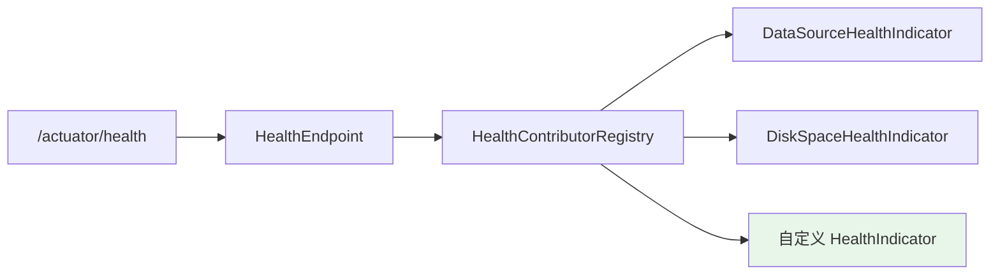
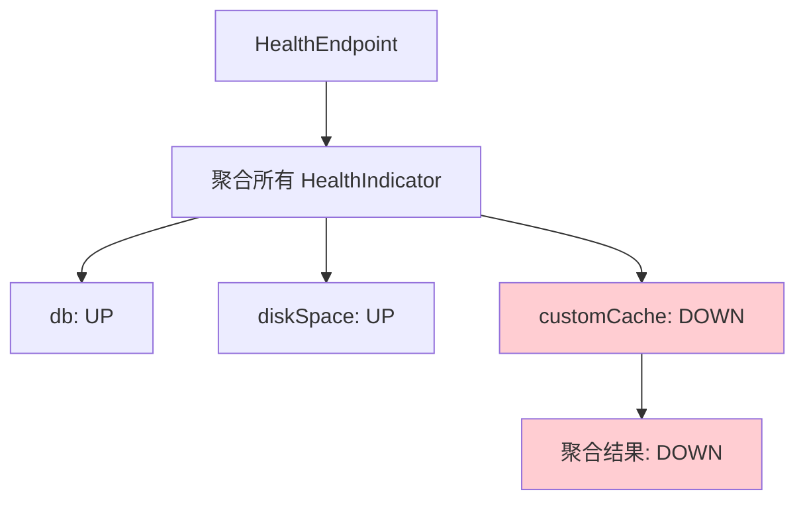
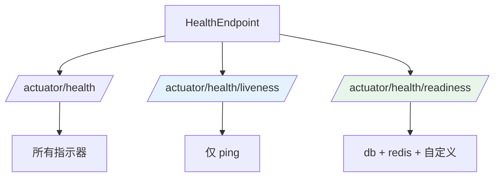

# 健康检查与自定义健康指示器

## 课程目标

- 理解 Spring Boot 健康检查机制的工作原理
- 掌握内置健康指示器的使用和配置
- 掌握自定义健康指示器的实现方法
- 掌握健康检查分组的配置
- 能够为图书管理系统实现数据库、缓存、外部服务的健康检查


## 回顾与导入

在上一讲中，我们通过 `/actuator/health` 端点查看了应用的健康状态：

```json
{
    "status": "UP",
    "components": {
        "db": {
            "status": "UP"
        },
        "diskSpace": {
            "status": "UP"
        },
        "ping": {
            "status": "UP"
        }
    }
}
```

但默认的健康检查存在以下局限：

| 局限               | 说明                                |
| ------------------ | ----------------------------------- |
| 检查项有限         | 默认只检查数据库、磁盘、Ping        |
| 无法感知业务健康   | 如缓存服务、外部 API 不可用无法感知 |
| 无法自定义判断规则 | 如库存服务数据是否正常              |
| 无法分组检查       | 无法区分"存活检查"和"就绪检查"      |

本节课将深入学习健康检查机制，并实现自定义健康指示器。




## 健康检查机制

### 核心接口

Spring Boot 健康检查的核心是 `HealthIndicator` 接口：

```java
@FunctionalInterface
public interface HealthIndicator extends HealthContributor {
    // 返回健康状态
    Health health();
}
```

### 健康状态

`Health` 对象表示健康检查的结果，包含：

| 属性      | 说明                                          |
| --------- | --------------------------------------------- |
| `status`  | 健康状态（UP、DOWN、OUT_OF_SERVICE、UNKNOWN） |
| `details` | 详细信息的 Map（可选）                        |

**状态说明：**

| 状态             | 说明     | HTTP 状态码（默认） |
| ---------------- | -------- | ------------------- |
| `UP`             | 正常     | 200                 |
| `DOWN`           | 异常     | 503                 |
| `OUT_OF_SERVICE` | 暂停服务 | 503                 |
| `UNKNOWN`        | 未知     | 200                 |

### 健康检查聚合机制

Spring Boot 会聚合所有 `HealthIndicator` 的结果：



**聚合规则：**
- 所有指示器都是 `UP`，则整体为 `UP`
- 任何一个指示器是 `DOWN`，则整体为 `DOWN`
- 使用 `StatusAggregator` 可自定义聚合规则


### 内置健康指示器

Spring Boot 根据 classpath 中的依赖自动配置健康指示器：

| 指示器                         | 依赖                     | 检查内容     |
| ------------------------------ | ------------------------ | ------------ |
| `DataSourceHealthIndicator`    | 数据源                   | 数据库连接   |
| `DiskSpaceHealthIndicator`     | 无                       | 磁盘空间     |
| `PingHealthIndicator`          | 无                       | 应用存活     |
| `RedisHealthIndicator`         | spring-data-redis        | Redis 连接   |
| `MongoHealthIndicator`         | spring-data-mongodb      | MongoDB 连接 |
| `ElasticsearchHealthIndicator` | elasticsearch            | ES 连接      |
| `MailHealthIndicator`          | spring-boot-starter-mail | 邮件服务     |
| `RabbitHealthIndicator`        | spring-boot-starter-amqp | RabbitMQ     |


## 内置健康指示器详解

### DataSourceHealthIndicator

自动检查数据库连接是否可用。执行一条 `validationQuery`（默认由驱动决定，如 `isValid()`）。

**配置详情展示：**

```yaml
management:
  endpoint:
    health:
      show-details: always
```

**响应：**

```json
{
    "status": "UP",
    "components": {
        "db": {
            "status": "UP",
            "details": {
                "database": "PostgreSQL",
                "validationQuery": "isValid()"
            }
        }
    }
}
```

**自定义数据源健康检查：**

```yaml
management:
  health:
    db:
      enabled: true
```

### DiskSpaceHealthIndicator

检查磁盘可用空间是否低于阈值。

**默认阈值：** 10 MB

**配置阈值：**

```yaml
management:
  health:
    diskspace:
      enabled: true
      threshold: 100MB   # 可用空间低于 100MB 时标记为 DOWN
      path: /data        # 检查指定路径
```

**响应：**

```json
{
    "diskSpace": {
        "status": "UP",
        "details": {
            "total": 500107862016,
            "free": 300107862016,
            "threshold": 10485760,
            "exists": true
        }
    }
}
```

### PingHealthIndicator

始终返回 `UP`，仅表示应用本身存活。

### RedisHealthIndicator

如果项目中集成了 Redis，会自动检查 Redis 连接。

```yaml
management:
  health:
    redis:
      enabled: true
```

### 禁用内置指示器

```yaml
management:
  health:
    db:
      enabled: false
    diskspace:
      enabled: false
```


## 自定义健康指示器

### 实现方式

自定义健康指示器有三种实现方式：

| 方式                           | 说明                     |
| ------------------------------ | ------------------------ |
| 实现 `HealthIndicator` 接口    | 最简单，返回单一健康状态 |
| 继承 `AbstractHealthIndicator` | 提供异常处理模板         |
| 实现 `ReactiveHealthIndicator` | 响应式（WebFlux）        |

### 方式一：实现 HealthIndicator 接口

**场景：** 检查图书管理系统的缓存服务是否正常。

```java
@Component
public class MockCacheHealthIndicator implements HealthIndicator {

    @Override
    public Health health() {
        try {
            // 模拟检查缓存服务
            boolean cacheAvailable = checkCache();
            if (cacheAvailable) {
                return Health.up()
                        .withDetail("service", "cache")
                        .withDetail("message", "缓存服务正常")
                        .build();
            } else {
                return Health.down()
                        .withDetail("service", "cache")
                        .withDetail("message", "缓存服务不可用")
                        .build();
            }
        } catch (Exception e) {
            return Health.down(e)
                    .withDetail("service", "cache")
                    .build();
        }
    }

    private boolean checkCache() {
        // 实际检查缓存服务的逻辑
        return true;
    }
}
```

**访问 `/actuator/health`：**

```json
{
    "status": "UP",
    "components": {
        "cache": {
            "status": "UP",
            "details": {
                "service": "cache",
                "message": "缓存服务正常"
            }
        }
    }
}
```

> [!NOTE]
> 健康指示器的名称由 Bean 名称推导：`CacheHealthIndicator` → `cache`。以 `HealthIndicator` 结尾的类名会被去掉后缀作为指示器名称。

### 方式二：继承 AbstractHealthIndicator

`AbstractHealthIndicator` 提供了异常处理模板，只需关注检查逻辑：

```java
@Component
public class StockServiceHealthIndicator extends AbstractHealthIndicator {

    @Override
    protected void doHealthCheck(Health.Builder builder) throws Exception {
        // 检查库存服务
        boolean stockServiceAvailable = checkStockService();

        if (stockServiceAvailable) {
            builder.up()
                    .withDetail("service", "stockService")
                    .withDetail("endpoint", "/api/stock/check");
        } else {
            builder.down()
                    .withDetail("service", "stockService")
                    .withDetail("reason", "服务无响应");
        }
    }

    private boolean checkStockService() {
        // 实际检查逻辑
        return true;
    }
}
```

> [!NOTE]
> `AbstractHealthIndicator` 会自动捕获 `doHealthCheck` 中抛出的异常，并将状态设为 `DOWN`。

### 方式三：检查外部服务

**场景：** 检查调用第三方 API 是否可用。

```java
@Component
public class ExternalApiHealthIndicator implements HealthIndicator {

    private final RestTemplate restTemplate;

    public ExternalApiHealthIndicator(RestTemplate restTemplate) {
        this.restTemplate = restTemplate;
    }

    @Override
    public Health health() {
        try {
            // 调用外部 API 的健康检查接口
            String url = "https://api.example.com/health";
            String result = restTemplate.getForObject(url, String.class);

            return Health.up()
                    .withDetail("service", "external-api")
                    .withDetail("response", result)
                    .build();
        } catch (Exception e) {
            return Health.down()
                    .withDetail("service", "external-api")
                    .withDetail("error", e.getMessage())
                    .build();
        }
    }
}
```

### 方式四：检查业务健康

除了技术组件，还可以检查业务逻辑的健康状况：

```java
@Component
public class BookDataHealthIndicator implements HealthIndicator {

    private static final long MIN_BOOK_COUNT = 1;

    private final BookService bookService;

    public BookDataHealthIndicator(BookService bookService) {
        this.bookService = bookService;
    }

    @Override
    public Health health() {
        try {
            long bookCount = bookService.count();
            if (bookCount >= MIN_BOOK_COUNT) {
                return Health.up()
                        .withDetail("bookCount", bookCount)
                        .withDetail("message", "图书数据正常")
                        .build();
            } else {
                return Health.down()
                        .withDetail("bookCount", bookCount)
                        .withDetail("message", "图书数据为空，可能初始化失败")
                        .build();
            }
        } catch (Exception e) {
            return Health.down(e)
                    .withDetail("message", "图书数据检查失败")
                    .build();
        }
    }
}
```

> [!NOTE]
> 业务健康检查适合启动依赖、数据完整性、定时任务状态等场景。但要谨慎：业务健康检查失败会导致整个应用健康状态为 `DOWN`，可能影响负载均衡器将流量路由到该实例。

### 控制状态码

默认情况下，`DOWN` 状态会返回 HTTP 503。可以通过配置修改：

```yaml
management:
  endpoint:
    health:
      status:
        http-mapping:
          DOWN: 500
          OUT_OF_SERVICE: 503
          UNKNOWN: 200
```

### 自定义健康状态

除了 `UP` 和 `DOWN`，还可以使用自定义状态：

```java
// 使用内置状态
return Health.status("OUT_OF_SERVICE").build();

// 或自定义状态
return Health.status(new Status("DEGRADED", "服务降级")).build();
```


## 健康检查分组

### 什么是健康检查分组

默认情况下，`/actuator/health` 会聚合所有健康指示器。**健康检查分组** 允许按用途将指示器分组，暴露不同的端点。



### 为什么需要分组

在 Kubernetes 等容器编排平台中：

| 检查类型                  | 用途                               | 分组                |
| ------------------------- | ---------------------------------- | ------------------- |
| **存活检查（Liveness）**  | 应用是否存活，失败则重启 Pod       | `/health/liveness`  |
| **就绪检查（Readiness）** | 应用是否准备好接收流量，失败则摘除 | `/health/readiness` |

**存活检查**应该只检查应用本身（ping），不应包含外部依赖。**就绪检查**应包含所有依赖（数据库、缓存等）。

### 配置分组

```yaml
management:
  endpoint:
    health:
      group:
        # 存活检查：只包含 ping
        liveness:
          include: ping
        # 就绪检查：包含数据库、磁盘、自定义指示器
        readiness:
          include: db,diskSpace,cache,stockService,externalApi
```

### 访问分组端点

```
GET /actuator/health/liveness
GET /actuator/health/readiness
```

**响应（/actuator/health/liveness）：**

```json
{
    "status": "UP"
}
```

**响应（/actuator/health/readiness）：**

```json
{
    "status": "UP",
    "components": {
        "db": {
            "status": "UP"
        },
        "cache": {
            "status": "UP"
        }
    }
}
```

### 分组中的排除

```yaml
management:
  endpoint:
    health:
      group:
        readiness:
          include: "*"              # 包含所有
          exclude: diskSpace        # 但排除磁盘空间
```


## 实战：为图书管理系统添加自定义健康检查

### 需求

为图书管理系统添加以下健康检查：

| 检查项   | 说明                                   |
| -------- | -------------------------------------- |
| 数据库   | 检查数据库连接（内置，已提供）         |
| 缓存服务 | 检查缓存是否可用                       |
| 库存服务 | 检查库存服务接口是否正常               |
| 图书数据 | 检查图书数据是否已初始化               |
| 分组     | 存活检查（ping）、就绪检查（所有依赖） |

### 实现步骤

**步骤一：缓存健康检查**

```java
@Component
public class CacheHealthIndicator extends AbstractHealthIndicator {

    private final CacheManager cacheManager;

    public CacheHealthIndicator(CacheManager cacheManager) {
        this.cacheManager = cacheManager;
    }

    @Override
    protected void doHealthCheck(Health.Builder builder) throws Exception {
        if (cacheManager == null) {
            builder.down()
                    .withDetail("cacheManager", "未配置")
                    .build();
            return;
        }

        // 检查 books 缓存是否可用
        var cache = cacheManager.getCache("books");
        if (cache != null) {
            builder.up()
                    .withDetail("cacheName", "books")
                    .withDetail("cacheType", cache.getNativeCache().getClass().getSimpleName())
                    .build();
        } else {
            builder.down()
                    .withDetail("reason", "books 缓存未初始化")
                    .build();
        }
    }
}
```

**步骤二：库存服务健康检查**

已构建

**步骤三：图书数据健康检查**

已构建

**步骤二：配置健康检查**

`application.yml`：

```yaml
management:
  server:
    port: 9090

  endpoints:
    web:
      exposure:
        include: health,info,metrics,loggers

  endpoint:
    health:
      show-details: always
      # 分组配置
      group:
        liveness:
          include: ping
        readiness:
          include: db,diskSpace,cache,stockService,bookData

info:
  app:
    name: 图书管理系统
    version: 1.0.0
```

**步骤四：启动应用，访问端点**

```bash
# 1. 查看所有健康检查
curl http://localhost:9090/actuator/health

# 2. 存活检查
curl http://localhost:9090/actuator/health/liveness

# 3. 就绪检查
curl http://localhost:9090/actuator/health/readiness
```

**预期响应（/actuator/health）：**

```json
{
    "status": "UP",
    "components": {
        "bookData": {
            "status": "UP",
            "details": {
                "bookCount": 5,
                "message": "图书数据正常"
            }
        },
        "cache": {
            "status": "UP",
            "details": {
                "cacheName": "books",
                "cacheType": "CaffeineCache"
            }
        },
        "db": {
            "status": "UP",
            "details": {
                "database": "PostgreSQL",
                "validationQuery": "isValid()"
            }
        },
        "diskSpace": {
            "status": "UP",
            "details": {
                "total": 500107862016,
                "free": 300107862016,
                "threshold": 10485760,
                "exists": true
            }
        },
        "ping": {
            "status": "UP"
        },
        "stockService": {
            "status": "UP",
            "details": {
                "service": "stockService",
                "message": "库存服务正常"
            }
        }
    }
}
```

**预期响应（/actuator/health/liveness）：**

```json
{
    "status": "UP"
}
```

**预期响应（/actuator/health/readiness）：**

```json
{
    "status": "UP",
    "components": {
        "bookData": {
            "status": "UP"
        },
        "cache": {
            "status": "UP"
        },
        "db": {
            "status": "UP"
        },
        "diskSpace": {
            "status": "UP"
        },
        "stockService": {
            "status": "UP"
        }
    }
}
```

### 模拟异常场景

修改 `StockServiceHealthIndicator`，让它返回 `DOWN`：

```java
private boolean checkStockService() {
    return false;  // 模拟服务不可用
}
```

重新启动，访问 `/actuator/health`：

```json
{
    "status": "DOWN",
    "components": {
        "stockService": {
            "status": "DOWN",
            "details": {
                "service": "stockService",
                "message": "库存服务无响应"
            }
        }
    }
}
```

HTTP 状态码变为 `503`。

访问 `/actuator/health/liveness`：

```json
{
    "status": "UP"
}
```

> [!NOTE]
> 这就是分组的价值：虽然就绪检查为 `DOWN`（不接收流量），但存活检查仍为 `UP`（不重启容器）。


## 注意事项

### 1. 健康指示器的性能

健康检查会被频繁调用（如每秒多次），检查逻辑应尽量快：

| 检查项   | 建议                          |
| -------- | ----------------------------- |
| 数据库   | 使用 `isValid()` 而非复杂查询 |
| 外部 API | 设置超时（如 1 秒）           |
| 磁盘     | 无开销                        |

### 2. 健康检查不应有副作用

健康检查应该是只读操作，不应修改数据或触发业务逻辑。

### 3. 存活检查 vs 就绪检查

| 检查          | 包含内容               | 失败后果         |
| ------------- | ---------------------- | ---------------- |
| **Liveness**  | 只包含应用本身（ping） | 容器被重启       |
| **Readiness** | 包含所有依赖           | 从负载均衡中摘除 |

> [!CAUTION]
> 存活检查不要包含外部依赖。如果数据库挂了，存活检查失败会导致容器不断重启，反而加重问题。

### 4. 避免过多的业务健康检查

业务健康检查失败会导致整个应用健康状态为 `DOWN`。对于非关键业务，建议：
- 使用自定义状态（如 `DEGRADED`）
- 或不纳入健康检查

### 5. 状态码的 HTTP 映射

默认 `DOWN` 返回 503，如果与负载均衡器或其他系统约定不一致，需要配置：

```yaml
management:
  endpoint:
    health:
      status:
        http-mapping:
          DOWN: 500
```


## 小结

本节课我们学习了：

1. **健康检查机制**：
   - `HealthIndicator` 接口
   - 健康状态（UP、DOWN、OUT_OF_SERVICE、UNKNOWN）
   - 聚合规则
2. **内置健康指示器**：
   - `DataSourceHealthIndicator`、`DiskSpaceHealthIndicator`、`PingHealthIndicator`
3. **自定义健康指示器**：
   - 实现 `HealthIndicator`
   - 继承 `AbstractHealthIndicator`
   - 检查业务健康
4. **健康检查分组**：
   - 存活检查（liveness）与就绪检查（readiness）
5. **实战应用**：为图书管理系统添加缓存、库存服务、图书数据健康检查


## 作业

### 作业一：代码阅读——健康指示器识别

阅读以下代码，回答问题。

```java
@Component
public class MyHealthIndicator implements HealthIndicator {
    @Override
    public Health health() {
        if (checkSomething()) {
            return Health.up().withDetail("key", "value").build();
        }
        return Health.down().withDetail("reason", "something failed").build();
    }

    private boolean checkSomething() {
        return false;
    }
}
```

**问题：**
1. 该健康指示器在 `/actuator/health` 中的名称是什么？
2. 如果 `checkSomething()` 返回 `false`，整体健康状态是什么？
3. HTTP 响应的状态码是什么？
4. 如果希望状态码为 500 而非 503，应如何配置？

---

### 作业二：实现图书管理系统健康检查

在图书管理系统中完成以下任务：

1. 创建 `CacheHealthIndicator`，检查 Caffeine 缓存是否可用。
2. 创建 `BookDataHealthIndicator`，检查图书数量是否大于 0。
3. 创建 `DatabaseConnectionHealthIndicator`，自定义数据库检查逻辑（使用 `JdbcTemplate` 执行 `SELECT 1`）。
4. 配置健康检查分组：
   - `liveness`：只包含 `ping`
   - `readiness`：包含所有指示器
5. 启动应用，验证：
   - `/actuator/health` 返回所有健康信息
   - `/actuator/health/liveness` 只返回 ping 状态
   - `/actuator/health/readiness` 返回所有依赖的健康状态

---

### 作业三：模拟故障场景

1. 修改 `BookDataHealthIndicator`，让图书数量为 0 时返回 `DOWN`。
2. 清空 `book` 表的数据（或使用 `DELETE FROM book`）。
3. 访问 `/actuator/health`，观察状态为 `DOWN`。
4. 访问 `/actuator/health/liveness`，观察状态仍为 `UP`。
5. 恢复数据，再次验证。

**思考：** 为什么就绪检查 `DOWN` 但存活检查 `UP` 是正确的设计？
