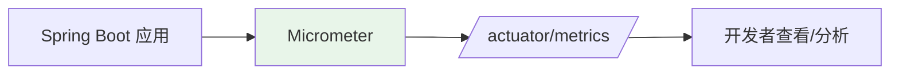

# 指标监控与 Micrometer

## 课程目标

- 理解 Micrometer 的定位与核心概念（Meter、MeterRegistry、Tag）
- 掌握 Micrometer 的 Meter 类型体系及适用场景
- 掌握编程式和注解式自定义指标的实现方法
- 掌握通过 Actuator 端点查看指标数据
- 能够为图书管理系统实现业务级别的指标监控


## 回顾与导入

在上一讲中，我们通过 `/actuator/health` 端点查看了应用的健康状态：

```json
{
    "status": "UP",
    "components": {
        "db": { "status": "UP" },
        "diskSpace": { "status": "UP" },
        "ping": { "status": "UP" }
    }
}
```

健康检查只能告诉我们应用 **是否存活**，但无法回答以下问题：

| 局限             | 说明                                         |
| ---------------- | -------------------------------------------- |
| 无法感知性能劣化 | 接口响应时间从 50ms 涨到 2s，健康检查仍为 UP |
| 无法统计业务数据 | 订单创建量、支付成功率、缓存命中率           |
| 无法刻画趋势     | 只知道当前状态，不知道过去 5 分钟的变化      |
| 无法支撑容量规划 | 缺少 JVM 内存、线程池、GC 等运行时数据       |

本节课将深入学习指标监控体系，并以 Micrometer 为核心，为图书管理系统构建完整的业务与技术指标。




## Micrometer 核心概念

### 核心接口

Micrometer 的核心接口是 `Meter`，所有度量类型都继承自它：

```java
public interface Meter extends AutoCloseable {
    // 获取 Meter 的唯一标识
    Id getId();
    // 获取 Meter 类型
    Meter.Type getType();
}
```

### Meter 三要素

每个 Meter 由**名称**和**标签（Tag）** 唯一标识：

| 要素   | 说明                                   | 示例                           |
| ------ | -------------------------------------- | ------------------------------ |
| `name` | 指标名称，主键                         | `http.server.requests`         |
| `tags` | 维度键值对，用于切片和钻取             | `uri=/api/books`, `status=200` |
| `type` | Meter 类型（Counter、Gauge、Timer 等） | `Counter`                      |

> [!NOTE]
> Micrometer 会将名称和标签统一存储，通过 Actuator 端点可以查看和过滤。

### MeterRegistry

`MeterRegistry` 是 Meter 的工厂和缓存中心：

- **工厂**：负责创建各类 Meter
- **缓存**：同一名称 + 标签组合的 Meter 只创建一次
- **存储**：保存所有已注册的 Meter 实例

Spring Boot 会自动配置一个 `CompositeMeterRegistry` 和合适的实现（默认是 `SimpleMeterRegistry`），无需额外依赖。

### Meter 类型体系

| 类型        | 语义                   | 典型场景                     |
| ----------- | ---------------------- | ---------------------------- |
| **Counter** | 单调递增计数器         | 请求总数、错误次数           |
| **Gauge**   | 瞬时值，可增可减       | 内存使用量、队列大小、线程数 |
| **Timer**   | 记录事件次数和执行时间 | 接口响应时间、方法耗时       |

**Counter 和 Gauge 的核心区别**：Counter 只增不减，代表累积量；Gauge 反映瞬时状态，可以上下波动。Timer 本质上是 Counter 和耗时统计的结合体——它既记录事件发生的次数，也记录每次事件所花费的时间。


## 内置指标

Spring Boot 通过 Micrometer 自动采集了大量开箱即用的指标，无需任何配置。

### JVM 指标

| 指标名                    | 类型    | 说明                       |
| ------------------------- | ------- | -------------------------- |
| `jvm.memory.used`         | Gauge   | JVM 各内存区域已使用字节数 |
| `jvm.memory.max`          | Gauge   | JVM 各内存区域最大字节数   |
| `jvm.gc.pause`            | Timer   | GC 停顿时间                |
| `jvm.gc.memory.allocated` | Counter | GC 期间分配的内存量        |
| `jvm.threads.live`        | Gauge   | 当前存活线程数             |
| `jvm.classes.loaded`      | Gauge   | 已加载的类数量             |

### 系统指标

| 指标名                   | 类型  | 说明               |
| ------------------------ | ----- | ------------------ |
| `system.cpu.usage`       | Gauge | 系统 CPU 使用率    |
| `process.cpu.usage`      | Gauge | 进程 CPU 使用率    |
| `process.uptime`         | Gauge | 应用运行时长（秒） |
| `system.load.average.1m` | Gauge | 1 分钟系统负载     |

### HTTP 指标

Web 应用（Spring MVC / WebFlux）自动采集 `http.server.requests`，包含以下标签：

- `method`：HTTP 方法
- `uri`：请求路径（路径参数会被归一化，如 `/api/books/{id}`）
- `status`：HTTP 状态码
- `outcome`：结果分类（SUCCESS、CLIENT_ERROR、SERVER_ERROR）

### 数据源指标

集成数据源后自动采集 `jdbc.connections.*`：

| 指标名                    | 类型  | 说明       |
| ------------------------- | ----- | ---------- |
| `jdbc.connections.active` | Gauge | 活跃连接数 |
| `jdbc.connections.idle`   | Gauge | 空闲连接数 |
| `jdbc.connections.max`    | Gauge | 最大连接数 |
| `jdbc.connections.min`    | Gauge | 最小连接数 |

### 缓存指标

集成 Caffeine 或 Redis 缓存后自动采集：

| 指标名            | 类型    | 说明                                        |
| ----------------- | ------- | ------------------------------------------- |
| `cache.gets`      | Counter | 缓存查询次数（按 result 标签区分 hit/miss） |
| `cache.puts`      | Counter | 缓存写入次数                                |
| `cache.evictions` | Counter | 缓存驱逐次数                                |
| `cache.size`      | Gauge   | 缓存当前条目数                              |

> [!NOTE]
> 内置指标的命名遵循 Micrometer 约定（点分格式）。通过 `/actuator/metrics` 可以查看所有指标名称。

### 禁用内置指标

```yaml
management:
  metrics:
    enable:
      jvm: false
      system: false
```

或者按名称禁用：

```yaml
management:
  metrics:
    enable:
      jvm.memory.used: false
```


## 集成与配置

### 添加依赖

Actuator 已经包含了 Micrometer 核心和 `SimpleMeterRegistry`，无需额外引入其他注册表依赖。

### 应用配置

`application.yml`：

```yaml
management:
  server:
    port: 9090

  endpoints:
    web:
      exposure:
        include: health,info,metrics

  endpoint:
    health:
      show-details: always

  metrics:
    tags:
      application: book-management
```

关键配置说明：

| 配置项                                      | 说明                   |
| ------------------------------------------- | ---------------------- |
| `management.endpoints.web.exposure.include` | 暴露 metrics 端点      |
| `management.metrics.tags.application`       | 为所有指标添加公共标签 |


### 验证端点

启动应用后访问 `http://localhost:9090/actuator/metrics`：

```json
{
    "names": [
        "jvm.memory.used",
        "jvm.memory.max",
        "jvm.gc.pause",
        "jvm.threads.live",
        "http.server.requests",
        "jdbc.connections.active",
        "system.cpu.usage",
        "process.uptime"
        ...
    ]
}
```

查看具体指标：`/actuator/metrics/jvm.memory.used`

```json
{
    "name": "jvm.memory.used",
    "description": "The amount of used memory",
    "baseUnit": "bytes",
    "measurements": [
        {
            "statistic": "VALUE",
            "value": 125879032
        }
    ],
    "availableTags": [
        {
            "tag": "area",
            "values": [
                "heap",
                "nonheap"
            ]
        },
        {
            "tag": "application",
            "values": [
                "book-management"
            ]
        },
        {
            "tag": "id",
            "values": [
                "G1 Survivor Space",
                "Compressed Class Space",
                "CodeCache",
                "G1 Old Gen",
                "Metaspace",
                "G1 Eden Space"
            ]
        }
    ]
}
```


## 自定义指标

内置指标覆盖了技术和基础设施层面，但业务级别的指标（订单量、支付成功率、缓存命中率）需要开发者自行创建。

### 实现方式

自定义指标有多种实现方式：

| 方式                  | 说明                               |
| --------------------- | ---------------------------------- |
| 注入 `MeterRegistry`  | 最灵活，适合动态标签和复杂逻辑     |
| 使用 `@Counted` 注解  | 统计方法调用次数，非侵入           |
| 使用 `@Timed` 注解    | 统计方法执行时间，非侵入           |
| 使用 `Gauge` 绑定对象 | 适合绑定瞬时值（如队列大小）       |
| 使用 `MeterBinder`    | 适合将已有对象的状态批量绑定为指标 |

### 方式一：注入 MeterRegistry

**场景：** 统计图书创建成功的次数和失败次数。

```java
@Component
public class BookMetrics {

    private final Counter bookCreatedSuccess;
    private final Counter bookCreatedFailure;

    public BookMetrics(MeterRegistry registry) {
        this.bookCreatedSuccess = Counter.builder("books.created")
                .tag("status", "success")
                .description("图书创建成功次数")
                .register(registry);

        this.bookCreatedFailure = Counter.builder("books.created")
                .tag("status", "failure")
                .description("图书创建失败次数")
                .register(registry);
    }

    public void recordSuccess() {
        bookCreatedSuccess.increment();
    }

    public void recordFailure() {
        bookCreatedFailure.increment();
    }
}
```

在 Service 中使用：

```java
@Service
public class BookService {

		@Autowired
    private BookMapper bookMapper;
  
    @Autowired
    private BookMetrics bookMetrics;

    public Book createBook(Book book) {
        try {
            bookMapper.insert(book);
            bookMetrics.recordSuccess();
            return book;
        } catch (Exception e) {
            bookMetrics.recordFailure();
            throw e;
        }
    }
}
```

### 方式二：@Counted 注解

`@Counted` 用于统计方法调用次数，需要 AOP 支持：

```xml
<dependency>
    <groupId>org.springframework.boot</groupId>
    <artifactId>spring-boot-starter-aop</artifactId>
</dependency>
```

**基本用法：**

```java
@Counted(value = "books.created.total", description = "图书创建总次数")
public Book createBook(Book book) {
    // 业务逻辑
}
```

**统计异常：**

```java
// 只记录失败调用
@Counted(value = "books.created.failed", recordFailuresOnly = true)
public Book createBook(Book book) {
    // 业务逻辑
}

// 记录所有异常类型
@Counted(value = "api.calls", countExceptions = true, extraTags = {"method", "createBook"})
public Book createBook(Book book) {
    // 业务逻辑
}
```

**关键属性：**

| 属性                 | 说明                                          |
| -------------------- | --------------------------------------------- |
| `value`              | 指标名称                                      |
| `recordFailuresOnly` | 只记录失败的调用（默认 false）                |
| `countExceptions`    | 是否在指标中添加 exception 标签（默认 false） |
| `extraTags`          | 附加的静态标签                                |
| `description`        | 指标描述                                      |

### 方式三：@Timed 注解

`@Timed` 用于记录方法执行时间，是接口性能监控最常用的注解：

```java
@Timed(value = "books.query.time",
       description = "图书查询耗时")
public Book getBookById(Long id)
    // 业务逻辑
}
```

**关键属性：**

| 属性          | 说明                                      |
| ------------- | ----------------------------------------- |
| `value`       | 指标名称                                  |
| `extraTags`   | 附加的静态标签                            |
| `longTask`    | 是否作为 LongTaskTimer 记录（默认 false） |
| `description` | 指标描述                                  |

> [!NOTE]
>
> 从 Spring Boot 3.4 开始，`management.observations.annotations.enabled` 属性默认值为 `false`。想要@Counted 和@Timed注解生效，需要将该值设置为`true`。同时，需要执行对应业务方法之后，才能访问这些注解的指标。

### 方式四：Gauge 绑定对象

Gauge 需要绑定一个对象，从中读取瞬时值：

```java
@Component
public class CacheMetrics {

    public CacheMetrics(MeterRegistry registry, CacheManager cacheManager) {

        // 1. 先拿到 Spring 的 Cache
        org.springframework.cache.Cache springCache = cacheManager.getCache("books");

        // 2. 拿到底层原生缓存（Caffeine）
        Cache<String, Book> nativeCache =
                (Cache<String, Book>) springCache.getNativeCache();

        // 3. 用原生缓存注册 Gauge，asMap() 是 Caffeine 的 API
        Gauge.builder("books.cache.size", nativeCache,
                        cache -> cache.asMap().size())
                .description("图书缓存条目数")
                .register(registry);
    }
}
```

### 方式五：MeterBinder

`MeterBinder` 适合将已有对象的状态批量绑定为指标：

```java
/**
 * 图书库存指标
 * 使用 MeterBinder 将 BookMapper 的统计结果绑定为 Gauge
 */
@Component
public class BookStockMetrics implements MeterBinder {

    private final BookMapper bookMapper;

    public BookStockMetrics(BookMapper bookMapper) {
        this.bookMapper = bookMapper;
    }

    @Override
    public void bindTo(MeterRegistry registry) {
        // 当前图书总数量
        Gauge.builder("books.total.current", bookMapper,
                      mapper -> mapper.selectCount(null))
             .description("当前图书总数量")
             .register(registry);

        // 当前图书总库存
        Gauge.builder("books.stock.total", bookMapper,
                      mapper -> mapper.sumStock())
             .description("当前图书总库存")
             .register(registry);
    }
}
```

Spring Boot 会自动检测所有 `MeterBinder` Bean 并调用 `bindTo`。

**BookMapper 中需要的统计方法：**

```java
@Mapper
public interface BookMapper extends BaseMapper<Book> {

    /**
     * 统计所有图书的总库存
     */
    @Select("SELECT COALESCE(SUM(stock), 0) FROM book")
    Long sumStock();
}
```

### 检查自定义指标

访问 `/actuator/metrics/books.created`：

```json
{
    "name": "books.created",
    "description": "图书创建成功次数",
    "measurements": [
        {
            "statistic": "COUNT",
            "value": 42.0
        }
    ],
    "availableTags": [
        {
            "tag": "status",
            "values": ["success", "failure"]
        }
    ]
}
```

带标签查询：`/actuator/metrics/books.created?tag=status:success`

访问 `/actuator/metrics/books.stock.total`：

```json
{
    "name": "books.stock.total",
    "description": "当前图书总库存",
    "measurements": [
        {
            "statistic": "VALUE",
            "value": 32.0
        }
    ]
}
```


## 注意事项

### 1. 指标基数控制

每个唯一的标签组合都会产生一条时间序列。**高基数标签**会导致指标数据量膨胀：

| 标签类型       | 示例                           | 风险                 |
| -------------- | ------------------------------ | -------------------- |
| 低基数（安全） | `status=success`、`method=GET` | 值有限，推荐使用     |
| 高基数（危险） | `userId=12345`、`orderId=...`  | 值无限，禁止作为标签 |

> [!CAUTION]
> 切勿将用户 ID、订单 ID、请求 ID 等唯一值作为标签。这类数据应放在日志或追踪系统中，而非指标系统。

### 2. 指标命名规范

| 规则                     | 示例                                                         |
| ------------------------ | ------------------------------------------------------------ |
| 使用点分小写             | `books.created`，而非 `BooksCreated`                         |
| 名称体现业务语义         | `orders.created`，而非 `counter1`                            |
| 单位放在名称末尾         | `books.query.time`（秒）、`cache.size`（个）                 |
| 用标签区分维度，而非名称 | `books.created{status=success}`，而非 `books.created.success` |

### 3. 指标采集与健康检查分离

指标监控不应影响业务性能。避免在请求路径中同步调用外部监控系统：

```java
// 不推荐：在请求中同步上报
public Book create(Book book) {
    Book result = bookMapper.insert(book);
    httpClient.post("http://monitor/report", result);  // 阻塞
    return result;
}

// 推荐：使用 Micrometer，由 Actuator 端点统一查看
public Book create(Book book) {
    Book result = bookMapper.insert(book);
    bookMetrics.recordSuccess();
    return result;
}
```


## 小结

本节课我们学习了：

1. **Micrometer 核心概念**：
   - `Meter`、`MeterRegistry`、`Tag` 三要素
   - Meter 类型体系（Counter、Gauge、Timer）
2. **内置指标**：
   - JVM、系统、HTTP、数据源、缓存等自动采集指标
   - 通过 `management.metrics.enable` 禁用不需要的指标
3. **自定义指标**：
   - 注入 `MeterRegistry` 编程式创建
   - `@Counted` / `@Timed` 注解式统计
   - `Gauge` 绑定对象、`MeterBinder` 批量绑定
4. **指标查看**：
   - 通过 `/actuator/metrics` 查看所有指标
   - 按名称和标签过滤


## 作业

### 作业一：代码阅读——指标类型识别

阅读以下代码，回答问题。

```java
@Component
public class OrderMetrics {

    private final Counter orderCounter;
    private final Timer orderTimer;

    public OrderMetrics(MeterRegistry registry) {
        this.orderCounter = registry.counter("orders.created", "status", "success");
        this.orderTimer = registry.timer("orders.processing.time");
    }

    public void recordOrder() {
        orderCounter.increment();
    }

    public <T> T recordProcessing(Supplier<T> action) {
        return orderTimer.record(action);
    }
}
```

**问题：**
1. `orders.created` 是什么类型的 Meter？它能否减少？
2. `orders.processing.time` 通过 `/actuator/metrics` 查看时，会包含哪些统计信息？
3. 如果希望统计订单金额分布，应使用哪种 Meter？
4. 如果希望统计当前待处理订单数，应使用哪种 Meter？

---

### 作业二：实现图书管理系统业务指标

在图书管理系统中完成以下任务：

1. 创建 `BookMetrics` 组件，实现以下指标：
   - `books.created`（Counter，按 status 标签区分 success/failure）
2. 创建 `BookStockMetrics`，通过 `MeterBinder` 绑定当前图书总数量和总库存（Gauge）。
   - 在 `BookMapper` 中补充 `sumStock()` 方法（使用 `@Select` 注解）
3. 在 `BookServiceImpl` 中集成上述指标。
4. 配置 `application.yml`，添加 `application` 公共标签并暴露 metrics 端点。
5. 启动应用，验证：
   - `/actuator/metrics/books.created` 返回正确数据
   - `/actuator/metrics/books.stock.total` 返回当前库存
   - 通过 `/actuator/metrics` 能列出所有自定义指标

---

### 作业三：指标查看与过滤

1. 调用图书创建接口多次（包括成功和失败的情况）。
2. 通过 `/actuator/metrics/books.created` 查看总体数据。
3. 通过 `/actuator/metrics/books.created?tag=status:success` 查看成功次数。
4. 通过 `/actuator/metrics/books.created?tag=status:failure` 查看失败次数。
5. 分析成功率和失败率的计算方式。
