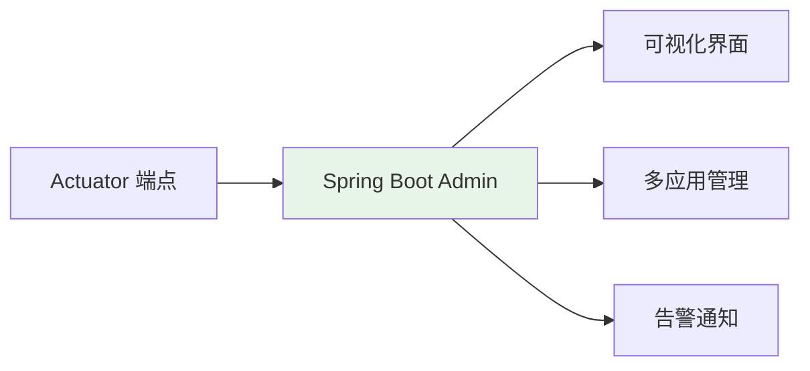
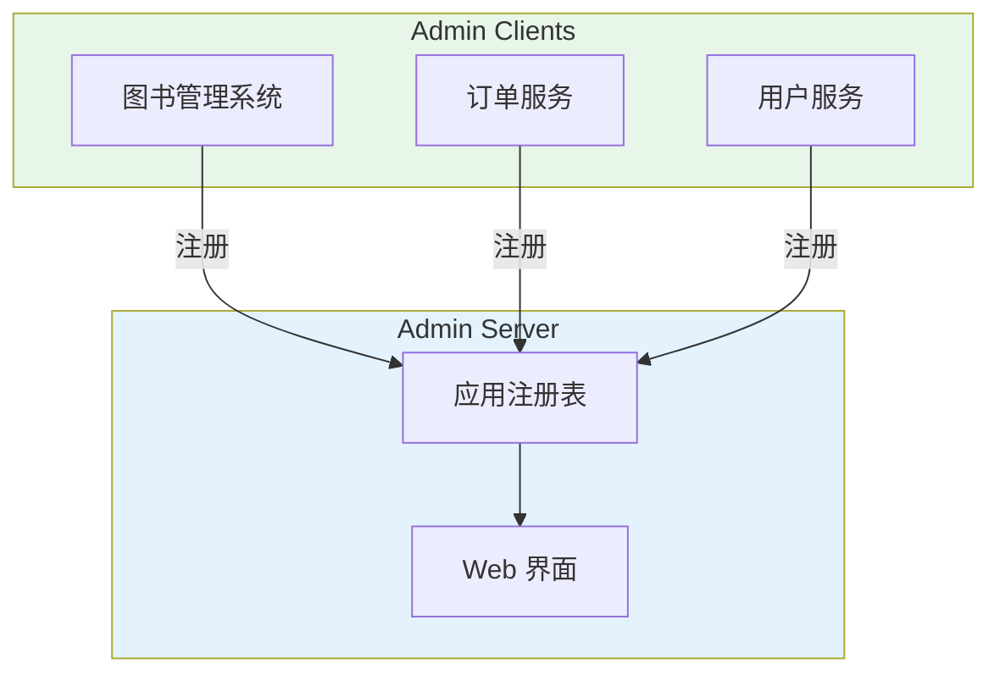
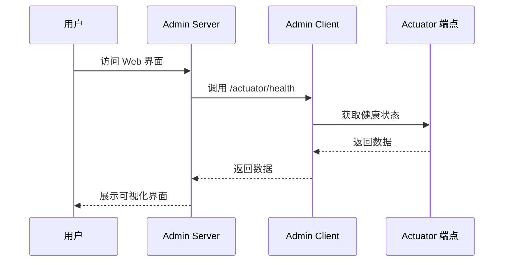
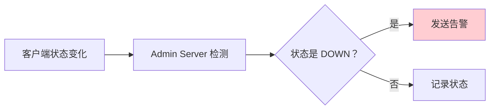
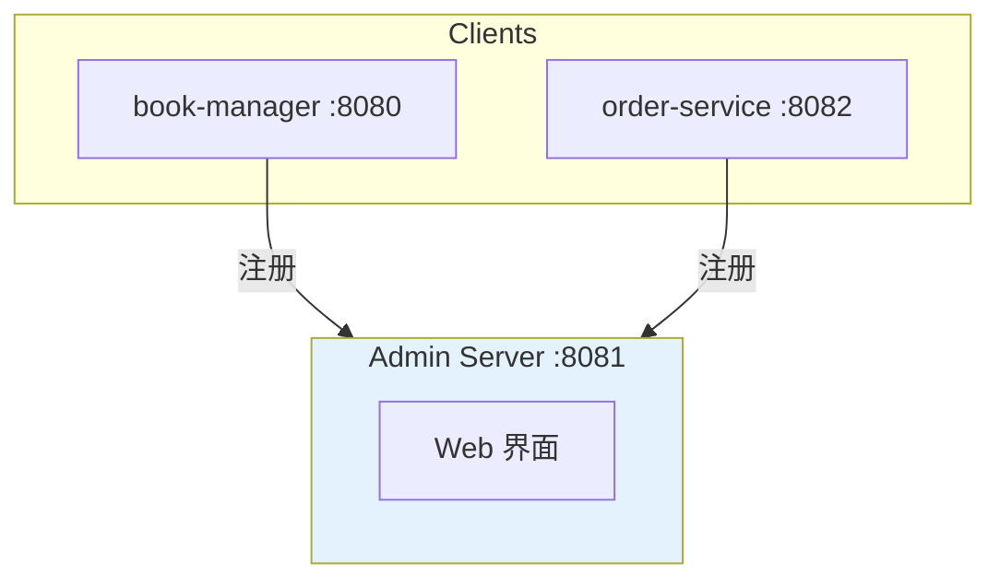

# Spring Boot Admin 可视化监控

## 课程目标

- 理解 Spring Boot Admin 的定位和与 Actuator 的关系
- 掌握 Admin Server 的搭建方法
- 掌握客户端接入 Admin Server 的配置
- 掌握 Admin 的核心监控功能（应用概览、日志调整、JVM 监控等）
- 能够搭建图书管理系统的可视化监控平台


## 回顾与导入

在前面课程中，我们学习了：

| 内容                       | 监控方式                      |
| -------------------------- | ----------------------------- |
| Actuator 入门与常用端点    | 通过 HTTP 端点查看            |
| 健康检查与自定义健康指示器 | 通过 `/actuator/health` 查看  |
| 指标监控与 Micrometer      | 通过 `/actuator/metrics` 查看 |

这些方式都需要**手动调用 HTTP 端点**或**集成第三方可视化工具**，存在以下局限：

| 局限           | 说明                             |
| -------------- | -------------------------------- |
| 缺乏可视化界面 | 只能看到 JSON 原始数据           |
| 无法多应用管理 | 每个应用独立监控，无法集中查看   |
| 无历史趋势     | 只能看到当前状态                 |
| 操作不便       | 修改日志级别需要手动发 POST 请求 |
| 无告警通知     | 服务异常无法主动通知             |

**Spring Boot Admin** 正是为解决这些问题而生的可视化监控平台。




## Spring Boot Admin 简介

### 什么是 Spring Boot Admin

**Spring Boot Admin** 是一个基于 Spring Boot Actuator 的**可视化监控平台**，它通过 Admin Server 集中管理多个 Spring Boot 应用（Admin Client），提供友好的 Web 界面展示应用的健康状态、指标数据、配置信息等。

### 核心架构



### Admin Server 与 Admin Client 的关系

| 组件             | 角色   | 说明                              |
| ---------------- | ------ | --------------------------------- |
| **Admin Server** | 服务端 | 提供 Web 界面，集中管理所有客户端 |
| **Admin Client** | 客户端 | 被监控的应用，向 Server 注册      |

### 与 Actuator 的关系

Spring Boot Admin **本身不采集数据**，而是通过调用 Actuator 端点获取信息：



> [!NOTE]
> Spring Boot Admin 是 Actuator 的**可视化封装**。如果 Actuator 端点未暴露，Admin 无法获取数据。因此客户端必须正确配置 Actuator。


## 搭建 Admin Server

### 1. 创建 Admin Server 项目

创建一个独立的 Spring Boot 项目（可以是一个新的 Maven 模块）：

```xml
<?xml version="1.0" encoding="UTF-8"?>
<project xmlns="http://maven.apache.org/POM/4.0.0">
    <modelVersion>4.0.0</modelVersion>

    <parent>
        <groupId>org.springframework.boot</groupId>
        <artifactId>spring-boot-starter-parent</artifactId>
        <version>3.5.16</version>
    </parent>

    <groupId>com.example</groupId>
    <artifactId>admin-server</artifactId>
    <version>1.0.0</version>

    <dependencies>
        <!-- Admin Server -->
        <dependency>
            <groupId>de.codecentric</groupId>
            <artifactId>spring-boot-admin-starter-server</artifactId>
            <version>3.2.0</version>
        </dependency>

        <!-- Web 支持 -->
        <dependency>
            <groupId>org.springframework.boot</groupId>
            <artifactId>spring-boot-starter-web</artifactId>
        </dependency>
    </dependencies>
</project>
```

> [!NOTE]
> `spring-boot-admin-starter-server` 的版本需要与 Spring Boot 版本匹配。Spring Boot 3.x 对应 Admin 3.x，Spring Boot 2.x 对应 Admin 2.x。

### 2. 启用 Admin Server

在主启动类上添加 `@EnableAdminServer` 注解：

```java
package com.example.adminserver;

import de.codecentric.boot.admin.server.config.EnableAdminServer;
import org.springframework.boot.SpringApplication;
import org.springframework.boot.autoconfigure.SpringBootApplication;

@SpringBootApplication
@EnableAdminServer
public class AdminServerApplication {
    public static void main(String[] args) {
        SpringApplication.run(AdminServerApplication.class, args);
    }
}
```

### 3. 配置 Admin Server

`application.yml`：

```yaml
server:
  port: 8081   # Admin Server 端口

spring:
  application:
    name: admin-server
```

### 4. 启动并访问

启动应用后，访问：

```
http://localhost:8081
```

可以看到 Admin Server 的初始界面（此时还没有客户端注册）。


## 接入客户端

### 1. 添加客户端依赖

在图书管理系统的 `pom.xml` 中添加：

```xml
<!-- Admin Client -->
<dependency>
    <groupId>de.codecentric</groupId>
    <artifactId>spring-boot-admin-starter-client</artifactId>
    <version>3.2.0</version>
</dependency>
```

### 2. 配置客户端

在图书管理系统的 `application.yml` 中配置：

```yaml
spring:
  application:
    name: book-manager
  boot:
    admin:
      client:
        # Admin Server 地址
        url: http://localhost:8081

management:
  endpoints:
    web:
      exposure:
        include: "*"   # 暴露所有端点（开发环境）
  endpoint:
    health:
      show-details: always
```

### 3. 启动客户端

启动图书管理系统后，Admin Server 会自动注册该客户端。访问 `http://localhost:8081` 即可看到：

```
应用列表：
  - book-manager (UP)
```

### 4. 应用列表说明

| 列           | 说明                               |
| ------------ | ---------------------------------- |
| **应用名称** | 客户端的 `spring.application.name` |
| **状态**     | UP / DOWN / OFFLINE                |
| **版本**     | 从 `/actuator/info` 获取           |
| **操作**     | 查看详情、查看日志等               |

### 5. 多客户端接入

如果需要在同一 Admin Server 中管理多个应用，只需在每个应用中都添加 Admin Client 依赖并配置相同的 `url`。

```yaml
# 订单服务 application.yml
spring:
  application:
    name: order-service
  boot:
    admin:
      client:
        url: http://localhost:8081
```

```yaml
# 用户服务 application.yml
spring:
  application:
    name: user-service
  boot:
    admin:
      client:
        url: http://localhost:8081
```

启动所有客户端后，Admin Server 会展示完整的应用列表：

```
应用列表：
  - book-manager (UP)
  - order-service (UP)
  - user-service (UP)
```


## 核心监控功能

### 1. 应用概览

点击客户端应用名，进入详情页，可以看到：

| 模块                         | 说明               |
| ---------------------------- | ------------------ |
| **Health**                   | 健康状态及详细信息 |
| **Info**                     | 应用基本信息       |
| **Metrics**                  | 所有指标           |
| **Environment**              | 环境变量和配置     |
| **Beans**                    | Bean 列表          |
| **Mappings**                 | 请求映射           |
| **Loggers**                  | 日志级别管理       |
| **Threads**                  | 线程快照           |
| **Heapdump**                 | 堆转储             |
| **Configuration Properties** | 配置属性           |

### 2. 日志级别动态调整

在 Admin 界面中，可以直接修改日志级别，无需手动调用 API：

**操作步骤：**
1. 点击客户端应用 → Loggers
2. 找到 `com.example.bookmanager` 包
3. 在 `Level` 选择 `DEBUG`
4. 点击 `重置`

> [!NOTE]
> 日志级别修改立即生效，无需重启应用。应用重启后恢复默认级别。

### 3. JVM 监控

在 Metrics 页面中可以看到 JVM 相关指标：

| 指标                | 说明         |
| ------------------- | ------------ |
| `jvm.memory.used`   | 堆内存使用量 |
| `jvm.memory.max`    | 堆内存最大值 |
| `jvm.gc.pause`      | GC 停顿时间  |
| `jvm.threads.live`  | 存活线程数   |
| `process.cpu.usage` | CPU 使用率   |

Admin 会将这些指标以**图表形式**展示，方便查看趋势。

### 4. 环境变量查看

在 Environment 页面中，可以查看：
- 系统属性
- 环境变量
- 配置文件中的属性
- 命令行参数

### 5. 请求映射查看

在 Mappings 页面中，可以看到所有 URL 与 Controller 方法的映射关系，便于排查请求路由问题。

### 6. 线程快照

在 Threads 页面中，可以查看 JVM 中所有线程的状态和堆栈，用于排查死锁、线程阻塞等问题。

### 7. 堆转储

在 Heapdump 页面中，可以下载堆内存快照，用于离线分析内存泄漏。


## 告警通知

### 1. 告警通知的作用

当应用状态发生变化（如从 UP 变为 DOWN）时，Admin Server 可以自动发送告警通知。



### 2. 支持的告警方式

| 方式         | 说明                          |
| ------------ | ----------------------------- |
| **邮件**     | 通过 SMTP 发送邮件            |
| **钉钉**     | 通过 Webhook 发送钉钉消息     |
| **企业微信** | 通过 Webhook 发送企业微信消息 |
| **Slack**    | 通过 Webhook 发送 Slack 消息  |
| **自定义**   | 实现 `Notifier` 接口发送通知  |

### 3. 实现自定义Notifier

```java
@Component
public class CustomNotifier extends AbstractEventNotifier {

    private static final Logger log = LoggerFactory.getLogger(CustomNotifier.class);

    public CustomNotifier(InstanceRepository repository) {
        super(repository);
    }

    @Override
    protected Mono<Void> doNotify(InstanceEvent event, Instance instance) {
        log.info("【自定义通知】type={}, instance={}, timestamp={}",
                event.getType(),
                instance.getRegistration().getName(),
                event.getTimestamp());
        return Mono.empty();
    }
}
```

**告警触发条件：**

| 事件                 | 说明       |
| -------------------- | ---------- |
| 应用状态变为 DOWN    | 应用不可用 |
| 应用状态变为 OFFLINE | 客户端离线 |
| 应用状态恢复为 UP    | 应用恢复   |

### 4. 配置邮件告警

**添加依赖：**

```xml
<dependency>
    <groupId>org.springframework.boot</groupId>
    <artifactId>spring-boot-starter-mail</artifactId>
</dependency>
```

**配置邮件服务器：**

```yaml
spring:
  mail:
    host: smtp.example.com
    port: 587
    username: monitor@example.com
    password: your_password
    properties:
      mail:
        smtp:
          auth: true
          starttls:
            enable: true

  boot:
    admin:
      notify:
        mail:
          # 收件人
          to: admin@example.com
          # 发件人
          from: monitor@example.com
          # 是否启用
          enabled: true
```

### 5. 告警通知的最佳实践

| 建议             | 说明                         |
| ---------------- | ---------------------------- |
| **区分告警级别** | 不同状态使用不同的通知渠道   |
| **避免告警风暴** | 设置告警间隔，避免频繁通知   |
| **记录告警历史** | 保存告警记录，便于追溯       |
| **通知内容完整** | 包含应用名、状态、时间、原因 |


## 实战：搭建图书管理系统监控平台

### 需求

搭建一个 Admin Server，集中监控图书管理系统和订单服务。

### 架构设计



### 实现步骤

**步骤一：创建 Admin Server 项目**

**步骤二：配置图书管理系统作为客户端**

**步骤三：启动所有应用**

1. 启动 Admin Server（端口 8081）
2. 启动图书管理系统（端口 8080）
3. 启动订单服务（端口 8082）

**步骤四：访问 Admin Server**

浏览器打开 `http://localhost:8081`，可以看到：

```
应用列表：
  ┌──────────────────┬────────┬─────────┐
  │ 应用名称          │ 状态   │ 操作    │
  ├──────────────────┼────────┼─────────┤
  │ book-manager     │ UP     │ 详情    │
  │ order-service    │ UP     │ 详情    │
  └──────────────────┴────────┴─────────┘
```

**步骤五：验证监控功能**

1. **查看健康状态**：点击 `book-manager` → Health，查看详细健康信息
2. **查看指标**：点击 Metrics，查看 JVM、HTTP 等指标
3. **修改日志级别**：点击 Loggers，将 `com.example.bookmanager` 改为 DEBUG
4. **查看请求映射**：点击 Mappings，查看所有 URL 映射

**步骤六：配置自定义告警**

**上步骤七：模拟故障：**

停止图书管理系统，观察 Admin Server 界面状态变为 OFFLINE，并收到告警通知。


## 注意事项

### 1. 版本兼容性

| Spring Boot | Spring Boot Admin |
| ----------- | ----------------- |
| 3.x         | 3.x               |
| 2.7.x       | 2.7.x             |
| 2.6.x       | 2.6.x             |

版本不匹配可能导致功能异常。务必参考官方文档选择匹配的版本。

### 2. 客户端 Actuator 暴露配置

Admin Server 依赖 Actuator 端点获取数据，客户端必须暴露必要的端点：

```yaml
management:
  endpoints:
    web:
      exposure:
        include: "*"  # 开发环境；生产环境按需暴露
```

### 3. 生产环境建议

| 建议             | 说明                                   |
| ---------------- | -------------------------------------- |
| **限制访问来源** | Admin Server 只允许内网访问            |
| **启用认证**     | 使用 Spring Security 保护 Admin Server |
| **按需暴露端点** | 客户端暴露必要端点，避免暴露敏感端点   |
| **配置告警**     | 状态变化时及时通知                     |
| **定期清理**     | 清理历史事件记录                       |

### 4. 性能影响

Admin Server 会定期轮询客户端状态（默认每 10 秒），对大量客户端会带来一定开销。可以调整：

```yaml
spring:
  boot:
    admin:
      monitor:
        status-interval: 30s   # 状态检查间隔
        info-interval: 60s     # 信息刷新间隔
```


## 小结

本节课我们学习了：

1. **Spring Boot Admin 简介**：
   - 基于 Actuator 的可视化监控平台
   - Admin Server 与 Admin Client 的关系
2. **搭建 Admin Server**：
   - 添加 `spring-boot-admin-starter-server` 依赖
   - 使用 `@EnableAdminServer` 启用
3. **接入客户端**：
   - 添加 `spring-boot-admin-starter-client` 依赖
   - 配置 Admin Server 地址
4. **核心监控功能**：
   - 应用概览、日志调整、JVM 监控、环境变量、请求映射、线程快照
5. **告警通知**：
   - 自定义 Notifier、邮件等
6. **实战应用**：搭建图书管理系统监控平台


## 作业

### 作业一：代码阅读——Admin 配置分析

阅读以下配置，回答问题。

```yaml
# Admin Server 配置
server:
  port: 8081

# 客户端配置
spring:
  application:
    name: book-manager
  boot:
    admin:
      client:
        url: http://localhost:8081

management:
  endpoints:
    web:
      exposure:
        include: health,info,metrics,loggers
```

**问题：**
1. Admin Server 的访问地址是什么？
2. 客户端的应用名称是什么？
3. 客户端暴露了哪些端点？
4. 如果需要暴露 `beans` 端点，应如何修改配置？

---

### 作业二：搭建图书管理系统监控平台

完成以下任务：

1. 创建 Admin Server 项目（端口 8081）。
2. 将图书管理系统配置为 Admin Client，注册到 Admin Server。
3. 启动两个应用，验证 Admin Server 能看到图书管理系统。
4. 在 Admin 界面中：
   - 查看图书管理系统的健康状态
   - 查看 JVM 内存指标
   - 将 `com.example.bookmanager` 的日志级别改为 DEBUG
   - 查看请求映射列表
5. 验证完成后，将日志级别恢复为 INFO。

---

### 作业三：自定义 Notifier

实现一个自定义的 `Notifier`，当应用状态变为 DOWN 时，输出告警到控制台：

```java
@Component
public class ConsoleNotifier extends AbstractStatusChangeNotifier {

    public ConsoleNotifier(InstanceRepository repository) {
        super(repository);
    }

    @Override
    protected Mono<Void> doNotify(InstanceEvent event, Instance instance) {
        return Mono.fromRunnable(() -> {
            System.out.println("【告警】应用 " + instance.getRegistration().getName()
                    + " 状态变化: " + event.getType());
        });
    }
}
```

**要求：**
1. 实现自定义 Notifier。
2. 停止客户端，观察控制台输出。
3. 思考：如何将告警信息发送到钉钉或企业微信？（可选）
