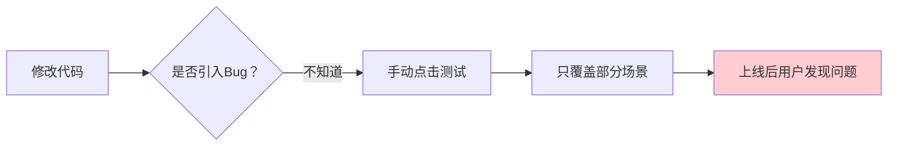
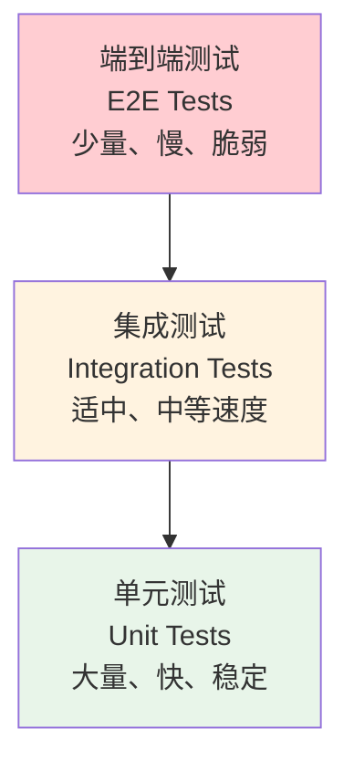
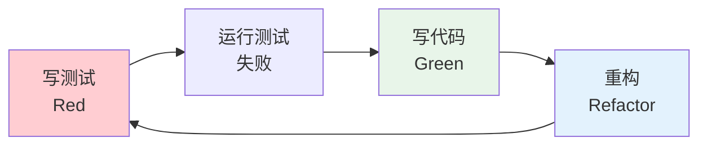

# 测试概述与 JUnit 5 基础

## 课程目标

- 理解测试在软件开发中的价值和测试金字塔模型
- 了解 Spring Boot 测试体系的组成
- 掌握 JUnit 5 的核心注解和断言方法
- 掌握参数化测试的使用
- 能够为图书管理系统的工具类编写单元测试


## 为什么需要测试

### 没有测试的困境

在图书管理系统的开发过程中，如果我们不写测试，会面临以下问题：



| 问题             | 说明                                         |
| ---------------- | -------------------------------------------- |
| **回归风险**     | 修改 A 功能，意外破坏了 B 功能，无法及时发现 |
| **手动测试低效** | 每次改动都要手动点击验证，耗时且容易遗漏     |
| **信心不足**     | 不敢重构代码，因为不知道会不会改坏           |
| **文档缺失**     | 测试用例本身就是最好的行为文档               |

### 自动化测试的价值

| 价值             | 说明                               |
| ---------------- | ---------------------------------- |
| **快速反馈**     | 修改代码后几秒内知道是否破坏了功能 |
| **回归保障**     | 确保已修复的 Bug 不会重新出现      |
| **支持重构**     | 有测试保护，可以放心重构           |
| **行为文档**     | 测试描述了代码的预期行为           |
| **降低调试成本** | 问题在开发阶段被发现，而非生产环境 |

### 测试金字塔

**测试金字塔**描述了不同类型测试的合理比例：



| 层级           | 数量 | 速度   | 依赖         | 验证范围     |
| -------------- | ---- | ------ | ------------ | ------------ |
| **单元测试**   | 最多 | 毫秒级 | 无（Mock）   | 单个类/方法  |
| **集成测试**   | 适中 | 秒级   | 数据库、容器 | 多个组件协作 |
| **端到端测试** | 最少 | 分钟级 | 完整环境     | 完整业务流程 |

> [!NOTE]
> 金字塔的核心思想：**多写单元测试，少写端到端测试**。单元测试快、稳定、容易定位问题；端到端测试慢、脆弱，但能验证整体流程。

### 测试驱动开发（TDD）简介

**TDD（Test-Driven Development）** 是一种开发方法论，流程如下：



| 阶段         | 说明                               |
| ------------ | ---------------------------------- |
| **Red**      | 先写一个失败的测试，描述期望的功能 |
| **Green**    | 写最少的代码让测试通过             |
| **Refactor** | 在测试保护下重构代码，改善设计     |

> [!NOTE]
> TDD 不是强制要求，但理解其思想有助于写出更好的测试。本课程不强制 TDD，但推荐在开发中先思考测试场景。

### Spring Boot 测试体系概览

Spring Boot 提供了完整的测试支持，核心依赖是 `spring-boot-starter-test`：

```xml
<dependency>
    <groupId>org.springframework.boot</groupId>
    <artifactId>spring-boot-starter-test</artifactId>
    <scope>test</scope>
</dependency>
```

它包含了以下核心库：

| 库              | 用途                                  |
| --------------- | ------------------------------------- |
| **JUnit 5**     | 测试框架，提供注解和断言              |
| **Mockito**     | Mock 框架，模拟依赖对象               |
| **AssertJ**     | 流式断言库，更易读                    |
| **Hamcrest**    | 匹配器库                              |
| **JSONassert**  | JSON 断言                             |
| **JsonPath**    | JSON 路径查询                         |
| **Spring Test** | Spring 测试支持（@SpringBootTest 等） |

> [!NOTE]
> `spring-boot-starter-test` 已经包含了上述所有依赖，无需额外添加。


## JUnit 5 基础

### JUnit 5 简介

**JUnit 5** 是当前主流的 Java 测试框架，由三个模块组成：

| 模块               | 说明                                   |
| ------------------ | -------------------------------------- |
| **JUnit Platform** | 测试运行平台，负责发现和执行测试       |
| **JUnit Jupiter**  | 新的编程模型和扩展模型（我们主要使用） |
| **JUnit Vintage**  | 兼容 JUnit 3/4 的测试                  |

### 核心注解

| 注解           | 说明                                         |
| -------------- | -------------------------------------------- |
| `@Test`        | 标记一个测试方法                             |
| `@BeforeEach`  | 每个测试方法执行前执行                       |
| `@AfterEach`   | 每个测试方法执行后执行                       |
| `@BeforeAll`   | 所有测试方法执行前执行一次（必须是静态方法） |
| `@AfterAll`    | 所有测试方法执行后执行一次（必须是静态方法） |
| `@Disabled`    | 禁用测试方法或类                             |
| `@DisplayName` | 为测试方法/类指定可读名称                    |
| `@Nested`      | 定义嵌套测试类                               |
| `@Tag`         | 为测试打标签，便于分组执行                   |

### 第一个测试类

```java
package com.example.bookmanager;

import org.junit.jupiter.api.*;

import static org.junit.jupiter.api.Assertions.*;

@DisplayName("JUnit 5 基础示例")
class FirstTest {

    @BeforeAll
    static void beforeAll() {
        System.out.println("=== 所有测试开始前执行一次 ===");
    }

    @BeforeEach
    void beforeEach() {
        System.out.println("--- 每个测试方法执行前执行 ---");
    }

    @Test
    @DisplayName("第一个测试方法")
    void test1() {
        System.out.println("执行测试1");
        assertEquals(2, 1 + 1);
    }

    @Test
    @DisplayName("第二个测试方法")
    void test2() {
        System.out.println("执行测试2");
        assertTrue(5 > 3);
    }

    @AfterEach
    void afterEach() {
        System.out.println("--- 每个测试方法执行后执行 ---");
    }

    @AfterAll
    static void afterAll() {
        System.out.println("=== 所有测试结束后执行一次 ===");
    }
}
```

**执行输出：**
```
=== 所有测试开始前执行一次 ===
--- 每个测试方法执行前执行 ---
执行测试1
--- 每个测试方法执行后执行 ---
--- 每个测试方法执行前执行 ---
执行测试2
--- 每个测试方法执行后执行 ---
=== 所有测试结束后执行一次 ===
```

### 断言方法

JUnit 5 提供了丰富的断言方法：

| 断言                                      | 说明               | 示例                                                      |
| ----------------------------------------- | ------------------ | --------------------------------------------------------- |
| `assertEquals(expected, actual)`          | 相等断言           | `assertEquals(2, 1+1)`                                    |
| `assertNotEquals(unexpected, actual)`     | 不相等断言         | `assertNotEquals(3, 1+1)`                                 |
| `assertTrue(condition)`                   | 真值断言           | `assertTrue(5 > 3)`                                       |
| `assertFalse(condition)`                  | 假值断言           | `assertFalse(5 < 3)`                                      |
| `assertNull(object)`                      | 空断言             | `assertNull(null)`                                        |
| `assertNotNull(object)`                   | 非空断言           | `assertNotNull("hello")`                                  |
| `assertThrows(exceptionType, executable)` | 异常断言           | `assertThrows(IllegalArgumentException.class, () -> ...)` |
| `assertDoesNotThrow(executable)`          | 无异常断言         | `assertDoesNotThrow(() -> ...)`                           |
| `assertAll(executables...)`               | 组合断言，全部执行 | `assertAll(() -> ..., () -> ...)`                         |
| `assertArrayEquals(expected, actual)`     | 数组相等断言       | `assertArrayEquals(new int[]{1,2}, arr)`                  |

**断言示例：**

```java
@Test
@DisplayName("断言方法示例")
void testAssertions() {
    // 相等断言
    assertEquals(4, 2 + 2, "2+2应该等于4");

    // 真值断言
    assertTrue("hello".length() > 3);

    // 异常断言
    IllegalArgumentException exception = assertThrows(
            IllegalArgumentException.class,
            () -> Integer.parseInt("abc")
    );
    assertEquals("For input string: \"abc\"", exception.getMessage());

    // 组合断言（全部执行，即使前面的失败）
    assertAll("用户信息",
            () -> assertEquals("Alice", "Alice"),
            () -> assertTrue(25 > 18),
            () -> assertNotNull("alice@example.com")
    );
}
```

> [!NOTE]
> `assertAll` 的优势：多个断言全部执行，一次性看到所有失败信息，而不是遇到第一个失败就停止。

### 参数化测试

**参数化测试**允许用不同的参数多次运行同一个测试方法：

```java
import org.junit.jupiter.params.ParameterizedTest;
import org.junit.jupiter.params.provider.*;

class ParameterizedTestDemo {

    @ParameterizedTest
    @ValueSource(ints = {1, 2, 3, 4, 5})
    @DisplayName("正数测试")
    void testPositive(int number) {
        assertTrue(number > 0);
    }

    @ParameterizedTest
    @ValueSource(strings = {"Alice", "Bob", "Charlie"})
    @DisplayName("字符串长度测试")
    void testStringLength(String name) {
        assertTrue(name.length() > 2);
    }

    @ParameterizedTest
    @CsvSource({
            "1, 1, 2",
            "2, 3, 5",
            "10, 20, 30",
            "-1, 1, 0"
    })
    @DisplayName("加法测试")
    void testAddition(int a, int b, int expected) {
        assertEquals(expected, a + b);
    }

    @ParameterizedTest
    @MethodSource("provideBookData")
    @DisplayName("图书数据测试")
    void testBookData(String title, double price) {
        assertNotNull(title);
        assertTrue(price > 0);
    }

    static Stream<Arguments> provideBookData() {
        return Stream.of(
                Arguments.of("Spring Boot 实战", 79.00),
                Arguments.of("Java 核心技术", 89.00),
                Arguments.of("深入理解 Java 虚拟机", 129.00)
        );
    }
}
```

**常用的参数来源：**

| 注解            | 说明                     |
| --------------- | ------------------------ |
| `@ValueSource`  | 提供基本类型或字符串数组 |
| `@CsvSource`    | 提供 CSV 格式的多参数    |
| `@MethodSource` | 提供方法返回的参数流     |
| `@EnumSource`   | 提供枚举值               |
| `@NullSource`   | 提供 null 值             |
| `@EmptySource`  | 提供空值                 |


## 实战：为 ISBN 校验工具类编写单元测试

### 需求

图书管理系统中需要校验 ISBN 格式。ISBN（国际标准书号）有两种格式：

- ISBN-10：10 位数字，最后一位可能是 X
- ISBN-13：13 位数字，以 978 或 979 开头

实现一个 `IsbnValidator` 工具类，并提供完整的单元测试。

### 实现工具类

使用简单的字符串遍历、去分隔符和长度判断。

```java
/**
 * ISBN 校验工具类
 * 只校验格式，不校验 ISBN 校验位。
 */
public class IsbnValidator {

    /**
     * 去除 ISBN 中的连字符和空白字符
     */
    private static String clean(String isbn) {
        StringBuilder sb = new StringBuilder();
        for (int i = 0; i < isbn.length(); i++) {
            char c = isbn.charAt(i);
            if (c != '-' && !Character.isWhitespace(c)) {
                sb.append(c);
            }
        }
        return sb.toString();
    }

    /**
     * 校验 ISBN 格式是否合法
     */
    public static boolean isValid(String isbn) {
        if (isbn == null || isbn.isBlank()) {
            return false;
        }

        String cleaned = clean(isbn);

        if (cleaned.length() == 10) {
            // ISBN-10：前 9 位必须是数字，最后一位是数字或 X/x
            for (int i = 0; i < 9; i++) {
                if (!Character.isDigit(cleaned.charAt(i))) {
                    return false;
                }
            }
            char last = cleaned.charAt(9);
            return Character.isDigit(last) || last == 'X' || last == 'x';
        }

        if (cleaned.length() == 13) {
            // ISBN-13：13 位全是数字，且以 978 或 979 开头
            if (!cleaned.startsWith("978") && !cleaned.startsWith("979")) {
                return false;
            }
            for (int i = 0; i < 13; i++) {
                if (!Character.isDigit(cleaned.charAt(i))) {
                    return false;
                }
            }
            return true;
        }

        return false;
    }

    /**
     * 获取 ISBN 类型
     */
    public static String getType(String isbn) {
        if (!isValid(isbn)) {
            throw new IllegalArgumentException("无效的 ISBN: " + isbn);
        }
        String cleaned = clean(isbn);
        return cleaned.length() == 10 ? "ISBN-10" : "ISBN-13";
    }

    /**
     * 标准化 ISBN（去除连字符和空格）
     */
    public static String normalize(String isbn) {
        if (isbn == null) {
            throw new IllegalArgumentException("ISBN 不能为 null");
        }
        return clean(isbn);
    }
}
```

### 编写单元测试

```java
@DisplayName("ISBN 校验工具类测试")
class IsbnValidatorTest {

    // ========== isValid 正常场景 ==========

    @Test
    @DisplayName("有效的 ISBN-10（无连字符）")
    void testValidIsbn10() {
        assertTrue(IsbnValidator.isValid("0306406152"));
    }

    @Test
    @DisplayName("有效的 ISBN-10（带连字符）")
    void testValidIsbn10WithHyphens() {
        assertTrue(IsbnValidator.isValid("0-306-40615-2"));
    }

    @Test
    @DisplayName("有效的 ISBN-10（最后一位为 X）")
    void testValidIsbn10WithX() {
        assertTrue(IsbnValidator.isValid("097522980X"));
    }

    @Test
    @DisplayName("有效的 ISBN-13")
    void testValidIsbn13() {
        assertTrue(IsbnValidator.isValid("9780306406157"));
    }

    @Test
    @DisplayName("有效的 ISBN-13（979 开头）")
    void testValidIsbn13With979() {
        assertTrue(IsbnValidator.isValid("9791234567890"));
    }

    // ========== isValid 异常场景 ==========

    @ParameterizedTest
    @NullAndEmptySource
    @DisplayName("null 或空字符串应返回 false")
    void testInvalidNullOrEmpty(String isbn) {
        assertFalse(IsbnValidator.isValid(isbn));
    }

    @ParameterizedTest
    @ValueSource(strings = {
            "12345",                    // 长度不足
            "12345678901234",           // 长度超出
            "abcdefghij",               // 非数字
            "030640615A",               // 最后一位不是数字或 X
            "978030640615",             // ISBN-13 长度不足
            "1234567890123",            // 不以 978/979 开头
            "978030640615A"             // ISBN-13 包含非数字
    })
    @DisplayName("无效的 ISBN 应返回 false")
    void testInvalidIsbn(String isbn) {
        assertFalse(IsbnValidator.isValid(isbn));
    }

    // ========== getType 测试 ==========

    @ParameterizedTest
    @CsvSource({
            "0306406152, ISBN-10",
            "0-306-40615-2, ISBN-10",
            "097522980X, ISBN-10",
            "9780306406157, ISBN-13",
            "9791234567890, ISBN-13"
    })
    @DisplayName("获取 ISBN 类型")
    void testGetType(String isbn, String expectedType) {
        assertEquals(expectedType, IsbnValidator.getType(isbn));
    }

    @Test
    @DisplayName("无效 ISBN 调用 getType 应抛出异常")
    void testGetTypeWithInvalidIsbn() {
        IllegalArgumentException exception = assertThrows(
                IllegalArgumentException.class,
                () -> IsbnValidator.getType("invalid")
        );
        assertTrue(exception.getMessage().contains("无效的 ISBN"));
    }

    // ========== normalize 测试 ==========

    @ParameterizedTest
    @CsvSource({
            "0-306-40615-2, 0306406152",
            "978 0 306 40615 7, 9780306406157",
            "0306406152, 0306406152"
    })
    @DisplayName("标准化 ISBN")
    void testNormalize(String input, String expected) {
        assertEquals(expected, IsbnValidator.normalize(input));
    }

    @Test
    @DisplayName("normalize(null) 应抛出异常")
    void testNormalizeNull() {
        assertThrows(IllegalArgumentException.class,
                () -> IsbnValidator.normalize(null));
    }
}
```

### 运行测试

在 IDE 中右键测试类 → Run，或使用 Maven 命令：

```bash
mvn test -Dtest=IsbnValidatorTest
```

**预期结果：**

```text
IsbnValidatorTest
  ✓ 有效的 ISBN-10（无连字符）
  ✓ 有效的 ISBN-10（带连字符）
  ✓ 有效的 ISBN-10（最后一位为 X）
  ✓ 有效的 ISBN-13
  ✓ 有效的 ISBN-13（979 开头）
  ✓ null 或空字符串应返回 false (2 个参数)
  ✓ 无效的 ISBN 应返回 false (7 个参数)
  ✓ 获取 ISBN 类型 (5 个参数)
  ✓ 无效 ISBN 调用 getType 应抛出异常
  ✓ 标准化 ISBN (3 个参数)
  ✓ normalize(null) 应抛出异常

测试结果：24 个测试用例通过
```

### 使用 @Nested 组织测试

当测试类较大时，可以使用 `@Nested` 按功能分组。上面的测试方法可以整理为如下结构：

```java
@DisplayName("ISBN 校验工具类测试")
class IsbnValidatorTestUsingNested {

    @Nested
    @DisplayName("isValid 方法测试")
    class IsValidTests {

        @Test
        @DisplayName("有效的 ISBN-10（无连字符）")
        void testValidIsbn10() {
            assertTrue(IsbnValidator.isValid("0306406152"));
        }

        @Test
        @DisplayName("有效的 ISBN-10（带连字符）")
        void testValidIsbn10WithHyphens() {
            assertTrue(IsbnValidator.isValid("0-306-40615-2"));
        }

        @Test
        @DisplayName("有效的 ISBN-10（最后一位为 X）")
        void testValidIsbn10WithX() {
            assertTrue(IsbnValidator.isValid("097522980X"));
        }

        @Test
        @DisplayName("有效的 ISBN-13")
        void testValidIsbn13() {
            assertTrue(IsbnValidator.isValid("9780306406157"));
        }

        @Test
        @DisplayName("有效的 ISBN-13（979 开头）")
        void testValidIsbn13With979() {
            assertTrue(IsbnValidator.isValid("9791234567890"));
        }

        @ParameterizedTest
        @NullAndEmptySource
        @DisplayName("null 或空字符串应返回 false")
        void testInvalidNullOrEmpty(String isbn) {
            assertFalse(IsbnValidator.isValid(isbn));
        }

        @ParameterizedTest
        @ValueSource(strings = {
                "12345",
                "12345678901234",
                "abcdefghij",
                "030640615A",
                "978030640615",
                "1234567890123",
                "978030640615A"
        })
        @DisplayName("无效的 ISBN 应返回 false")
        void testInvalidIsbn(String isbn) {
            assertFalse(IsbnValidator.isValid(isbn));
        }
    }

    @Nested
    @DisplayName("getType 方法测试")
    class GetTypeTests {

        @ParameterizedTest
        @CsvSource({
                "0306406152, ISBN-10",
                "0-306-40615-2, ISBN-10",
                "097522980X, ISBN-10",
                "9780306406157, ISBN-13",
                "9791234567890, ISBN-13"
        })
        @DisplayName("获取 ISBN 类型")
        void testGetType(String isbn, String expectedType) {
            assertEquals(expectedType, IsbnValidator.getType(isbn));
        }

        @Test
        @DisplayName("无效 ISBN 调用 getType 应抛出异常")
        void testGetTypeWithInvalidIsbn() {
            IllegalArgumentException exception = assertThrows(
                    IllegalArgumentException.class,
                    () -> IsbnValidator.getType("invalid")
            );
            assertTrue(exception.getMessage().contains("无效的 ISBN"));
        }
    }

    @Nested
    @DisplayName("normalize 方法测试")
    class NormalizeTests {

        @ParameterizedTest
        @CsvSource({
                "0-306-40615-2, 0306406152",
                "978 0 306 40615 7, 9780306406157",
                "0306406152, 0306406152"
        })
        @DisplayName("标准化 ISBN")
        void testNormalize(String input, String expected) {
            assertEquals(expected, IsbnValidator.normalize(input));
        }

        @Test
        @DisplayName("normalize(null) 应抛出异常")
        void testNormalizeNull() {
            assertThrows(IllegalArgumentException.class,
                    () -> IsbnValidator.normalize(null));
        }
    }
}
```


## 注意事项

### 1. 测试方法命名规范

| 方式                          | 示例                               | 说明 |
| ----------------------------- | ---------------------------------- | ---- |
| **should_预期结果_when_条件** | `shouldReturnFalse_whenIsbnIsNull` | 推荐 |
| **test_方法名_场景**          | `testIsValid_nullIsbn`             | 常用 |

### 2. 测试的独立性

每个测试应该**独立运行**，不依赖其他测试的执行顺序或结果：

```java
// ❌ 错误：测试依赖前一个测试的状态
private List<Book> books = new ArrayList<>();

@Test
void testAdd() {
    books.add(new Book());
}

@Test
void testSize() {
    assertEquals(1, books.size());  // 依赖 testAdd 的执行
}

// ✅ 正确：每个测试独立初始化
private List<Book> books;

@BeforeEach
void setUp() {
    books = new ArrayList<>();
}
```

### 3. 一个测试只验证一个行为

```java
// ❌ 错误：一个测试验证多个不相关的行为
@Test
void testBook() {
    Book book = new Book("Spring Boot 实战", 79.0);
    assertEquals("Spring Boot 实战", book.getTitle());  // 验证标题
    assertEquals(79.0, book.getPrice());                // 验证价格
    assertThrows(IllegalArgumentException.class, () -> book.setPrice(-1));  // 验证异常
}

// ✅ 正确：拆分为多个测试
@Test
void testBookTitle() { ... }

@Test
void testBookPrice() { ... }

@Test
void testNegativePriceThrowsException() { ... }
```

### 4. 测试的可读性

使用 `@DisplayName` 和 `assertAll` 让测试更易读：

```java
@Test
@DisplayName("创建图书时，价格不能为负数")
void testCreateBookWithNegativePrice() {
    Book book = new Book("测试", -10.0);
    IllegalArgumentException exception = assertThrows(
            IllegalArgumentException.class,
            () -> bookService.createBook(book)
    );
    assertAll(
            () -> assertTrue(exception.getMessage().contains("价格")),
            () -> assertTrue(exception.getMessage().contains("负数"))
    );
}
```

### 5. 避免在测试中使用 System.out.println

使用断言而非打印来验证结果。如果需要调试，使用 IDE 的断点或日志。

### 6. 测试执行速度

单元测试应该非常快（毫秒级）。如果测试超过 1 秒，可能有以下问题：
- 做了 I/O 操作（读写文件、网络请求）
- 初始化了 Spring 上下文
- 使用了 `Thread.sleep()`

### 7. 断言失败信息要清晰

```java
// ❌ 失败时不知道实际值
assertTrue(book.getPrice() > 0);

// ✅ 失败时能看到实际值
assertEquals(79.0, book.getPrice(), "图书价格应为 79.0");
```


## 小结

本节课我们学习了：

1. **测试的价值**：快速反馈、回归保障、支持重构、行为文档
2. **测试金字塔**：单元测试（多）、集成测试（适中）、端到端测试（少）
3. **Spring Boot 测试体系**：`spring-boot-starter-test` 包含了 JUnit 5、Mockito、AssertJ 等
4. **JUnit 5 核心用法**：
   - 核心注解：`@Test`、`@BeforeEach`、`@AfterEach`、`@BeforeAll`、`@AfterAll`
   - 断言方法：`assertEquals`、`assertTrue`、`assertThrows`、`assertAll`
   - 参数化测试：`@ParameterizedTest`、`@ValueSource`、`@CsvSource`、`@MethodSource`
5. **实战应用**：为 ISBN 校验工具类编写完整的单元测试


## 作业

### 作业一：代码阅读——测试分析

阅读以下测试代码，回答问题。

```java
@DisplayName("计算器测试")
class CalculatorTest {

    private Calculator calculator;

    @BeforeEach
    void setUp() {
        calculator = new Calculator();
    }

    @Test
    @DisplayName("加法测试")
    void testAdd() {
        assertEquals(5, calculator.add(2, 3));
    }

    @Test
    @DisplayName("除法测试")
    void testDivide() {
        assertEquals(2.5, calculator.divide(5, 2));
    }

    @Test
    @DisplayName("除零异常测试")
    void testDivideByZero() {
        assertThrows(ArithmeticException.class,
                () -> calculator.divide(1, 0));
    }

    @ParameterizedTest
    @CsvSource({"1, 1, 2", "2, 3, 5", "-1, 1, 0"})
    @DisplayName("参数化加法测试")
    void testAddParameterized(int a, int b, int expected) {
        assertEquals(expected, calculator.add(a, b));
    }
}
```

**问题：**
1. `setUp()` 方法在什么时候执行？
2. `testDivide` 中 `assertEquals(2.5, calculator.divide(5, 2))` 有什么问题？（提示：考虑浮点数精度）
3. `testDivideByZero` 使用的是什么断言？
4. `testAddParameterized` 会执行几次？
5. 如果要测试 `calculator.add(-1, -1)` 应该返回什么？

---

### 作业二：为工具类编写单元测试

在图书管理系统中，实现一个 `PriceUtil` 工具类：

```java
public class PriceUtil {
    /**
     * 格式化价格为两位小数的字符串
     * 例如：79 -> "79.00"
     */
    public static String format(double price) { ... }

    /**
     * 计算折扣价
     * 例如：原价 100，折扣 0.8 -> 80.00
     */
    public static double applyDiscount(double price, double discount) { ... }

    /**
     * 判断价格是否在指定范围内（包含边界）
     */
    public static boolean isInRange(double price, double min, double max) { ... }
}
```

**要求：**
1. 实现 `PriceUtil` 工具类。
2. 为每个方法编写单元测试，覆盖正常场景和边界场景：
   - `format`：整数、小数、负数、0
   - `applyDiscount`：正常折扣、0 折扣、1 折扣、非法折扣（<0 或 >1）
   - `isInRange`：正常范围、边界值（等于 min、等于 max）、超出范围、非法范围（min > max）
3. 使用 `@ParameterizedTest` 覆盖多种输入。
4. 使用 `@DisplayName` 为每个测试方法添加可读描述。


### 作业三：使用嵌套测试类组织测试

将作业二中的测试代码使用 `@Nested` 组织为三个嵌套类：
- `FormatTests`
- `ApplyDiscountTests`
- `IsInRangeTests`

**要求：**
1. 使用 `@Nested` 注解。
2. 为每个嵌套类添加 `@DisplayName`。
3. 运行测试，验证所有测试通过。
