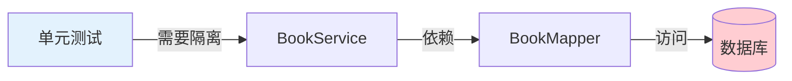
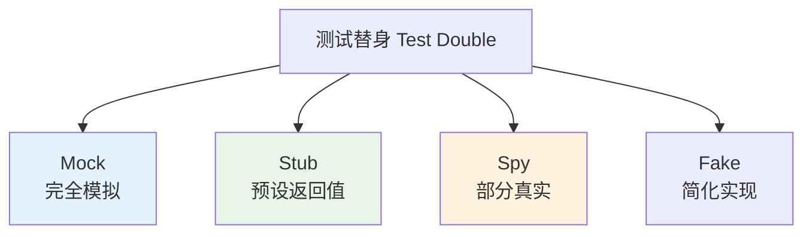
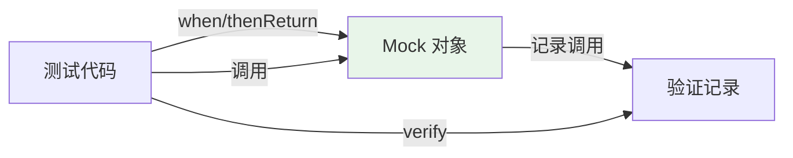

# Mockito 与单元测试

## 课程目标

- 理解 Mock 的概念和单元测试的隔离原则
- 掌握 Mockito 的核心 API（@Mock、@InjectMocks、when、verify）
- 掌握 ArgumentCaptor 参数捕获
- 掌握 Mock 异常场景的测试方法
- 能够为 BookService 编写完整的 Mock 单元测试


## 回顾与导入

在上一讲中，我们为 `IsbnValidator` 工具类编写了单元测试。工具类没有外部依赖，测试非常直接：

```java
@Test
void testValidIsbn10() {
    assertTrue(IsbnValidator.isValid("0306406152"));
}
```

但图书管理系统中的 `BookService` 依赖 `BookMapper`（数据库访问），如果直接测试：

```java
@Service
public class BookServiceImpl implements BookService {
    private final BookMapper bookMapper;

    public Book getBookById(Long id) {
        Book book = bookMapper.selectById(id);   // 需要数据库
        if (book == null) {
            throw new ResourceNotFoundException("Book", id);
        }
        return book;
    }
}
```

**问题：** 没有数据库就无法测试，单元测试变成了集成测试。



**解决方案：** 使用 **Mock** 模拟 `BookMapper`，让 `BookService` 的单元测试不依赖数据库。

本节课将深入学习 Mockito，实现 Service 层的纯单元测试。


## 什么是 Mock

### 单元测试的隔离原则

**单元测试**应该只测试**当前单元**的逻辑，不依赖外部组件（数据库、网络、文件系统）。

| 依赖类型 | 隔离方式                    |
| -------- | --------------------------- |
| 数据库   | Mock Mapper/Repository      |
| 外部 API | Mock RestTemplate/WebClient |
| 缓存     | Mock CacheManager           |
| 消息队列 | Mock Template               |

### Mock、Stub、Spy 的区别

| 概念     | 说明                               | 用途         |
| -------- | ---------------------------------- | ------------ |
| **Mock** | 完全模拟的对象，所有方法返回默认值 | 验证交互行为 |
| **Stub** | 预设返回值的对象                   | 提供测试数据 |
| **Spy**  | 包装真实对象，可选择调用真实方法   | 部分模拟     |



> [!NOTE]
> 在 Mockito 中，`@Mock` 创建的对象既能作为 Mock（验证调用），也能作为 Stub（预设返回值），两者界限并不严格。**Spy** 用于需要调用真实方法的场景。

### Mockito 的工作方式

Mockito 通过**动态代理**创建 Mock 对象：




## Mockito 核心 API

### 1. 启用 Mockito

**方式一：使用 `@ExtendWith(MockitoExtension.class)`（推荐）**

```java
@ExtendWith(MockitoExtension.class)
class BookServiceTest {

    @Mock
    private BookMapper bookMapper;  // 自动创建 Mock

    @InjectMocks
    private BookServiceImpl bookService;  // 自动注入 Mock
}
```

**方式二：手动创建 Mock**

```java
class BookServiceTest {
    private BookMapper bookMapper = Mockito.mock(BookMapper.class);
    private BookServiceImpl bookService = new BookServiceImpl(bookMapper);
}
```

> [!NOTE]
> `@ExtendWith(MockitoExtension.class)` 会在每个测试方法执行前自动初始化 `@Mock` 和 `@InjectMocks`，简化代码。

### 2. 核心注解

| 注解           | 说明                             |
| -------------- | -------------------------------- |
| `@Mock`        | 创建 Mock 对象                   |
| `@InjectMocks` | 创建实例并注入所有 `@Mock` 依赖  |
| `@Spy`         | 创建 Spy 对象（包装真实对象）    |
| `@Captor`      | 创建 ArgumentCaptor 用于参数捕获 |

### 3. 核心方法

| 方法                                                | 说明                           |
| --------------------------------------------------- | ------------------------------ |
| `when(mock.method()).thenReturn(value)`             | 预设返回值                     |
| `when(mock.method()).thenThrow(exception)`          | 预设抛出异常                   |
| `when(mock.method()).thenReturn(v1).thenReturn(v2)` | 连续调用返回不同值             |
| `doNothing().when(mock).method()`                   | 对 void 方法预设无操作         |
| `doThrow(exception).when(mock).method()`            | 对 void 方法预设抛异常         |
| `verify(mock).method(args)`                         | 验证方法被调用一次             |
| `verify(mock, times(n)).method(args)`               | 验证方法被调用 n 次            |
| `verify(mock, never()).method(args)`                | 验证方法从未被调用             |
| `verifyNoMoreInteractions(mock)`                    | 验证 Mock 没有其他未验证的调用 |

### 4. 基础用法示例

```java
@ExtendWith(MockitoExtension.class)
class BasicMockitoTest {

    @Mock
    private BookMapper bookMapper;

    @Test
    @DisplayName("when-thenReturn 示例")
    void testWhenThenReturn() {
        // 预设返回值
        Book book = new Book("Spring Boot 实战", "Craig Walls", 79.0, 10);
        when(bookMapper.selectById(1L)).thenReturn(book);

        // 调用
        Book result = bookMapper.selectById(1L);

        // 验证结果
        assertEquals("Spring Boot 实战", result.getTitle());

        // 验证调用
        verify(bookMapper).selectById(1L);
    }

    @Test
    @DisplayName("when-thenThrow 示例")
    void testWhenThenThrow() {
        // 预设抛出异常
        when(bookMapper.selectById(999L))
                .thenThrow(new RuntimeException("数据库连接失败"));

        // 验证异常
        assertThrows(RuntimeException.class, () -> bookMapper.selectById(999L));
    }

    @Test
    @DisplayName("连续调用返回不同值")
    void testConsecutiveReturns() {
        when(bookMapper.count())
                .thenReturn(5L)
                .thenReturn(10L)
                .thenReturn(15L);

        assertEquals(5L, bookMapper.count());
        assertEquals(10L, bookMapper.count());
        assertEquals(15L, bookMapper.count());
    }
}
```


## 编写 Service 单元测试

### 完整测试类

```java
@ExtendWith(MockitoExtension.class)
@DisplayName("BookService 单元测试")
class BookServiceTest {

    @Mock
    private BookMapper bookMapper;

    @InjectMocks
    private BookServiceImpl bookService;

    private Book sampleBook;

    @BeforeEach
    void setUp() {
        sampleBook = new Book();
        sampleBook.setId(1L);
        sampleBook.setTitle("Spring Boot 实战");
        sampleBook.setAuthor("Craig Walls");
        sampleBook.setPrice(79.0);
        sampleBook.setStock(10);
        sampleBook.setSales(0);
    }

    // ==================== createBook 测试 ====================

    @Nested
    @DisplayName("createBook 方法测试")
    class CreateBookTests {

        @Test
        @DisplayName("正常创建图书")
        void testCreateBookSuccess() {
            // Given
            Book newBook = new Book("Java 核心技术", "Cay Horstmann", 89.0, 8);
            when(bookMapper.insert(any(Book.class))).thenReturn(1);

            // When
            Book result = bookService.createBook(newBook);

            // Then
            assertNotNull(result);
            assertEquals("Java 核心技术", result.getTitle());
            assertEquals(0, result.getSales());  // 销量自动设为 0

            // 验证 Mapper 被调用
            verify(bookMapper, times(1)).insert(any(Book.class));
        }

        @Test
        @DisplayName("创建图书时，价格为负数应抛出异常")
        void testCreateBookWithNegativePrice() {
            // Given
            Book book = new Book("测试", "作者", -10.0, 5);

            // When & Then
            BusinessException exception = assertThrows(
                    BusinessException.class,
                    () -> bookService.createBook(book)
            );
            assertTrue(exception.getMessage().contains("价格"));
            assertTrue(exception.getMessage().contains("负数"));

            // 验证 Mapper 未被调用
            verify(bookMapper, never()).insert(any(Book.class));
        }

        @Test
        @DisplayName("创建图书时，价格为空应抛出异常")
        void testCreateBookWithNullPrice() {
            Book book = new Book("测试", "作者", null, 5);

            BusinessException exception = assertThrows(
                    BusinessException.class,
                    () -> bookService.createBook(book)
            );
            assertTrue(exception.getMessage().contains("价格"));

            verify(bookMapper, never()).insert(any(Book.class));
        }

        @Test
        @DisplayName("创建图书时，库存为负数应抛出异常")
        void testCreateBookWithNegativeStock() {
            Book book = new Book("测试", "作者", 50.0, -5);

            BusinessException exception = assertThrows(
                    BusinessException.class,
                    () -> bookService.createBook(book)
            );
            assertTrue(exception.getMessage().contains("库存"));

            verify(bookMapper, never()).insert(any(Book.class));
        }

        @Test
        @DisplayName("创建图书时，使用 ArgumentCaptor 验证参数")
        void testCreateBookWithArgumentCaptor() {
            // Given
            Book newBook = new Book("测试书", "测试作者", 50.0, 5);
            when(bookMapper.insert(any(Book.class))).thenReturn(1);

            // When
            bookService.createBook(newBook);

            // Then - 使用 ArgumentCaptor 捕获参数
            ArgumentCaptor<Book> captor = ArgumentCaptor.forClass(Book.class);
            verify(bookMapper).insert(captor.capture());

            Book capturedBook = captor.getValue();
            assertEquals("测试书", capturedBook.getTitle());
            assertEquals("测试作者", capturedBook.getAuthor());
            assertEquals(50.0, capturedBook.getPrice());
            assertEquals(5, capturedBook.getStock());
            assertEquals(0, capturedBook.getSales());  // 验证销量被设置为 0
        }
    }

    // ==================== getBookById 测试 ====================

    @Nested
    @DisplayName("getBookById 方法测试")
    class GetBookByIdTests {

        @Test
        @DisplayName("查询存在的图书")
        void testGetBookByIdFound() {
            // Given
            when(bookMapper.selectById(1L)).thenReturn(sampleBook);

            // When
            Book result = bookService.getBookById(1L);

            // Then
            assertNotNull(result);
            assertEquals(1L, result.getId());
            assertEquals("Spring Boot 实战", result.getTitle());

            verify(bookMapper, times(1)).selectById(1L);
        }

        @Test
        @DisplayName("查询不存在的图书应抛出异常")
        void testGetBookByIdNotFound() {
            // Given
            when(bookMapper.selectById(999L)).thenReturn(null);

            // When & Then
            ResourceNotFoundException exception = assertThrows(
                    ResourceNotFoundException.class,
                    () -> bookService.getBookById(999L)
            );
            assertTrue(exception.getMessage().contains("999"));

            verify(bookMapper, times(1)).selectById(999L);
        }
    }

    // ==================== getAllBooks 测试 ====================

    @Nested
    @DisplayName("getAllBooks 方法测试")
    class GetAllBooksTests {

        @Test
        @DisplayName("查询所有图书（有数据）")
        void testGetAllBooksWithData() {
            // Given
            List<Book> books = Arrays.asList(
                    sampleBook,
                    new Book("Java 核心技术", "Cay Horstmann", 89.0, 8)
            );
            when(bookMapper.selectList(null)).thenReturn(books);

            // When
            List<Book> result = bookService.getAllBooks();

            // Then
            assertEquals(2, result.size());
            assertEquals("Spring Boot 实战", result.get(0).getTitle());
            assertEquals("Java 核心技术", result.get(1).getTitle());

            verify(bookMapper, times(1)).selectList(null);
        }

        @Test
        @DisplayName("查询所有图书（无数据）")
        void testGetAllBooksEmpty() {
            // Given
            when(bookMapper.selectList(null)).thenReturn(Collections.emptyList());

            // When
            List<Book> result = bookService.getAllBooks();

            // Then
            assertTrue(result.isEmpty());

            verify(bookMapper, times(1)).selectList(null);
        }
    }

    // ==================== updateBook 测试 ====================

    @Nested
    @DisplayName("updateBook 方法测试")
    class UpdateBookTests {

        @Test
        @DisplayName("正常更新图书")
        void testUpdateBookSuccess() {
            // Given
            Book updateBook = new Book("Spring Boot 实战（第2版）", "Craig Walls", 99.0, 15);
            updateBook.setId(1L);

            when(bookMapper.selectById(1L)).thenReturn(sampleBook);
            when(bookMapper.updateById(any(Book.class))).thenReturn(1);
            when(bookMapper.selectById(1L)).thenReturn(updateBook);

            // When
            Book result = bookService.updateBook(updateBook);

            // Then
            assertNotNull(result);
            assertEquals("Spring Boot 实战（第2版）", result.getTitle());
            assertEquals(99.0, result.getPrice());

            verify(bookMapper, times(1)).updateById(any(Book.class));
        }

        @Test
        @DisplayName("更新时 ID 为空应抛出异常")
        void testUpdateBookWithNullId() {
            Book book = new Book("测试", "作者", 50.0, 5);
            // id 为 null

            BusinessException exception = assertThrows(
                    BusinessException.class,
                    () -> bookService.updateBook(book)
            );
            assertTrue(exception.getMessage().contains("ID"));

            verify(bookMapper, never()).updateById(any(Book.class));
        }

        @Test
        @DisplayName("更新不存在的图书应抛出异常")
        void testUpdateBookNotFound() {
            Book book = new Book("测试", "作者", 50.0, 5);
            book.setId(999L);

            when(bookMapper.selectById(999L)).thenReturn(null);

            ResourceNotFoundException exception = assertThrows(
                    ResourceNotFoundException.class,
                    () -> bookService.updateBook(book)
            );

            verify(bookMapper, never()).updateById(any(Book.class));
        }
    }

    // ==================== deleteBook 测试 ====================

    @Nested
    @DisplayName("deleteBook 方法测试")
    class DeleteBookTests {

        @Test
        @DisplayName("正常删除图书")
        void testDeleteBookSuccess() {
            // Given
            when(bookMapper.selectById(1L)).thenReturn(sampleBook);
            when(bookMapper.deleteById(1L)).thenReturn(1);

            // When
            boolean result = bookService.deleteBook(1L);

            // Then
            assertTrue(result);
            verify(bookMapper, times(1)).deleteById(1L);
        }

        @Test
        @DisplayName("删除时 ID 为空应抛出异常")
        void testDeleteBookWithNullId() {
            BusinessException exception = assertThrows(
                    BusinessException.class,
                    () -> bookService.deleteBook(null)
            );
            assertTrue(exception.getMessage().contains("ID"));

            verify(bookMapper, never()).deleteById(anyLong());
        }

        @Test
        @DisplayName("删除不存在的图书应抛出异常")
        void testDeleteBookNotFound() {
            when(bookMapper.selectById(999L)).thenReturn(null);

            assertThrows(ResourceNotFoundException.class,
                    () -> bookService.deleteBook(999L));

            verify(bookMapper, never()).deleteById(999L);
        }
    }
}
```

### 运行测试

```bash
mvn test -Dtest=BookServiceTest
```

**预期结果：**
```
BookServiceTest
  ✓ createBook 方法测试
    ✓ 正常创建图书
    ✓ 创建图书时，价格为负数应抛出异常
    ✓ 创建图书时，价格为空应抛出异常
    ✓ 创建图书时，库存为负数应抛出异常
    ✓ 创建图书时，使用 ArgumentCaptor 验证参数
  ✓ getBookById 方法测试
    ✓ 查询存在的图书
    ✓ 查询不存在的图书应抛出异常
  ✓ getAllBooks 方法测试
    ✓ 查询所有图书（有数据）
    ✓ 查询所有图书（无数据）
  ✓ updateBook 方法测试
    ✓ 正常更新图书
    ✓ 更新时 ID 为空应抛出异常
    ✓ 更新不存在的图书应抛出异常
  ✓ deleteBook 方法测试
    ✓ 正常删除图书
    ✓ 删除时 ID 为空应抛出异常
    ✓ 删除不存在的图书应抛出异常

测试结果：16 个测试通过
```


## Mockito 常用技巧

### 1. 使用 any() 匹配任意参数

```java
// 精确匹配
when(bookMapper.selectById(1L)).thenReturn(book);

// 任意参数匹配
when(bookMapper.selectById(anyLong())).thenReturn(book);

// 任意 Book 对象
when(bookMapper.insert(any(Book.class))).thenReturn(1);
```

**常用的参数匹配器：**

| 匹配器                                   | 说明                |
| ---------------------------------------- | ------------------- |
| `any()`                                  | 任意对象（含 null） |
| `anyLong()` / `anyInt()` / `anyString()` | 任意基本类型包装    |
| `any(Class<T>)`                          | 任意指定类型对象    |
| `eq(value)`                              | 等于指定值          |
| `isNull()` / `isNotNull()`               | null 判断           |
| `argThat(predicate)`                     | 满足自定义条件      |

### 2. 使用 argThat 自定义匹配

```java
// 匹配标题包含 "Spring" 的图书
when(bookMapper.insert(argThat(book -> 
        book.getTitle().contains("Spring"))))
        .thenReturn(1);

// 匹配价格大于 50 的图书
when(bookMapper.insert(argThat(book -> 
        book.getPrice() > 50)))
        .thenReturn(1);
```

### 3. 验证调用次数

```java
verify(bookMapper, times(1)).selectById(1L);       // 恰好 1 次
verify(bookMapper, times(2)).selectById(1L);       // 恰好 2 次
verify(bookMapper, atLeast(1)).selectById(anyLong());  // 至少 1 次
verify(bookMapper, atMost(3)).selectById(anyLong());   // 至多 3 次
verify(bookMapper, never()).deleteById(anyLong());     // 从未调用
```

### 4. 验证调用顺序

```java
InOrder inOrder = inOrder(bookMapper);

inOrder.verify(bookMapper).selectById(1L);
inOrder.verify(bookMapper).updateById(any(Book.class));
inOrder.verify(bookMapper).selectById(1L);
```

### 5. 验证没有其他未验证的调用

```java
verify(bookMapper).selectById(1L);
verifyNoMoreInteractions(bookMapper);  // 确保没有其他调用
```


## 常见陷阱与注意事项

### 1. 不要过度 Mock

```java
// ❌ 过度 Mock：连 Book 对象都 Mock
Book mockBook = mock(Book.class);
when(mockBook.getTitle()).thenReturn("Spring Boot 实战");
when(mockBook.getPrice()).thenReturn(79.0);
when(mockBook.getStock()).thenReturn(10);

// ✅ 简单对象直接 new
Book book = new Book("Spring Boot 实战", "Craig Walls", 79.0, 10);
```

> [!NOTE]
> 只 Mock 有外部依赖的对象（如 Mapper、Service、API 客户端）。值对象、实体类、工具类直接使用真实对象。

### 2. 不要 Mock 被测对象本身

```java
// ❌ 错误：Mock 了被测对象
@Mock
private BookServiceImpl bookService;

// ✅ 正确：用 @InjectMocks 注入依赖
@InjectMocks
private BookServiceImpl bookService;
```

### 3. 测试行为而非实现

```java
// ❌ 测试实现细节：验证内部调用了哪个方法
verify(bookMapper, times(1)).selectById(1L);
verify(bookMapper, times(1)).selectList(null);

// ✅ 测试行为：验证最终结果
Book result = bookService.getBookById(1L);
assertEquals("Spring Boot 实战", result.getTitle());
```

### 4. 每个测试独立

```java
// ❌ 错误：测试依赖前一个测试的状态
private Book book;

@Test
void testCreate() {
    book = new Book();
    bookService.create(book);
}

@Test
void testGet() {
    bookService.getBookById(book.getId());  // book 可能是 null
}

// ✅ 正确：每个测试在 @BeforeEach 中初始化
@BeforeEach
void setUp() {
    book = new Book();
}
```

### 5. 使用 @Nested 按方法分组

将测试按被测方法分组，提高可读性：

```java
class BookServiceTest {

    @Nested
    @DisplayName("createBook 方法测试")
    class CreateBookTests { ... }

    @Nested
    @DisplayName("getBookById 方法测试")
    class GetBookByIdTests { ... }
}
```


## 小结

本节课我们学习了：

1. **Mock 的概念**：
   - 单元测试的隔离原则
   - Mock、Stub、Spy 的区别
2. **Mockito 核心 API**：
   - `@Mock`、`@InjectMocks`、`@ExtendWith(MockitoExtension.class)`
   - `when().thenReturn()`、`when().thenThrow()`
   - `verify()`、`times()`、`never()`
3. **实战应用**：为 `BookService` 编写完整的 Mock 单元测试
4. **常用技巧**：
   - `any()`、`argThat()` 参数匹配
   - `InOrder` 验证调用顺序
5. **常见陷阱**：过度 Mock、Mock 被测对象、测试实现细节


## 作业

### 作业一：代码阅读——Mockito 用法分析

阅读以下测试代码，回答问题。

```java
@ExtendWith(MockitoExtension.class)
class OrderServiceTest {

    @Mock
    private OrderMapper orderMapper;

    @Mock
    private BookMapper bookMapper;

    @InjectMocks
    private OrderServiceImpl orderService;

    @Test
    void testCreateOrder() {
        Book book = new Book("Spring Boot 实战", "Craig Walls", 79.0, 10);
        book.setId(1L);

        when(bookMapper.selectById(1L)).thenReturn(book);
        when(orderMapper.insert(any(Order.class))).thenReturn(1);

        Order order = orderService.createOrder(1L, 2);

        assertNotNull(order);
        verify(bookMapper).selectById(1L);
        verify(orderMapper).insert(any(Order.class));
        verify(bookMapper).decreaseStock(1L, 2);
    }
}
```

**问题：**
1. `@Mock` 和 `@InjectMocks` 的作用分别是什么？
2. 如果 `bookMapper.selectById(1L)` 返回 `null`，测试会怎样？
3. `verify(bookMapper).selectById(1L)` 验证了什么？
4. 如果 `orderService.createOrder` 中调用了 `bookMapper.selectById(2L)`，但测试中只预设了 `1L` 的返回值，会发生什么？
5. `any(Order.class)` 的作用是什么？

---

### 作业二：为 OrderService 编写单元测试

假设存在以下 `OrderService`：

```java
@Service
public class OrderServiceImpl implements OrderService {

    private final OrderMapper orderMapper;
    private final BookMapper bookMapper;

    public OrderServiceImpl(OrderMapper orderMapper, BookMapper bookMapper) {
        this.orderMapper = orderMapper;
        this.bookMapper = bookMapper;
    }

    @Override
    public Order createOrder(Long bookId, int quantity) {
        // 1. 检查库存
        Book book = bookMapper.selectById(bookId);
        if (book == null) {
            throw new ResourceNotFoundException("Book", bookId);
        }
        if (book.getStock() < quantity) {
            throw new BusinessException("库存不足，当前库存: " + book.getStock());
        }

        // 2. 扣减库存
        int rows = bookMapper.decreaseStock(bookId, quantity);
        if (rows != 1) {
            throw new BusinessException("扣减库存失败");
        }

        // 3. 创建订单
        Order order = new Order();
        order.setBookId(bookId);
        order.setQuantity(quantity);
        order.setStatus("CREATED");
        order.setTotalAmount(book.getPrice() * quantity);
        orderMapper.insert(order);

        return order;
    }
}
```

**要求：**

1. 创建 `OrderServiceTest`，使用 `@Mock` 和 `@InjectMocks`。
2. 编写以下测试：
   - 正常创建订单（验证订单金额、状态、Mapper 调用）
   - 图书不存在时抛出 `ResourceNotFoundException`
   - 库存不足时抛出 `BusinessException`（验证 Mapper 未被调用）
   - 扣减库存失败时抛出 `BusinessException`（验证订单未被创建）
3. 使用 `ArgumentCaptor` 验证插入的订单对象。
4. 使用 `verify(bookMapper, never()).decreaseStock(...)` 验证库存不足时不扣减。
