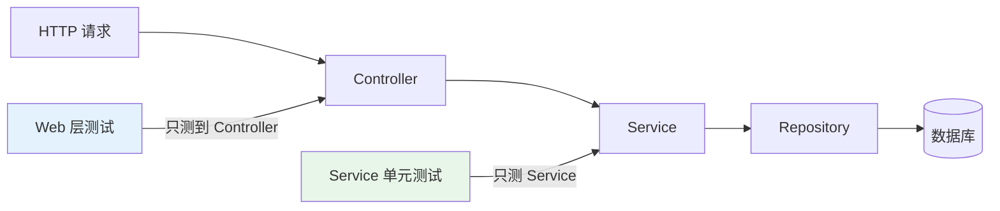
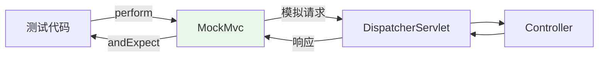

# Web 层测试：@WebMvcTest

## 课程目标

- 理解测试切片（Test Slice）的概念
- 掌握 @WebMvcTest 的使用方法
- 掌握 MockMvc 的核心 API
- 掌握请求参数、请求体、路径参数的测试方法
- 掌握 JSON 响应断言和异常场景测试
- 能够为 BookController 的所有接口编写 Web 层测试


## 回顾与导入

在上一讲中，我们使用 Mockito 为 `BookService` 编写了单元测试。这些测试直接调用 Service 方法，不涉及 HTTP 请求：

```java
@Test
void testGetBookById() {
    when(bookMapper.selectById(1L)).thenReturn(book);
    Book result = bookService.getBookById(1L);
    assertEquals("Spring Boot 实战", result.getTitle());
}
```

但 Web 层的测试需要验证的是：

| 待验证项        | 说明                                                      |
| --------------- | --------------------------------------------------------- |
| **请求映射**    | `/api/books/1` 是否正确路由到 `getBook` 方法              |
| **参数绑定**    | `@PathVariable`、`@RequestParam`、`@RequestBody` 是否正确 |
| **参数校验**    | `@Valid` 是否生效，校验失败是否返回 400                   |
| **响应格式**    | 返回的 JSON 结构是否正确                                  |
| **异常处理**    | `@ControllerAdvice` 是否统一处理异常                      |
| **HTTP 状态码** | 200、201、400、404、500 等                                |

这些无法通过 Service 单元测试验证，需要针对 **Web 层** 编写测试。



本节课将使用 `@WebMvcTest` 对 `BookController` 进行完整的 Web 层测试。


## 测试切片（Test Slice）

### 什么是测试切片

**测试切片**是 Spring Boot 提供的**部分上下文加载**机制。不同的切片注解只加载特定层次的组件，避免加载完整的 Spring 上下文，从而提升测试速度。

```mermaid
flowchart TB
    A[完整上下文<br/>@SpringBootTest] --> B[所有组件]
    C[Web 切片<br/>@WebMvcTest] --> D[Controller + MVC 组件]
    E[数据切片<br/>@DataJpaTest] --> F[Repository + JPA 组件]
    G[JSON 切片<br/>@JsonTest] --> H[JSON 序列化组件]

    style C fill:#e3f2fd
    style E fill:#e8f5e9
```

### 常用测试切片注解

| 注解              | 加载的组件                                | 典型用途           |
| ----------------- | ----------------------------------------- | ------------------ |
| `@WebMvcTest`     | Controller、Filter、Interceptor、MVC 配置 | 测试 Controller 层 |
| `@DataJpaTest`    | Repository、EntityManager、DataSource     | 测试数据访问层     |
| `@JdbcTest`       | JdbcTemplate、DataSource                  | 测试 JDBC 操作     |
| `@JsonTest`       | Jackson、ObjectMapper                     | 测试 JSON 序列化   |
| `@RestClientTest` | RestTemplate、WebClient                   | 测试 REST 客户端   |
| `@WebFluxTest`    | WebFlux Controller                        | 测试响应式 Web 层  |

### @WebMvcTest 与 @SpringBootTest 的对比

| 对比                   | @WebMvcTest       | @SpringBootTest    |
| ---------------------- | ----------------- | ------------------ |
| **加载范围**           | 只加载 Web 层     | 加载完整上下文     |
| **速度**               | 快（秒级以内）    | 慢（秒级到十秒级） |
| **Service/Repository** | 不加载，需要 Mock | 完整加载           |
| **数据库连接**         | 不需要            | 需要               |
| **适用场景**           | Controller 测试   | 端到端集成测试     |

> [!NOTE]
> `@WebMvcTest` 不会加载 `@Service`、`@Repository`、`@Component` 等 Bean。如果 Controller 依赖 Service，需要使用 `@MockitoBean` 提供 Mock 实例。

### @WebMvcTest 支持的组件

| 组件                                      | 是否加载 |
| ----------------------------------------- | -------- |
| `@Controller` / `@RestController`         | ✅        |
| `@ControllerAdvice`                       | ✅        |
| `Filter`                                  | ✅        |
| `Interceptor`                             | ✅        |
| `WebMvcConfigurer`                        | ✅        |
| `@Service` / `@Component` / `@Repository` | ❌        |
| `@Configuration`                          | ❌        |


## MockMvc 核心用法

### 什么是 MockMvc

**MockMvc** 是 Spring Test 提供的模拟 MVC 请求的工具，可以在**不启动真实 HTTP 服务器**的情况下发送请求并验证响应。



### 启用 MockMvc

**方式一：使用 @WebMvcTest（推荐）**

```java
@WebMvcTest(BookController.class)
class BookControllerTest {

    @Autowired
    private MockMvc mockMvc;
}
```

`@WebMvcTest` 会自动配置 `MockMvc`，直接 `@Autowired` 注入即可。

**方式二：手动配置（老式）**

```java
@SpringBootTest
@AutoConfigureMockMvc
class BookControllerTest {

    @Autowired
    private MockMvc mockMvc;
}
```

### MockMvc 核心 API

| 方法                       | 说明                   |
| -------------------------- | ---------------------- |
| `perform(RequestBuilder)`  | 执行请求               |
| `andExpect(ResultMatcher)` | 断言响应               |
| `andDo(ResultHandler)`     | 执行额外操作（如打印） |
| `andReturn(MvcResult)`     | 返回结果对象           |

### 请求构建器

| 方法                      | 说明         | 示例                                       |
| ------------------------- | ------------ | ------------------------------------------ |
| `get(url)`                | GET 请求     | `get("/api/books")`                        |
| `post(url)`               | POST 请求    | `post("/api/books")`                       |
| `put(url)`                | PUT 请求     | `put("/api/books/1")`                      |
| `delete(url)`             | DELETE 请求  | `delete("/api/books/1")`                   |
| `patch(url)`              | PATCH 请求   | `patch("/api/books/1")`                    |
| `.param(name, values)`    | 查询参数     | `.param("author", "Craig")`                |
| `.header(name, values)`   | 请求头       | `.header("Authorization", "Bearer xxx")`   |
| `.contentType(MediaType)` | 请求内容类型 | `.contentType(MediaType.APPLICATION_JSON)` |
| `.content(String)`        | 请求体       | `.content("{\"title\":\"xx\"}")`           |
| `.accept(MediaType)`      | 期望响应类型 | `.accept(MediaType.APPLICATION_JSON)`      |

### 响应断言

| 方法                                 | 说明          | 示例                               |
| ------------------------------------ | ------------- | ---------------------------------- |
| `status().isOk()`                    | 状态码 200    | 查询成功                           |
| `status().isCreated()`               | 状态码 201    | 创建成功                           |
| `status().isNoContent()`             | 状态码 204    | 删除成功                           |
| `status().isBadRequest()`            | 状态码 400    | 参数错误                           |
| `status().isNotFound()`              | 状态码 404    | 资源不存在                         |
| `status().isInternalServerError()`   | 状态码 500    | 服务器错误                         |
| `content().contentType(MediaType)`   | 内容类型      | `application/json`                 |
| `content().string(String)`           | 响应体字符串  | 精确匹配                           |
| `content().json(String)`             | 响应体 JSON   | 结构匹配                           |
| `jsonPath("$.field").value(v)`       | JSON 路径断言 | `jsonPath("$.title").value("xxx")` |
| `jsonPath("$.field").exists()`       | 字段存在      | `jsonPath("$.id").exists()`        |
| `jsonPath("$.field").doesNotExist()` | 字段不存在    | —                                  |
| `jsonPath("$.field").isEmpty()`      | 数组为空      | —                                  |


## 依赖 Mock

### 使用 @MockitoBean

由于 `@WebMvcTest` 不加载 Service 层，Controller 依赖的 Service 需要使用 `@MockitoBean` 提供 Mock 实例：

```java
@WebMvcTest(BookController.class)
class BookControllerTest {

    @Autowired
    private MockMvc mockMvc;

    @MockitoBean
    private BookService bookService;   // 替换容器中的真实 Bean

    @MockitoBean
    private BookMapper bookMapper;     // 如果 Controller 依赖它
}
```

| 对比             | `@Mock`        | `@MockitoBean`                        |
| ---------------- | -------------- | ------------------------------------- |
| **来源**         | Mockito        | Spring Boot                           |
| **作用**         | 创建 Mock 对象 | 创建 Mock 对象并**替换容器中的 Bean** |
| **使用场景**     | 单元测试       | 集成测试、切片测试                    |
| **是否影响容器** | 否             | 是（替换 Bean）                       |

> [!NOTE]
> `@MockitoBean` 会检查容器中是否存在同类型 Bean，如果有则替换；如果没有则新增。每个测试方法执行完毕后，Spring 会重置该 Bean。

### @SpyBean

如果需要调用真实方法的部分逻辑，可以使用 `@SpyBean`：

```java
@SpyBean
private BookService bookService;   // 默认调用真实方法，可选择性 stub
```


## 实战：测试 BookController

### 完整测试类

```java
@WebMvcTest(BookController.class)
@DisplayName("BookController Web 层测试")
class BookControllerTest {

    @Autowired
    private MockMvc mockMvc;

    @Autowired
    private ObjectMapper objectMapper;

    @MockitoBean
    private BookService bookService;

    private Book sampleBook;

    @BeforeEach
    void setUp() {
        sampleBook = new Book();
        sampleBook.setId(1L);
        sampleBook.setTitle("Spring Boot 实战");
        sampleBook.setAuthor("Craig Walls");
        sampleBook.setPrice(79.0);
        sampleBook.setStock(10);
        sampleBook.setSales(0);
    }

    // ==================== GET /api/books ====================

    @Nested
    @DisplayName("GET /api/books - 查询所有图书")
    class GetAllBooksTests {

        @Test
        @DisplayName("返回所有图书，状态码 200")
        void testGetAllBooks() throws Exception {
            // Given
            List<Book> books = Arrays.asList(
                    sampleBook,
                    new Book("Java 核心技术", "Cay Horstmann", 89.0, 8)
            );
            when(bookService.getAllBooks()).thenReturn(books);

            // When & Then
            mockMvc.perform(get("/api/books")
                            .accept(MediaType.APPLICATION_JSON))
                    .andDo(print())
                    .andExpect(status().isOk())
                    .andExpect(content().contentType(MediaType.APPLICATION_JSON))
                    .andExpect(jsonPath("$.code").value(200))
                    .andExpect(jsonPath("$.data").isArray())
                    .andExpect(jsonPath("$.data", hasSize(2)))
                    .andExpect(jsonPath("$.data[0].title").value("Spring Boot 实战"))
                    .andExpect(jsonPath("$.data[1].title").value("Java 核心技术"));

            verify(bookService, times(1)).getAllBooks();
        }

        @Test
        @DisplayName("无图书时返回空数组")
        void testGetAllBooksEmpty() throws Exception {
            when(bookService.getAllBooks()).thenReturn(Collections.emptyList());

            mockMvc.perform(get("/api/books"))
                    .andExpect(status().isOk())
                    .andExpect(jsonPath("$.data").isArray())
                    .andExpect(jsonPath("$.data", hasSize(0)));

            verify(bookService).getAllBooks();
        }
    }

    // ==================== GET /api/books/{id} ====================

    @Nested
    @DisplayName("GET /api/books/{id} - 查询单本图书")
    class GetBookByIdTests {

        @Test
        @DisplayName("查询存在的图书，状态码 200")
        void testGetBookById() throws Exception {
            when(bookService.getBookById(1L)).thenReturn(sampleBook);

            mockMvc.perform(get("/api/books/{id}", 1L))
                    .andExpect(status().isOk())
                    .andExpect(jsonPath("$.code").value(200))
                    .andExpect(jsonPath("$.data.id").value(1))
                    .andExpect(jsonPath("$.data.title").value("Spring Boot 实战"))
                    .andExpect(jsonPath("$.data.author").value("Craig Walls"))
                    .andExpect(jsonPath("$.data.price").value(79.0));

            verify(bookService).getBookById(1L);
        }

        @Test
        @DisplayName("查询不存在的图书，返回 404")
        void testGetBookByIdNotFound() throws Exception {
            when(bookService.getBookById(999L))
                    .thenThrow(new ResourceNotFoundException("Book", 999L));

            mockMvc.perform(get("/api/books/{id}", 999L))
                    .andExpect(status().isNotFound());

            verify(bookService).getBookById(999L);
        }
    }

    // ==================== GET /api/books/author ====================

    @Nested
    @DisplayName("GET /api/books/author - 按作者查询")
    class GetBooksByAuthorTests {

        @Test
        @DisplayName("按作者查询返回匹配结果")
        void testGetBooksByAuthor() throws Exception {
            when(bookService.getBooksByAuthor("Craig Walls"))
                    .thenReturn(Collections.singletonList(sampleBook));

            mockMvc.perform(get("/api/books/author")
                            .param("author", "Craig Walls"))
                    .andExpect(status().isOk())
                    .andExpect(jsonPath("$.data", hasSize(1)))
                    .andExpect(jsonPath("$.data[0].author").value("Craig Walls"));

            verify(bookService).getBooksByAuthor("Craig Walls");
        }

        @Test
        @DisplayName("缺少 author 参数，返回 500")
        void testGetBooksByAuthorWithoutParam() throws Exception {
            mockMvc.perform(get("/api/books/author"))
                    .andExpect(status().isInternalServerError());

            verify(bookService, never()).getBooksByAuthor(any());
        }
    }

    // ==================== POST /api/books ====================

    @Nested
    @DisplayName("POST /api/books - 创建图书")
    class CreateBookTests {

        @Test
        @DisplayName("创建图书成功，返回 201")
        void testCreateBookSuccess() throws Exception {
            Book newBook = new Book("Java 核心技术", "Cay Horstmann", 89.0, 8);
            when(bookService.createBook(any(Book.class))).thenReturn(sampleBook);

            mockMvc.perform(post("/api/books")
                            .contentType(MediaType.APPLICATION_JSON)
                            .content(objectMapper.writeValueAsString(newBook)))
                    .andExpect(status().isOk())
                    .andExpect(jsonPath("$.code").value(200))
                    .andExpect(jsonPath("$.data.id").value(1))
                    .andExpect(jsonPath("$.data.title").value("Spring Boot 实战"));

            verify(bookService).createBook(any(Book.class));
        }

        @Test
        @DisplayName("价格为负，Service 抛出业务异常")
        void testCreateBookWithBusinessException() throws Exception {
            Book newBook = new Book("测试", "作者", -50.0, 5);
            when(bookService.createBook(any(Book.class)))
                    .thenThrow(new BusinessException("价格不能为负数"));

            mockMvc.perform(post("/api/books")
                            .contentType(MediaType.APPLICATION_JSON)
                            .content(objectMapper.writeValueAsString(newBook)))
                    .andExpect(status().isBadRequest());
        }
    }

    // ==================== PUT /api/books/{id} ====================

    @Nested
    @DisplayName("PUT /api/books/{id} - 更新图书")
    class UpdateBookTests {

        @Test
        @DisplayName("更新图书成功")
        void testUpdateBookSuccess() throws Exception {
            Book updateBook = new Book("Spring Boot 实战（第2版）", "Craig Walls", 99.0, 15);
            updateBook.setId(1L);
            when(bookService.updateBook(any(Book.class))).thenReturn(updateBook);

            mockMvc.perform(put("/api/books/{id}", 1L)
                            .contentType(MediaType.APPLICATION_JSON)
                            .content(objectMapper.writeValueAsString(updateBook)))
                    .andExpect(status().isOk())
                    .andExpect(jsonPath("$.data.title").value("Spring Boot 实战（第2版）"))
                    .andExpect(jsonPath("$.data.price").value(99.0));

            verify(bookService).updateBook(any(Book.class));
        }

        @Test
        @DisplayName("更新不存在的图书，返回 404")
        void testUpdateBookNotFound() throws Exception {
            Book updateBook = new Book("测试", "作者", 50.0, 5);
            updateBook.setId(999L);
            when(bookService.updateBook(any(Book.class)))
                    .thenThrow(new ResourceNotFoundException("Book", 999L));

            mockMvc.perform(put("/api/books/{id}", 999L)
                            .contentType(MediaType.APPLICATION_JSON)
                            .content(objectMapper.writeValueAsString(updateBook)))
                    .andExpect(status().isNotFound());
        }
    }

    // ==================== DELETE /api/books/{id} ====================

    @Nested
    @DisplayName("DELETE /api/books/{id} - 删除图书")
    class DeleteBookTests {

        @Test
        @DisplayName("删除图书成功，返回 204")
        void testDeleteBookSuccess() throws Exception {
            when(bookService.deleteBook(1L)).thenReturn(true);

            mockMvc.perform(delete("/api/books/{id}", 1L))
                    .andExpect(status().isOk());

            verify(bookService).deleteBook(1L);
        }

        @Test
        @DisplayName("删除不存在的图书，返回 404")
        void testDeleteBookNotFound() throws Exception {
            when(bookService.deleteBook(999L))
                    .thenThrow(new ResourceNotFoundException("Book", 999L));

            mockMvc.perform(delete("/api/books/{id}", 999L))
                    .andExpect(status().isNotFound());

            verify(bookService).deleteBook(999L);
        }
    }
}
```

### 运行测试

```bash
mvn test -Dtest=BookControllerTest
```

**预期结果：**
```
BookController Web 层测试
  ✓ DELETE /api/books/{id} - 删除图书
    ✓ 删除图书成功，返回 204
    ✓ 删除不存在的图书，返回 404
  ✓ PUT /api/books/{id} - 更新图书
    ✓ 更新图书成功
    ✓ 更新不存在的图书，返回 404
  ✓ POST /api/books - 创建图书
  ✓ GET /api/books/author - 按作者查询
    ✓ 按作者查询返回匹配结果
    ✓ 缺少 author 参数，返回 400
  ✓ GET /api/books/{id} - 查询单本图书
  ✓ GET /api/books - 查询所有图书
    ✓ 返回所有图书，状态码 200
    ✓ 无图书时返回空数组
```


## 测试报告输出

`andDo(print())` 会打印请求和响应的详细信息，便于调试：

```java
mockMvc.perform(get("/api/books/1"))
        .andDo(print())        // 打印详细信息
        .andExpect(status().isOk());
```

**输出示例：**

```
MockHttpServletRequest:
      HTTP Method = GET
      Request URI = /api/books/1
       Parameters = {}
          Headers = []
             Body = null
    Session Attrs = {}

Handler:
             Type = com.example.bookmanager.controller.BookController
           Method = BookController#getBook(Long)

MockHttpServletResponse:
           Status = 200
    Error message = null
          Headers = [Content-Type:"application/json"]
     Content type = application/json
             Body = {"code":200,"message":"success","data":{"id":1,"title":"Spring Boot 实战",...}}
    Forwarded URL = null
   Redirected URL = null
          Cookies = []
```

> [!NOTE]
> `print()` 只在开发调试时使用，正式测试中可以去掉，避免日志过多。


## 参数校验的测试

### 验证校验失败返回 400

```java
@Test
@DisplayName("书名为空时校验失败")
void testCreateBookWithBlankTitle() throws Exception {
    String invalidJson = """
            {
                "title": "",
                "author": "Test",
                "price": 79.0,
                "stock": 10
            }
            """;

    mockMvc.perform(post("/api/books")
                    .contentType(MediaType.APPLICATION_JSON)
                    .content(invalidJson))
            .andExpect(status().isBadRequest());
}
```

### 验证校验失败的错误信息

如果全局异常处理器返回了详细错误信息，可以断言：

```java
mockMvc.perform(post("/api/books")
                .contentType(MediaType.APPLICATION_JSON)
                .content(invalidJson))
        .andExpect(status().isBadRequest())
        .andExpect(jsonPath("$.message").exists())
        .andExpect(jsonPath("$.message", containsString("不能为空")));
```

### 使用 @ParameterizedTest 测试多种非法输入

```java
@ParameterizedTest
@ValueSource(strings = {
        """{"title":"","author":"Test","price":79.0,"stock":10}""",
        """{"title":"Test","author":"","price":79.0,"stock":10}""",
        """{"title":"Test","author":"Test","price":-1,"stock":10}""",
        """{"title":"Test","author":"Test","price":79.0,"stock":-1}"""
})
@DisplayName("无效请求体应返回 400")
void testCreateBookWithInvalidBody(String body) throws Exception {
    mockMvc.perform(post("/api/books")
                    .contentType(MediaType.APPLICATION_JSON)
                    .content(body))
            .andExpect(status().isBadRequest());

    verify(bookService, never()).createBook(any(Book.class));
}
```


## 常见的 JSON 断言

### 断言嵌套 JSON

```java
.andExpect(jsonPath("$.data.id").value(1))
.andExpect(jsonPath("$.data.title").value("Spring Boot 实战"))
.andExpect(jsonPath("$.data.author").value("Craig Walls"))
.andExpect(jsonPath("$.data.price").value(79.0))
.andExpect(jsonPath("$.data.category").doesNotExist())  // 不存在
```

### 断言数组

```java
.andExpect(jsonPath("$.data").isArray())
.andExpect(jsonPath("$.data", hasSize(2)))
.andExpect(jsonPath("$.data[*].title",
        containsInAnyOrder("Spring Boot 实战", "Java 核心技术")))
```

### 断言数字与比较

```java
.andExpect(jsonPath("$.data.price", greaterThan(50.0)))  // 大于
.andExpect(jsonPath("$.data.stock", lessThanOrEqualTo(100)))  // 小于等于
.andExpect(jsonPath("$.data.sales", greaterThanOrEqualTo(0)))
```

### 常用 Hamcrest 匹配器

| 匹配器                              | 说明         |
| ----------------------------------- | ------------ |
| `hasSize(n)`                        | 集合大小     |
| `contains("a", "b")`                | 按顺序包含   |
| `containsInAnyOrder("a", "b")`      | 任意顺序包含 |
| `containsString("abc")`             | 字符串包含   |
| `startsWith("a")` / `endsWith("z")` | 字符串前后缀 |
| `greaterThan(n)` / `lessThan(n)`    | 数值比较     |
| `equalTo(value)`                    | 相等         |
| `isNull()` / `notNullValue()`       | null 判断    |
| `empty()` / `not(empty())`          | 集合判空     |

### 使用 content().json() 完整断言

```java
.andExpect(content().json("""
        {
            "code": 200,
            "message": "success",
            "data": {
                "id": 1,
                "title": "Spring Boot 实战"
            }
        }
        """))
```

> [!NOTE]
> `content().json()` 默认是**非严格匹配**，即 JSON 中的其他字段可以存在。如果需要严格匹配，使用 `content().json(expected, true)`。

### 获取 JSON 字符串

```java
MvcResult result = mockMvc.perform(get("/api/books/1"))
        .andExpect(status().isOk())
        .andReturn();

String responseBody = result.getResponse().getContentAsString();
// 使用 JSON 库解析
```


## 注意事项

### 1. @WebMvcTest 不加载哪些组件

- `@Service`、`@Repository`、`@Component`
- `@Configuration` 类（部分例外）
- 数据源、JPA、缓存等自动配置

如果 Controller 依赖了这些组件，需要使用 `@MockitoBean` 提供 Mock。

### 2. 使用 @WebMvcTest(controllers = ...) 限定范围

```java
// 只加载 BookController
@WebMvcTest(BookController.class)

// 加载多个 Controller
@WebMvcTest(controllers = {BookController.class, OrderController.class})

// 不指定则加载所有 Controller
@WebMvcTest
```

> [!NOTE]
> 推荐显式指定要测试的 Controller，避免加载无关的组件。

### 3. MockMvc 的依赖

- `spring-boot-starter-test` 已经包含了 MockMvc 所需的依赖
- 无需额外添加

### 4. 参数校验需要 validation 依赖

如果 Controller 中使用了 `@Valid`、`@Min` 等校验注解，需要确保：

```xml
<dependency>
    <groupId>org.springframework.boot</groupId>
    <artifactId>spring-boot-starter-validation</artifactId>
</dependency>
```

Spring Boot 2.3+ 中，`spring-boot-starter-web` 不再默认包含 validation，需要显式添加。

### 5. JSON 序列化需要无参构造

被测对象（如 `Book`）需要有**无参构造方法**和 **getter/setter**，否则 Jackson 序列化/反序列化会失败。

### 6. `@MockitoBean` 的影响范围

`@MockitoBean` 会**替换容器中的 Bean**。如果在测试类级别使用，所有测试方法都使用 Mock；如果在方法级别使用，仅当前测试方法使用。

```java
// 类级别：所有测试方法使用 Mock
@MockitoBean
private BookService bookService;

// 方法级别：仅当前测试方法使用 Mock
@Test
void test(@MockitoBean BookService bookService) { ... }
```

### 7. 测试方法独立性

每个测试方法执行前，Spring 会重置 `@MockitoBean` 的调用记录，但不重置 `when()` 预设。因此推荐在 `@BeforeEach` 中重新配置 Mock。


## 小结

本节课我们学习了：

1. **测试切片概念**：`@WebMvcTest` 只加载 Web 层组件
2. **@WebMvcTest 使用**：
   - `@Autowired MockMvc` 直接注入
   - `@MockitoBean` 替换 Service 依赖
   - `@WebMvcTest(BookController.class)` 限定范围
3. **MockMvc 核心 API**：
   - 请求构建：`get()`、`post()`、`param()`、`content()`
   - 响应断言：`status()`、`jsonPath()`、`content().json()`
4. **测试各种场景**：
   - 正常请求、路径参数、查询参数、请求体
   - 参数校验失败、资源不存在、业务异常
5. **实战应用**：为 `BookController` 编写完整的 Web 层测试


## 作业

### 作业一：代码阅读——Web 层测试分析

阅读以下测试代码，回答问题。

```java
@WebMvcTest(UserController.class)
class UserControllerTest {

    @Autowired
    private MockMvc mockMvc;

    @MockitoBean
    private UserService userService;

    @Test
    void testGetUser() throws Exception {
        User user = new User(1L, "Alice", "alice@example.com");
        when(userService.getUserById(1L)).thenReturn(user);

        mockMvc.perform(get("/api/users/{id}", 1L)
                        .accept(MediaType.APPLICATION_JSON))
                .andExpect(status().isOk())
                .andExpect(jsonPath("$.data.id").value(1))
                .andExpect(jsonPath("$.data.name").value("Alice"));
    }
}
```

**问题：**
1. 测试类为什么没有 `@SpringBootTest` 注解？
2. `@MockitoBean` 与 `@Mock` 有什么区别？
3. `mockMvc.perform(get("/api/users/{id}", 1L))` 中的 `{id}` 和 `1L` 如何对应？
4. 如果 `UserController` 还依赖 `CacheManager`，测试类需要怎么修改？
5. 如果 `userService.getUserById(1L)` 返回 `null`，测试会怎样？

---

### 作业二：为 OrderController 编写 Web 层测试

假设存在以下 `OrderController`：

```java
@RestController
@RequestMapping("/api/orders")
public class OrderController {

    private final OrderService orderService;

    public OrderController(OrderService orderService) {
        this.orderService = orderService;
    }

    @PostMapping
    @ResponseStatus(HttpStatus.CREATED)
    public Result<Order> createOrder(@Valid @RequestBody OrderCreateRequest request) {
        Order order = orderService.createOrder(request.getBookId(), request.getQuantity());
        return Result.success(order);
    }

    @GetMapping("/{id}")
    public Result<Order> getOrder(@PathVariable Long id) {
        return Result.success(orderService.getOrderById(id));
    }

    @DeleteMapping("/{id}")
    @ResponseStatus(HttpStatus.NO_CONTENT)
    public Result<Void> cancelOrder(@PathVariable Long id) {
        orderService.cancelOrder(id);
        return Result.success();
    }
}
```

**要求：**

1. 创建 `OrderControllerTest`，使用 `@WebMvcTest(OrderController.class)`。
2. 使用 `@MockitoBean` 提供 `OrderService`。
3. 编写以下测试：
   - 创建订单成功，返回 201
   - 创建订单时 `quantity` 为 0，返回 400（参数校验）
   - 创建订单时 `bookId` 为空，返回 400
   - 查询订单成功，返回 200
   - 查询不存在的订单，返回 404
   - 取消订单成功，返回 204
   - 取消订单时订单不存在，返回 404
4. 使用 `jsonPath` 断言响应内容。
5. 使用 `verify` 验证 Service 被调用。
