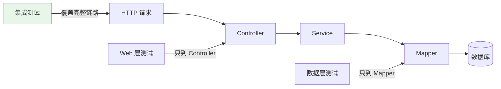

# 端到端集成测试：@SpringBootTest

## 课程目标

- 理解集成测试的定位和与切片测试的区别
- 掌握 @SpringBootTest 的使用方法和配置选项
- 掌握 webEnvironment 的四种模式及其适用场景
- 掌握 TestRestTemplate 和 MockMvc 两种测试方式
- 掌握测试配置管理（@TestConfiguration、@TestPropertySource）
- 能够为图书管理系统编写完整的端到端集成测试


## 回顾与导入

在前面几讲中，我们学习了不同层次的测试：

| 测试类型         | 加载范围 | 数据库             |
| ---------------- | -------- | ------------------ |
| JUnit 5 单元测试 | 无       | 无                 |
| Mockito 单元测试 | 无       | 无                 |
| @WebMvcTest      | Web 层   | 无（Mock Service） |
| @MybatisPlusTest | 数据层   | H2 内存数据库      |

这些测试各有侧重，但都无法验证**完整请求链路**：



**集成测试** 加载完整的 Spring 上下文，验证从 HTTP 请求到数据库的完整流程。

本节课将使用 `@SpringBootTest` 为图书管理系统编写端到端集成测试。


## @SpringBootTest 概述

### 什么是 @SpringBootTest

**@SpringBootTest** 是 Spring Boot 提供的集成测试注解，它加载**完整的 Spring 应用上下文**，包括所有 Bean、配置、数据源等。

```mermaid
flowchart TB
    A[完整上下文<br/>@SpringBootTest] --> B[Controller]
    A --> C[Service]
    A --> D[Mapper]
    A --> E[DataSource]
    A --> F[所有 @Configuration]
    A --> G[所有 @Component]

    style A fill:#e8f5e9
```

### 加载的组件

| 组件                              | 是否加载 |
| --------------------------------- | -------- |
| `@Controller` / `@RestController` | ✅        |
| `@Service`                        | ✅        |
| `@Mapper` / `@Repository`         | ✅        |
| `@Component`                      | ✅        |
| `@Configuration`                  | ✅        |
| `DataSource`                      | ✅        |
| `SqlSessionFactory`               | ✅        |
| 拦截器、过滤器                    | ✅        |

### @SpringBootTest 与切片测试对比

| 对比          | 切片测试           | @SpringBootTest    |
| ------------- | ------------------ | ------------------ |
| **加载范围**  | 只加载特定层       | 完整上下文         |
| **启动速度**  | 快（秒级以内）     | 慢（秒级到十秒级） |
| **依赖 Mock** | 大量使用 @MockBean | 少量或不使用       |
| **验证范围**  | 单层逻辑           | 端到端流程         |
| **适用场景**  | 分层测试           | 集成验证           |

> [!NOTE]
> `@SpringBootTest` 会启动完整的应用上下文，包括内嵌 Web 服务器（可选）。启动速度较慢，但能验证真实的端到端流程。

### webEnvironment 的四种模式

`@SpringBootTest` 通过 `webEnvironment` 属性控制 Web 环境的启动方式：

| 模式           | 说明                           | 是否启动服务器 | 适用场景                       |
| -------------- | ------------------------------ | -------------- | ------------------------------ |
| `MOCK`（默认） | 不启动真实服务器，使用 MockMvc | ❌              | 快速测试 Controller            |
| `RANDOM_PORT`  | 启动真实服务器，随机端口       | ✅              | 端到端测试（TestRestTemplate） |
| `DEFINED_PORT` | 启动真实服务器，使用配置端口   | ✅              | 需要固定端口时                 |
| `NONE`         | 不启动 Web 环境                | ❌              | 测试非 Web 组件                |

```mermaid
flowchart TB
    A[@SpringBootTest] --> B[webEnvironment]
    B --> C[MOCK<br/>默认，不启动服务器]
    B --> D[RANDOM_PORT<br/>随机端口]
    B --> E[DEFINED_PORT<br/>固定端口]
    B --> F[NONE<br/>无 Web 环境]

    style C fill:#e3f2fd
    style D fill:#e8f5e9
```

**使用示例：**

```java
// MOCK 模式（默认）
@SpringBootTest
class MockModeTest {
    @Autowired
    private MockMvc mockMvc;
}

// RANDOM_PORT 模式
@SpringBootTest(webEnvironment = SpringBootTest.WebEnvironment.RANDOM_PORT)
class RandomPortTest {
    @Autowired
    private TestRestTemplate restTemplate;
}

// DEFINED_PORT 模式
@SpringBootTest(webEnvironment = SpringBootTest.WebEnvironment.DEFINED_PORT)
class DefinedPortTest {
    @Autowired
    private TestRestTemplate restTemplate;
}

// NONE 模式
@SpringBootTest(webEnvironment = SpringBootTest.WebEnvironment.NONE)
class NoneModeTest {
    @Autowired
    private BookService bookService;
}
```

> [!NOTE]
> 对于大多数集成测试，推荐使用 `RANDOM_PORT`，避免端口冲突，同时能验证真实的 HTTP 请求链路。


## TestRestTemplate

### 什么是 TestRestTemplate

**TestRestTemplate** 是 Spring Boot 提供的测试用 HTTP 客户端，用于在集成测试中发起真实的 HTTP 请求。


### 与 RestTemplate 的区别

| 对比         | RestTemplate | TestRestTemplate                |
| ------------ | ------------ | ------------------------------- |
| **异常处理** | 抛出异常     | 返回 ResponseEntity（不抛异常） |
| **重定向**   | 自动跟随     | 不跟随（可测试重定向）          |
| **Cookie**   | 不自动管理   | 自动管理                        |
| **使用场景** | 生产代码     | 测试代码                        |

### 核心方法

| 方法                                                 | 说明                           |
| ---------------------------------------------------- | ------------------------------ |
| `getForObject(url, responseType)`                    | GET 请求，返回对象             |
| `getForEntity(url, responseType)`                    | GET 请求，返回 ResponseEntity  |
| `postForObject(url, request, responseType)`          | POST 请求                      |
| `postForEntity(url, request, responseType)`          | POST 请求，返回 ResponseEntity |
| `exchange(url, method, requestEntity, responseType)` | 通用请求                       |
| `delete(url)`                                        | DELETE 请求                    |

### 使用示例

```java
@SpringBootTest(webEnvironment = SpringBootTest.WebEnvironment.RANDOM_PORT)
class BookApiTest {

    @Autowired
    private TestRestTemplate restTemplate;

    @Test
    void testGetBook() {
        // 发起 GET 请求
        ResponseEntity<String> response = restTemplate.getForEntity(
                "/api/books/1", String.class);

        // 断言
        assertThat(response.getStatusCode()).isEqualTo(HttpStatus.OK);
        assertThat(response.getBody()).contains("Spring Boot 实战");
    }
}
```

### 自定义 TestRestTemplate

如果需要进行认证等操作，可以在测试中自定义：

```java
@Autowired
private TestRestTemplate restTemplate;

@Test
void testWithAuth() {
    // 添加认证头
    HttpHeaders headers = new HttpHeaders();
    headers.setBearerAuth("token");

    HttpEntity<Void> request = new HttpEntity<>(headers);
    ResponseEntity<String> response = restTemplate.exchange(
            "/api/books", HttpMethod.GET, request, String.class);

    assertThat(response.getStatusCode()).isEqualTo(HttpStatus.OK);
}
```


## 测试配置管理

### @TestConfiguration

`@TestConfiguration` 用于定义测试专用的配置类，不会被主应用的组件扫描加载。

```java
@TestConfiguration
public class TestConfig {

    @Bean
    public RestTemplate restTemplate() {
        return new RestTemplate();
    }
}
```

**在测试中导入：**

```java
@SpringBootTest
@Import(TestConfig.class)
class BookServiceTest {
    // ...
}
```

### @TestConfiguration vs @Configuration

| 对比               | @Configuration | @TestConfiguration |
| ------------------ | -------------- | ------------------ |
| **是否被组件扫描** | ✅              | ❌                  |
| **使用场景**       | 生产配置       | 测试专用配置       |
| **加载方式**       | 自动扫描       | 需要 @Import       |

> [!NOTE]
> `@TestConfiguration` 定义在测试类内部时，不会被自动扫描。定义在测试类外部时，需要显式 `@Import`。

### @TestPropertySource

`@TestPropertySource` 用于覆盖测试中的配置属性：

```java
@SpringBootTest
@TestPropertySource(properties = {
        "spring.datasource.url=jdbc:h2:mem:testdb",
        "logging.level.com.example=DEBUG"
})
class BookServiceTest {
    // ...
}
```

**使用属性文件：**

```java
@SpringBootTest
@TestPropertySource(locations = "classpath:application-test.yml")
class BookServiceTest {
    // ...
}
```

### 测试配置文件

创建 `src/test/resources/application-test.yml`：

```yaml
spring:
  datasource:
    driver-class-name: org.h2.Driver
    url: jdbc:h2:mem:testdb;DB_CLOSE_DELAY=-1;MODE=PostgreSQL
    username: sa
    password:
  sql:
    init:
      mode: always
      schema-locations: classpath:schema-test.sql

mybatis-plus:
  configuration:
    map-underscore-to-camel-case: true
    log-impl: org.apache.ibatis.logging.stdout.StdOutImpl
  global-config:
    db-config:
      id-type: auto

logging:
  level:
    com.example: DEBUG
```

**在测试中激活：**

```java
@SpringBootTest
@ActiveProfiles("test")
class BookServiceTest {
    // ...
}
```


## 实战：图书管理系统集成测试

### 需求

为图书管理系统编写完整的集成测试，覆盖以下场景：

| 场景     | 说明                                           |
| -------- | ---------------------------------------------- |
| 创建图书 | POST /api/books，验证 200 和返回数据           |
| 查询图书 | GET /api/books/{id}，验证 200 和内容           |
| 更新图书 | PUT /api/books/{id}，验证 200 和更新后内容     |
| 删除图书 | DELETE /api/books/{id}，验证 204               |
| 完整流程 | 创建 → 查询 → 更新 → 查询 → 删除 → 查询（404） |

### 实现步骤

**步骤一：测试配置**

`src/test/resources/application-test.yml`：已完成

**步骤二：测试用 Schema**

`src/test/resources/schema-test.sql`：已完成

**步骤三：完整的集成测试类**

```java
@SpringBootTest(webEnvironment = SpringBootTest.WebEnvironment.RANDOM_PORT)
@DisplayName("图书管理系统集成测试")
class BookIntegrationTest {

    @Autowired
    private TestRestTemplate restTemplate;

    @Autowired
    private BookMapper bookMapper;

    @BeforeEach
    void setUp() {
        bookMapper.delete(null);
    }

    @Test
    @Order(1)
    @DisplayName("创建图书 - POST /api/books")
    void testCreateBook() {
        // Given
        Book newBook = new Book("Spring Boot 实战", "Craig Walls", 79.0, 10, "编程");

        // When
        ResponseEntity<Result> response = restTemplate.postForEntity(
                "/api/books", newBook, Result.class);

        // Then
        assertThat(response.getStatusCode()).isEqualTo(HttpStatus.OK);
        assertThat(response.getBody()).isNotNull();
        assertThat(response.getBody().getCode()).isEqualTo(200);

        // 验证数据库
        List<Book> books = bookMapper.selectList(null);
        assertThat(books.size()).isEqualTo(1);
        assertThat(books.get(0).getTitle()).isEqualTo("Spring Boot 实战");
    }

    @Test
    @Order(2)
    @DisplayName("查询图书 - GET /api/books/{id}")
    void testGetBook() {
        // Given
        Book book = new Book("Java 核心技术", "Cay Horstmann", 89.0, 8, "编程");
        bookMapper.insert(book);

        // When
        ResponseEntity<Result> response = restTemplate.getForEntity(
                "/api/books/" + book.getId(), Result.class);

        // Then
        assertThat(response.getStatusCode()).isEqualTo(HttpStatus.OK);
        assertThat(response.getBody()).isNotNull();

        // 解析 data 字段
        var data = (java.util.Map<?, ?>) response.getBody().getData();
        assertThat(data.get("title")).isEqualTo("Java 核心技术");
        assertThat(data.get("author")).isEqualTo("Cay Horstmann");
    }

    @Test
    @Order(3)
    @DisplayName("查询不存在的图书 - 返回 404")
    void testGetBookNotFound() {
        ResponseEntity<String> response = restTemplate.getForEntity(
                "/api/books/999", String.class);

        assertThat(response.getStatusCode()).isEqualTo(HttpStatus.NOT_FOUND);
    }

    @Test
    @Order(4)
    @DisplayName("更新图书 - PUT /api/books/{id}")
    void testUpdateBook() {
        // Given
        Book book = new Book("测试书", "测试作者", 50.0, 5, "测试");
        bookMapper.insert(book);

        Book updateBook = new Book("测试书（第2版）", "测试作者", 60.0, 10, "测试");

        // When
        HttpEntity<Book> request = new HttpEntity<>(updateBook);
        ResponseEntity<Result> response = restTemplate.exchange(
                "/api/books/" + book.getId(),
                HttpMethod.PUT,
                request,
                Result.class);

        // Then
        assertThat(response.getStatusCode()).isEqualTo(HttpStatus.OK);

        // 验证数据库
        Book updated = bookMapper.selectById(book.getId());
        assertThat(updated.getTitle()).isEqualTo("测试书（第2版）");
        assertThat(updated.getPrice()).isEqualTo(60.0);
    }

    @Test
    @Order(5)
    @DisplayName("删除图书 - DELETE /api/books/{id}")
    void testDeleteBook() {
        // Given
        Book book = new Book("待删除", "作者", 30.0, 3, "测试");
        bookMapper.insert(book);

        // When
        ResponseEntity<Void> response = restTemplate.exchange(
                "/api/books/" + book.getId(),
                HttpMethod.DELETE,
                null,
                Void.class);

        // Then
        assertThat(response.getStatusCode()).isEqualTo(HttpStatus.OK);

        // 验证数据库
        Book deleted = bookMapper.selectById(book.getId());
        assertThat(deleted).isNull();
    }

    @Test
    @Order(6)
    @DisplayName("完整流程：创建 → 查询 → 更新 → 查询 → 删除 → 查询")
    void testFullLifecycle() {
        // 1. 创建
        Book newBook = new Book("完整流程测试", "作者", 100.0, 5, "测试");
        ResponseEntity<Result> createResponse = restTemplate.postForEntity(
                "/api/books", newBook, Result.class);
        assertThat(createResponse.getStatusCode()).isEqualTo(HttpStatus.OK);

        // 从数据库获取 ID
        List<Book> books = bookMapper.selectList(null);
        Long bookId = books.get(0).getId();

        // 2. 查询
        ResponseEntity<Result> getResponse = restTemplate.getForEntity(
                "/api/books/" + bookId, Result.class);
        assertThat(getResponse.getStatusCode()).isEqualTo(HttpStatus.OK);

        // 3. 更新
        Book updateBook = new Book("完整流程测试（更新）", "作者", 150.0, 10, "测试");
        HttpEntity<Book> updateRequest = new HttpEntity<>(updateBook);
        ResponseEntity<Result> updateResponse = restTemplate.exchange(
                "/api/books/" + bookId, HttpMethod.PUT, updateRequest, Result.class);
        assertThat(updateResponse.getStatusCode()).isEqualTo(HttpStatus.OK);

        // 4. 再次查询，验证更新
        Book updated = bookMapper.selectById(bookId);
        assertThat(updated.getTitle()).isEqualTo("完整流程测试（更新）");
        assertThat(updated.getPrice()).isEqualTo(150.0);

        // 5. 删除
        ResponseEntity<Void> deleteResponse = restTemplate.exchange(
                "/api/books/" + bookId, HttpMethod.DELETE, null, Void.class);
        assertThat(deleteResponse.getStatusCode()).isEqualTo(HttpStatus.OK);

        // 6. 查询已删除的图书
        ResponseEntity<String> afterDeleteResponse = restTemplate.getForEntity(
                "/api/books/" + bookId, String.class);
        assertThat(afterDeleteResponse.getStatusCode()).isEqualTo(HttpStatus.NOT_FOUND);
    }

    @Test
    @Order(7)
    @DisplayName("参数校验 - 无效请求体返回 400")
    void testCreateBookWithInvalidBody() {
        // 价格为负数
        Book invalidBook = new Book("测试", "作者", -10.0, 5, "测试");

        ResponseEntity<String> response = restTemplate.postForEntity(
                "/api/books", invalidBook, String.class);

        assertThat(response.getStatusCode()).isEqualTo(HttpStatus.BAD_REQUEST);
        assertThat(bookMapper.selectCount(null)).isEqualTo(0);
    }

    @Test
    @Order(8)
    @DisplayName("查询所有图书 - 返回列表")
    void testGetAllBooks() {
        // Given
        bookMapper.insert(new Book("书1", "作者1", 10.0, 1, "测试"));
        bookMapper.insert(new Book("书2", "作者2", 20.0, 2, "测试"));
        bookMapper.insert(new Book("书3", "作者3", 30.0, 3, "测试"));

        // When
        ResponseEntity<String> response = restTemplate.getForEntity(
                "/api/books", String.class);

        // Then
        assertThat(response.getStatusCode()).isEqualTo(HttpStatus.OK);
        assertThat(response.getBody()).contains("书1");
        assertThat(response.getBody()).contains("书2");
        assertThat(response.getBody()).contains("书3");
    }
}
```

### 运行测试

```bash
mvn test -Dtest=BookIntegrationTest
```

**预期结果：**
```
BookIntegrationTest
  ✓ 创建图书 - POST /api/books
  ✓ 查询图书 - GET /api/books/{id}
  ✓ 查询不存在的图书 - 返回 404
  ✓ 更新图书 - PUT /api/books/{id}
  ✓ 删除图书 - DELETE /api/books/{id}
  ✓ 完整流程：创建 → 查询 → 更新 → 查询 → 删除 → 查询
  ✓ 参数校验 - 无效请求体返回 400
  ✓ 查询所有图书 - 返回列表

测试结果：8 个测试通过
```


## 使用 MockMvc 的集成测试

除了 TestRestTemplate，也可以使用 MockMvc 进行集成测试。

### 配置方式

```java
@SpringBootTest
@AutoConfigureMockMvc
class BookIntegrationWithMockMvcTest {

    @Autowired
    private MockMvc mockMvc;

    @Autowired
    private BookMapper bookMapper;

    @BeforeEach
    void setUp() {
        bookMapper.delete(null);
    }

    @Test
    @DisplayName("创建并查询图书")
    void testCreateAndGet() throws Exception {
        // 创建
        String bookJson = """
                {
                    "title": "Spring Boot 实战",
                    "author": "Craig Walls",
                    "price": 79.0,
                    "stock": 10,
                    "category": "编程"
                }
                """;

        mockMvc.perform(post("/api/books")
                        .contentType(MediaType.APPLICATION_JSON)
                        .content(bookJson))
                .andExpect(status().isOk());

        // 查询
        List<Book> books = bookMapper.selectList(null);
        assertThat(books).hasSize(1);

        mockMvc.perform(get("/api/books/" + books.get(0).getId()))
                .andExpect(status().isOk())
                .andExpect(jsonPath("$.data.title").value("Spring Boot 实战"));
    }
}
```

### TestRestTemplate vs MockMvc

| 对比               | TestRestTemplate | MockMvc          |
| ------------------ | ---------------- | ---------------- |
| **是否启动服务器** | ✅（RANDOM_PORT） | ❌（MOCK）        |
| **请求方式**       | 真实 HTTP 请求   | 模拟请求         |
| **速度**           | 较慢             | 较快             |
| **真实性**         | 高（完整链路）   | 中（无网络层）   |
| **事务回滚**       | 不支持           | 支持             |
| **适用场景**       | 端到端测试       | 集成测试（快速） |


## 分层测试策略

### 测试金字塔在 Spring Boot 中的实践

```mermaid
flowchart TB
    A[E2E 测试<br/>@SpringBootTest + RANDOM_PORT<br/>少量] --> B[集成测试<br/>@SpringBootTest + MockMvc<br/>适中]
    B --> C[切片测试<br/>@WebMvcTest / @MybatisPlusTest<br/>较多]
    C --> D[单元测试<br/>JUnit 5 + Mockito<br/>大量]

    style A fill:#ffcdd2
    style B fill:#fff3e0
    style C fill:#e3f2fd
    style D fill:#e8f5e9
```

### 推荐的测试比例

| 测试类型 | 比例 | 数量示例（100 个测试） |
| -------- | ---- | ---------------------- |
| 单元测试 | 70%  | 70 个                  |
| 切片测试 | 20%  | 20 个                  |
| 集成测试 | 8%   | 8 个                   |
| E2E 测试 | 2%   | 2 个                   |

### 各层测试的职责

| 测试类型     | 验证内容                     |
| ------------ | ---------------------------- |
| **单元测试** | 单个类的逻辑正确性           |
| **切片测试** | 单层的功能（Web 层、数据层） |
| **集成测试** | 多层协作是否正确             |
| **E2E 测试** | 完整业务流程是否正确         |


## 注意事项

### 1. @SpringBootTest 启动慢

`@SpringBootTest` 会加载完整上下文，启动较慢。优化建议：

- **减少集成测试数量**：只保留关键流程的集成测试
- **复用上下文**：相同配置的测试类会共享上下文（Spring TestContext 缓存）
- **使用切片测试**：能覆盖的场景优先使用切片测试

### 2. webEnvironment 的选择

| 场景               | 推荐                             |
| ------------------ | -------------------------------- |
| 测试 Controller 层 | `MOCK`（默认）+ MockMvc          |
| 测试完整 HTTP 链路 | `RANDOM_PORT` + TestRestTemplate |
| 需要固定端口       | `DEFINED_PORT`                   |
| 非 Web 组件        | `NONE`                           |

### 3. @Transactional 与 TestRestTemplate 的冲突

```java
// ❌ 错误：@Transactional 对 TestRestTemplate 无效
@SpringBootTest(webEnvironment = RANDOM_PORT)
@Transactional
class BadTest {
    @Autowired
    private TestRestTemplate restTemplate;

    @Test
    void test() {
        // HTTP 请求在独立线程执行，不受测试事务控制
        // 数据不会回滚
    }
}

// ✅ 正确：手动清理
@SpringBootTest(webEnvironment = RANDOM_PORT)
class GoodTest {
    @Autowired
    private BookMapper bookMapper;

    @BeforeEach
    void setUp() {
        bookMapper.delete(null);
    }
}
```

### 4. 数据库隔离

如果多个测试类共享同一个数据库：

- **推荐**：每个测试在 `@BeforeEach` 中清理数据
- **可选**：使用 `@Transactional`（仅 MockMvc 模式下有效）
- **可选**：每个测试使用独立的 H2 数据库

### 5. 测试数据准备

集成测试通常需要准备测试数据，推荐方式：

| 方式                   | 说明                                |
| ---------------------- | ----------------------------------- |
| `@BeforeEach` + Mapper | 通过代码插入数据                    |
| `@Sql`                 | 执行 SQL 脚本                       |
| 数据初始化脚本         | `schema-test.sql` + `data-test.sql` |

### 6. 测试的独立性

```java
// ❌ 错误：测试依赖前一个测试的数据
@Test
void test1() {  // 创建数据 }

@Test
void test2() {  // 依赖 test1 创建的数据 }

// ✅ 正确：每个测试独立准备数据
@BeforeEach
void setUp() {
    bookMapper.delete(null);
    // 插入本测试需要的数据
}
```

### 7. 使用 @TestMethodOrder 控制执行顺序

如果确实需要按顺序执行（如完整流程测试），可以使用：

```java
@SpringBootTest
@TestMethodOrder(MethodOrderer.OrderAnnotation.class)
class OrderedTest {

    @Test
    @Order(1)
    void step1() { ... }

    @Test
    @Order(2)
    void step2() { ... }
}
```

> [!CAUTION]
> 测试之间应该尽量独立，只有在测试完整生命周期时才推荐使用 `@Order`。


## 小结

本节课我们学习了：

1. **@SpringBootTest 概述**：
   - 加载完整的 Spring 上下文
   - 四种 webEnvironment 模式（MOCK、RANDOM_PORT、DEFINED_PORT、NONE）
   - 与切片测试的对比
2. **TestRestTemplate**：
   - 发起真实 HTTP 请求
   - 与 RestTemplate 的区别
   - 测试完整请求链路
3. **测试配置管理**：
   - `@TestConfiguration` 定义测试专用配置
   - `@TestPropertySource` 覆盖配置
   - `application-test.yml` 配置文件
5. **实战应用**：为图书管理系统编写完整的集成测试
6. **分层测试策略**：测试金字塔在 Spring Boot 中的实践


## 作业

### 作业一：代码阅读——集成测试分析

阅读以下测试代码，回答问题。

```java
@SpringBootTest(webEnvironment = SpringBootTest.WebEnvironment.RANDOM_PORT)
@TestMethodOrder(MethodOrderer.OrderAnnotation.class)
class UserIntegrationTest {

    @Autowired
    private TestRestTemplate restTemplate;

    @Autowired
    private UserMapper userMapper;

    @BeforeEach
    void setUp() {
        userMapper.delete(null);
    }

    @Test
    @Order(1)
    void testCreateUser() {
        User user = new User("Alice", "alice@example.com");
        ResponseEntity<String> response = restTemplate.postForEntity(
                "/api/users", user, String.class);

        assertThat(response.getStatusCode()).isEqualTo(HttpStatus.CREATED);
        assertThat(userMapper.selectCount(null)).isEqualTo(1);
    }

    @Test
    @Order(2)
    void testGetUser() {
        User user = new User("Bob", "bob@example.com");
        userMapper.insert(user);

        ResponseEntity<String> response = restTemplate.getForEntity(
                "/api/users/" + user.getId(), String.class);

        assertThat(response.getStatusCode()).isEqualTo(HttpStatus.OK);
    }
}
```

**问题：**
1. `webEnvironment = RANDOM_PORT` 表示什么？与默认模式有什么区别？
2. `@BeforeEach` 中调用 `userMapper.delete(null)` 的作用是什么？
3. 测试类为什么没有 `@Transactional` 注解？
4. `@TestMethodOrder(MethodOrderer.OrderAnnotation.class)` 和 `@Order` 的作用是什么？
5. `testCreateUser` 和 `testGetUser` 之间数据是否共享？

---

### 作业二：为图书管理系统编写完整集成测试

在图书管理系统中完成以下任务：

1. 创建 `BookIntegrationTest`，使用 `@SpringBootTest(webEnvironment = RANDOM_PORT)`。
2. 在 `@BeforeEach` 中清理数据。
3. 编写以下测试：
   - 创建图书（POST /api/books），验证 200 和数据库记录
   - 查询单本图书（GET /api/books/{id}），验证 200 和内容
   - 查询所有图书（GET /api/books），验证列表长度
   - 更新图书（PUT /api/books/{id}），验证更新后内容
   - 删除图书（DELETE /api/books/{id}），验证 200 和数据库记录删除
   - 查询不存在的图书，验证 404
   - 创建无效图书（价格为负），验证 400

4. 使用 `TestRestTemplate` 发起请求。
5. 使用 `AssertJ` 进行断言。
