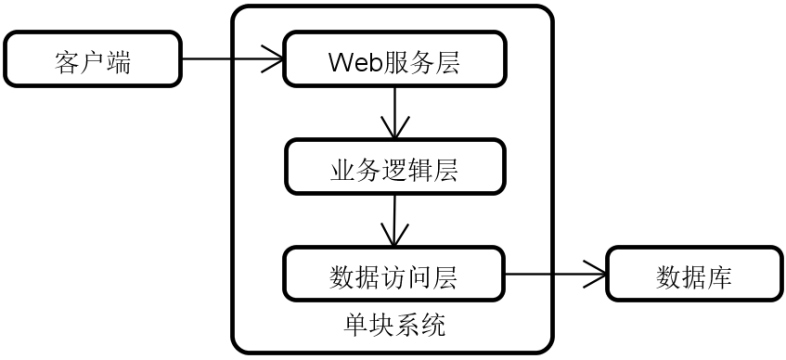
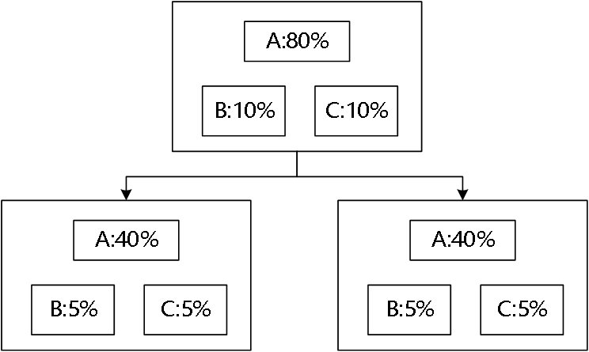
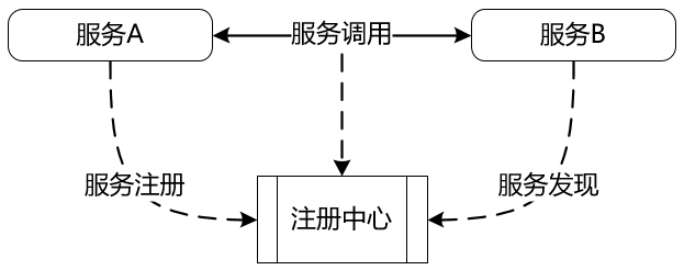
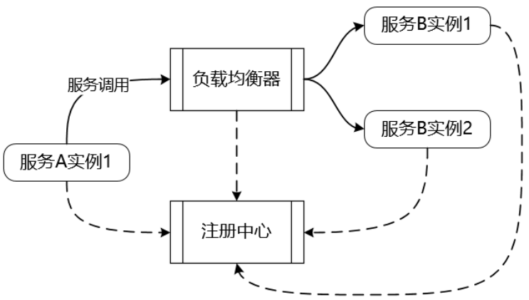
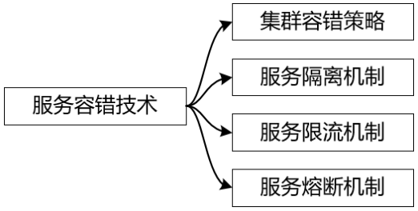
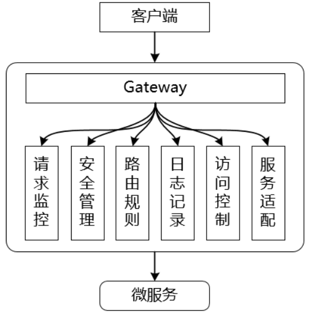
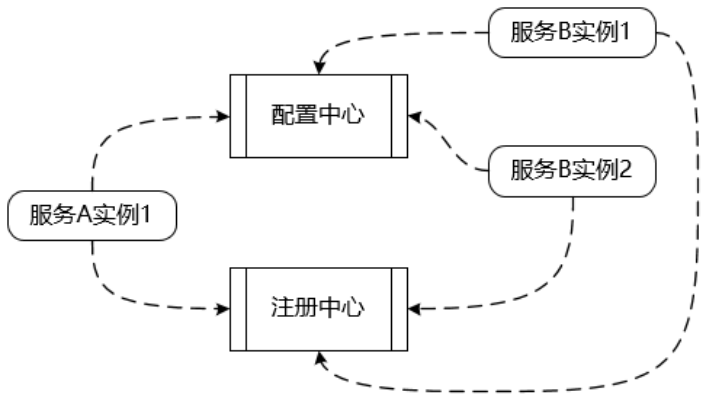
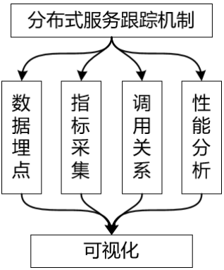

# 微服务架构与案例系统初始化

## 课程目标

- 理解从单体系统到微服务架构的演进历程
- 掌握微服务架构的核心特性与技术组件
- 了解 Spring Cloud Alibaba 技术栈全景
- 完成图书管理系统四个模块的工程骨架搭建


## 从单体系统到微服务架构

### 单体系统存在的问题

在软件技术发展的很长一段时间内，软件系统都表现为一种**单体系统**（也叫单块系统）。所谓单体系统，就是把一个系统所涉及的各个组件都打包成一个一体化结构并进行部署和运行。下图展示了一个典型的单体系统，应用服务器上同时运行着 Web 服务层、业务逻辑层和数据访问层组件，这些组件作为一个整体进行统一的开发、部署和维护。



单体架构简单而容易实现，但随着业务扩张、结构变化和用户量增加，其优势逐渐无法适应互联网时代的快速发展，面临越来越多的挑战：

**1. 可扩展性差**

可扩展性（Extensibility）是指系统在面对业务变更时的灵活性。单体系统对任何一处业务的修改都需要重新构建整个系统并发布。内部没有根据业务结构进行合理拆分，是导致可扩展性低下的主要原因。

**2. 可伸缩性差**

可伸缩性（Scalability）是指当系统出现性能瓶颈时，通过添加硬件设备来解决问题的难易程度。单体系统的所有程序代码都运行在同一个进程中，内存密集型和 CPU 密集型并存，要求所有服务器都必须有足够的内存和强劲的 CPU。以下图为例，组件 A 的负载达到 80%，需要扩容，但组件 B 和 C 的负载不足 20%，由于打包在同一个运行包中，扩容会导致其他组件利用率更低，造成资源浪费。同时，对于需要保持会话（Session）数据的需求，扩容后如何保持各服务器之间数据一致性也存在较大实现难度。



**3. 代码腐化与缺陷修复成本高**

在单体系统中，由于缺乏合理的业务和技术实现边界，随着功能增多，当出现缺陷时，可能引起缺陷的原因组合较多，导致分析、定位、修复缺陷的成本增高。同时，代码结构日益复杂，修复一个缺陷可能引入其他缺陷，在不具备完善持续集成和持续交付能力的情况下，容易陷入“越修越多”的恶性循环。


### 微服务架构的特性

软件工程大师 Martin Fowler 在《Microservices》一文中提到，微服务架构具有以下核心特性：

**1. 服务组件化**

组件（Component）是一种可独立替换和升级的软件单元。服务是一种进程外组件，服务之间利用 HTTP 协议完成交互。服务组件化的主要目的是**服务可以独立部署**。将应用程序拆分成多个服务后，通常只需要重新部署那个改变的服务，而不需要重新部署整个应用。

**2. 按业务能力组织服务**

微服务架构倾向于围绕业务功能来组织服务，而不是围绕技术能力。团队是跨职能的特征团队（Feature Team），包含用户体验、项目管理和技术研发等所有岗位和技能。每个服务都围绕业务进行构建，并能够独立部署到生产环境。

**3. 去中心化治理**

微服务团队更喜欢不同的标准。在构建具体服务时，可以根据业务上下文选择合适的语言和工具。微服务架构也崇尚对数据进行分散管理，让每个服务管理自己的数据库。

**4. 基础设施自动化**

使用微服务架构的团队需要更广泛的依赖基础设施自动化技术，包括持续集成和持续交付等。

此外，微服务架构还需要考虑网络传输的三态性、异构性、数据一致性和服务容错性等分布式系统问题。


### 微服务架构核心组件

微服务架构的核心技术组件包括以下六个方面：

**1. 服务治理**

服务治理是最关键的技术组件，因为各个微服务需要通过服务治理实现自动化的注册和发现。当服务数量达到一定量级时，需要一个独立的媒介来管理服务的实例，这个媒介就是**服务注册中心**。下图展示了服务注册中心的作用。



服务注册中心是保存服务调用所需路由信息的存储仓库，也是服务提供者和消费者进行交互的媒介。主流的微服务框架都基于 Zookeeper、Nacos 等分布式协调工具构建了服务注册中心。

**2. 服务路由**

当客户端请求到达多服务集群环境时，如何确定由某一台服务器对请求做出响应就是服务路由问题。负载均衡是最常见的一种路由方案，常见的客户端/服务器端负载均衡技术都可以完成服务路由。下图展示了注册中心和负载均衡之间的交互关系。



此外，还可以采用路由规则（如白名单或黑名单）实现精细化的路由管理。

**3. 服务容错**

服务容错需要考虑服务自身失败以及依赖其他服务导致的失败。除了超时、重试和异步解耦外，还需要考虑针对各种场景的容错机制。下图展示了服务容错的常见实现策略。



包括集群容错策略、服务隔离机制、服务限流机制和服务熔断机制等。Spring Cloud Alibaba 内置了专用的服务可用性框架 Sentinel。

**4. 服务网关**

服务网关（API 网关）封装了系统内部架构，为每个客户端提供一个定制的 API。在微服务架构中，所有客户端和消费端都通过统一的网关接入微服务，在网关层处理所有非业务功能。下图展示了服务网关的常见功能。



服务网关可以完成身份验证、监控、缓存、请求管理、静态响应处理等功能，并可以制定灵活的路由策略。Spring Cloud Gateway 是代表性的实现框架。

**5. 服务配置**

在微服务架构中，由于服务数量和配置信息的分散性，一般需要引入配置中心。配置中心管理的是配置信息而不是服务实例信息。下图展示了配置中心与注册中心之间的交互关系。



配置中心通常需要依赖分布式协调机制，确保配置信息在分布式环境中的各个服务中得到实时、一致的管理。Nacos 是 Spring Cloud Alibaba 提供的配置中心实现。

**6. 服务跟踪**

当服务数量达到一定量级时，需要构建分布式服务跟踪机制，解决两个核心问题：如何管理服务之间的调用关系，以及如何跟踪业务流的处理过程和结果。下图展示了分布式服务跟踪相关的核心功能。



服务跟踪需要完成调用链数据的生成、采集、存储及查询，并对调用链数据进行运算和可视化管理。Spring Cloud 提供了 Spring Cloud Sleuth 与 Zipkin 的集成方案，本课程采用 Micrometer Tracing + OpenTelemetry。

### Spring Cloud Alibaba 技术栈全景

Spring Cloud Alibaba 提供了一站式微服务解决方案，本课程将涵盖以下组件：

| 功能       | 组件                               |
| ---------- | ---------------------------------- |
| 注册中心   | Nacos                              |
| 配置中心   | Nacos Config                       |
| 远程调用   | OpenFeign                          |
| 负载均衡   | Spring Cloud LoadBalancer          |
| 服务网关   | Spring Cloud Gateway               |
| 消息通信   | RocketMQ                           |
| 分布式事务 | Seata                              |
| 服务保障   | Sentinel                           |
| 可观测性   | Micrometer Tracing + OpenTelemetry |


## 图书管理系统需求概述

### 系统功能需求

- 用户管理：注册、登录、个人信息
- 商品管理：图书商品的增删改查、库存管理、分类检索
- 订单管理：创建订单、查询订单、取消订单

### 微服务拆分策略

按业务能力拆分：

| 模块         | 说明                                   |
| ------------ | -------------------------------------- |
| book-common  | 公共模块（工具类、统一响应、异常体系） |
| book-user    | 用户服务                               |
| book-product | 商品服务（图书商品）                   |
| book-order   | 订单服务                               |

### 工程整体结构

```
book-microservice/
├── book-common/          # 公共模块
├── book-user/            # 用户服务
├── book-product/         # 商品服务
├── book-order/           # 订单服务
└── pom.xml               # 父POM（版本管理 + 模块聚合）
```


## 多模块工程搭建实战

### 步骤一：创建父工程

基于Maven创建代码工程：

- Group：`com.example`
- Artifact：`book-microservice`
- Packaging：`pom`
- Java：17

### 步骤二：创建子模块

在父工程根目录下，创建四个子模块：

| 模块         | 类型             | 说明                     |
| ------------ | ---------------- | ------------------------ |
| book-common  | Maven 模块       | 公共模块，被其他模块依赖 |
| book-user    | Spring Boot 模块 | 用户服务                 |
| book-product | Spring Boot 模块 | 商品服务（图书商品）     |
| book-order   | Spring Boot 模块 | 订单服务                 |

### 步骤三：配置父 POM 的基础信息

本节课的父 POM 只做**基础配置**：定义项目坐标、声明子模块、统一 Java 版本、配置编译插件。**版本管理（BOM 导入）将在下一节课专门讲解**。

```xml
<?xml version="1.0" encoding="UTF-8"?>
<project xmlns="http://maven.apache.org/POM/4.0.0"
         xmlns:xsi="http://www.w3.org/2001/XMLSchema-instance"
         xsi:schemaLocation="http://maven.apache.org/POM/4.0.0
         http://maven.apache.org/xsd/maven-4.0.0.xsd">
    <modelVersion>4.0.0</modelVersion>

    <groupId>com.example</groupId>
    <artifactId>book-microservice</artifactId>
    <version>1.0.0-SNAPSHOT</version>
    <packaging>pom</packaging>

    <name>book-microservice</name>
    <description>图书管理系统微服务架构</description>

    <!-- 基础属性配置 -->
    <properties>
        <java.version>17</java.version>
        <maven.compiler.source>17</maven.compiler.source>
        <maven.compiler.target>17</maven.compiler.target>
        <project.build.sourceEncoding>UTF-8</project.build.sourceEncoding>
    </properties>

    <!-- 子模块声明 -->
    <modules>
        <module>book-common</module>
        <module>book-user</module>
        <module>book-product</module>
        <module>book-order</module>
    </modules>

    <!-- 基础构建配置 -->
    <build>
        <pluginManagement>
            <plugins>
                <plugin>
                    <groupId>org.apache.maven.plugins</groupId>
                    <artifactId>maven-compiler-plugin</artifactId>
                    <version>3.13.0</version>
                    <configuration>
                        <source>${java.version}</source>
                        <target>${java.version}</target>
                        <encoding>UTF-8</encoding>
                    </configuration>
                </plugin>
            </plugins>
        </pluginManagement>
    </build>
</project>
```

### 步骤四：配置子模块 POM

**book-common（公共模块）：**

```xml
<?xml version="1.0" encoding="UTF-8"?>
<project xmlns="http://maven.apache.org/POM/4.0.0">
    <modelVersion>4.0.0</modelVersion>

    <parent>
        <groupId>com.example</groupId>
        <artifactId>book-microservice</artifactId>
        <version>1.0.0-SNAPSHOT</version>
    </parent>

    <artifactId>book-common</artifactId>
    <packaging>jar</packaging>
    <name>book-common</name>
    <description>公共模块：工具类、统一响应、异常体系</description>
</project>
```

**book-product（商品服务）：**

```xml
<?xml version="1.0" encoding="UTF-8"?>
<project xmlns="http://maven.apache.org/POM/4.0.0">
    <modelVersion>4.0.0</modelVersion>

    <parent>
        <groupId>com.example</groupId>
        <artifactId>book-microservice</artifactId>
        <version>1.0.0-SNAPSHOT</version>
    </parent>

    <artifactId>book-product</artifactId>
    <packaging>jar</packaging>
    <name>book-product</name>
    <description>商品服务（图书商品）</description>

    <dependencies>
        <!-- 内部模块依赖 -->
        <dependency>
            <groupId>com.example</groupId>
            <artifactId>book-common</artifactId>
            <version>${project.version}</version>
        </dependency>
    </dependencies>
</project>
```

> **说明：** 本节课子模块的 POM 只声明内部模块依赖。Spring Web、MyBatis-Plus 等外部依赖将在第后续节导入 BOM 后统一引入。

**book-user 和 book-order 的 POM 结构与 book-product 类似**，只需修改 `artifactId` 和 `description`。

### 步骤五：验证工程骨架

在父工程根目录执行：

```bash
mvn clean compile
```

**预期输出：**

```
[INFO] Reactor Summary for book-microservice 1.0.0-SNAPSHOT:
[INFO]
[INFO] book-microservice .................................. SUCCESS
[INFO] book-common ........................................ SUCCESS
[INFO] book-user .......................................... SUCCESS
[INFO] book-product ....................................... SUCCESS
[INFO] book-order ......................................... SUCCESS
[INFO]
[INFO] BUILD SUCCESS
```

### 步骤六：各模块目录结构

创建各模块的基础包结构：

```
book-product/
└── src/main/java/com/example/product/
    ├── BookProductApplication.java
    ├── controller/
    ├── service/
    ├── mapper/
    ├── model/
    └── config/
```

**入口类示例（BookProductApplication）：**

```java
package com.example.product;

public class BookProductApplication {
    public static void main(String[] args) {
        System.out.println("Hello world!");
    }
}
```


## 注意事项

1. **父模块 packaging 必须为 pom**：否则无法声明子模块。
2. **子模块版本继承**：子模块继承父 POM 的版本，无需单独声明 `<version>`。
3. **内部模块依赖**：`book-common` 依赖必须写 `${project.version}`。
4. **本节课不导入 BOM**：本节课只完成工程骨架搭建。
5. **JDK 版本**：Spring Cloud Alibaba 2025.0.0.0 要求 JDK 17+。
6. **模块命名规范**：公共模块使用 `-common` 后缀，服务模块使用业务名称。


## 小结

本节课我们学习了：

1. **单体系统的问题**：可扩展性差、可伸缩性差、代码腐化与缺陷修复成本高。

2. **微服务架构的特性**：服务组件化、按业务能力组织服务、去中心化治理、基础设施自动化。

4. **微服务架构核心组件**：服务治理、服务路由、服务容错、服务网关、服务配置、服务跟踪。

5. **Spring Cloud Alibaba 技术栈**：Nacos、OpenFeign、LoadBalancer、Gateway、RocketMQ、Seata、Sentinel、Micrometer Tracing + OpenTelemetry。

6. **多模块工程搭建**：使用 Spring Initializr 创建父工程，配置父 POM 基础信息和子模块 POM，验证编译成功。

   

## 作业

### 作业一：工程搭建验证

1. 参照课程内容，使用 Spring Initializr 创建多模块 Maven 工程。
3. 创建 book-common、book-user、book-product、book-order 四个子模块。
4. 在父工程根目录执行 `mvn clean compile`，截图编译成功的输出。

### 作业二：模块依赖关系分析

1. 分析当前工程的模块依赖关系，画出依赖图。
2. 回答以下问题：
   - 哪个模块被其他模块依赖？
   - 如果 book-order 需要调用 book-product 的接口，应该采用什么方式？（提示：不能直接依赖，需要通过远程调用）
   - book-common 应该包含哪些内容？不应该包含哪些内容？

### 作业三：工程结构优化

1. 思考：如果未来需要引入网关模块，应该在父 POM 中添加什么？
2. 尝试创建 `book-gateway` 模块（暂不实现业务逻辑，仅验证模块创建成功）。
3. 讨论：为什么要把公共模块独立出来？如果不用公共模块，有什么问题？
