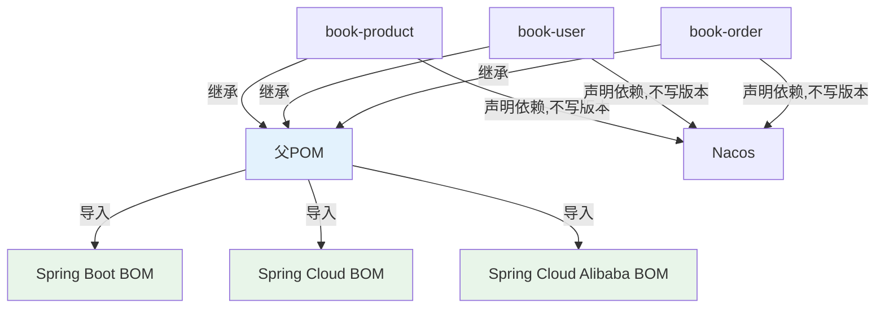

# Spring Cloud Alibaba技术栈集成

## 课程目标

- 理解 BOM（Bill of Materials）在微服务多模块项目中的作用
- 掌握 Spring Cloud Alibaba 版本对应关系与选择原则
- 掌握在父 POM 中导入 Spring Boot、Spring Cloud、Spring Cloud Alibaba 三大 BOM
- 掌握子模块依赖声明的规范写法
- 掌握使用 `mvn dependency:tree` 验证依赖版本


## 回顾与导入

在前面的课程中，我们完成了多模块工程骨架搭建，但父 POM 尚未导入任何 BOM。此时子模块声明外部依赖时需要写版本号，存在以下问题：

| 问题           | 说明                                               |
| -------------- | -------------------------------------------------- |
| **版本冲突**   | 不同模块使用不同版本，导致运行时 NoSuchMethodError |
| **升级困难**   | 升级某个组件需要修改所有模块                       |
| **遗漏依赖**   | 新模块容易忘记声明某些依赖的版本                   |
| **兼容性风险** | 手动选择版本可能不兼容                             |

本节课将引入 Spring Cloud Alibaba 技术栈，通过 BOM 统一管理所有依赖版本。


## 为什么需要 BOM

**BOM（Bill of Materials）** 是 Maven 提供的依赖管理机制。通过 `<dependencyManagement>` 导入 BOM，可以统一管理所有相关组件的版本，子模块无需指定版本号。



| 好处         | 说明                             |
| ------------ | -------------------------------- |
| **版本一致** | 所有子模块使用同一版本，避免冲突 |
| **简化配置** | 子模块无需写版本号               |
| **升级方便** | 只需修改父 POM 的版本变量        |
| **兼容保证** | BOM 内部已解决组件之间的兼容性   |


## 版本对应关系

Spring Cloud Alibaba 的版本命名与 Spring Cloud 和 Spring Boot 有严格的对应关系。选择正确的版本组合是项目成功的第一步。

### 版本对应表：

| Spring Cloud Alibaba | Spring Cloud | Spring Boot | Sentinel  | Nacos     | RocketMQ  | Seata     |
| -------------------- | ------------ | ----------- | --------- | --------- | --------- | --------- |
| 2025.1.0.0           | 2025.1.0     | 4.0.0       | 1.8.9     | 3.1.1     | 5.3.1     | 2.5.0     |
| **2025.0.0.0**       | **2025.0.0** | **3.5.X**   | **1.8.9** | **3.0.3** | **5.3.1** | **2.5.0** |

> **本课程选择：** Spring Cloud Alibaba 2025.0.0.0 + Spring Cloud 2025.0.0 + Spring Boot 3.5.X。该组合适配 JDK 17+，是目前稳定成熟的发布版本。

### 版本选择原则

| 原则                     | 说明                                |
| ------------------------ | ----------------------------------- |
| **优先选择 GA 版本**     | 避免使用里程碑（M）或候选（RC）版本 |
| **严格遵循官方对应关系** | 不要跨版本混用                      |
| **JDK 版本匹配**         | Spring Boot 3.x 要求 JDK 17+        |
| **统一全项目版本**       | 所有模块使用相同的 BOM 版本         |
| **使用广泛度**           | 使用企业当下使用最广泛的版本        |


## 在父 POM 中导入三大 BOM

### 完整父 POM 配置

```xml
<?xml version="1.0" encoding="UTF-8"?>
<project xmlns="http://maven.apache.org/POM/4.0.0"
         xmlns:xsi="http://www.w3.org/2001/XMLSchema-instance"
         xsi:schemaLocation="http://maven.apache.org/POM/4.0.0
         http://maven.apache.org/xsd/maven-4.0.0.xsd">
    <modelVersion>4.0.0</modelVersion>

    <groupId>com.example</groupId>
    <artifactId>book-microservice</artifactId>
    <version>1.0.0-SNAPSHOT</version>
    <packaging>pom</packaging>

    <name>book-microservice</name>
    <description>图书管理系统微服务架构</description>

    <!-- ==================== 版本统一管理 ==================== -->
    <properties>
        <java.version>17</java.version>
        <maven.compiler.source>17</maven.compiler.source>
        <maven.compiler.target>17</maven.compiler.target>
        <project.build.sourceEncoding>UTF-8</project.build.sourceEncoding>

        <!-- 三大核心版本 -->
        <spring-boot.version>3.5.16</spring-boot.version>
        <spring-cloud.version>2025.0.0</spring-cloud.version>
        <spring-cloud-alibaba.version>2025.0.0.0</spring-cloud-alibaba.version>

        <!-- 工具版本 -->
        <mybatis-plus.version>3.5.17</mybatis-plus.version>
        <hutool.version>5.8.28</hutool.version>
    </properties>

    <!-- ==================== 子模块声明 ==================== -->
    <modules>
        <module>book-common</module>
        <module>book-user</module>
        <module>book-product</module>
        <module>book-order</module>
    </modules>

    <!-- ==================== 依赖版本管理 ==================== -->
    <dependencyManagement>
        <dependencies>
            <!-- Spring Boot BOM -->
            <dependency>
                <groupId>org.springframework.boot</groupId>
                <artifactId>spring-boot-dependencies</artifactId>
                <version>${spring-boot.version}</version>
                <type>pom</type>
                <scope>import</scope>
            </dependency>

            <!-- Spring Cloud BOM -->
            <dependency>
                <groupId>org.springframework.cloud</groupId>
                <artifactId>spring-cloud-dependencies</artifactId>
                <version>${spring-cloud.version}</version>
                <type>pom</type>
                <scope>import</scope>
            </dependency>

            <!-- Spring Cloud Alibaba BOM -->
            <dependency>
                <groupId>com.alibaba.cloud</groupId>
                <artifactId>spring-cloud-alibaba-dependencies</artifactId>
                <version>${spring-cloud-alibaba.version}</version>
                <type>pom</type>
                <scope>import</scope>
            </dependency>

            <!-- MyBatis-Plus -->
            <dependency>
                <groupId>com.baomidou</groupId>
                <artifactId>mybatis-plus-spring-boot3-starter</artifactId>
                <version>${mybatis-plus.version}</version>
            </dependency>

            <!-- Hutool 工具类 -->
            <dependency>
                <groupId>cn.hutool</groupId>
                <artifactId>hutool-all</artifactId>
                <version>${hutool.version}</version>
            </dependency>
        </dependencies>
    </dependencyManagement>

    <!-- ==================== 插件管理 ==================== -->
    <build>
        <pluginManagement>
            <plugins>
                <plugin>
                    <groupId>org.springframework.boot</groupId>
                    <artifactId>spring-boot-maven-plugin</artifactId>
                    <version>${spring-boot.version}</version>
                </plugin>
                <plugin>
                    <groupId>org.apache.maven.plugins</groupId>
                    <artifactId>maven-compiler-plugin</artifactId>
                    <version>3.13.0</version>
                    <configuration>
                        <source>${java.version}</source>
                        <target>${java.version}</target>
                        <encoding>UTF-8</encoding>
                    </configuration>
                </plugin>
            </plugins>
        </pluginManagement>
    </build>
</project>
```

### 关键配置说明

| 配置                          | 说明                                                         |
| ----------------------------- | ------------------------------------------------------------ |
| `<scope>import</scope>`       | 必须加，否则 BOM 不生效                                      |
| `<type>pom</type>`            | 必须加，BOM 是 pom 类型                                      |
| 三个 BOM 的顺序               | 后导入的会覆盖先导入的同名依赖，Spring Cloud Alibaba 应放在最后 |
| `<properties>` 中定义版本变量 | 便于统一升级                                                 |


## 子模块依赖声明

本节将为三个服务预置后续课程所需的全部 Starter 依赖。此时只声明依赖，不写配置，后续课程中逐个启用。

### book-common 的完整依赖

```xml
<dependencies>
    <!-- Spring Web（提供统一响应和异常处理所需的注解） -->
    <dependency>
        <groupId>org.springframework.boot</groupId>
        <artifactId>spring-boot-starter-web</artifactId>
        <scope>provided</scope>
    </dependency>

    <!-- 参数校验 -->
    <dependency>
        <groupId>org.springframework.boot</groupId>
        <artifactId>spring-boot-starter-validation</artifactId>
        <scope>provided</scope>
    </dependency>

    <!-- Lombok -->
    <dependency>
        <groupId>org.projectlombok</groupId>
        <artifactId>lombok</artifactId>
        <scope>provided</scope>
    </dependency>

    <!-- Hutool 工具类 -->
    <dependency>
        <groupId>cn.hutool</groupId>
        <artifactId>hutool-all</artifactId>
    </dependency>
</dependencies>
```

> **说明：** `book-common` 中的 Spring Web 依赖使用 `provided` 范围，避免传递到不需要 Web 的模块。

### book-product / book-user / book-order 的完整依赖

三个服务的依赖结构相同，以 book-product 为例：

```xml
<dependencies>
    <!-- ==================== 内部模块 ==================== -->
    <dependency>
        <groupId>com.example</groupId>
        <artifactId>book-common</artifactId>
        <version>${project.version}</version>
    </dependency>

    <!-- ==================== Spring Boot 基础 ==================== -->
    <dependency>
        <groupId>org.springframework.boot</groupId>
        <artifactId>spring-boot-starter-web</artifactId>
    </dependency>
    <dependency>
        <groupId>org.springframework.boot</groupId>
        <artifactId>spring-boot-starter-validation</artifactId>
    </dependency>
    <dependency>
        <groupId>org.springframework.boot</groupId>
        <artifactId>spring-boot-starter-actuator</artifactId>
    </dependency>

    <!-- ==================== 数据访问 ==================== -->
    <dependency>
        <groupId>com.baomidou</groupId>
        <artifactId>mybatis-plus-spring-boot3-starter</artifactId>
    </dependency>
    <dependency>
        <groupId>org.postgresql</groupId>
        <artifactId>postgresql</artifactId>
        <scope>runtime</scope>
    </dependency>

    <!-- ==================== 服务注册发现 ==================== -->
    <dependency>
        <groupId>com.alibaba.cloud</groupId>
        <artifactId>spring-cloud-starter-alibaba-nacos-discovery</artifactId>
    </dependency>

    <!-- ==================== 配置中心 ==================== -->
    <dependency>
        <groupId>com.alibaba.cloud</groupId>
        <artifactId>spring-cloud-starter-alibaba-nacos-config</artifactId>
    </dependency>

    <!-- ==================== 远程调用 ==================== -->
    <dependency>
        <groupId>org.springframework.cloud</groupId>
        <artifactId>spring-cloud-starter-openfeign</artifactId>
    </dependency>

    <!-- ==================== 负载均衡 ==================== -->
    <dependency>
        <groupId>org.springframework.cloud</groupId>
        <artifactId>spring-cloud-starter-loadbalancer</artifactId>
    </dependency>

    <!-- ==================== 服务保障 ==================== -->
    <dependency>
        <groupId>com.alibaba.cloud</groupId>
        <artifactId>spring-cloud-starter-alibaba-sentinel</artifactId>
    </dependency>

    <!-- ==================== 可观测性 ==================== -->
    <dependency>
        <groupId>io.micrometer</groupId>
        <artifactId>micrometer-tracing-bridge-brave</artifactId>
    </dependency>
    <dependency>
        <groupId>io.zipkin.reporter2</groupId>
        <artifactId>zipkin-reporter-brave</artifactId>
    </dependency>

    <!-- ==================== 工具 ==================== -->
    <dependency>
        <groupId>org.projectlombok</groupId>
        <artifactId>lombok</artifactId>
        <scope>provided</scope>
    </dependency>

    <!-- ==================== 测试 ==================== -->
    <dependency>
        <groupId>org.springframework.boot</groupId>
        <artifactId>spring-boot-starter-test</artifactId>
        <scope>test</scope>
    </dependency>
</dependencies>
```

> **注意：**当添加Spring Cloud Alibaba各个微服务组件依赖包时，需要添加对应的配置才能启动应用程序，所以在现阶段我们把微服务组件相关依赖都先去掉，后续使用时再逐个添加。

### 规则总结

| 依赖类型                      | 是否写版本号            | 示例                                           |
| ----------------------------- | ----------------------- | ---------------------------------------------- |
| **Spring Boot 组件**          | 不写                    | `spring-boot-starter-web`                      |
| **Spring Cloud 组件**         | 不写                    | `spring-cloud-starter-openfeign`               |
| **Spring Cloud Alibaba 组件** | 不写                    | `spring-cloud-starter-alibaba-nacos-discovery` |
| **第三方组件（BOM 管理）**    | 不写                    | `mybatis-plus-spring-boot3-starter`            |
| **内部模块**                  | 写 `${project.version}` | `book-common`                                  |

### 常见错误

```xml
<!-- ❌ 错误：手动指定版本，可能与 BOM 冲突 -->
<dependency>
    <groupId>com.alibaba.cloud</groupId>
    <artifactId>spring-cloud-starter-alibaba-nacos-discovery</artifactId>
    <version>2025.0.0.0</version>
</dependency>

<!-- ✅ 正确：由 BOM 管理版本 -->
<dependency>
    <groupId>com.alibaba.cloud</groupId>
    <artifactId>spring-cloud-starter-alibaba-nacos-discovery</artifactId>
</dependency>
```


## 验证 BOM 是否生效

### 查看依赖树

在父工程根目录执行：

```bash
mvn dependency:tree -pl book-product
```

**预期输出（关键部分）：**

```
[INFO] com.example:book-product:jar:1.0.0-SNAPSHOT
[INFO] +- com.example:book-common:jar:1.0.0-SNAPSHOT:compile
[INFO] +- org.springframework.boot:spring-boot-starter-web:jar:3.5.16:compile
[INFO] +- com.alibaba.cloud:spring-cloud-starter-alibaba-nacos-discovery:jar:2025.0.0.0:compile
[INFO] |  +- com.alibaba.nacos:nacos-client:jar:3.0.3:compile
[INFO] +- com.alibaba.cloud:spring-cloud-starter-alibaba-sentinel:jar:2025.0.0.0:compile
[INFO] |  +- com.alibaba.csp:sentinel-core:jar:1.8.9:compile
[INFO] +- com.baomidou:mybatis-plus-spring-boot3-starter:jar:3.5.9:compile
[INFO] +- cn.hutool:hutool-all:jar:5.8.28:compile
```

> **验证要点：** 所有组件版本与 BOM 声明的版本一致，说明 BOM 生效。

### 编译验证

```bash
mvn clean compile
```

**预期输出：**

```
[INFO] Reactor Summary for book-microservice 1.0.0-SNAPSHOT:
[INFO]
[INFO] book-microservice .................................. SUCCESS
[INFO] book-common ........................................ SUCCESS
[INFO] book-user .......................................... SUCCESS
[INFO] book-product ....................................... SUCCESS
[INFO] book-order ......................................... SUCCESS
[INFO]
[INFO] BUILD SUCCESS
```

> **注意：** 如果编译过程出现 `NoSuchMethodError` 或 `ClassNotFoundException`，通常是 BOM 未生效或版本冲突。检查父 POM 的 `<dependencyManagement>` 配置。


## 使用 IDEA HTTP Request 验证服务

### 创建Spring Boot应用

```java
@SpringBootApplication(exclude = {DataSourceAutoConfiguration.class})
public class BookProductApplication {

    public static void main(String[] args) {
        SpringApplication.run(BookProductApplication.class, args);
    }
}
```

> 注意：因为现在还没有配置数据库，所以需要把数据源自动配置（DataSourceAutoConfiguration）功能去掉。

### 创建Controller

为每个微服务创建一个测试用Controller：

```java
@RestController
public class HealthController {

    @GetMapping("/health")
    public String health() {
        return "book-product is running";
    }
}
```

配置服务名称和端口：application.yaml

```java
server:
  port: 8081

spring:
  application:
    name: book-product
```

### 环境变量配置

在项目根目录创建 `http-client.env.json`：

```json
{
  "dev": {
    "product_url": "http://localhost:8081",
    "user_url": "http://localhost:8082",
    "order_url": "http://localhost:8083"
  }
}
```

### 验证文件：book-microservice.http

```txt
### 测试商品服务
GET {{product_url}}/health

### 测试用户服务
GET {{user_url}}/health

### 测试订单服务
GET {{order_url}}/health
```

> **说明：** 本节课使用三个模拟的HTTP请求。此时启动服务后，使用上述 `.http` 文件验证接口可正常访问。

### 使用说明

1. 在 IDEA 中打开 `book-microservice.http` 文件。
2. 右上角选择环境 `dev`。
3. 点击每个请求左侧的绿色三角形执行。
4. 观察响应状态码和响应体，验证服务正常。


## 注意事项

1. **BOM 导入位置**：三个 BOM 必须在 `<dependencyManagement>` 中通过 `<scope>import</scope>` 导入，否则版本管理不生效。
2. **BOM 顺序**：Spring Cloud Alibaba BOM 应放在最后，因为它会覆盖前面 BOM 中同名依赖的版本。
3. **内部模块版本**：`book-common` 等内部模块必须写 `${project.version}`，不能省略。
4. **不要混用版本**：不要手动指定 Spring Cloud Alibaba 组件的版本号，一切由 BOM 裁决。
5. **JDK 版本**：Spring Cloud Alibaba 2025.0.0.0 要求 JDK 17+。
6. **版本升级**：升级 Spring Boot 版本时，必须同步升级 Spring Cloud 和 Spring Cloud Alibaba 版本，三者版本必须匹配。
7. **验证方法**：使用 `mvn dependency:tree` 查看实际生效的版本，确认 BOM 是否生效。


## 小结

本节课我们学习了：

1. **BOM 的作用**：统一管理依赖版本，避免版本冲突，简化子模块配置。
2. **版本对应关系**：Spring Cloud Alibaba 2025.0.0.0 对应 Spring Cloud 2025.0.0 和 Spring Boot 3.5.X。
3. **父 POM 配置**：在 `<dependencyManagement>` 中导入三大 BOM，使用 `<scope>import</scope>`。
4. **子模块依赖规范**：Spring Cloud Alibaba 组件不写版本号，内部模块写 `${project.version}`。
6. **验证方法**：使用 `mvn dependency:tree` 查看依赖树，确认版本一致。
7. **IDEA HTTP Request**：编写 `.http` 文件，一键执行接口测试。


## 作业

### 作业一：配置父 POM 并验证

1. 参照课程内容，在父 POM 中导入 Spring Boot、Spring Cloud、Spring Cloud Alibaba 三大 BOM。
2. 在 `<properties>` 中定义版本变量。
3. 执行 `mvn dependency:tree -pl book-product`，截图关键输出，确认 Nacos Client 版本为 3.0.3。
4. 执行 `mvn clean compile`，截图编译成功的输出。

### 作业二：使用 IDEA HTTP Request 测试

1. 为每个服务创建Spring Boot应用并添加一个测试用Controller
2. 创建 `http-client.env.json` 和 `book-microservice.http` 文件。
3. 启动三个服务，执行 `.http` 文件中的所有请求。
4. 记录每个请求的状态码和响应体。
5. 验证三个服务运行功能正常。
