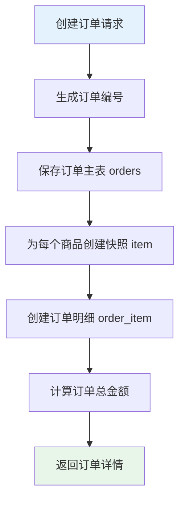
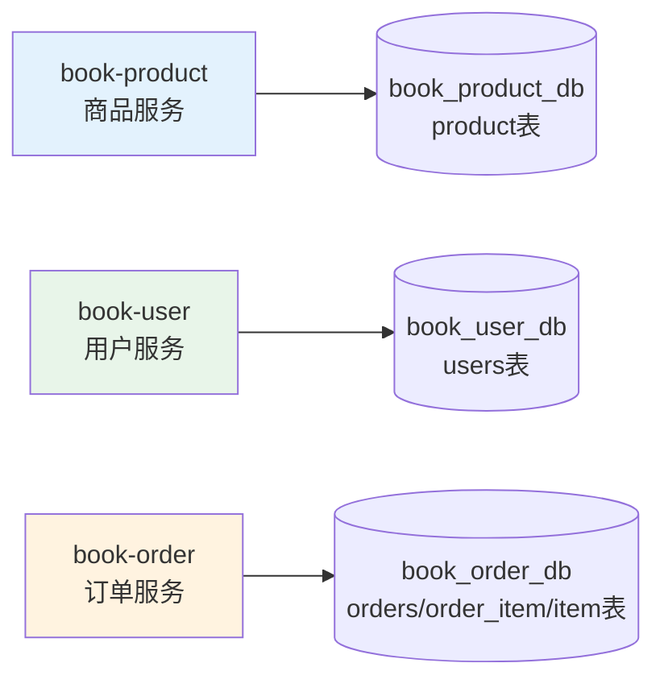
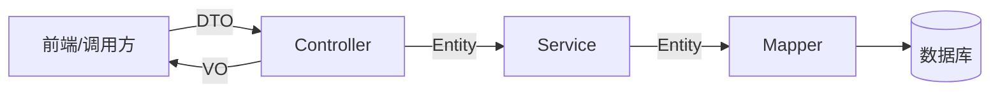

# 服务拆分与接口设计

## 课程目标

- 理解微服务拆分后各服务的领域模型设计
- 理解 Entity、DTO、VO 三种数据结构的定位、作用与区别
- 掌握使用 BeanUtils / Hutool 简化 VO 转换，避免大量 set 方法
- 掌握使用 MyBatis-Plus 完成 Entity、Mapper、Service、Controller 的完整开发流程
- 掌握分库设计原则，为三个服务配置独立的数据库
- 掌握使用 IDEA 自带的 HTTP Request 功能测试接口


## 回顾与导入

目前，我们完成了多模块工程的搭建，建立了 book-common、book-user、book-product、book-order 四个模块。本节课将进行**服务拆分与接口设计**。

其中**商品服务和用户服务**的 CRUD 较为简单，直接继承 MyBatis-Plus 的 `ServiceImpl` 即可。但**订单服务**的业务逻辑更复杂：



订单服务需要同时操作 **orders、item、order_item 三张表**，并在一个事务中保证数据一致性。

## 分库设计



> **分库原则：** 每个微服务拥有独立的数据库，服务之间不能直接访问对方的数据库，只能通过 API 调用获取数据。


## Entity、DTO、VO 的定位与区别

在分层架构中，我们经常需要用到三种不同的数据结构，初学者容易混淆它们。理解它们的定位，是设计清晰接口的前提。

### 三者的定位



| 结构       | 全称                 | 定位                                      | 使用位置            |
| ---------- | -------------------- | ----------------------------------------- | ------------------- |
| **Entity** | 实体类               | 数据库表的映射，字段与表结构一一对应      | Mapper / Service 层 |
| **DTO**    | Data Transfer Object | 接收前端请求参数，通常包含校验注解        | Controller 入参     |
| **VO**     | View Object          | 返回给前端的展示数据，可以组合多个 Entity | Controller 出参     |

### 为什么不能只用 Entity

| 问题               | 说明                                                         |
| ------------------ | ------------------------------------------------------------ |
| **暴露数据库结构** | Entity 包含表的所有字段（如 `deleted`、`internal_remark`），不应返回给前端 |
| **无法组合数据**   | 订单详情需要同时返回订单主表和订单项，Entity 无法表达        |
| **无法承载校验**   | 创建订单时，`userId` 和 `items` 需要校验，而 Entity 只对应单表 |
| **耦合数据库**     | 数据库字段调整会直接影响前端接口                             |

### 订单服务中的三种结构

| 结构       | 示例                                     | 说明                                 |
| ---------- | ---------------------------------------- | ------------------------------------ |
| **Entity** | `Order`、`Item`、`OrderItem`             | 对应 orders、item、order_item 三张表 |
| **DTO**    | `OrderCreateRequest`、`OrderItemRequest` | 接收前端创建的订单数据，带校验       |
| **VO**     | `OrderDetailVO`                          | 返回订单 + 订单项的组合数据          |

### VO 转换：不要手写大量 set

传统写法（不推荐）：

```java
OrderDetailVO.OrderItemVO itemVO = new OrderDetailVO.OrderItemVO();
itemVO.setItemId(item.getId());
itemVO.setProductId(item.getProductId());
itemVO.setTitle(item.getTitle());
itemVO.setAuthor(item.getAuthor());
itemVO.setPrice(item.getPrice());
itemVO.setQuantity(orderItem.getQuantity());
itemVO.setSubtotal(item.getPrice() * orderItem.getQuantity());
```

当一个 VO 有 10 多个字段时，会写大量重复的 set 方法，容易遗漏且难以维护。

推荐使用 **BeanUtils**（Spring 自带）或 **Hutool库 的 BeanUtil** 自动拷贝同名属性：

```java
// Spring 的 BeanUtils（book-common 已通过 spring-boot-starter-web 间接引入）
OrderDetailVO.OrderItemVO itemVO = new OrderDetailVO.OrderItemVO();
BeanUtils.copyProperties(item, itemVO);      // 自动拷贝同名属性
BeanUtils.copyProperties(orderItem, itemVO); // 后拷贝的覆盖前面的同名属性
itemVO.setSubtotal(item.getPrice() * orderItem.getQuantity()); // 计算字段手动设置
```

```java
// Hutool 的 BeanUtil（推荐，功能更强大）
OrderDetailVO.OrderItemVO itemVO = BeanUtil.copyProperties(item, OrderDetailVO.OrderItemVO.class);
BeanUtil.copyProperties(orderItem, itemVO);
itemVO.setSubtotal(item.getPrice() * orderItem.getQuantity());
```

| 工具               | 来源             | 特点                                         |
| ------------------ | ---------------- | -------------------------------------------- |
| Spring `BeanUtils` | Spring Framework | 无需额外依赖，功能基础                       |
| Hutool `BeanUtil`  | Hutool           | 功能强大，支持类型转换、忽略属性、拷贝列表等 |

> **提示：** 本节使用 Hutool 的 `BeanUtil`，因为它在拷贝集合、类型转换方面更方便。

### 在 book-common 中引入 Hutool

```xml
<dependency>
    <groupId>cn.hutool</groupId>
    <artifactId>hutool-all</artifactId>
</dependency>
```

> **说明：** book-common 引入 Hutool 后，所有依赖 book-common 的服务都能使用。


## 数据库表设计

### 商品库（book_product_db）

```sql
CREATE TABLE IF NOT EXISTS product (
    id BIGSERIAL PRIMARY KEY,
    title VARCHAR(100) NOT NULL,
    author VARCHAR(50) NOT NULL,
    price NUMERIC(10, 2) NOT NULL,
    stock INT NOT NULL,
    sales INT DEFAULT 0,
    category VARCHAR(20),
    isbn VARCHAR(20),
    description VARCHAR(200),
    created_at TIMESTAMP DEFAULT CURRENT_TIMESTAMP,
    updated_at TIMESTAMP DEFAULT CURRENT_TIMESTAMP
);
```

### 用户库（book_user_db）

```sql
CREATE TABLE IF NOT EXISTS users (
    id BIGSERIAL PRIMARY KEY,
    username VARCHAR(50) NOT NULL UNIQUE,
    email VARCHAR(100) NOT NULL,
    phone VARCHAR(20),
    created_at TIMESTAMP DEFAULT CURRENT_TIMESTAMP,
    updated_at TIMESTAMP DEFAULT CURRENT_TIMESTAMP
);
```

### 订单库（book_order_db）

```sql
-- 订单主表
CREATE TABLE IF NOT EXISTS orders (
    id BIGSERIAL PRIMARY KEY,
    order_number VARCHAR(20) NOT NULL UNIQUE,
    user_id BIGINT NOT NULL,
    total_amount NUMERIC(12, 2) NOT NULL,
    status VARCHAR(20) NOT NULL DEFAULT 'CREATED',
    created_at TIMESTAMP DEFAULT CURRENT_TIMESTAMP,
    updated_at TIMESTAMP DEFAULT CURRENT_TIMESTAMP
);

-- 商品快照表（记录下单时的商品信息，避免商品变更影响历史订单）
CREATE TABLE IF NOT EXISTS item (
    id BIGSERIAL PRIMARY KEY,
    product_id BIGINT NOT NULL,
    title VARCHAR(100) NOT NULL,
    author VARCHAR(50) NOT NULL,
    price NUMERIC(10, 2) NOT NULL,
    created_at TIMESTAMP DEFAULT CURRENT_TIMESTAMP
);

-- 订单明细表
CREATE TABLE IF NOT EXISTS order_item (
    id BIGSERIAL PRIMARY KEY,
    order_id BIGINT NOT NULL,
    item_id BIGINT NOT NULL,
    quantity INT NOT NULL,
    price NUMERIC(10, 2) NOT NULL,
    created_at TIMESTAMP DEFAULT CURRENT_TIMESTAMP,
    CONSTRAINT fk_order_item_order FOREIGN KEY (order_id) REFERENCES orders(id),
    CONSTRAINT fk_order_item_item FOREIGN KEY (item_id) REFERENCES item(id)
);

CREATE INDEX idx_order_item_order_id ON order_item(order_id);
CREATE INDEX idx_orders_user_id ON orders(user_id);
```


## 订单服务的完整实现

### DTO 设计

#### OrderCreateRequest

```java
@Data
public class OrderCreateRequest {

    @NotNull(message = "用户ID不能为空")
    private Long userId;

    @NotEmpty(message = "订单项不能为空")
    @Valid
    private List<OrderItemRequest> items;
}
```

#### OrderItemRequest

```java
@Data
public class OrderItemRequest {

    @NotNull(message = "商品ID不能为空")
    private Long productId;

    @NotNull(message = "数量不能为空")
    @Min(value = 1, message = "数量至少为1")
    private Integer quantity;

    // 由前端传入（模拟商品信息，引入 OpenFeign 后改为通过商品服务查询）
    @NotNull(message = "商品标题不能为空")
    private String title;

    @NotNull(message = "商品作者不能为空")
    private String author;

    @NotNull(message = "商品价格不能为空")
    @Min(value = 0, message = "价格不能为负数")
    private Double price;
}
```

### VO 设计

#### OrderDetailVO

```java
@Data
public class OrderDetailVO {

    /** 订单主表信息 */
    private Order order;

    /** 订单项列表 */
    private List<OrderItemVO> items;

    @Data
    public static class OrderItemVO {
        private Long itemId;      // 商品快照ID
        private Long productId;   // 原商品ID
        private String title;     // 商品标题（快照）
        private String author;    // 作者（快照）
        private Double price;     // 下单时单价
        private Integer quantity; // 数量
        private Double subtotal;  // 小计 = price * quantity
    }
}
```

> **说明：** `OrderDetailVO` 组合了 `Order`（Entity）和 `List<OrderItemVO>`，形成前端所需的完整数据结构。这是 VO 存在的核心价值——**组合多个 Entity 表达业务语义**。

### Entity 层

#### Order

```java
@Data
@TableName("orders")
public class Order {

    @TableId(type = IdType.AUTO)
    private Long id;

    private String orderNumber;
    private Long userId;
    private Double totalAmount;
    private String status;

    @TableField(fill = FieldFill.INSERT)
    private LocalDateTime createdAt;

    @TableField(fill = FieldFill.INSERT_UPDATE)
    private LocalDateTime updatedAt;
}
```

#### Item

```java
@Data
@TableName("item")
public class Item {

    @TableId(type = IdType.AUTO)
    private Long id;

    private Long productId;
    private String title;
    private String author;
    private Double price;

    @TableField(fill = FieldFill.INSERT)
    private LocalDateTime createdAt;
}
```

#### OrderItem

```java
@Data
@TableName("order_item")
public class OrderItem {

    @TableId(type = IdType.AUTO)
    private Long id;

    private Long orderId;
    private Long itemId;
    private Integer quantity;
    private Double price;

    @TableField(fill = FieldFill.INSERT)
    private LocalDateTime createdAt;
}
```

### Mapper 层

```java
@Mapper
public interface OrderMapper extends BaseMapper<Order> {
}
```

```java
@Mapper
public interface ItemMapper extends BaseMapper<Item> {
}
```

```java
@Mapper
public interface OrderItemMapper extends BaseMapper<OrderItem> {
}
```

### Service 层（重点）

#### OrderService 接口

```java
public interface OrderService extends IService<Order> {

    OrderDetailVO createOrder(OrderCreateRequest request);

    OrderDetailVO getOrderDetail(Long orderId);

    List<Order> listByUserId(Long userId);

    List<Order> listByStatus(String status);

    boolean cancelOrder(Long orderId);
}
```

#### OrderServiceImpl

```java
@Service
@RequiredArgsConstructor
public class OrderServiceImpl extends ServiceImpl<OrderMapper, Order> implements OrderService {

    private final ItemMapper itemMapper;
    private final OrderItemMapper orderItemMapper;

    private static final DateTimeFormatter ORDER_NUMBER_FORMAT =
            DateTimeFormatter.ofPattern("yyyyMMddHHmmss");

    private static final AtomicInteger SEQUENCE = new AtomicInteger(0);

    /**
     * 创建订单
     * 业务步骤：
     * 1. 生成唯一订单编号
     * 2. 保存订单主表（orders）
     * 3. 为每个商品创建快照（item）
     * 4. 创建订单明细（order_item）
     * 5. 计算订单总金额并更新订单主表
     * 全部在一个事务中完成。
     */
    @Override
    @Transactional(rollbackFor = Exception.class)
    public OrderDetailVO createOrder(OrderCreateRequest request) {

        if (request.getItems() == null || request.getItems().isEmpty()) {
            throw new IllegalArgumentException("订单项不能为空");
        }

        // 1. 保存订单主表
        Order order = new Order();
        order.setOrderNumber(generateOrderNumber());
        order.setUserId(request.getUserId());
        order.setTotalAmount(0.0);
        order.setStatus("CREATED");
        this.save(order);

        // 2. 遍历订单项，逐个创建商品快照和订单明细
        double totalAmount = 0.0;
        List<OrderDetailVO.OrderItemVO> itemVOs = new ArrayList<>();

        for (OrderItemRequest itemReq : request.getItems()) {

            // 2.1 创建商品快照：从 DTO 拷贝到 Item Entity
            Item item = BeanUtil.copyProperties(itemReq, Item.class);
            itemMapper.insert(item);

            // 2.2 创建订单明细：从 DTO 拷贝到 OrderItem Entity，再补充关联字段
            OrderItem orderItem = BeanUtil.copyProperties(itemReq, OrderItem.class);
            orderItem.setOrderId(order.getId());
            orderItem.setItemId(item.getId());
            orderItemMapper.insert(orderItem);

            // 2.3 组装返回的 VO（从 Item + OrderItem 合并）
            OrderDetailVO.OrderItemVO itemVO = new OrderDetailVO.OrderItemVO();
            BeanUtil.copyProperties(item, itemVO);          // itemId, productId, title, author, price
            BeanUtil.copyProperties(orderItem, itemVO);     // quantity, price（覆盖）
            itemVO.setSubtotal(item.getPrice() * orderItem.getQuantity());

            itemVOs.add(itemVO);

            // 2.4 累加总金额
            totalAmount += itemVO.getSubtotal();
        }

        // 3. 更新订单总金额
        order.setTotalAmount(totalAmount);
        this.updateById(order);

        // 4. 组装返回
        OrderDetailVO detailVO = new OrderDetailVO();
        detailVO.setOrder(order);
        detailVO.setItems(itemVOs);
        return detailVO;
    }

    /**
     * 查询订单详情
     */
    @Override
    public OrderDetailVO getOrderDetail(Long orderId) {

        Order order = this.getById(orderId);
        if (order == null) {
            throw new RuntimeException("Order不存在");
        }

        // 1. 查询订单明细
        LambdaQueryWrapper<OrderItem> itemWrapper = new LambdaQueryWrapper<>();
        itemWrapper.eq(OrderItem::getOrderId, orderId);
        List<OrderItem> orderItems = orderItemMapper.selectList(itemWrapper);

        // 2. 批量查询商品快照（避免 N+1）
        List<OrderDetailVO.OrderItemVO> itemVOs = new ArrayList<>();
        for (OrderItem orderItem : orderItems) {
            Item item = itemMapper.selectById(orderItem.getItemId());
            if (item == null) continue;

            OrderDetailVO.OrderItemVO itemVO = new OrderDetailVO.OrderItemVO();
            BeanUtil.copyProperties(item, itemVO);
            BeanUtil.copyProperties(orderItem, itemVO);
            itemVO.setSubtotal(orderItem.getPrice() * orderItem.getQuantity());
            itemVOs.add(itemVO);
        }

        OrderDetailVO detailVO = new OrderDetailVO();
        detailVO.setOrder(order);
        detailVO.setItems(itemVOs);
        return detailVO;
    }

    @Override
    public List<Order> listByUserId(Long userId) {
        return this.list(new LambdaQueryWrapper<Order>()
                .eq(Order::getUserId, userId)
                .orderByDesc(Order::getCreatedAt));
    }

    @Override
    public List<Order> listByStatus(String status) {
        return this.list(new LambdaQueryWrapper<Order>()
                .eq(Order::getStatus, status)
                .orderByDesc(Order::getCreatedAt));
    }

    @Override
    @Transactional(rollbackFor = Exception.class)
    public boolean cancelOrder(Long orderId) {
        Order order = this.getById(orderId);
        if (order == null) {
            throw new RuntimeException("Order不存在");
        }
        if (!"CREATED".equals(order.getStatus())) {
            throw new RuntimeException("只有待支付订单可以取消，当前状态: " + order.getStatus());
        }
        order.setStatus("CANCELLED");
        return this.updateById(order);
    }

    /**
     * 生成订单编号：ORD + yyyyMMddHHmmss + 3位序列号
     */
    private String generateOrderNumber() {
        String timestamp = LocalDateTime.now().format(ORDER_NUMBER_FORMAT);
        int seq = SEQUENCE.incrementAndGet() % 1000;
        return String.format("ORD%s%03d", timestamp, seq);
    }
}
```

> **说明：** 使用 `BeanUtil.copyProperties` 后，代码从原来的 8 行 set 方法缩减为 2 行，且字段增多时优势更明显。

### Controller 层

```java
@RestController
@RequestMapping("/api/orders")
@RequiredArgsConstructor
public class OrderController {

    private final OrderService orderService;

    @PostMapping
    public OrderDetailVO createOrder(@Valid @RequestBody OrderCreateRequest request) {
        return orderService.createOrder(request);
    }

    @GetMapping("/{id}")
    public OrderDetailVO getOrderDetail(@PathVariable("id") Long id) {
        return orderService.getOrderDetail(id);
    }

    @GetMapping
    public List<Order> list() {
        return orderService.list();
    }

    @GetMapping("/user/{userId}")
    public List<Order> listByUserId(@PathVariable("userId") Long userId) {
        return orderService.listByUserId(userId);
    }

    @GetMapping("/status/{status}")
    public List<Order> listByStatus(@PathVariable("status") String status) {
        return orderService.listByStatus(status);
    }

    @PutMapping("/{id}/cancel")
    public Boolean cancelOrder(@PathVariable("id") Long id) {
        return orderService.cancelOrder(id);
    }

    @DeleteMapping("/{id}")
    public Boolean delete(@PathVariable("id")  Long id) {
        return orderService.removeById(id);
    }
}
```

### 启动类

```java
@SpringBootApplication
@MapperScan("com.example.order.mapper")
public class BookOrderApplication {

    public static void main(String[] args) {
        SpringApplication.run(BookOrderApplication.class, args);
    }
}
```

### 配置：application.yml

```yaml
server:
  port: 8083

spring:
  application:
    name: book-order
  datasource:
    driver-class-name: org.postgresql.Driver
    url: jdbc:postgresql://localhost:5432/book_order_db
    username: postgres
    password: your_password

mybatis-plus:
  configuration:
    map-underscore-to-camel-case: true
    log-impl: org.apache.ibatis.logging.stdout.StdOutImpl
  global-config:
    db-config:
      id-type: auto
```


## 使用 IDEA HTTP Request 测试接口

### 什么是 IDEA HTTP Request

IDEA 内置了 HTTP Client 功能，可以通过 `.http` 文件编写和执行 HTTP 请求，比 curl 更直观，支持环境变量、请求历史、响应断言等。

### 测试文件：book-microservice.http

```http
### 环境切换（默认使用 dev）
GET {{product_url}}/api/products

### ========================================
### 商品服务测试
### ========================================

### 创建商品1
POST {{product_url}}/api/products
Content-Type: application/json

{
  "title": "Spring Boot 实战",
  "author": "Craig Walls",
  "price": 79.0,
  "stock": 10,
  "category": "编程"
}

### 创建商品2
POST {{product_url}}/api/products
Content-Type: application/json

{
  "title": "Java 核心技术",
  "author": "Cay Horstmann",
  "price": 89.0,
  "stock": 8,
  "category": "编程"
}

### 查询所有商品
GET {{product_url}}/api/products

### ========================================
### 用户服务测试
### ========================================

### 创建用户
POST {{user_url}}/api/users
Content-Type: application/json

{
  "username": "alice",
  "email": "alice@example.com",
  "phone": "13800138000"
}

### 查询所有用户
GET {{user_url}}/api/users

### ========================================
### 订单服务测试
### ========================================

### 创建订单（包含两个订单项）
POST {{order_url}}/api/orders
Content-Type: application/json

{
  "userId": 1,
  "items": [
    {
      "productId": 1,
      "title": "Spring Boot 实战",
      "author": "Craig Walls",
      "price": 79.0,
      "quantity": 2
    },
    {
      "productId": 2,
      "title": "Java 核心技术",
      "author": "Cay Horstmann",
      "price": 89.0,
      "quantity": 1
    }
  ]
}

### 查询订单详情
GET {{order_url}}/api/orders/1

### 查询所有订单
GET {{order_url}}/api/orders

### 根据用户查询订单
GET {{order_url}}/api/orders/user/1

### 根据状态查询订单
GET {{order_url}}/api/orders/status/CREATED

### 取消订单
PUT {{order_url}}/api/orders/1/cancel

### ========================================
### 异常场景测试
### ========================================

### 创建订单 - 订单项为空（应返回 400）
POST {{order_url}}/api/orders
Content-Type: application/json

{
  "userId": 1,
  "items": []
}

### 创建订单 - 数量为 0（应返回 400）
POST {{order_url}}/api/orders
Content-Type: application/json

{
  "userId": 1,
  "items": [
    {
      "productId": 1,
      "title": "Spring Boot 实战",
      "author": "Craig Walls",
      "price": 79.0,
      "quantity": 0
    }
  ]
}

### 取消已取消的订单
PUT {{order_url}}/api/orders/1/cancel

### 查询不存在的订单
GET {{order_url}}/api/orders/999
```

### 使用说明

1. 在 IDEA 中打开 `book-microservice.http` 文件。
2. 每个请求左侧有绿色三角形，点击即可执行。
3. 右上角可选择环境（dev），`{{product_url}}` 等变量会自动替换。
4. 响应结果会在 IDEA 的 Run 窗口中显示。

**预期响应（创建订单）：**

```json
{
  "order": {
    "id": 1,
    "orderNumber": "ORD20260101120000001",
    "userId": 1,
    "totalAmount": 247.0,
    "status": "CREATED"
  },
  "items": [
    {
      "itemId": 1,
      "productId": 1,
      "title": "Spring Boot 实战",
      "author": "Craig Walls",
      "price": 79.0,
      "quantity": 2,
      "subtotal": 158.0
    },
    {
      "itemId": 2,
      "productId": 2,
      "title": "Java 核心技术",
      "author": "Cay Horstmann",
      "price": 89.0,
      "quantity": 1,
      "subtotal": 89.0
    }
  ]
}
```


## 注意事项

1. **事务一致性**：`createOrder` 需要操作三张表，必须使用 `@Transactional` 保证数据一致性。
2. **商品快照**：订单保存商品快照（item 表）而不是直接引用商品表，避免商品信息变更影响历史订单。
3. **VO 转换**：使用 `BeanUtil.copyProperties` 自动拷贝同名属性，避免手写大量 set 方法。对于需要计算的字段（如 `subtotal`），需要手动设置。
4. **BeanUtil 拷贝顺序**：先拷贝 `item`，再拷贝 `orderItem`，后者会覆盖同名的 `price` 字段（因为订单项的价格是下单时的快照价）。
5. **分库设计**：三个服务对应三个数据库，服务之间不能直接访问对方的数据库。
6. **后续演进**：创建订单时还应该扣减商品库存，这需要调用商品服务（远程调用），将在后续章节中引入 OpenFeign 后实现。
7. **订单编号生成**：使用"ORD + 时间戳 + 序列号"的格式，生产环境应使用分布式 ID 生成器。


## 小结

本节课我们学习了：

1. **分库设计**：三个业务服务对应三个独立数据库。
2. **Entity、DTO、VO 的定位与区别**：
   - **Entity**：数据库表映射，用于 Mapper / Service 层
   - **DTO**：接收请求参数，带校验注解，用于 Controller 入参
   - **VO**：返回展示数据，可组合多个 Entity，用于 Controller 出参
3. **VO 转换简化**：使用 Hutool 的 `BeanUtil.copyProperties` 自动拷贝同名属性，避免手写 set 方法。
4. **订单服务的复杂实现（重点）**：
   - `createOrder` 方法操作三张表（orders、item、order_item）
   - 使用 `@Transactional` 保证事务一致性
   - 商品快照设计保证历史订单不受商品变更影响
   - 使用 `BeanUtil` 简化 Entity 与 VO 之间的转换
5. **IDEA HTTP Request 测试**：编写 `.http` 文件，一键执行接口测试。


## 作业

### 作业一：完成三个服务的 CRUD 实现

1. 创建三个数据库：book_product_db、book_user_db、book_order_db。
2. 在 book-product、book-user、book-order 中分别实现 Entity、Mapper、Service、Controller。
3. 在 book-common 中引入 Hutool 依赖。
4. 使用 `BeanUtil.copyProperties` 简化 VO 转换。
5. 编写 `.http` 文件，测试各服务接口。

### 作业二：订单服务核心业务测试

1. 使用 IDEA HTTP Request 创建订单（包含多个订单项），验证：
   - orders 表中生成一条订单记录
   - item 表中生成多条商品快照记录
   - order_item 表中生成多条订单明细记录
   - 订单总金额等于所有小计之和
2. 查询订单详情，验证返回结构。
3. 取消订单，验证订单状态变为 CANCELLED。
4. 尝试取消一个已取消的订单，验证异常返回。

### 作业三：订单服务扩展接口

为订单服务添加以下接口：

1. 根据订单编号查询订单：`GET /api/orders/number/{orderNumber}`
2. 统计某用户的订单总金额：`GET /api/orders/user/{userId}/total`
3. 查询某时间段的订单：`GET /api/orders/date-range?start=xxx&end=xxx`

**要求：** 使用 `BeanUtil` 简化 VO 转换。

### 作业四：事务回滚验证

1. 在 `createOrder` 方法中，故意在创建第二个订单项时抛出异常。
2. 验证 orders、item、order_item 三张表是否全部回滚。
3. 将 `@Transactional(rollbackFor = Exception.class)` 改为 `@Transactional`（默认只回滚 RuntimeException），观察 checked exception 的行为差异。
