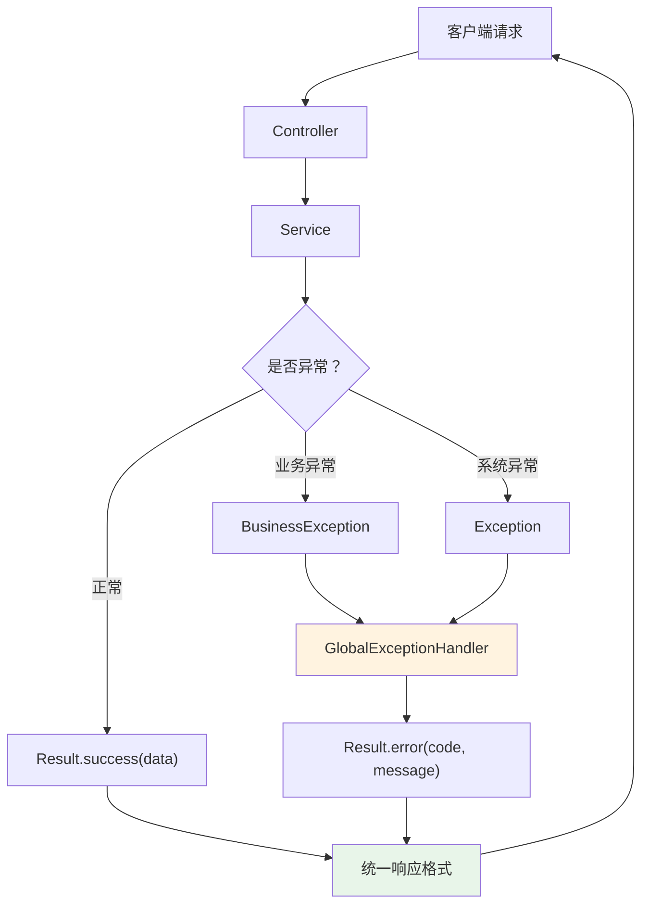
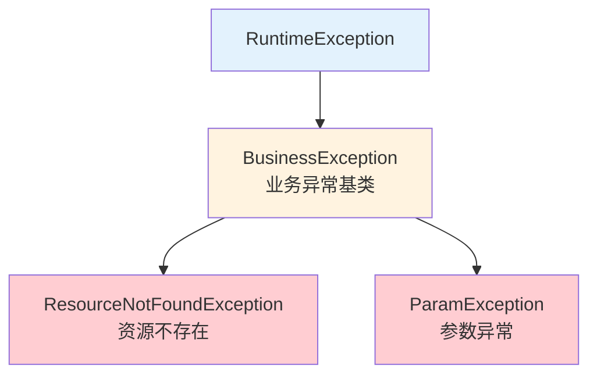

# 公共模块建设

## 课程目标

- 理解公共模块在微服务架构中的定位与作用
- 掌握统一响应体 `Result<T>` 的设计与实现
- 掌握业务异常体系的设计与实现
- 掌握全局异常处理器的实现
- 掌握状态码枚举的设计
- 完成三个服务共用公共模块的标准化改造


## 回顾与导入

在前三节中，我们完成了工程初始化和三个服务的 CRUD 实现。此时三个服务的 Controller 直接返回 VO 对象或 List、原生对象：

```java
@PostMapping
public ProductVO create(@Valid @RequestBody ProductCreateRequest request) {
   	return productService.create(request);
}

@GetMapping
public List<ProductVO> list() {
    return productService.listAll();
}
```

这种返回方式存在以下问题：

| 问题               | 说明                                          |
| ------------------ | --------------------------------------------- |
| **响应格式不统一** | 有的返回实体、有的返回 List、有的返回 Boolean |
| **缺少状态码**     | 前端无法区分业务成功与失败                    |
| **缺少错误信息**   | 异常时直接抛出 500，前端无法获取具体原因      |
| **无法携带元数据** | 无法返回分页信息、时间戳等                    |
| **代码重复**       | 每个 Controller 都要处理异常                  |

本节课将在 `book-common` 中实现**统一响应封装**和**异常体系**，让三个服务共用同一套规范。



## 公共模块的结构设计

### book-common 的包结构

```
book-common/
└── src/main/java/com/example/common/
    ├── model/
    │   ├── Result.java            # 统一响应体
    │   └── PageResult.java        # 分页响应体
    ├── exception/
    │   ├── BusinessException.java        # 业务异常
    │   ├── ResourceNotFoundException.java # 资源不存在异常
    │   └── ParamException.java            # 参数异常
    ├── enums/
    │   └── ResultCode.java        # 状态码枚举
    └── handler/
        └── GlobalExceptionHandler.java # 全局异常处理器
```

> **设计原则：** 公共模块只包含**与业务无关**的通用组件（统一响应、异常体系、工具类）。任何与具体业务相关的实体（如 Book、Order）都不能放入 book-common。


## 状态码枚举设计

### 什么是状态码

**业务状态码**是接口返回的用于表示业务处理结果的数字编码，不同于 HTTP 状态码。它让前端能够精确判断业务处理的具体情况。

| 对比         | HTTP 状态码    | 业务状态码      |
| ------------ | -------------- | --------------- |
| **负责范围** | HTTP 协议层面  | 业务层面        |
| **示例**     | 200、404、500  | 200、1001、1004 |
| **作用对象** | 客户端和中间件 | 前端业务逻辑    |

### 设计原则

| 原则         | 说明                               |
| ------------ | ---------------------------------- |
| **分层分类** | 按功能模块或错误类型分类，便于扩展 |
| **语义清晰** | 状态码本身能反映错误类型           |
| **规范统一** | 全系统使用同一套状态码规范         |
| **可扩展**   | 预留状态码段供后续业务扩展         |

### 状态码分段

| 段         | 范围      | 含义                       |
| ---------- | --------- | -------------------------- |
| 成功       | 200       | 请求成功                   |
| 客户端错误 | 400-499   | 请求参数、格式、权限等问题 |
| 服务器错误 | 500-599   | 服务器内部错误             |
| 业务错误   | 1000-1999 | 业务规则校验失败           |

### ResultCode 枚举

```java
/**
 * 统一状态码枚举
 */
@Getter
public enum ResultCode {

    // ==================== 成功 ====================
    SUCCESS(200, "操作成功"),
    CREATED(201, "创建成功"),
    NO_CONTENT(204, "操作成功，无返回数据"),

    // ==================== 客户端错误 400-499 ====================
    BAD_REQUEST(400, "请求参数错误"),
    UNAUTHORIZED(401, "未认证或登录已过期"),
    FORBIDDEN(403, "无权限访问"),
    NOT_FOUND(404, "资源不存在"),
    METHOD_NOT_ALLOWED(405, "请求方法不支持"),
    PARAM_ERROR(422, "参数校验失败"),

    // ==================== 服务器错误 500-599 ====================
    INTERNAL_ERROR(500, "系统内部错误，请稍后重试"),
    SERVICE_UNAVAILABLE(503, "服务暂时不可用"),

    // ==================== 业务错误 1000-1999 ====================
    BUSINESS_ERROR(1000, "业务处理失败"),
    RESOURCE_NOT_FOUND(1001, "资源不存在"),
    RESOURCE_EXISTS(1002, "资源已存在"),
    INVALID_OPERATION(1003, "操作不允许"),
    STOCK_INSUFFICIENT(1004, "库存不足"),
    ORDER_STATUS_ERROR(1005, "订单状态异常");

    private final Integer code;
    private final String message;

    ResultCode(Integer code, String message) {
        this.code = code;
        this.message = message;
    }
}
```


## 统一响应体设计

### Result 类的字段设计

| 字段        | 类型      | 说明             |
| ----------- | --------- | ---------------- |
| `code`      | `Integer` | 业务状态码       |
| `message`   | `String`  | 响应描述信息     |
| `data`      | `T`       | 响应数据（泛型） |
| `timestamp` | `Long`    | 响应时间戳       |

### Result 完整实现

```java
/**
 * 统一响应体
 *
 * @param <T> 数据类型
 */
@Data
@JsonInclude(JsonInclude.Include.NON_NULL)
public class Result<T> implements Serializable {

    /** 业务状态码 */
    private Integer code;

    /** 响应描述信息 */
    private String message;

    /** 响应数据 */
    private T data;

    /** 响应时间戳 */
    private Long timestamp;

    public Result() {
        this.timestamp = System.currentTimeMillis();
    }

    private Result(Integer code, String message, T data) {
        this.code = code;
        this.message = message;
        this.data = data;
        this.timestamp = System.currentTimeMillis();
    }

    // ==================== 成功响应 ====================

    /**
     * 成功响应（无数据）
     */
    public static <T> Result<T> success() {
        return new Result<>(ResultCode.SUCCESS.getCode(),
                ResultCode.SUCCESS.getMessage(), null);
    }

    /**
     * 成功响应（带数据）
     */
    public static <T> Result<T> success(T data) {
        return new Result<>(ResultCode.SUCCESS.getCode(),
                ResultCode.SUCCESS.getMessage(), data);
    }

    /**
     * 成功响应（自定义消息 + 数据）
     */
    public static <T> Result<T> success(String message, T data) {
        return new Result<>(ResultCode.SUCCESS.getCode(), message, data);
    }

    // ==================== 失败响应 ====================

    /**
     * 失败响应（使用预定义状态码）
     */
    public static <T> Result<T> error(ResultCode resultCode) {
        return new Result<>(resultCode.getCode(), resultCode.getMessage(), null);
    }

    /**
     * 失败响应（预定义状态码 + 自定义消息）
     */
    public static <T> Result<T> error(ResultCode resultCode, String message) {
        return new Result<>(resultCode.getCode(), message, null);
    }

    /**
     * 失败响应（自定义状态码 + 消息）
     */
    public static <T> Result<T> error(Integer code, String message) {
        return new Result<>(code, message, null);
    }
}
```

> **`@JsonInclude(JsonInclude.Include.NON_NULL)` 的作用：** 序列化时忽略 `null` 值，避免返回大量空字段，减少网络传输量。


## 分页响应体设计

### 为什么需要 PageResult

MyBatis-Plus 的 `Page<T>` 对象包含大量字段（如 `orders`、`optimizeCountSql` 等），直接返回给前端会暴露不必要的内部字段。`PageResult<T>` 只保留分页必需的信息。

### PageResult 的字段设计

| 字段         | 类型      | 说明       |
| ------------ | --------- | ---------- |
| `page`       | `Integer` | 当前页码   |
| `size`       | `Integer` | 每页大小   |
| `total`      | `Long`    | 总记录数   |
| `totalPages` | `Integer` | 总页数     |
| `data`       | `List<T>` | 当前页数据 |

### PageResult 完整实现

```java
/**
 * 分页响应体
 *
 * @param <T> 数据类型
 */
@Data
public class PageResult<T> implements Serializable {

    /** 当前页码（从 1 开始） */
    private Integer page;

    /** 每页大小 */
    private Integer size;

    /** 总记录数 */
    private Long total;

    /** 总页数 */
    private Integer totalPages;

    /** 当前页数据 */
    private List<T> data;

    public PageResult() {
    }

    public PageResult(Integer page, Integer size, Long total, List<T> data) {
        this.page = page;
        this.size = size;
        this.total = total;
        this.totalPages = size > 0 ? (int) Math.ceil((double) total / size) : 0;
        this.data = data;
    }

    /**
     * 从 MyBatis-Plus 的 IPage 对象转换
     */
    public static <T> PageResult<T> of(IPage<T> page) {
        return new PageResult<>(
                (int) page.getCurrent(),
                (int) page.getSize(),
                page.getTotal(),
                page.getRecords()
        );
    }
}
```

> **`of(IPage<T>)` 静态方法的价值：** 直接接收 MyBatis-Plus 的 `Page` 对象，一键转换为前端友好的 `PageResult`，避免在每个 Service 中手动组装。


## 异常体系设计

### 异常类的层次结构



### 为什么需要自定义异常

| 问题                     | 自定义异常的解决方式           |
| ------------------------ | ------------------------------ |
| 内置异常无法表达业务语义 | 定义与业务对应的异常类型       |
| 异常信息不统一           | 统一携带 `code` 和 `message`   |
| 无法区分异常来源         | 通过类型区分业务异常和系统异常 |

### BusinessException

```java
/**
 * 业务异常基类
 */
@Getter
public class BusinessException extends RuntimeException {

    /** 业务状态码 */
    private final Integer code;

    /** 错误消息 */
    private final String message;

    public BusinessException(String message) {
        super(message);
        this.code = ResultCode.BUSINESS_ERROR.getCode();
        this.message = message;
    }

    public BusinessException(Integer code, String message) {
        super(message);
        this.code = code;
        this.message = message;
    }

    public BusinessException(ResultCode resultCode) {
        super(resultCode.getMessage());
        this.code = resultCode.getCode();
        this.message = resultCode.getMessage();
    }

    public BusinessException(ResultCode resultCode, String message) {
        super(message);
        this.code = resultCode.getCode();
        this.message = message;
    }
}
```

### ResourceNotFoundException

```java
/**
 * 资源不存在异常
 */
public class ResourceNotFoundException extends BusinessException {

    public ResourceNotFoundException(String resource, Long id) {
        super(ResultCode.RESOURCE_NOT_FOUND.getCode(),
                resource + "不存在，ID: " + id);
    }

    public ResourceNotFoundException(String message) {
        super(ResultCode.RESOURCE_NOT_FOUND.getCode(), message);
    }
}
```

### ParamException

```java
/**
 * 参数异常
 */
public class ParamException extends BusinessException {

    public ParamException(String message) {
        super(ResultCode.PARAM_ERROR.getCode(), message);
    }
}
```


## 全局异常处理器

如果不在 Controller 中显式捕获异常，异常会直接抛给 Spring 的默认处理机制，返回 500 错误页面或简单的错误 JSON，无法满足统一响应的要求。全局异常处理器可以集中捕获所有异常，转换为统一的 `Result` 格式。

### GlobalExceptionHandler 实现

```java
/**
 * 全局异常处理器
 *
 * 捕获所有 Controller 抛出的异常，转换为统一的 Result 格式。
 */
@Slf4j
@RestControllerAdvice
public class GlobalExceptionHandler {

    /**
     * 处理所有业务异常
     */
    @ExceptionHandler(BusinessException.class)
    @ResponseStatus(HttpStatus.BAD_REQUEST)
    public Result<Void> handleBusinessException(BusinessException e) {
        log.warn("业务异常: code={}, message={}", e.getCode(), e.getMessage());
        return Result.error(e.getCode(), e.getMessage());
    }

    /**
     * 处理其他未捕获的异常
     */
    @ExceptionHandler(Exception.class)
    @ResponseStatus(HttpStatus.INTERNAL_SERVER_ERROR)
    public Result<Void> handleException(Exception e) {
        log.error("系统异常", e);
        return Result.error(ResultCode.INTERNAL_ERROR);
    }
}
```

### 关键注解说明

| 注解                    | 说明                                         |
| ----------------------- | -------------------------------------------- |
| `@RestControllerAdvice` | 全局异常处理器，作用于所有 `@RestController` |
| `@ExceptionHandler`     | 指定处理的异常类型                           |
| `@ResponseStatus`       | 指定 HTTP 响应状态码                         |
| `@Slf4j`                | Lombok 注解，自动生成 `log` 字段             |

> **注意：** `GlobalExceptionHandler` 位于 `book-common` 中，但它的自动装配依赖于 Spring Boot 的组件扫描。各服务的主启动类包名是 `com.example.product`、`com.example.user`、`com.example.order`，默认扫描范围不包含 `com.example.common`。因此需要在各服务的主启动类上添加 `scanBasePackages`。


## 各服务集成公共模块

### 主启动类添加扫描路径

在三个服务的主启动类上添加 `scanBasePackages = "com.example"`，确保能够扫描到 `book-common` 中的 `GlobalExceptionHandler`。

**BookProductApplication：**

```java
@SpringBootApplication(scanBasePackages = "com.example")
@MapperScan("com.example.product.mapper")
public class BookProductApplication {
    public static void main(String[] args) {
        SpringApplication.run(BookProductApplication.class, args);
    }
}
```

**BookUserApplication 和 BookOrderApplication 同理**，只需修改 `@MapperScan` 的包路径。

### 改造 Controller 返回 Result

以商品服务的 Controller 为例：

```java
@RestController
@RequestMapping("/api/products")
@RequiredArgsConstructor
public class ProductController {

    private final ProductService productService;

    @PostMapping
    public Result<ProductVO> create(@Valid @RequestBody ProductCreateRequest request) {
        return Result.success(productService.create(request));
    }

    @GetMapping
    public Result<List<ProductVO>> list() {
        return Result.success(productService.listAll());
    }

    @GetMapping("/{id}")
    public Result<ProductVO> detail(@PathVariable("id") Long id) {
        return Result.success(productService.getDetail(id));
    }

    @PutMapping("/{id}")
    public Result<ProductVO> update(@PathVariable("id") Long id,
                                    @Valid @RequestBody ProductCreateRequest request) {
        return Result.success(productService.update(id, request));
    }

    @DeleteMapping("/{id}")
    public Result<Boolean> delete(@PathVariable("id") Long id) {
        return Result.success(productService.delete(id));
    }
}
```

### 改造 Service 抛出业务异常

在 Service 层，将返回 null 或直接抛 RuntimeException 的逻辑改为抛出自定义异常。

**OrderServiceImpl 示例：**

```java
@Service
@RequiredArgsConstructor
public class OrderServiceImpl extends ServiceImpl<OrderMapper, Order> implements OrderService {
  
   @Override
   @Transactional(rollbackFor = Exception.class)
   public OrderDetailVO createOrder(OrderCreateRequest request) {

				if (request.getItems() == null || request.getItems().isEmpty()) {
	        throw new BusinessException("订单项不能为空");
				}
     		...
   }

    @Override
    public OrderDetailVO getOrderDetail(Long orderId) {

        Order order = this.getById(orderId);
				if (order == null) {
						throw new ResourceNotFoundException("Order", orderId);
				}
      	...
    }
  
  	@Override
    @Transactional(rollbackFor = Exception.class)
    public boolean cancelOrder(Long orderId) {
        Order order = this.getById(orderId);
				if (order == null) {
						throw new ResourceNotFoundException("Order", orderId);
				}
				if (!"CREATED".equals(order.getStatus())) {
						throw new BusinessException("只有待支付订单可以取消，当前状态: " + order.getStatus());
				}
        order.setStatus("CANCELLED");
        return this.updateById(order);
    }
}
```


## 运行与测试

**成功响应：**

```json
{
  "code": 200,
  "message": "操作成功",
  "data": [
    {
      "id": 1,
      "title": "Spring Boot 实战",
      "author": "Craig Walls",
      "price": 79.0,
      "stock": 10,
      "category": "编程"
    }
  ],
  "timestamp": 1727000000000
}
```

**资源不存在异常（HTTP 400）：**

```json
{
  "code": 1001,
  "message": "商品不存在，ID: 999",
  "timestamp": 1727000000000
}
```

**参数异常（HTTP 400）：**

```json
{
  "code": 422,
  "message": "价格不能为空或负数",
  "timestamp": 1727000000000
}
```

**参数校验失败（HTTP 400）：**

```json
{
  "code": 422,
  "message": "商品标题不能为空",
  "timestamp": 1727000000000
}
```

**系统异常（HTTP 500）：**

```json
{
  "code": 500,
  "message": "系统内部错误，请稍后重试",
  "timestamp": 1727000000000
}
```

> **注意：** `timestamp` 字段值为示例，实际为当前时间戳。


## 注意事项

1. **`scanBasePackages` 配置**：`GlobalExceptionHandler` 位于 `book-common` 中，各服务主启动类必须添加 `@SpringBootApplication(scanBasePackages = "com.example")`，否则异常处理器不会被加载。
2. **`@JsonInclude` 的作用**：`Result` 类上的 `@JsonInclude(JsonInclude.Include.NON_NULL)` 确保 `data` 为 null 时不返回该字段。
3. **HTTP 状态码与业务状态码的映射**：`@ResponseStatus` 指定 HTTP 状态码，`Result.code` 指定业务状态码，两者独立但协同工作。
4. **异常日志记录**：`GlobalExceptionHandler` 中使用 `log.warn` 记录业务异常，`log.error` 记录系统异常，便于后续排查。
5. **公共模块的边界**：`book-common` 中不能包含任何具体业务的实体（如 Product、Order），只能包含通用的响应封装和异常体系。
6. **向后兼容**：改造 Controller 时，所有返回类型从 `ProductVO` / `List<ProductVO>` 改为 `Result<ProductVO>` / `Result<List<ProductVO>>`，需同步通知前端调整解析逻辑。


## 小结

本节课我们学习了：

1. **公共模块的定位**：`book-common` 存放与业务无关的通用组件，被三个服务共用。
2. **状态码枚举 ResultCode**：定义分层分类的业务状态码。
3. **统一响应体 Result<T>**：包含 `code`、`message`、`data`、`timestamp` 四个字段，提供 `success` 和 `error` 静态方法。
4. **分页响应体 PageResult<T>**：从 MyBatis-Plus 的 `IPage` 一键转换，只保留分页必需字段。
5. **异常体系**：`BusinessException`、`ResourceNotFoundException`、`ParamException` 三个层级。
6. **全局异常处理器 GlobalExceptionHandler**：使用 `@RestControllerAdvice` 统一捕获异常，返回统一的 `Result` 格式。
7. **服务集成**：在主启动类上添加 `scanBasePackages`，确保能扫描到 `book-common` 中的组件。


## 作业

### 作业一：完成公共模块实现

1. 在 `book-common` 中实现以下类：
   - `ResultCode` 枚举
   - `Result<T>` 统一响应体
   - `PageResult<T>` 分页响应体
   - `BusinessException`、`ResourceNotFoundException`、`ParamException`
   - `GlobalExceptionHandler`
2. 在三个服务的主启动类上添加 `scanBasePackages = "com.example"`。
3. 执行 `mvn clean compile`，确认编译通过。

### 作业二：改造三个服务的 Controller

1. 改造 `ProductController`，所有方法返回 `Result<T>`。
2. 改造 `UserController`，所有方法返回 `Result<T>`。
3. 改造 `OrderController`，所有方法返回 `Result<T>`。
4. 启动三个服务，使用 IDEA HTTP Request 验证响应格式。

### 作业三：改造 Service 抛出自定义异常

1. 为 `ProductService` 添加 `getProductById` 和 `createProduct` 方法，在 Service 层抛出 `ResourceNotFoundException` 和 `ParamException`。
2. 为 `UserService` 添加 `getUserById` 方法，在用户不存在时抛出 `ResourceNotFoundException`。
3. 使用 IDEA HTTP Request 验证异常响应格式。

### 作业四：扩展异常体系

1. 添加一个 `StockInsufficientException`，继承 `BusinessException`。
2. 在订单服务的 `createOrder` 方法中，当商品数量超过库存时抛出该异常。
3. 在 `ResultCode` 中添加 `STOCK_INSUFFICIENT` 状态码。
4. 验证异常响应中 `code` 为 `1004`，`message` 为"库存不足"。
