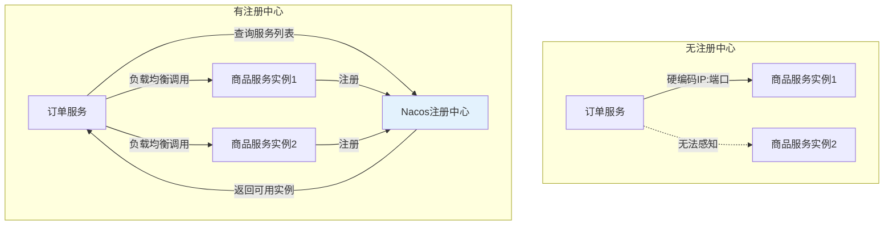
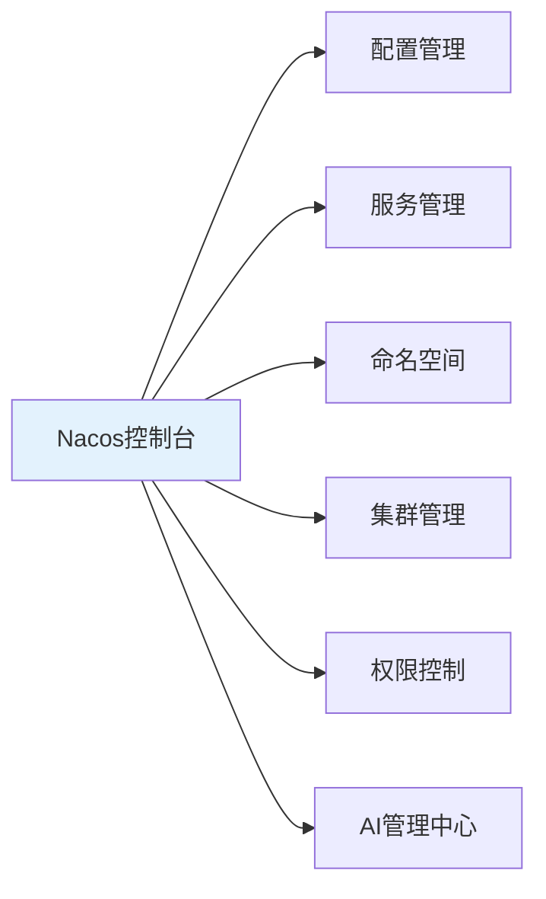

# Nacos部署与快速上手

## 课程目标

- 理解服务注册中心在微服务架构中的核心作用
- 了解Nacos作为注册中心和配置中心的双核心能力
- 掌握Nacos单机版的下载、安装与启动方法
- 掌握Nacos控制台的基本操作
- 了解Nacos 3.x版本的关键变化
- 完成图书管理系统注册中心环境的准备工作


## 回顾与导入

在前面课程中，我们完成了多模块工程搭建、三个服务的CRUD实现、Spring Cloud Alibaba技术栈的BOM导入，以及公共模块的统一响应与异常体系。此时，三个服务（book-product、book-user、book-order）可以独立运行，但它们之间**无法感知对方的存在**。

来看一个真实的问题场景：

> 订单服务创建订单时需要扣减商品库存，但目前订单服务直接接收前端传来的商品信息（title、author、price），并没有真正调用商品服务。即便后续引入了远程调用，订单服务也需要知道商品服务的**具体地址**（IP + 端口）。如果商品服务的地址写死在配置文件中，一旦商品服务扩容或宕机迁移，就需要手动修改配置并重启订单服务，这在微服务环境下是不可接受的。

这就是**服务注册中心**要解决的核心问题：

| 问题                 | 解决方案                             |
| -------------------- | ------------------------------------ |
| 服务地址硬编码       | 服务启动时自动注册到注册中心         |
| 服务地址动态变化     | 消费者从注册中心动态获取服务地址     |
| 无法感知服务健康状态 | 注册中心通过心跳检测自动剔除异常实例 |
| 多实例无法统一管理   | 注册中心维护所有实例列表并支持权重等 |



本节课将完成Nacos注册中心环境的搭建，为下一节将三个服务注册到Nacos做好准备。


## 为什么选择Nacos

### 主流注册中心对比

在微服务架构中，常见的服务注册中心方案包括以下几种：

| 注册中心  | 一致性协议   | 健康检查        | 配置中心 | 控制台 | 维护方            |
| --------- | ------------ | --------------- | -------- | ------ | ----------------- |
| **Nacos** | AP/CP 可切换 | 心跳 + 主动探测 | 支持     | 内置   | 阿里巴巴          |
| Eureka    | AP           | 心跳            | 不支持   | 有     | Netflix（已停更） |
| Consul    | CP           | 多种方式        | 支持     | 内置   | HashiCorp         |
| Zookeeper | CP           | Session         | 不支持   | 无     | Apache            |

> CAP理论：分布式系统的一致性（Consistency）、可用性（Availability）和分区容错性（Partition tolerance）无法同时完全满足，最多只能同时满足其中两个；由于网络分区在分布式系统中通常不可避免，所以一般必须保留分区容错性，而在发生分区时只能在一致性与可用性之间取舍——选择CP会优先保证数据一致，但可能拒绝请求或不可用，选择AP会优先保证服务可用，但可能返回旧数据，因此常见系统如ZooKeeper偏CP，Eureka偏AP。

Nacos（Dynamic Naming and Configuration Service）在本课程中被选为注册中心，原因如下：

| 优势             | 说明                                                         |
| ---------------- | ------------------------------------------------------------ |
| **一站式方案**   | 同时提供注册中心和配置中心能力，本课程后续将技术使用该框架实现配置中心 |
| **生态集成好**   | Spring Cloud Alibaba 原生集成，与 OpenFeign、Gateway 无缝协作 |
| **生产验证**     | 国内 50%+ 市场份额，被各行业头部企业广泛使用                 |
| **AP/CP 可切换** | 根据业务场景灵活选择一致性模型                               |
| **控制台友好**   | 内置可视化管理界面，便于开发和运维                           |

> **Nacos 3.x 重要变化：** Nacos 从 3.0.0 版本开始默认启用鉴权功能，控制台端口从 8848 调整为 8080（客户端通信端口仍为 8848）。同时，Nacos 3.x 不再支持 JDK 8，要求 JDK 17+。

### Spring Cloud Alibaba 与 Nacos 版本对应

Spring Cloud Alibaba 2025.0.0.0 内置的 Nacos Client 版本为 3.0.3，因此 Nacos Server 也应选择 3.0.3 版本，确保客户端与服务端版本一致。


## Nacos 下载与安装

### 环境要求

在安装Nacos之前，请确认本机环境满足以下要求：

| 要求         | 说明                                                        |
| ------------ | ----------------------------------------------------------- |
| **操作系统** | 64 bit OS，支持 Linux/Unix/Mac/Windows，推荐 Linux/Unix/Mac |
| **JDK**      | 64 bit JDK 17+                                              |
| **内存**     | 建议至少 2C4G 60G                                           |

> **注意：** Nacos 3.x 不再支持 JDK 8，必须使用 JDK 17 或以上版本。

验证本机 Java 版本：

```bash
java -version
```

### 下载Nacos

**方式一：通过Nacos官网下载**

访问 Nacos 版本下载页面（`https://nacos.io/download/nacos-server/`），选择稳定版本 3.0.3，点击二进制包下载列中的 `nacos-server-3.0.3.zip` 进行下载。

**方式二：通过GitHub下载**

进入 Nacos GitHub 的 Releases 页面（`https://github.com/alibaba/nacos/releases`），选择 3.0.3 版本，在 Assets 中点击下载 `nacos-server-3.0.3.zip` 包。

> **提示：** 官网下载可能遇到限流问题，如果下载失败，请稍后重试或改用GitHub方式下载。

### 解压缩安装包

**Linux/Mac：**

```bash
unzip nacos-server-3.0.3.zip
cd nacos
```

**Windows：**

使用解压工具将 `nacos-server-3.0.3.zip` 解压到指定目录。

解压后的目录结构如下：

```
nacos/
├── bin/                    # 启动脚本目录
│   ├── startup.sh          # Linux/Mac 启动脚本
│   ├── startup.cmd         # Windows 启动脚本
│   └── shutdown.sh         # 停止脚本
├── conf/                   # 配置文件目录
│   ├── application.properties  # 主配置文件
│   ├── mysql-schema.sql        # MySQL 初始化脚本
│   └── ...
├── data/                   # 数据目录（Derby 数据库文件）
├── logs/                   # 日志目录
└── target/                 # 应用文件
```


## 启动Nacos单机版

### 单机模式说明

Nacos 支持两种部署模式：

| 模式           | 说明                          | 适用场景       |
| -------------- | ----------------------------- | -------------- |
| **standalone** | 单机模式，使用内置Derby数据库 | 开发、测试环境 |
| **cluster**    | 集群模式，需要外置数据库      | 生产环境       |

本节课使用单机模式，下一讲讲解高可用集群搭建。

### 启动命令

**Linux/Unix/Mac：**

```bash
sh startup.sh -m standalone
```

**Ubuntu 系统（如果运行脚本报错提示 `[[` 符号找不到）：**

```bash
bash startup.sh -m standalone
```

**Windows：**

```cmd
startup.cmd -m standalone
```

> **参数说明：** `-m standalone` 表示以单机模式运行，非集群模式。

### 首次启动的鉴权配置

Nacos 从 3.0.0 版本开始默认启用控制台鉴权功能，首次启动时会提示输入三个鉴权相关配置：

| 配置项                      | 说明                                                      |
| --------------------------- | --------------------------------------------------------- |
| `NACOS_AUTH_TOKEN`          | 用于生成JWT令牌的密钥，长度需大于32字符，并进行Base64编码 |
| `NACOS_AUTH_IDENTITY_KEY`   | Nacos Server 之间内部API的身份密钥，必填                  |
| `NACOS_AUTH_IDENTITY_VALUE` | Nacos Server 之间内部API的身份值，必填                    |

按照提示依次输入即可。这些配置也可以在 `conf/application.properties` 中提前设置。

 [application.properties](application.properties) 

### 验证启动成功

**方式一：查看启动日志**

进入 `${nacos.home}/logs/` 目录，查看 `nacos.log` 文件：

```bash
logs/nacos.log
```

如果看到类似以下日志，说明服务启动成功：

```
Nacos started successfully in stand alone mode. use embedded storage
```

**方式二：访问控制台**

打开浏览器，输入地址：

```
http://127.0.0.1:8080/index.html
```

即可进入 Nacos 控制台页面。

> **注意：** Nacos 3.x 的控制台端口默认为 **8080**（不是 8848），客户端通信端口为 **8848**。这是 3.x 版本与 2.x 版本的重要区别。


## Nacos控制台快速上手

### 首次登录

首次打开控制台时，系统会要求初始化管理员用户 `nacos` 的密码。按照页面提示设置密码后，使用用户名 `nacos` 和刚设置的密码登录。

### 控制台功能概览

登录成功后，可以看到Nacos控制台的主要功能菜单：



| 菜单         | 功能说明                                     |
| ------------ | -------------------------------------------- |
| **配置管理** | 管理配置的发布、查询、监听和回滚             |
| **服务管理** | 查看服务列表、实例详情、调整权重和上下线状态 |
| **命名空间** | 环境隔离（开发/测试/生产）                   |
| **集群管理** | 查看集群节点状态                             |
| **权限控制** | 用户、角色、权限管理                         |
| **MCP管理**  | 管理AI应用依赖的资源（MCP、Prompt等）        |

### 服务管理页面

点击左侧导航栏的 **“服务管理” → “服务列表”** ，可以查看当前注册的所有服务。由于此时还没有服务注册进来，列表为空。服务列表主要展示以下信息：

| 栏目         | 说明                   |
| ------------ | ---------------------- |
| 服务名       | 注册的服务名称         |
| 集群数目     | 服务下的集群数量       |
| 实例数目     | 服务的实例总数         |
| 健康实例数目 | 当前健康的实例数量     |
| 操作         | 详情、订阅者等操作按钮 |

进入服务详情页面后，可以查看服务下的集群、实例、元数据和权重信息，并支持对实例进行**上线/下线**操作。被下线的实例将不会包含在健康的实例列表中。

> **后续课程预告：** 把book-product、book-user、book-order三个服务注册到Nacos，届时服务列表中将出现这三个服务的条目。

### 命名空间页面

点击左侧导航栏的 **“命名空间”** ，可以查看和管理命名空间。默认情况下，Nacos 提供一个名为 `public` 的保留命名空间。

| 操作           | 说明                                     |
| -------------- | ---------------------------------------- |
| 创建命名空间   | 为不同环境（开发/测试/生产）创建独立空间 |
| 查看命名空间ID | 命名空间ID用于在客户端配置中指定环境     |
| 编辑/删除      | 管理已有命名空间                         |

> **后续课程预告：** 使用 Namespace/Group 实现开发与测试环境的隔离。


## Nacos 3.x 版本变化说明

本节课程使用Nacos 3.0.3版本，相比2.x版本有以下重要变化，使用过程中需要特别注意：

### 端口变化

| 端口   | 2.x 版本 | 3.x 版本 | 说明                    |
| ------ | -------- | -------- | ----------------------- |
| 控制台 | 8848     | **8080** | 浏览器访问控制台的端口  |
| 客户端 | 8848     | 8848     | 服务注册/发现的通信端口 |

### 安全性变化

| 变化             | 说明                                   |
| ---------------- | -------------------------------------- |
| **默认开启鉴权** | Nacos 3.0.0 开始默认启用控制台鉴权功能 |
| **密码初始化**   | 首次访问控制台需手动设置管理员密码     |
| **零信任方案**   | 支持动态数据源密钥等零信任安全方案     |

Nacos 3.0 在安全架构上做了整体升级，默认开启鉴权，并支持动态数据源密钥等零信任方案。

### JDK要求变化

Nacos 3.x 不再支持 JDK 8，依赖的 JDK 版本升级至 17。这与本课程使用的 Spring Boot 3.5.16（要求 JDK 17+）保持一致。


## 停止与重启Nacos

### 停止Nacos

**Linux/Mac：**

```bash
sh shutdown.sh
```

**Windows：**

```cmd
shutdown.cmd
```

### 重启Nacos

先执行停止命令，再执行启动命令即可：

```bash
sh shutdown.sh && sh startup.sh -m standalone
```


## 注意事项

1. **JDK 版本要求**：Nacos 3.x 要求 JDK 17+，与 Spring Boot 3.5.X 保持一致。如果本机默认 JDK 版本低于 17，需要切换到 JDK 17 后再启动 Nacos。

2. **端口冲突**：Nacos 默认使用 8848（客户端通信）和 8080（控制台）端口。Nacos 3.x 的控制台端口为 8080，与 Spring Boot 应用常用的 8080 端口可能冲突，建议后续将 Gateway 的端口调整为其他值（如 8085）。

3. **内存配置**：Nacos 运行建议至少 2C4G。如果机器内存不足，可以调整 `bin/startup.sh` 中的 JVM 参数（如 `-Xms512m -Xmx512m`）。

4. **首次启动输入鉴权配置**：Nacos 3.0.0 开始默认启用鉴权，首次启动时会提示输入三个鉴权相关配置，必须填写才能正常启动。

5. **数据持久化**：单机模式默认使用内置 Derby 数据库，数据存储在 `${nacos.home}/data/` 目录下。重启 Nacos 不会丢失数据，但 Derby 不适合生产环境。

6. **不要暴露到公网**：如果未开启鉴权（或鉴权配置较弱），Nacos 控制台不应暴露到公网，应放在可信内部网络中。

7. **版本一致性**：Nacos Server 版本应与 Spring Cloud Alibaba 中 Nacos Client 的版本保持一致（本课程为 3.0.3）。

   


## 小结

本节课我们学习了：

1. **服务注册中心的作用**：解决微服务架构中服务地址动态变化、服务发现、健康检测等问题。
2. **为什么选择 Nacos**：一站式方案（注册中心 + 配置中心）、生态集成好、生产验证充分、AP/CP 可切换。
3. **版本对应关系**：Spring Cloud Alibaba 2025.0.0.0 对应 Nacos Server 3.0.3。
4. **Nacos 单机版安装**：下载二进制包，解压，使用 `startup.cmd -m standalone` 启动。
5. **Nacos 3.x 关键变化**：控制台端口改为 8080，默认开启鉴权，要求 JDK 17+。
6. **控制台快速上手**：了解了服务管理、配置管理、命名空间等核心功能模块。


## 作业

### 作业一：完成Nacos环境搭建

1. 参照课程内容，下载 Nacos Server 3.0.3 二进制包并解压。
2. 以单机模式启动 Nacos，记录启动过程中输入的鉴权配置。
3. 查看日志，截图“Nacos started successfully”的输出。
4. 访问控制台 `http://127.0.0.1:8080/index.html`，完成管理员密码初始化，截图登录后的控制台首页。

### 作业二：探索控制台功能

1. 浏览控制台的各个功能菜单（配置管理、服务管理、命名空间等），记录每个菜单的作用。
2. 在命名空间页面创建一个名为 `book-dev` 的命名空间，记录其命名空间ID。
3. 思考：为什么需要命名空间？如果不用命名空间，开发环境和测试环境的服务会混在一起吗？

### 作业三：端口冲突排查

1. 如果本机 8848 端口已被其他程序占用，如何排查？
2. 如何修改 Nacos 的默认端口？需要在哪个配置文件中修改？
3. 如果 8080 端口被 Spring Boot 应用占用，应如何调整？
