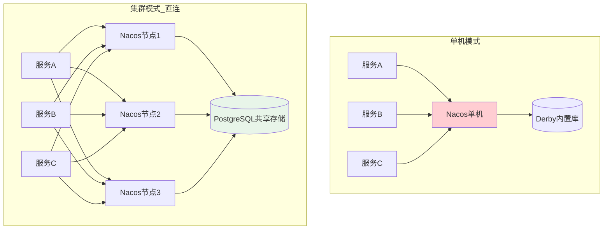

# Nacos高可用集群搭建

## 课程目标

- 理解Nacos集群架构的核心原理（Raft协议、Distro协议）
- 掌握Nacos集群部署的环境规划与节点配置方法
- 掌握将Nacos数据存储从内置Derby迁移到PostgreSQL的方法
- 掌握Nacos客户端直连集群的配置方式与故障转移机制
- 掌握Nacos集群的高可用验证方法（节点状态检查、故障转移测试）


## 回顾与导入

在上一节中，我们完成了Nacos单机版的部署，成功访问了控制台，并了解了Nacos 3.x在端口、鉴权和JDK要求方面的关键变化。单机模式使用内置Derby数据库存储数据，适合开发和测试环境快速上手。

但在生产环境中，单机模式存在明显的风险：

| 问题                | 影响                                        | 集群模式的解决方案         |
| ------------------- | ------------------------------------------- | -------------------------- |
| **单点故障**        | Nacos宕机后，所有服务的注册与发现功能不可用 | 多节点部署，互为备份       |
| **Derby数据库限制** | Derby是嵌入式数据库，不支持多节点共享数据   | 使用PostgreSQL作为共享存储 |
| **无负载均衡**      | 所有客户端连接同一个Nacos节点，压力集中     | 客户端直连多节点 + 轮询    |
| **数据一致性风险**  | 无法保证多节点间的数据同步                  | Raft/Distro协议保证一致性  |

本节的目标是“搭建生产可用的注册中心”。那么，什么才算“生产可用”？业界公认的Nacos生产部署最低标配包括：至少3节点跨可用区部署、后端配PostgreSQL等数据库共享存储、控制台不暴露公网。负载均衡层面，客户端直连多节点是Nacos原生支持的模式，在中小规模集群中完全可行。



本节课将完成从单机模式到集群模式的演进。


## Nacos集群架构原理

### 为什么至少需要3个节点

Nacos集群的配置中心模块依赖Raft协议实现数据一致性。Raft协议要求集群中超过半数（含半数）的节点存活才能正常工作，且选举Leader时也需要多数节点参与投票。2个节点的情况下，如果1个节点宕机，剩余1个节点无法构成多数（2的半数仍为1，但Raft要求严格多数），整个集群将无法选举出Leader，导致配置管理功能不可用。

因此，Nacos集群至少需要3个节点，这是工程纪律。在3节点集群中，允许1个节点故障而不影响整体可用性。

| 集群规模 | 容忍故障节点数 | 适用场景         |
| -------- | -------------- | ---------------- |
| 1节点    | 0              | 开发测试         |
| 3节点    | 1              | 生产环境最低要求 |
| 5节点    | 2              | 大规模生产环境   |

### Nacos集群的两种协议

Nacos集群内部使用两种协议处理不同类型的数据：

| 协议       | 处理数据类型             | 一致性模型     | 说明                                     |
| ---------- | ------------------------ | -------------- | ---------------------------------------- |
| **Raft**   | 配置中心数据、持久化实例 | CP（强一致）   | 写入需要多数节点确认，保证配置数据不丢失 |
| **Distro** | 临时实例的服务注册数据   | AP（最终一致） | 异步复制，保证高可用，适合服务发现场景   |

### 集群部署架构

无论采用何种部署方式，推荐将Nacos集群中所有服务节点放到一个VIP（虚拟IP）下面，然后挂到一个域名下面。这样客户端只需要连接统一入口，无需感知后端具体节点，集群扩缩容时也不需要修改客户端配置。

Nacos 3.x集群需要开放的端口如下：

| 端口 | 用途                     | 说明                          |
| ---- | ------------------------ | ----------------------------- |
| 8848 | HTTP API / 客户端主端口  | 服务注册、配置管理的HTTP接口  |
| 8080 | 控制台                   | Nacos 3.x控制台默认端口       |
| 9848 | gRPC 客户端连接          | 主端口+1000，用于客户端长连接 |
| 9849 | gRPC 服务端间通信        | 主端口+1001，仅集群内部使用   |
| 7848 | 旧版Raft通信（保留兼容） | 服务端间Raft选举与数据同步    |

> **安全注意：** 9849和7848端口为服务端之间的通信端口，**请勿暴露到外部网络环境和客户端侧**。

### 客户端直连的寻址机制

Nacos客户端默认提供基于配置的 `PropertiesServerListProvider`，从 `server-addr` 配置中获取服务端地址列表。当配置中存在多个服务端地址时，Nacos客户端会用逗号或分号拆分地址列表，并随机选择一个作为当前连接的服务端地址。如果当前选中的地址不可用，客户端会以轮询方式逐一尝试其他地址；尝试完所有地址后，会回到第一个地址继续轮询，直到找到可用地址或客户端停止。

```yaml
spring:
  cloud:
    nacos:
      discovery:
        server-addr: 127.0.0.1:8848,127.0.0.1:8849,127.0.0.1:8850
      config:
        server-addr: 127.0.0.1:8848,127.0.0.1:8849,127.0.0.1:8850
```

这种寻址方式的最大优点是客户端配置非常简单，只需配置 `server-addr` 即可，无需额外的服务端地址列表配置或额外组件部署。缺点是无法动态修改服务端地址列表，要变更必须创建新的Nacos客户端。


## 环境规划与准备

### 节点规划

为了在本机演示集群搭建，我们使用3个Nacos节点模拟3台服务器，分别使用不同的端口来区分。在实际生产环境中，这3个节点应部署在不同的物理机或虚拟机上，最好跨可用区。

| 节点  | IP地址    | 端口 | 模拟服务器 |
| ----- | --------- | ---- | ---------- |
| 节点1 | 127.0.0.1 | 8848 | 服务器A    |
| 节点2 | 127.0.0.1 | 8858 | 服务器B    |
| 节点3 | 127.0.0.1 | 8868 | 服务器C    |

> **说明：** 在生产环境中，3个节点使用相同的端口（8848）部署在不同服务器上，通过不同的IP区分。本课程为了在本机模拟，使用不同端口来区分节点。

> **注意：** 在单台服务器上搭建集群时，**不能使用连续端口号**（如 8848, 8849, 8850）。因为 `8849` 节点的 gRPC 端口会是 `9849` 和 `9850`，会与 `8848` 节点的 `9849` 端口冲突。所以你需要像上表那样，**间隔一定数值**（如 10 或更大）来设置主端口。

### 环境要求

| 要求           | 说明                              |
| -------------- | --------------------------------- |
| **JDK**        | JDK 17+（Nacos 3.x不再支持JDK 8） |
| **PostgreSQL** | 12+（推荐PostgreSQL 14+）         |
| **内存**       | 每个Nacos节点建议至少1GB堆内存    |

### 准备PostgreSQL数据库

集群模式需要使用PostgreSQL作为共享存储，Derby数据库不支持集群模式。

**步骤一：下载插件**

想要在Nacos中使用PostgreSQL，需要下载专门的插件：

https://repo1.maven.org/maven2/com/sinhy/nacos-postgresql-datasource-plugin-ext/3.0.3/nacos-postgresql-datasource-plugin-ext-3.0.3.jar

下载该插件，并放在nacos根目录下的plugins文件夹中。

**步骤二：初始化数据库表**

在下载的插件包中，解压获取Nacos官方提供了PostgreSQL初始化脚本nacos-pg.sql。

执行该脚本创建Nacos所需的表结构。执行成功后，`nacos`数据库中会创建以下表：

| 表名                 | 用途                   |
| -------------------- | ---------------------- |
| config_info          | 配置信息主表           |
| config_info_aggr     | 配置聚合表             |
| config_info_beta     | 配置Beta发布表         |
| config_info_tag      | 配置标签表             |
| config_tags_relation | 配置标签关联表         |
| group_capacity       | 分组容量表             |
| his_config_info      | 配置历史表             |
| tenant_info          | 命名空间（租户）信息表 |
| users                | 用户表                 |
| roles                | 角色表                 |
| permissions          | 权限表                 |


## 部署Nacos集群节点

### 解压Nacos安装包

由于本机模拟需要3个节点，我们将Nacos解压到3个不同的目录。

### 配置cluster.conf集群文件

在**每个节点**的`conf`目录下，编辑`cluster.conf`文件，列出集群中所有节点的地址，每行一个节点：

```bash
# cluster.conf 内容（三个节点保持一致）：
127.0.0.1:8848
127.0.0.1:8858
127.0.0.1:8868
```

### 配置PostgreSQL数据源

在**每个节点**的`conf/application.properties`文件中，添加PostgreSQL数据源配置。首先注释掉或删除原有的Derby配置，然后添加以下内容：

```properties
# 数据库类型
spring.sql.init.platform=postgresql

# 数据库实例数量
db.num=1

# 数据库连接 URL
db.url.0=jdbc:postgresql://127.0.0.1:5432/nacos?currentSchema=public

# 数据库用户名和密码
db.user=postgres
db.password=admin

# JDBC 驱动类名 (此配置项至关重要)
db.pool.config.driverClassName=org.postgresql.Driver

# (可选) 连接测试查询
db.pool.config.connectionTestQuery=SELECT 1
```

> **说明：** `db.url.0`中的`.0`表示第0个数据库实例。如果使用PostgreSQL主备架构，可以配置`db.num=2`并添加`db.url.1`、`db.user.1`、`db.password.1`。

### 修改节点端口

由于本机模拟3个节点，需要为每个节点配置不同的端口。在每个节点的`conf/application.properties`中添加：

```properties
# 节点1
nacos.server.main.port=8848

# 节点2
nacos.server.main.port=8858

# 节点3
nacos.server.main.port=8868
```

### 修改控制台端口

```properties
# 节点1
nacos.console.port=8080

# 节点2
nacos.console.port=8081

# 节点3
nacos.console.port=8082
```


## 启动Nacos集群

### 启动命令

在每个节点的`bin`目录下，执行启动命令。**注意：** 集群模式不需要加`-m standalone`参数。

如果已经在`application.properties`中配置了鉴权信息，启动时不会提示输入。否则，启动程序会提示输入3个鉴权相关配置（`NACOS_AUTH_TOKEN`、`NACOS_AUTH_IDENTITY_KEY`、`NACOS_AUTH_IDENTITY_VALUE`）。

### 查看启动日志

进入每个节点的`logs`目录，查看`start.out`文件，确认启动成功：

```
Nacos started successfully in cluster mode with external storage in 11183 ms
```

> **注意：** 日志中应显示 `cluster mode` 和 `external storage`（表示使用外部PostgreSQL存储），而非单机模式的 `stand alone mode. use embedded storage`。

### 验证集群状态

访问任意一个Nacos节点的控制台：

```
http://127.0.0.1:8080/index.html
```

登录后，点击左侧导航栏的 **“集群管理” → “节点列表”** ，可以看到集群中的所有节点及其状态。

**预期结果：** 3个节点的状态均显示为 **UP**（健康）。

| 节点地址       | 状态 | 角色     |
| -------------- | ---- | -------- |
| 127.0.0.1:8848 | UP   | leader   |
| 127.0.0.1:8858 | UP   | follower |
| 127.0.0.1:8868 | UP   | follower |

> **说明：** Raft协议会自动选举一个Leader节点。Leader负责处理写请求，Follower负责同步数据。如果Leader宕机，Follower会自动重新选举。


## 高可用验证实战

### 验证一：节点状态检查

访问任意节点的控制台，在“集群管理 → 节点列表”中确认3个节点状态均为UP。

### 验证二：停止一个节点，验证服务可用

模拟节点故障，停止节点3。

**预期结果：**

1. 控制台的节点列表中，节点3的状态变为DOWN或消失
2. 剩余2个节点仍然正常工作（3节点中剩余2个，满足多数原则）
3. 服务注册与配置管理功能不受影响
4. 配置了多节点地址的客户端自动切换到其他可用节点

### 验证三：恢复节点，验证重新加入

重新启动节点3。

**预期结果：**

1. 节点3自动加入集群，状态恢复为UP
2. 节点3自动从其他节点同步数据（配置信息、服务列表等）
3. 数据保持一致


## 注意事项

1. **节点数量要求**：Nacos集群至少需要3个节点，这是Raft协议保证一致性的基本要求。2个节点无法在故障时构成多数。

2. **PostgreSQL共享存储**：集群模式下必须使用外部PostgreSQL数据库，Derby不支持集群模式。每个节点都需要配置相同的PostgreSQL数据源。

3. **cluster.conf一致性**：所有节点的`cluster.conf`文件内容必须完全一致，否则会出现节点无法正确发现其他成员的问题。

4. **端口规划**：Nacos 3.x的控制台端口为8080，与Spring Boot应用常用的8080端口可能冲突，需要注意。

6. **客户端直连的局限性**：直连模式下集群扩缩容需要更新所有客户端配置。如果集群规模较大或客户端数量较多，建议引入Nginx/SLB作为统一入口。

   

## 小结

本节课我们学习了：

1. **Nacos集群架构原理**：3节点最低要求、Raft协议（配置数据）与Distro协议（服务注册数据）的分工、集群部署架构图。

2. **环境规划**：3个节点的端口规划、PostgreSQL数据库的创建与初始化。

3. **集群节点部署**：解压3个节点目录、配置`cluster.conf`、配置PostgreSQL数据源、配置节点端口、配置鉴权信息。

4. **集群启动与验证**：启动3个节点、通过控制台方式验证集群状态。

6. **高可用验证**：节点状态检查、停止节点验证服务可用、恢复节点验证重新加入

   

## 作业

### 作业一：完成Nacos集群搭建

1. 参照课程内容，准备PostgreSQL数据库并执行`pg-schema.sql`初始化脚本。
2. 解压3个Nacos节点到不同目录，配置`cluster.conf`和`application.properties`。
3. 启动3个节点，截图控制台“集群管理 → 节点列表”中3个节点状态均为UP的画面。
4. 验证日志中“Nacos started successfully in cluster mode with external storage in 11183 ms.”的输出。

### 作业二：高可用验证

1. 停止一个Nacos节点，观察并记录：
   - 控制台节点列表的变化
   - 剩余节点是否正常工作
2. 重新启动被停止的节点，观察并记录：
   - 节点是否自动重新加入集群
   - 数据是否自动同步
