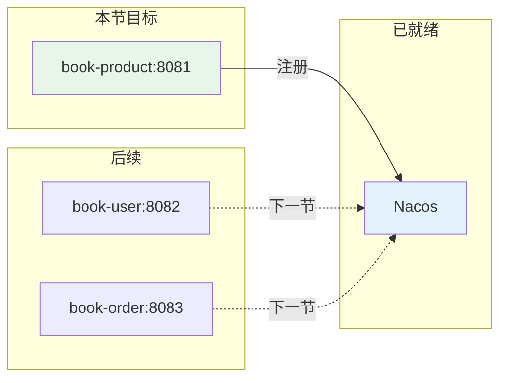
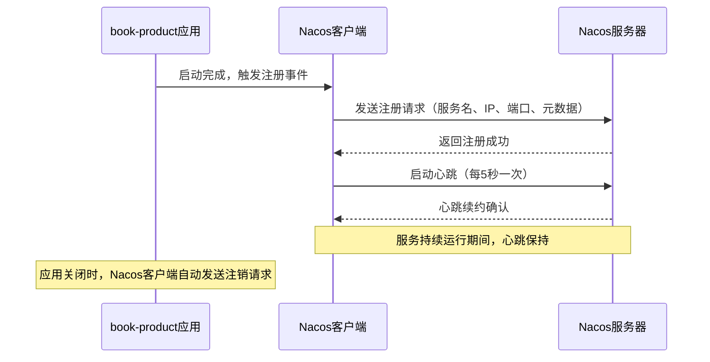

# 图书服务注册到Nacos

## 课程目标

- 理解服务注册与发现的核心机制与Nacos客户端的自动装配原理
- 掌握Spring Cloud Alibaba Nacos Discovery的依赖引入与配置方法
- 掌握将book-product服务注册到Nacos集群的完整流程
- 掌握Nacos服务注册的配置项含义（server-addr、namespace、group等）
- 掌握服务注册失败的常见原因与排查方法
- 完成图书管理系统第一个服务注册到Nacos集群


## 回顾与导入

在前两节课中，我们完成了Nacos环境的搭建。注册中心环境已经就绪，但目前Nacos控制台的服务列表仍然是空的，还没有任何服务注册进来。

本节的目标是**将book-product服务注册到Nacos集群**，完成从“注册中心就绪”到“服务真正出现在注册中心”的关键一步。本节课的核心内容是“在book-product中添加Nacos依赖，配置注册信息，实现book-product注册到Nacos”。




## 服务注册与发现机制回顾

在动手配置之前，先理解Nacos客户端的工作机制。

### 注册流程

当Spring Boot应用启动时，如果引入了Nacos Discovery依赖并配置了Nacos服务器地址，Nacos客户端会自动完成以下动作：



### 自动装配原理

Spring Cloud Alibaba Nacos Discovery通过Spring Boot的自动装配机制实现“零代码”注册。核心类是`NacosServiceRegistry`和`NacosDiscoveryAutoConfiguration`，它们在应用启动时自动注册`AutoServiceRegistration`，监听Web服务器的启动事件，随后向Nacos发起注册。

这意味着：**不需要手写任何注册代码**，只需引入依赖、添加配置，服务就会自动注册到Nacos。

### 服务名的作用

`spring.application.name`是服务在注册中心的唯一标识。当一个服务有多个实例时（如启动两个book-product实例），它们注册在同一个服务名下，Nacos会将它们作为同一个服务的不同实例进行管理。消费者通过服务名（而非IP:端口）来调用服务，由负载均衡器选择一个实例。


## 依赖确认

在**"Spring Cloud Alibaba技术栈集成"**讲中，我们已经为三个服务预置了完整的Starter依赖，其中就包括Nacos Discovery。本节需要确认依赖已正确引入。

### book-product的pom.xml

打开`book-product/pom.xml`，确认以下依赖存在：

```xml
<!-- ==================== 服务注册发现 ==================== -->
<dependency>
    <groupId>com.alibaba.cloud</groupId>
    <artifactId>spring-cloud-starter-alibaba-nacos-discovery</artifactId>
</dependency>
```

> **注意：** 该依赖的版本由父POM中的Spring Cloud Alibaba BOM统一管理，**不要手动写版本号**。如果手动指定了版本号，可能与BOM中的版本冲突，导致运行时异常。

### 确认BOM已生效

在父工程根目录执行以下命令，确认Nacos客户端版本：

```bash
mvn dependency:tree -pl book-product | grep nacos
```

**预期输出（关键行）：**

```
[INFO] +- com.alibaba.cloud:spring-cloud-starter-alibaba-nacos-discovery:jar:2025.0.0.0:compile
[INFO] |  +- com.alibaba.nacos:nacos-client:jar:3.0.3:compile
```

> **验证要点：** `nacos-client`版本为3.0.3，与Nacos Server版本一致。如果版本不一致，可能需要检查BOM是否生效。


## 配置application.yml

### 当前配置状态

在前面的课程中，book-product的`application.yml`已经配置了端口和数据库：

```yaml
server:
  port: 8081

spring:
  application:
    name: book-product
```

此时`spring.application.name`已配置为`book-product`，这正是服务注册到Nacos时使用的服务名。

### 添加Nacos注册配置

在`application.yml`中添加`spring.cloud.nacos.discovery`配置。如果我们使用的是3节点集群，`server-addr`需要配置所有节点地址，用英文逗号分隔：

```yaml
server:
  port: 8081

spring:
  application:
    name: book-product
  cloud:
    nacos:
      discovery:
        # Nacos服务器
        server-addr: 127.0.0.1:8848
        # Nacos集群地址（多个节点用逗号分隔）
        # server-addr: 127.0.0.1:8848,127.0.0.1:8858,127.0.0.1:8868
        # 命名空间（留空使用public）
        namespace: public
        # 分组（默认DEFAULT_GROUP）
        group: DEFAULT_GROUP
```

### 配置项详解

| 配置项                | 必填 | 默认值          | 说明                                                         |
| --------------------- | ---- | --------------- | ------------------------------------------------------------ |
| `server-addr`         | 是   | 无              | Nacos服务器地址，如果是集群则用逗号分隔。客户端会随机选择一个节点建立连接，如果连接失败则轮询其他节点 |
| `namespace`           | 否   | `public`        | 命名空间ID，用于环境隔离。后续内容将详细讲解                 |
| `group`               | 否   | `DEFAULT_GROUP` | 服务分组，用于逻辑隔离                                       |
| `metadata`            | 否   | 空              | 实例元数据，可用于版本标记、灰度路由等                       |
| `register-enabled`    | 否   | `true`          | 是否启用服务注册。纯消费者（不对外提供服务）可设为`false`    |
| `prefer-ip-address`   | 否   | `false`         | 是否优先使用IP而非hostname注册。Docker/K8s环境建议设为`true` |
| `heart-beat-interval` | 否   | `5000`          | 心跳间隔（毫秒）                                             |
| `heart-beat-timeout`  | 否   | `15000`         | 心跳超时时间（毫秒），超时后标记为不健康                     |
| `ip-delete-timeout`   | 否   | `30000`         | 实例删除超时（毫秒），超时后从服务列表剔除                   |

> **生产环境提示：** 配置`namespace`时使用的是**命名空间ID**（不是名称）。在Nacos控制台创建命名空间后，页面上会显示一个自动生成的ID（如`a1b2c3d4-...`），配置时需填写该ID。

### 关于server-addr的集群配置

当配置了多个Nacos节点地址后，Nacos客户端的寻址机制如下：

1. **随机选择**：客户端从地址列表中随机选择一个节点建立连接
2. **故障转移**：如果当前节点不可用，客户端以轮询方式依次尝试其他地址
3. **持续重试**：尝试完所有地址后，回到第一个地址继续轮询，直到找到可用节点或客户端停止

这意味着即使集群中某个节点宕机，客户端也能自动切换到其他健康节点，注册功能不受影响。

```yaml
# 单机模式
server-addr: 127.0.0.1:8848

# 集群模式
server-addr: 127.0.0.1:8848,127.0.0.1:8858,127.0.0.1:8868
```


## 启动类配置

### 是否需要@EnableDiscoveryClient

在我们使用的Spring Cloud Alibaba版本中，**`@EnableDiscoveryClient`注解已不再必需**。只要满足以下两个条件，服务就会自动注册：

1. 引入了`spring-cloud-starter-alibaba-nacos-discovery`依赖
2. 配置了`spring.cloud.nacos.discovery.server-addr`

Nacos Discovery的自动装配机制会检测到这些条件，并自动完成注册。

不过，为了代码的**显式性和可读性**，建议在启动类上保留`@EnableDiscoveryClient`注解，明确表明该服务启用了服务发现功能。这不是强制要求，但有助于团队协作时快速理解服务定位。

### 启动类完整代码

**BookProductApplication.java：**

```java
@SpringBootApplication(scanBasePackages = "com.example")
@EnableDiscoveryClient
@MapperScan("com.example.product.mapper")
public class BookProductApplication {
    public static void main(String[] args) {
        SpringApplication.run(BookProductApplication.class, args);
    }
}
```


## 启动服务并验证注册

### 启动book-product

启动日志中应包含注册相关日志：

```
[Nacos Register] register service, serviceName: book-product, groupName: DEFAULT_GROUP
[Nacos Register] register success, serviceName: book-product
```

如果日志中没有出现注册相关输出，请参考下文“常见问题排查”部分。

### 方式一：通过Nacos控制台验证

登录Nacos控制台（`http://127.0.0.1:8080/index.html`），点击左侧导航栏 **“服务管理” → “服务列表”** 。

**预期结果：**

| 服务名         | 集群数目 | 实例数目 | 健康实例数 |
| -------------- | -------- | -------- | ---------- |
| `book-product` | 1        | 1        | 1          |

点击服务名进入详情页，可以看到实例的详细信息：

| 字段     | 值        |
| -------- | --------- |
| IP       | 127.0.0.1 |
| 端口     | 8081      |
| 健康状态 | 健康      |
| 权重     | 1.0       |

### 方式二：通过API接口验证

使用curl命令查询已注册的服务列表：

```bash
# 查询服务列表
curl -X GET 'http://127.0.0.1:8848/nacos/v1/ns/service/list?pageNo=1&pageSize=10'
```

**预期响应：**

```json
{
    "count": 1,
    "doms": [
        "book-product"
    ]
}
```

查询服务实例详情：

```bash
curl -X GET 'http://127.0.0.1:8848/nacos/v1/ns/instance/list?serviceName=book-product'
```

**预期响应（简化）：**

```json
{
    "name": "DEFAULT_GROUP@@book-product",
    "groupName": "DEFAULT_GROUP",
    "clusters": "",
    "cacheMillis": 10000,
    "hosts": [
        {
            "instanceId": "10.80.216.99#8081##DEFAULT_GROUP@@book-product",
            "ip": "10.80.216.99",
            "port": 8081,
            "weight": 1,
            "healthy": true,
            "enabled": true,
            "ephemeral": true,
            "clusterName": "DEFAULT",
            "serviceName": "DEFAULT_GROUP@@book-product",
            "metadata": {
                "preserved.register.source": "SPRING_CLOUD"
            },
            "ipDeleteTimeout": 30000,
            "instanceHeartBeatTimeOut": 15000,
            "instanceHeartBeatInterval": 5000
        }
    ],
    "lastRefTime": 1792391282352,
    "checksum": "",
    "allIps": false,
    "reachProtectionThreshold": false,
    "valid": true
}
```

### 方式三：通过客户端日志验证

查看应用日志中的Nacos注册相关输出，或在IDEA的控制台中搜索`register`关键字，确认注册请求已发出且成功。

### 服务列表中的实例状态

注册成功后，在Nacos控制台的服务详情页中，实例会显示以下状态：

| 状态       | 含义                           |
| ---------- | ------------------------------ |
| **健康**   | 心跳正常，实例可用             |
| **不健康** | 心跳超时，实例可能已宕机       |
| **上线**   | 实例正常对外提供服务           |
| **下线**   | 实例被手动下线，不参与服务发现 |


## 多实例注册验证

### 启动第二个book-product实例

将book-product的端口改为8082（仅用于验证），启动第二个实例。由于`spring.application.name`相同（都是`book-product`），两个实例会注册在同一个服务名下。

**修改application.yml中的端口：**

```yaml
server:
  port: 8082  # 第二个实例
```

启动第二个实例。

### 验证多实例

在Nacos控制台的服务列表中，`book-product`的实例数目会变为 **2**。

| 实例  | IP        | 端口 | 健康状态 |
| ----- | --------- | ---- | -------- |
| 实例1 | 127.0.0.1 | 8081 | 健康     |
| 实例2 | 127.0.0.1 | 8082 | 健康     |

> **说明：** 多实例注册是负载均衡的基础。后续课程将利用多实例验证Spring Cloud LoadBalancer的负载均衡效果。本节先验证多实例能正确注册。

### 停止一个实例

停止第二个实例，观察Nacos控制台的实例列表。由于Nacos客户端在应用关闭时会发送注销请求，实例会从列表中移除。如果应用异常退出，实例不会立即移除，而是等待心跳超时后被标记为不健康，再经过`ip-delete-timeout`后剔除。


## 常见问题排查

### 服务未出现在Nacos控制台

这是最常见的问题。按以下顺序逐步排查：

**第一步：检查Nacos是否正常运行**

访问Nacos控制台，确认节点状态均为UP。如果Nacos服务器本身不可用，服务自然无法注册。

**第二步：检查网络连通性**

```bash
# 测试能否访问Nacos节点
telnet 127.0.0.1 8848
```

如果telnet不通，说明网络或防火墙存在问题。Nacos 3.x需要开放的端口包括：8848（HTTP）、9848（gRPC）、8080（控制台）。

**第三步：检查配置是否正确**

确认`application.yml`中的配置项：

```yaml
spring:
  cloud:
    nacos:
      discovery:
        server-addr: 127.0.0.1:8848
```

- 确认`server-addr`的IP和端口与Nacos实际监听一致
- 确认`spring.application.name`已配置（这是服务名）
- 确认`namespace`填的是命名空间ID而非名称

**第四步：查看应用启动日志**

在应用日志中搜索`REGISTER-SERVICE`关键字，确认注册请求是否已发出。如果日志中没有该关键字，说明注册请求根本没有发出，可能是依赖缺失或配置未生效。

**第五步：查看Nacos服务端日志**

查看Nacos的日志文件，确认包含注册请求信息中的服务名称："book-product"。

### 注册成功但实例不健康

如果实例已出现在Nacos控制台，但状态为“不健康”：

| 可能原因                            | 排查方法                                            |
| ----------------------------------- | --------------------------------------------------- |
| 心跳未正常发送                      | 检查应用日志中是否有心跳发送记录                    |
| 网络延迟导致心跳超时                | 检查`heart-beat-interval`和`heart-beat-timeout`配置 |
| Nacos服务器时间与客户端时间偏差过大 | 检查服务器时间同步状态                              |

### 注册时报连接超时

如果启动日志中出现`Connection refused`或`Timeout`异常：

| 可能原因       | 排查方法                                    |
| -------------- | ------------------------------------------- |
| Nacos未启动    | 检查Nacos进程是否运行                       |
| 端口错误       | 确认`server-addr`中的端口是8848而非8080     |
| gRPC端口未开放 | Nacos 3.x需要9848端口，确认防火墙已放行     |
| 鉴权失败       | 如果Nacos开启了鉴权，确认用户名密码配置正确 |

### 版本冲突导致NoSuchMethodError

如果启动时出现`NoSuchMethodError`或`ClassNotFoundException`，通常是BOM未生效或版本冲突：

```bash
# 查看实际生效的nacos-client版本
mvn dependency:tree -pl book-product | grep nacos
```

确认`nacos-client`版本为3.0.3，与Nacos Server版本一致。如果版本不一致，检查父POM中的BOM配置。


## 小结

本节课我们学习了：

1. **服务注册与发现机制**：Nacos客户端在应用启动时自动向Nacos注册服务，并通过心跳维持注册状态。
2. **依赖确认**：`spring-cloud-starter-alibaba-nacos-discovery`依赖版本由BOM统一管理。
3. **application.yml配置**：核心配置项包括`server-addr`、`namespace`、`group`、`metadata`等。
4. **集群地址配置**：多个Nacos节点用逗号分隔，客户端自动实现故障转移。
5. **启动类配置**：`@EnableDiscoveryClient`为可选注解，但建议保留以提升可读性。
6. **验证注册成功**：通过控制台、API、日志三种方式验证服务已注册。
7. **多实例注册**：相同服务名的多个实例会注册在同一个服务下，为负载均衡做准备。
8. **常见问题排查**：服务未出现、实例不健康、连接超时、版本冲突等问题的排查方法。


## 作业

### 作业一：完成book-product注册

1. 确认book-product的`pom.xml`中已包含`spring-cloud-starter-alibaba-nacos-discovery`依赖。
2. 在`application.yml`中添加Nacos Discovery配置，`server-addr`配置Nacos服务器地址。
3. 启动book-product服务，截图Nacos控制台“服务列表”中出现`book-product`的画面。
4. 截图服务详情页中实例的元数据信息。

### 作业二：多实例注册验证

1. 启动第二个book-product实例（端口8082），验证Nacos控制台显示2个实例。
2. 停止第二个实例，观察Nacos控制台实例列表的变化。
3. 杀死第一个实例（模拟异常宕机），观察Nacos控制台实例状态的变化（从健康→不健康→剔除）。
