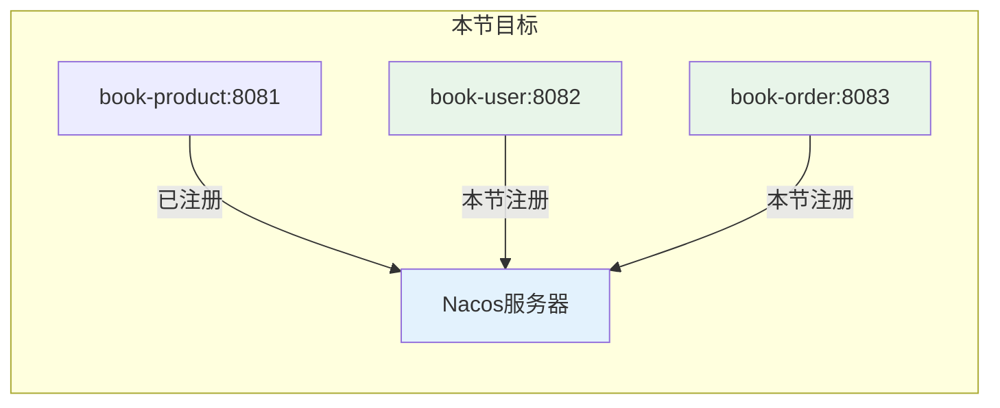

# 用户与订单服务注册

## 课程目标

- 掌握将book-user和book-order服务注册到Nacos的完整流程

- 掌握服务全部注册后的验证方法

- 掌握多服务注册时的配置复用与差异化配置方法

- 掌握使用配置文件抽取（shared config）避免重复配置

- 掌握注册开关、元数据与权重的配置方法

  

## 回顾与导入

在上一节中，我们完成了book-product服务到Nacos集群的注册，验证了单服务注册、多实例注册以及常见问题的排查方法。此时Nacos控制台的服务列表中只有`book-product`一个服务。

本节的定位是**将book-user和book-order也注册到Nacos**，完成三个服务全部注册的目标。



> **前置条件：** 请确保上一节已顺利完成，Nacos控制台中能看到`book-product`服务。如果尚未完成，请先回顾上一节内容。


## 不同微服务的差异化分析

在动手配置之前，先分析三个服务的差异，判断是否可以完全复用上一节的配置方式。

### 三个服务的对比

| 维度             | book-product                 | book-user                    | book-order                           |
| ---------------- | ---------------------------- | ---------------------------- | ------------------------------------ |
| 端口             | 8081                         | 8082                         | 8083                                 |
| 服务名           | `book-product`               | `book-user`                  | `book-order`                         |
| 业务定位         | 服务提供者（被订单服务调用） | 服务提供者（被订单服务调用） | 服务消费者（调用商品服务、用户服务） |
| 是否注册         | 是                           | 是                           | 是（原则上可以不注册）               |
| 是否需要服务发现 | 是（原则上可以不发现）       | 是（原则上可以不发现）       | 是                                   |

### 差异化配置分析

三个服务的Nacos注册配置**完全相同**，唯一的区别是`server.port`和`spring.application.name`。这意味着：

- `spring.cloud.nacos.discovery`配置可以完全复用
- 但每个服务的`application.yml`是独立的，需要分别添加

### 是否需要配置复用

三个服务有相同的Nacos配置，如果未来需要修改Nacos集群地址，需要修改三个文件。虽然这不算是大问题，但为了演示**配置抽取**的最佳实践，本节将介绍两种方式：

| 方式                     | 说明                                       | 适用场景                 |
| ------------------------ | ------------------------------------------ | ------------------------ |
| **方式一：分别配置**     | 每个服务的`application.yml`中独立配置      | 服务数量少、配置差异大   |
| **方式二：抽取共享配置** | 使用`spring.config.import`导入共享配置文件 | 服务数量多、配置高度一致 |

> **本节重点：** 方式一是基础，必须掌握；方式二是进阶，了解其思路即可。后续内容将使用Nacos配置中心实现更优雅的配置共享。


## book-user和book-order服务注册

### 确认依赖

打开`book-user/pom.xml`，确认已引入Nacos Discovery依赖：

```xml
<dependency>
    <groupId>com.alibaba.cloud</groupId>
    <artifactId>spring-cloud-starter-alibaba-nacos-discovery</artifactId>
</dependency>
```

### 配置application.yml

打开`book-user/src/main/resources/application.yml`，添加Nacos注册配置：

```yaml
server:
  port: 8082

spring:
  application:
    name: book-user
  cloud:
    nacos:
      discovery:
        # Nacos服务器
        server-addr: 127.0.0.1:8848
        # 命名空间（留空使用public）
        namespace: public
        # 分组（默认DEFAULT_GROUP）
        group: DEFAULT_GROUP
```

### 启动类配置

**BookUserApplication.java：**

```java
@SpringBootApplication(scanBasePackages = "com.example")
@EnableDiscoveryClient
@MapperScan("com.example.user.mapper")
public class BookUserApplication {
    public static void main(String[] args) {
        SpringApplication.run(BookUserApplication.class, args);
    }
}
```

### 启动并验证

**预期日志：**

```
[Nacos Register] register service, serviceName: book-user, groupName: DEFAULT_GROUP
[Nacos Register] register success, serviceName: book-user
```

打开Nacos控制台的服务列表，应该能看到`book-user`服务。

**book-order服务的注册过程与book-user完全一致。**


## 三服务全部注册后的验证

### 控制台验证

登录Nacos控制台，点击 **“服务管理” → “服务列表”** 。

**预期结果：**

| 服务名         | 集群数目 | 实例数目 | 健康实例数 |
| -------------- | -------- | -------- | ---------- |
| `book-product` | 1        | 1        | 1          |
| `book-user`    | 1        | 1        | 1          |
| `book-order`   | 1        | 1        | 1          |

三个服务全部显示为“健康”状态。

### API验证

使用curl命令查询所有已注册的服务：

```bash
curl -X GET 'http://127.0.0.1:8848/nacos/v1/ns/service/list?pageNo=1&pageSize=10'
```

**预期响应（简化）：**

```json
{
  "count": 3,
  "doms": [
    "DEFAULT_GROUP@@book-product",
    "DEFAULT_GROUP@@book-user",
    "DEFAULT_GROUP@@book-order"
  ]
}
```

分别查询三个服务的实例详情：

```bash
# 查询book-product实例
curl -X GET 'http://127.0.0.1:8848/nacos/v1/ns/instance/list?serviceName=book-product'

# 查询book-user实例
curl -X GET 'http://127.0.0.1:8848/nacos/v1/ns/instance/list?serviceName=book-user'

# 查询book-order实例
curl -X GET 'http://127.0.0.1:8848/nacos/v1/ns/instance/list?serviceName=book-order'
```

### 业务验证

三个服务注册成功后，原有的CRUD接口应仍然正常工作：

```http
### 查询所有商品
GET {{product_url}}/api/products

### 查询所有用户
GET {{user_url}}/api/users

### 查询所有订单
GET {{order_url}}/api/orders
```

**预期结果：** 三个请求均返回统一的`Result`格式响应，状态码为200。


## 进阶：配置抽取与共享

### 问题分析

三个服务的Nacos配置完全相同，分散在三个文件中。如果Nacos集群地址发生变化（如从3节点扩展到5节点），需要修改三个文件。虽然目前只有三个服务，但如果未来服务数量增加，维护成本会显著上升。

### 方案一：使用spring.config.import导入共享配置

Spring Boot 2.4+支持通过`spring.config.import`导入外部配置文件。我们可以在项目根目录创建一个共享的`nacos-shared.yml`：

```yaml
# 项目根目录/nacos-shared.yml
spring:
  cloud:
    nacos:
      discovery:
        server-addr: 127.0.0.1:8848
        namespace: public
        group: DEFAULT_GROUP
```

然后在每个服务的`application.yml`中导入：

```yaml
spring:
  config:
    import: optional:file:../nacos-shared.yml
  application:
    name: book-product
```

> **注意：** `optional:`前缀表示文件不存在时不报错。路径`../nacos-shared.yml`是相对于服务目录的路径，实际使用时需要根据项目结构调整。

### 方案二：使用Nacos配置中心（推荐，后续课程）

后续内容将引入Nacos Config配置中心，届时所有服务的配置都可以集中管理到Nacos，支持动态刷新和灰度发布。这是最优雅的方案，也是生产环境的标准做法。

> **本节建议：** 现阶段保持方式一（分别配置）即可，重点是理解服务注册的机制。配置共享的优雅方案将在配置中心课程中讲解。


## 进阶：注册开关、元数据与权重

### register-enabled开关

如果某个服务是纯消费者（只调用其他服务，不会被其他服务调用，如book-order服务），可以关闭注册：

```yaml
spring:
  cloud:
    nacos:
      discovery:
        register-enabled: false
```

关闭后，服务仍然可以从Nacos发现其他服务，但自身不会出现在服务列表中。

### 元数据的使用

元数据（metadata）是附加在服务实例上的键值对，可用于灰度发布、版本路由等场景：

```yaml
spring:
  cloud:
    nacos:
      discovery:
        metadata:
          version: 1.0.0
          env: dev
          region: beijing
```

注册后，在Nacos控制台的实例详情中可以看到这些元数据。后续课程中将利用元数据实现基于请求Header的灰度流量路由。

### 权重配置

实例权重影响负载均衡时的流量分配。默认权重为1.0，权重越高的实例被选中的概率越大：

```yaml
spring:
  cloud:
    nacos:
      discovery:
        weight: 2.0  # 该实例权重为2，是默认实例的2倍
```

权重也可以在Nacos控制台中动态修改（“服务详情” → 实例列表 → 编辑权重），无需重启应用。后续内容将详细讲解权重的使用。


## 服务注册后的运维操作

### 手动下线实例

在Nacos控制台中，进入服务详情页，可以手动将实例**下线**。下线后的实例不会参与服务发现，但进程仍在运行。

**操作步骤：**

1. 进入`book-product`服务详情页
2. 找到目标实例，点击“下线”
3. 实例状态变为“已下线”
4. 其他服务无法发现该实例

**适用场景：** 灰度发布前将旧版本实例下线、临时摘除问题实例。

### 手动上线实例

将已下线的实例重新**上线**，恢复其参与服务发现的能力。

### 编辑实例权重

在服务详情页点击“编辑”，可以修改实例权重。权重越高，被负载均衡选中的概率越大。

| 权重 | 流量分配                 |
| ---- | ------------------------ |
| 1.0  | 默认权重                 |
| 2.0  | 约两倍流量               |
| 0.0  | 不接收流量（等价于下线） |

> **注意：** 权重调整仅对**临时实例**有效。持久化实例的权重调整需要通过API或控制台的特殊操作。

### 实例元数据查看

在服务详情页可以看到实例的元数据（metadata），如`version=1.0.0`、`region=local`。这些元数据可用于灰度路由、监控分组等场景。

### 配置debug日志

配置 debug 日志方式：

```yaml
logging:
  level:
    com.alibaba.cloud.nacos: DEBUG
    com.alibaba.nacos: DEBUG
```

注意：需要同时更新 `spring-cloud-starter-alibaba-nacos-discovery`的依赖：

```xml
<dependency>
    <groupId>com.alibaba.cloud</groupId>
    <artifactId>spring-cloud-starter-alibaba-nacos-discovery</artifactId>
    <exclusions>
        <exclusion>
            <groupId>com.alibaba.nacos</groupId>
            <artifactId>logback-adapter</artifactId>
        </exclusion>
    </exclusions>
</dependency>
```

为什么要这样配置？简单来说，`logback-adapter` 是旧版 Nacos 为了在 Spring Boot 3.x 下“抢回”日志控制权而引入的一个**过渡性补丁**。但在 Spring Boot 3.5 和 Nacos 3.x 的新组合下，这个补丁本身会引发初始化错误，并且与 Nacos 内部新的日志管理机制相冲突。因此，通过 `<exclusions>` 将其移除，是为了**让日志系统的控制权平滑地交还给 Spring Boot**，同时**让 Nacos 3.x 使用它自带的、更稳定的日志集成机制**。这是恢复日志正常输出（包括你需要的 DEBUG 级别）的必要步骤。


## 小结

本节课我们学习了：

1. **book-user服务注册**：添加Nacos Discovery配置，设置服务名为`book-user`，端口8082。

2. **book-order服务注册**：添加Nacos Discovery配置，设置服务名为`book-order`，端口8083。

3. **三服务全部注册验证**：通过控制台、API、业务接口三种方式验证。

4. **配置抽取方案**：介绍了`spring.config.import`配置共享方案。

5. **进阶配置**：注册开关、元数据与权重的配置方法

6. **运维操作**：掌握了手动上下线、编辑权重、查看元数据等运维操作。

   


## 作业

### 作业一：完成book-user和book-order注册

1. 确认book-user和book-order的`pom.xml`中包含`spring-cloud-starter-alibaba-nacos-discovery`依赖。
2. 分别为两个服务添加Nacos Discovery配置。
3. 启动三个服务，截图Nacos控制台“服务列表”中三个服务全部显示的画面。
4. 截图每个服务详情页中的实例信息。

### 作业二：多实例与运维操作验证

1. 启动第二个book-product实例（端口8081和8082），验证控制台显示2个实例。
2. 在控制台中将其中一个实例**下线**，验证服务列表中的健康实例数变为1。
3. 将下线实例重新**上线**，验证健康实例数恢复为2。
4. 编辑实例权重为`0.5`，观察控制台中权重字段的变化。
5. 记录每个操作对应的控制台变化。

### 作业三：配置抽取实践

1. 参照课程内容，创建`nacos-shared.yml`共享配置文件。
2. 在三个服务的`application.yml`中通过`spring.config.import`导入共享配置。
3. 启动三个服务，验证注册仍然正常。
4. 思考：`spring.config.import`方式与分别配置方式相比，有哪些优缺点？
