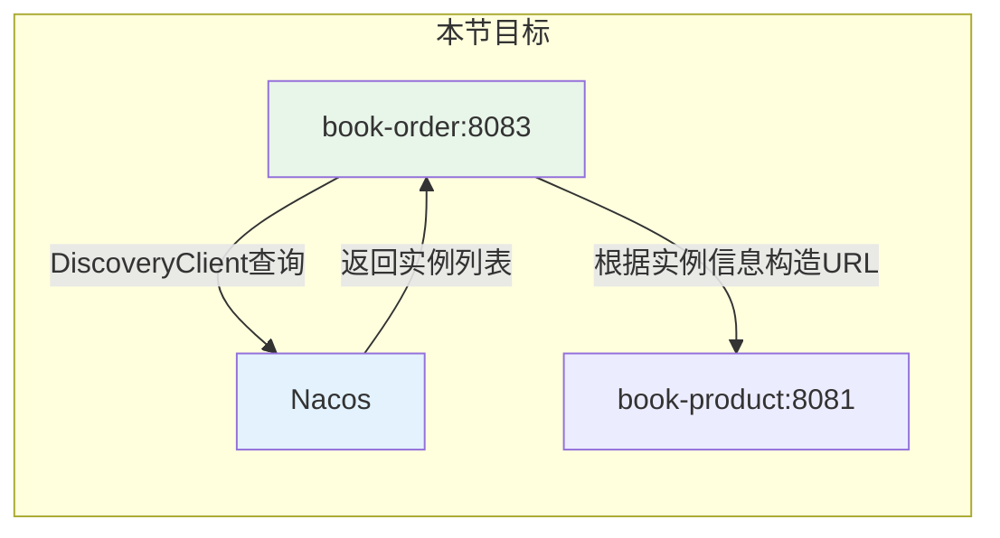
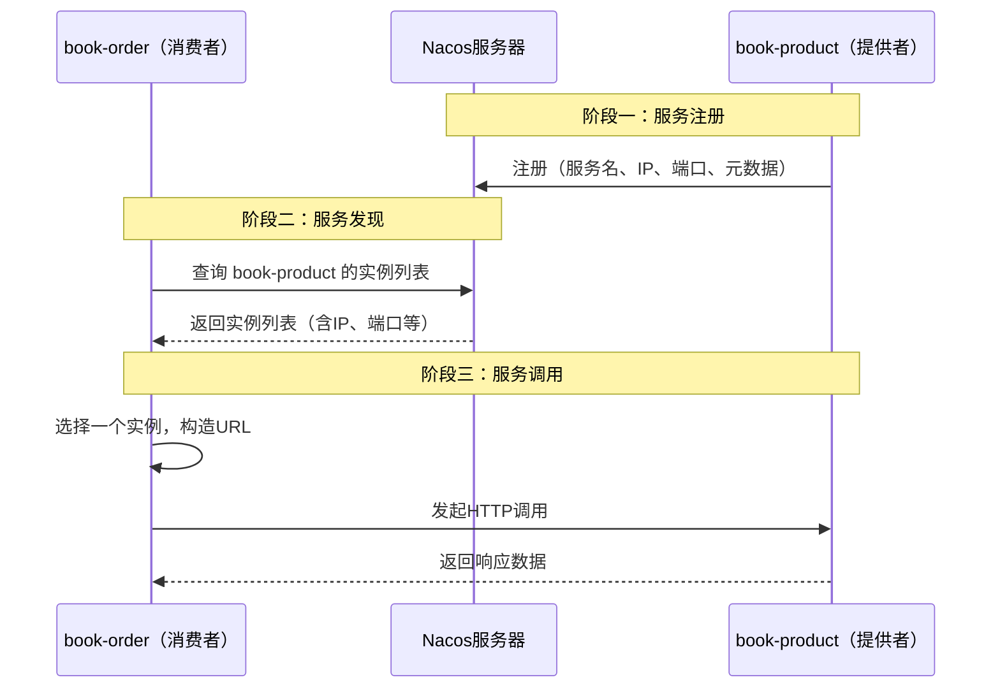

# Nacos服务发现实战

## 课程目标

- 理解服务发现（Service Discovery）的核心概念与工作流程
- 掌握`DiscoveryClient`接口的核心API及其与Nacos的集成方式
- 掌握在订单服务中通过`DiscoveryClient`获取图书服务实例列表的方法
- 掌握从实例列表中解析IP、端口并构造调用URL的技巧
- 理解服务发现与负载均衡之间的关系，为后续LoadBalancer课程做铺垫
- 完成订单服务动态发现图书服务的实战验证


## 回顾与导入

在前三节课中，我们完成了三个服务到Nacos服务器的注册。此时Nacos控制台的服务列表中已经能看到三个服务，每个服务都有健康的实例。

但这仅仅完成了“注册”这一步。注册的目的是为了被发现——book-order创建订单时需要扣减图书库存，它需要知道book-product在哪里。在传统方式中，我们可能会在配置文件中写死图书服务的地址：

```yaml
# 不推荐的硬编码方式
book:
  product:
    url: http://localhost:8081
```

这种方式的致命缺陷在于：图书服务一旦扩容、迁移或宕机，订单服务就需要手动修改配置并重启。在微服务架构中，服务实例的地址是**动态变化**的，因此必须通过服务发现机制来动态获取。本节内容将关注**通过DiscoveryClient实现服务发现**：



> **前置条件：** 请确保三个服务均已成功注册到Nacos服务器，控制台服务列表中能看到book-product、book-user、book-order三个服务。


## 服务发现核心概念

### 什么是服务发现

**服务发现**是指服务消费者（如订单服务）从注册中心（如Nacos）动态获取服务提供者（如商品服务）的实例列表，并从中选择一个实例进行调用的过程。

服务发现包含三个核心角色：

| 角色           | 说明                                   | 本课程中的示例          |
| -------------- | -------------------------------------- | ----------------------- |
| **服务提供者** | 将自己注册到注册中心，对外提供服务     | book-product、book-user |
| **服务消费者** | 从注册中心获取提供者实例列表，发起调用 | book-order              |
| **注册中心**   | 维护服务注册信息，提供服务发现接口     | Nacos服务器             |

### 服务发现的工作流程



### Spring Cloud的DiscoveryClient接口

`DiscoveryClient`是Spring Cloud提供的一个标准接口，用于抽象服务发现功能。它不绑定具体的注册中心实现，Nacos、Eureka、Consul等都有对应的实现类。对于Nacos，其实现类是`NacosDiscoveryClient`，它将`DiscoveryClient`的API委托给Nacos客户端来完成实际的服务查询。

`DiscoveryClient`的核心方法如下：

| 方法                                              | 返回值                  | 说明                                             |
| ------------------------------------------------- | ----------------------- | ------------------------------------------------ |
| `getServices()`                                   | `List<String>`          | 获取所有已注册的服务名列表                       |
| `getInstances(String serviceId)`                  | `List<ServiceInstance>` | 获取指定服务的所有实例列表                       |
| `getInstances(String serviceId, boolean healthy)` | `List<ServiceInstance>` | 获取指定服务的实例列表，可指定是否只返回健康实例 |
| `description()`                                   | `String`                | 返回服务发现客户端的描述信息                     |

### ServiceInstance接口

`ServiceInstance`封装了一个服务实例的完整信息，主要方法包括：

| 方法              | 返回值               | 说明         | 示例值                  |
| ----------------- | -------------------- | ------------ | ----------------------- |
| `getServiceId()`  | `String`             | 服务名       | `book-product`          |
| `getHost()`       | `String`             | 主机地址     | `127.0.0.1`             |
| `getPort()`       | `int`                | 端口号       | `8081`                  |
| `getUri()`        | `URI`                | 完整URI      | `http://127.0.0.1:8081` |
| `getMetadata()`   | `Map<String,String>` | 元数据       | `{version=1.0.0}`       |
| `getScheme()`     | `String`             | 协议         | `http`                  |
| `isSecure()`      | `boolean`            | 是否HTTPS    | `false`                 |
| `getInstanceId()` | `String`             | 实例唯一标识 | `127.0.0.1:8081`        |

在实际开发中，获取到`ServiceInstance`后，通常使用`getUri()`获取完整的基地址，然后拼接接口路径发起调用。


## 订单服务集成DiscoveryClient

### 确认依赖

`DiscoveryClient`接口来自Spring Cloud Commons模块，已通过`spring-cloud-starter-alibaba-nacos-discovery`依赖间接引入，无需额外添加依赖。确认`book-order/pom.xml`中包含：

```xml
<dependency>
    <groupId>com.alibaba.cloud</groupId>
    <artifactId>spring-cloud-starter-alibaba-nacos-discovery</artifactId>
</dependency>
```

### 在订单服务中注入DiscoveryClient

在`book-order`中，我们创建一个专门的Controller来演示服务发现功能。首先创建一个`DiscoveryController`：

```java
@Slf4j
@RestController
@RequestMapping("/api/discovery")
@RequiredArgsConstructor
public class DiscoveryController {

    private final DiscoveryClient discoveryClient;

    private final RestTemplate restTemplate;
    /**
     * 获取所有已注册的服务名列表
     * GET /api/discovery/services
     */
    @GetMapping("/services")
    public Result<List<String>> getServices() {
        List<String> services = discoveryClient.getServices();
        log.info("当前注册的服务列表: {}", services);
        return Result.success(services);
    }

    /**
     * 获取指定服务的所有实例
     * GET /api/discovery/instances/{serviceName}
     */
    @GetMapping("/instances/{serviceName}")
    public Result<List<ServiceInstance>> getInstances(@PathVariable("serviceName") String serviceName) {
        List<ServiceInstance> instances = discoveryClient.getInstances(serviceName);
        log.info("服务 {} 的实例列表: {}", serviceName, instances);
        return Result.success(instances);
    }

    /**
     * 获取图书服务的实例信息（带详细信息输出）
     * GET /api/discovery/book-instances
     */
    @GetMapping("/book-instances")
    public Result<List<ServiceInstance>> getBookInstances() {
        List<ServiceInstance> instances = discoveryClient.getInstances("book-product");

        if (instances == null || instances.isEmpty()) {
            log.warn("未发现任何 book-product 实例");
        } else {
            for (ServiceInstance instance : instances) {
                log.info("服务ID: {}, 主机: {}, 端口: {}, URI: {}, 元数据: {}",
                        instance.getServiceId(),
                        instance.getHost(),
                        instance.getPort(),
                        instance.getUri(),
                        instance.getMetadata());
            }
        }

        return Result.success(instances);
    }
}
```

> **关键点：** `DiscoveryClient`通过构造器注入（`@RequiredArgsConstructor` + `private final`）的方式获取，这是Spring推荐的注入方式。`discoveryClient.getInstances("book-product")`中的`"book-product"`就是`spring.application.name`配置的值。


## 构造调用URL并实现服务调用

### 从ServiceInstance构造URL

获取到`ServiceInstance`后，可以通过`getUri()`方法直接获取完整的基地址，然后拼接接口路径即可发起调用。

```java
// 获取第一个实例的基地址
ServiceInstance instance = instances.get(0);
String baseUrl = instance.getUri().toString();  // http://127.0.0.1:8081

// 拼接完整请求URL
String requestUrl = baseUrl + "/api/products/1";
```

### 使用RestTemplate发起调用

在订单服务中添加`RestTemplate`的配置类：

```java
@Configuration
public class RestTemplateConfig {

    @Bean
    public RestTemplate restTemplate() {
        return new RestTemplate();
    }
}
```

> **注意：** 此时`RestTemplate`**不要**添加`@LoadBalanced`注解。本节演示的是通过`DiscoveryClient`手动获取实例并构造URL的方式，属于底层原理的展示。后续内容将引入LoadBalancer实现自动负载均衡。

### 在订单服务中查询图书信息

接下来，在`DiscoveryController`中添加一个方法，通过服务发现获取图书服务的实例，并调用图书服务的接口：

```java
// ... 在 DiscoveryController 中 ...

private final RestTemplate restTemplate;

/**
 * 通过服务发现调用图书服务查询图书
 * GET /api/discovery/book/{id}
 */
@GetMapping("/book/{id}")
public Result<String> getBookById(@PathVariable Long id) {

    // 第一步：通过服务发现获取图书服务实例列表
    List<ServiceInstance> instances = discoveryClient.getInstances("book-product");

    if (instances == null || instances.isEmpty()) {
        return Result.error(503, "图书服务暂时不可用，请稍后重试");
    }

    // 第二步：选择一个实例（此处取第一个，后续课程将引入负载均衡）
    ServiceInstance instance = instances.get(0);
    String baseUrl = instance.getUri().toString();

    log.info("选中图书服务实例: {}:{}", instance.getHost(), instance.getPort());

    // 第三步：构造完整URL并发起调用
    String requestUrl = baseUrl + "/api/products/" + id;
    log.info("发起远程调用: {}", requestUrl);

    try {
        String result = restTemplate.getForObject(requestUrl, String.class);
        return Result.success(result);
    } catch (Exception e) {
        log.error("调用图书服务失败", e);
        return Result.error(500, "调用图书服务失败: " + e.getMessage());
    }
}
```

> **完整流程总结：**
> 1. `discoveryClient.getInstances("book-product")` → 从Nacos获取实例列表
> 2. `instances.get(0).getUri()` → 解析出基地址（如`http://127.0.0.1:8081`）
> 3. `baseUrl + "/api/products/" + id` → 拼接完整请求URL
> 4. `restTemplate.getForObject(...)` → 发起HTTP调用


## 启动与测试

### 启动三个服务

确保三个服务都已启动并注册到Nacos。

### 测试一：获取所有服务列表

```http
### 获取所有已注册的服务
GET {{order_url}}/api/discovery/services
```

**预期响应：**

```json
{
  "code": 200,
  "message": "操作成功",
  "data": [
    "book-order",
    "book-product",
    "book-user"
  ],
  "timestamp": 1729000000000
}
```

### 测试二：获取图书服务的实例列表

```http
### 获取图书服务的实例列表
GET {{order_url}}/api/discovery/instances/book-product
```

**预期响应（简化）：**

```json
{
  "code": 200,
  "message": "操作成功",
  "data": [
    {
      "serviceId": "book-product",
      "host": "127.0.0.1",
      "port": 8081,
      "uri": "http://127.0.0.1:8081",
      "metadata": {
        "version": "1.0.0",
        "region": "local"
      }
    }
  ],
  "timestamp": 1729000000000
}
```

### 测试三：通过服务发现调用图书服务

```http
### 通过服务发现调用图书服务查询图书
GET {{order_url}}/api/discovery/book/1
```

**预期响应（简化）：**

```json
{
  "code": 200,
  "message": "操作成功",
  "data": "{\"code\":200,\"message\":\"操作成功\",\"data\":{\"id\":1,\"title\":\"Spring Boot 实战\",...}}",
  "timestamp": 1729000000000
}
```

> **说明：** `data`字段返回的是图书服务响应的JSON字符串，因为此处使用`String.class`接收。在实际项目中，应定义对应的DTO来接收响应数据。

### 测试四：查询不存在的图书

```http
### 通过服务发现调用图书服务查询不存在的图书
GET {{order_url}}/api/discovery/book/999
```

**预期响应：**

```json
{
  "code": 500,
  "message": "调用图书服务失败: 400...",
  "timestamp": 1729000000000
}
```


## 多实例发现验证

### 启动第二个图书服务实例

启动第二个`book-product`实例（端口改为8084），验证`DiscoveryClient`是否能发现多个实例。

### 验证多实例发现

再次调用实例查询接口：

```http
GET {{order_url}}/api/discovery/instances/book-product
```

**预期响应（简化）：**

```json
{
  "code": 200,
  "data": [
    {
      "serviceId": "book-product",
      "host": "127.0.0.1",
      "port": 8081,
      "uri": "http://127.0.0.1:8081"
    },
    {
      "serviceId": "book-product",
      "host": "127.0.0.1",
      "port": 8084,
      "uri": "http://127.0.0.1:8084"
    }
  ]
}
```

> **重要观察：** 当前代码中`instances.get(0)`始终取第一个实例，如果第一个实例宕机，调用仍然会失败。这就是为什么需要负载均衡组件来自动选择一个健康的实例。

### 停止一个实例验证

停止端口8084的实例，再次调用实例查询接口，观察返回的实例列表是否从2个变为1个。Nacos客户端在应用正常关闭时会发送注销请求，实例会从列表中移除。


## 常见问题排查

### 实例列表为空

| 可能原因          | 排查方法                                                     |
| ----------------- | ------------------------------------------------------------ |
| 服务未注册到Nacos | 检查Nacos控制台服务列表，确认目标服务已注册                  |
| 服务名拼写错误    | `getInstances("book-product")`中的服务名必须与`spring.application.name`完全一致 |
| 命名空间不一致    | 确认消费方和提供方的`namespace`配置相同                      |
| 分组不一致        | 确认消费方和提供方的`group`配置相同                          |

### 调用时连接超时

| 可能原因       | 排查方法                                                   |
| -------------- | ---------------------------------------------------------- |
| 实例IP不可达   | 确认实例的IP地址是否可被消费方访问（如Docker网络隔离问题） |
| 实例端口未开放 | 确认提供方服务的端口是否已正确监听                         |
| 防火墙拦截     | 检查防火墙规则是否放行服务端口                             |

### DiscoveryClient注入失败

如果启动时报`NoSuchBeanDefinitionException`，说明`DiscoveryClient`没有被自动装配。检查：

1. 启动类上是否有`@EnableDiscoveryClient`注解（可选但推荐）
2. `pom.xml`中是否包含`spring-cloud-starter-alibaba-nacos-discovery`依赖
3. `application.yml`中是否配置了`spring.cloud.nacos.discovery.server-addr`


## 服务发现的局限性

通过`DiscoveryClient` + `RestTemplate`的组合，我们实现了服务的动态发现和调用。这种方式能够解决硬编码地址的问题，但仍有以下不足：

| 局限性             | 说明                                | 后续课程的解决方案               |
| ------------------ | ----------------------------------- | -------------------------------- |
| **无负载均衡**     | `instances.get(0)`始终取第一个实例  | 引入LoadBalancer                 |
| **无健康检查选择** | 不会自动跳过不健康的实例            | LoadBalancer支持健康实例过滤     |
| **代码侵入性强**   | 每次调用都需要手动获取实例、拼接URL | 引入OpenFeign声明式调用          |
| **无重试机制**     | 调用失败后没有自动重试              | OpenFeign + LoadBalancer支持重试 |
| **无超时控制**     | `RestTemplate`需要手动配置超时      | OpenFeign支持超时配置            |

> **课程定位：** 本节通过`DiscoveryClient`展示了服务发现的**底层原理**。理解了“获取实例列表 → 选择实例 → 构造URL → 发起调用”这个完整流程后，后续学习OpenFeign和LoadBalancer时就能理解它们背后的工作机制。


## 注意事项

1. **RestTemplate不加@LoadBalanced**：本节演示的是手动服务发现，`RestTemplate`不应添加`@LoadBalanced`注解。后续内容将演示如何使用`@LoadBalanced`实现自动负载均衡。

2. **实例选择策略**：本节的`instances.get(0)`仅用于演示，生产环境应使用负载均衡算法选择实例。即使手写轮询，也应考虑实例的健康状态。

3. **健康实例过滤**：`getInstances(serviceId)`默认返回所有实例（包括不健康的实例）。如需只获取健康实例，可使用`getInstances(serviceId, true)`。

4. **Nacos客户端缓存**：Nacos客户端会将服务实例列表缓存在本地，默认每10秒从服务端拉取一次更新。因此服务下线后，消费者最多需要10秒才能感知到变化。

5. **异常处理**：调用远程服务时，应妥善处理连接超时、服务不可用等异常，返回友好的错误信息（如“图书服务暂时不可用，请稍后重试”）。

   


## 小结

本节课我们学习了：

1. **服务发现的核心概念**：服务提供者、服务消费者、注册中心三个角色的协作关系。
2. **DiscoveryClient接口**：`getServices()`获取所有服务名，`getInstances(serviceId)`获取指定服务的实例列表。
3. **ServiceInstance接口**：封装了实例的IP、端口、URI、元数据等信息，是构造调用URL的关键。
4. **订单服务集成服务发现**：通过注入`DiscoveryClient`，实现了从Nacos动态获取图书服务实例的完整流程。
5. **服务调用完整链路**：获取实例列表 → 选择实例 → 解析URI → 构造URL → 发起HTTP调用。
6. **多实例发现验证**：验证了`DiscoveryClient`能够发现同一服务的多个实例。
7. **服务发现的局限性**：理解了手动服务发现在负载均衡、重试、超时控制方面的不足，为后续课程指明了演进方向。


## 作业

### 作业一：完成服务发现接口开发

1. 在`book-order`中创建`DiscoveryController`，实现以下接口：
   - `GET /api/discovery/services`：返回所有已注册的服务名列表
   - `GET /api/discovery/instances/{serviceName}`：返回指定服务的实例列表
   - `GET /api/discovery/book/{id}`：通过服务发现调用图书服务查询图书
2. 启动三个服务，使用IDEA HTTP Request依次测试上述三个接口，截图响应结果。
3. 记录`getInstances`返回的`ServiceInstance`对象中包含哪些字段。

### 作业二：多实例发现与调用验证

1. 启动两个`book-product`实例（端口8081和8082）。
2. 调用`/api/discovery/instances/book-product`，验证返回2个实例。
3. 修改`/api/discovery/book/{id}`接口，使其在每次调用时**轮询**选择不同的实例（提示：使用`AtomicInteger`实现简单轮询）。
4. 连续调用5次，观察日志中选中的实例是否交替变化。

