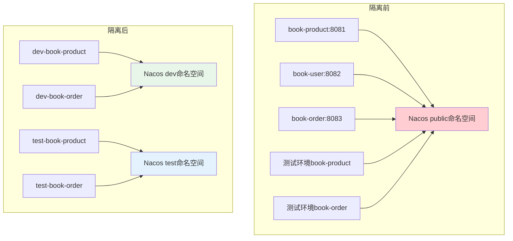
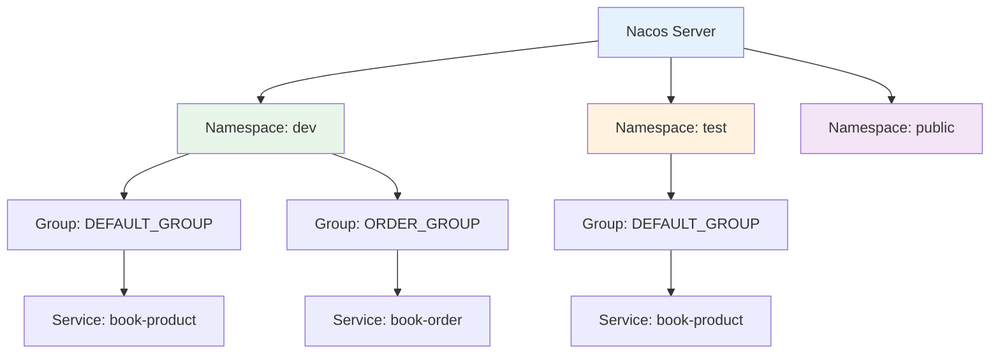
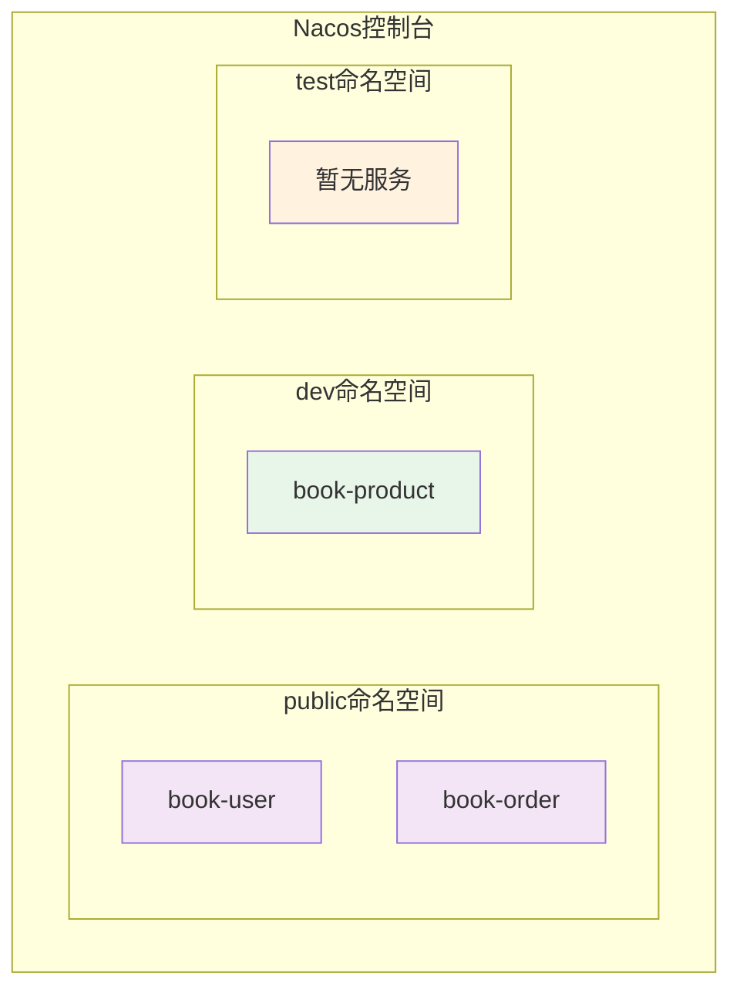

# Nacos分级模型与Namespace环境隔离

## 课程目标

- 理解 Nacos 分级存储模型的三层结构（Namespace、Group、Service）
- 掌握 Namespace 在服务注册和配置管理中的隔离作用
- 掌握在 Nacos 控制台创建和管理命名空间的方法
- 掌握 Spring Cloud Alibaba 客户端配置命名空间的方法
- 掌握使用 Namespace 实现开发/测试环境隔离的完整流程
- 完成图书管理系统 dev/test 两套隔离环境的搭建


## 回顾与导入

在前几节课中，我们完成了三个服务到 Nacos 集群的注册，并通过 `DiscoveryClient` 实现了服务发现的实战验证。但目前所有服务都注册在 Nacos 默认的 `public` 命名空间中。

这在开发和测试环境中会带来一系列问题：

| 问题         | 说明                                                         |
| ------------ | ------------------------------------------------------------ |
| **环境混乱** | 开发人员本地启动的服务与测试环境部署的服务注册在同一个命名空间，互相干扰 |
| **调用错乱** | 开发环境的 book-order 可能调用到测试环境的 book-product，导致数据污染 |
| **配置冲突** | 不同环境的配置堆在一起，难以区分和管理                       |
| **权限失控** | 无法对不同环境的资源进行独立授权                             |

> **真实场景：** 某团队在 public 命名空间中同时注册了开发、测试、生产三套环境的服务。开发人员在本地调试时，测试环境的 book-order 偶然调用到了开发人员本地启动的 book-product，导致测试数据被写入开发人员的本地数据库，排查了整整一个下午才发现问题。

本讲**使用 Namespace 隔离环境，为图书系统配置 dev/test 两套环境**



> **前置条件：** 请确保三个服务均已成功注册到 Nacos 集群，控制台服务列表中能看到 book-product、book-user、book-order 三个服务。


## Nacos分级存储模型

### 三层结构概览

Nacos 的分级存储模型是一个基于 **Namespace（命名空间）→ Group（分组）→ Service（服务）** 三大维度的配置管理结构，这三个维度相互独立又彼此配合，为复杂的配置管理提供了灵活的组织方式。



### 三个维度的定位

| 维度          | 定位                                                | 隔离级别                                            | 常用场景                             |
| ------------- | --------------------------------------------------- | --------------------------------------------------- | ------------------------------------ |
| **Namespace** | 最上层隔离维度，用于区分不同环境或不同租户          | 逻辑隔离，不同 Namespace 之间的服务和配置完全不可见 | dev/test/prod 环境隔离、多租户隔离   |
| **Group**     | 在 Namespace 内进一步分组，用于区分不同业务线或项目 | 同一 Namespace 内不同 Group 的服务默认不可见        | 业务线隔离（order-group、pay-group） |
| **Service**   | 最小单元                                            | 标识具体服务                                        | 服务名、配置文件名                   |

> **记忆口诀：** Namespace 切环境，Group 切业务线，Service 标识具体服务。

### Namespace的隔离机制

Namespace 是 Nacos 用于实现资源逻辑隔离的核心概念。每个 Namespace 拥有自己独立的服务注册表、配置列表和集群信息。其核心特性包括：

| 特性           | 说明                                        |
| -------------- | ------------------------------------------- |
| **逻辑隔离**   | 不同 Namespace 之间的服务、配置相互不可见   |
| **资源隔离**   | 每个 Namespace 拥有独立的数据存储（逻辑上） |
| **多租户支持** | 适合多团队、多项目、多环境场景              |
| **权限控制**   | 可基于 Namespace 进行精细化的权限管理       |

不同的命名空间下，可以存在相同的 Group 或 Service 的配置。Namespace 的常用场景之一是不同环境的配置的区分隔离，例如开发测试环境和生产环境的资源隔离。

### 数据模型在服务注册中的体现

Nacos 的服务注册同样遵循三级模型。一个服务的完整标识由 Namespace + Group + ServiceName 组成：

| 层级        | 示例值          | 说明                |
| ----------- | --------------- | ------------------- |
| Namespace   | `dev`           | 开发环境命名空间 ID |
| Group       | `DEFAULT_GROUP` | 默认分组            |
| ServiceName | `book-product`  | 服务名              |

这意味着，**即使两个服务名相同（都是 book-product），只要它们在不同的 Namespace 中，就是完全独立的两个服务**，互相不可见。开发环境的 book-order 无法发现测试环境的 book-product，这正是环境隔离的核心机制。


## 实战准备：当前环境状态分析

### 三个服务的现有配置

回顾服务配置，三个服务的 `application.yml` 中 Nacos 相关配置如下：

```yaml
spring:
  cloud:
    nacos:
      discovery:
        server-addr: 127.0.0.1:8848
        namespace: public   # 当前配置：所有服务都在 public 命名空间
        group: DEFAULT_GROUP
```

此时 Nacos 控制台的服务列表中，三个服务全部出现在 `public` 命名空间下。

### 本讲要达成的目标

| 环境     | Namespace | 服务                                | 端口           |
| -------- | --------- | ----------------------------------- | -------------- |
| 开发环境 | `dev`     | book-product、book-user、book-order | 8081/8082/8083 |
| 测试环境 | `test`    | book-product、book-user、book-order | 8084/8085/8086 |

本讲先为 book-product 服务配置 dev 环境，验证隔离效果后，再扩展到其他服务。

> **注意：** 本机模拟时，dev 和 test 环境使用不同的端口，因为它们是不同的 Namespace，但同一台机器上端口不能冲突。如果需要在同一台机器上同时运行 dev 和 test 环境，需要为不同环境分配不同的端口。


## 在Nacos控制台创建命名空间

### 创建dev命名空间

**步骤一：登录 Nacos 控制台**

访问 `http://127.0.0.1:8080/index.html`，使用管理员账号登录。

**步骤二：进入命名空间管理页面**

点击左侧导航栏的 **“命名空间”** ，进入命名空间列表页面。默认情况下，列表中只有一个名为 `public` 的保留命名空间。

**步骤三：创建 dev 命名空间**

点击右上角的 **“创建命名空间”** 按钮，填写以下信息：

| 配置项       | 填写值                 | 说明                                                         |
| ------------ | ---------------------- | ------------------------------------------------------------ |
| 命名空间名称 | `开发环境`             | 命名空间的显示名称，便于识别                                 |
| 命名空间ID   | `dev`                  | 自定义 ID，用于客户端配置。如果不填写，Nacos 会自动生成 UUID |
| 描述         | `图书管理系统开发环境` | 用途描述                                                     |

点击“确定”完成创建。

### 创建test命名空间

重复上述步骤，创建测试环境命名空间：

| 配置项       | 填写值                 |
| ------------ | ---------------------- |
| 命名空间名称 | `测试环境`             |
| 命名空间ID   | `test`                 |
| 描述         | `图书管理系统测试环境` |

### 验证命名空间列表

创建完成后，命名空间列表中应显示三个命名空间：

| 命名空间名称 | 命名空间ID | 类型     |
| ------------ | ---------- | -------- |
| public       | public     | 保留空间 |
| 开发环境     | dev        | 自定义   |
| 测试环境     | test       | 自定义   |

> **重要提示：** 配置客户端时，`namespace` 参数填写的是**命名空间 ID**（如 `dev`），不是命名空间名称（如 `开发环境`）。这是初学者最容易混淆的地方。如果误将名称填入配置，服务注册会失败或注册到错误的命名空间。

### 查看命名空间ID

在命名空间列表中，可以查看每个命名空间的 ID。对于自定义 ID（如 `dev`、`test`），直接使用填写的值即可。如果创建时未填写 ID，Nacos 会自动生成一个 UUID（如 `a1b2c3d4-...`），此时需要复制该 UUID 用于客户端配置。


## 配置book-product注册到dev环境

### 修改application.yml

打开 `book-product/src/main/resources/application.yml`，将 `namespace` 修改为 `dev`：

```yaml
server:
  port: 8081

spring:
  application:
    name: book-product
  cloud:
    nacos:
      discovery:
        server-addr: 127.0.0.1:8848
        # 开发环境命名空间
        namespace: dev
        group: DEFAULT_GROUP
        metadata:
          env: dev
```

> **关键变化：** 只有 `namespace` 从 `public` 改为 `dev`，其他配置不变。`metadata` 中添加了 `env: dev`，便于在控制台中直观识别环境。

### 启动book-product并验证

**启动日志中应包含：**

```
[Nacos Register] register service, serviceName: book-product, groupName: DEFAULT_GROUP, namespace: dev
[Nacos Register] register success, serviceName: book-product
```

### 控制台验证

登录 Nacos 控制台，在**命名空间下拉框**中选择 **“开发环境”** ，然后点击 **“服务管理” → “服务列表”** 。

**预期结果：**

| 服务名         | 集群数目 | 实例数目 | 健康实例数 |
| -------------- | -------- | -------- | ---------- |
| `book-product` | 1        | 1        | 1          |

再切换到 **“public”** 命名空间，服务列表中应**看不到** book-product 服务（因为它的注册信息已迁移到 dev 命名空间）。



## 环境隔离验证

### 验证一：在dev命名空间注册全部三个服务

为了完整演示环境隔离，我们将三个服务都注册到 dev 命名空间。

**修改 book-user 和 book-order 的配置：**

```yaml
spring:
  cloud:
    nacos:
      discovery:
        server-addr: 127.0.0.1:8848
        namespace: dev
        group: DEFAULT_GROUP
        metadata:
          env: dev
```

**重启 book-user 和 book-order**，然后在 Nacos 控制台的 dev 命名空间中查看服务列表。

**预期结果：** dev 命名空间下显示三个服务：

| 服务名         | 实例数目 | 健康实例数 |
| -------------- | -------- | ---------- |
| `book-product` | 1        | 1          |
| `book-user`    | 1        | 1          |
| `book-order`   | 1        | 1          |

### 验证二：test命名空间注册独立的服务实例

接下来，我们模拟测试环境。在 test 命名空间中注册一套独立的 book-product 实例。

**修改 book-product 的配置：**

```yaml
server:
  port: 8084

spring:
  cloud:
    nacos:
      discovery:
        namespace: test
        metadata:
          env: test
```

> **注意：** 如果同时运行 dev 和 test 环境的 book-product，需要修改端口避免冲突。例如 test 环境使用 8084。

**启动 test 环境的 book-product**，在 Nacos 控制台切换到 test 命名空间，验证服务列表：

| 命名空间 | 服务名       | 实例数 | 端口 |
| -------- | ------------ | ------ | ---- |
| dev      | book-product | 1      | 8081 |
| test     | book-product | 1      | 8084 |

### 验证三：跨命名空间调用测试

在 dev 命名空间的 book-order 中调用 `DiscoveryClient.getInstances("book-product")`，返回的是 dev 命名空间的 book-product 实例（端口 8081），**不会**返回 test 命名空间的 book-product 实例（端口 8084）。

```java
// 在 dev 命名空间的 book-order 中调用
List<ServiceInstance> instances = discoveryClient.getInstances("book-product");
// 返回结果：[ServiceInstance(host=127.0.0.1, port=8081)]  ← 只有 dev 环境的实例
// 不包含 test 环境的实例（端口 8084）
```

> **重要结论：** 服务发现严格遵循命名空间隔离。消费者只能发现**同命名空间**下的服务实例，这从架构层面保证了环境隔离的可靠性。


## 注意事项

1. **namespace 填 ID 而非名称**：这是最常见的错误。`namespace` 参数必须是命名空间 ID（如 `dev`），不是命名空间名称（如 `开发环境`）。

2. **Nacos 3.x 默认命名空间变化**：Nacos 3.0 的默认命名空间 ID 为 `public`，不再是空字符串。

3. **Namespace 切环境，Group 切业务线**：推荐的分工方式。不要用 Group 代替 Namespace 做环境隔离，Namespace 的隔离级别更高。我们将在下一讲中介绍 Group 分组机制。

4. **同名服务在不同 Namespace 中互相独立**：dev 的 book-product 和 test 的 book-product 是两个完全独立的服务，不会互相发现。

5. **metadata 辅助识别**：在 metadata 中添加 `env: dev` 等标记，便于在控制台中直观区分环境。

6. **端口规划**：在同一台机器上运行不同环境的服务时，需要为不同环境分配不同的端口，避免端口冲突。

   


## 小结

本讲我们学习了：

1. **Nacos 分级存储模型**：Namespace → Group → Service 三层结构，Namespace 用于环境隔离，Group 用于业务线隔离。
2. **Namespace 的隔离机制**：不同 Namespace 之间的服务和配置完全不可见，实现环境级别的隔离。
3. **Nacos 3.x 的重要变化**：默认命名空间 ID 从空字符串改为 `public`，以及相关的兼容性注意事项。
4. **控制台创建命名空间**：在 Nacos 控制台的“命名空间”页面创建 dev 和 test 命名空间。
5. **客户端配置命名空间**：通过 `spring.cloud.nacos.discovery.namespace` 配置，值为命名空间 ID。
6. **环境隔离验证**：通过控制台和 DiscoveryClient 两种方式验证不同命名空间的服务互相隔离。


## 作业

### 作业一：完成命名空间创建与配置

1. 在 Nacos 控制台创建 `dev` 和 `test` 两个命名空间，记录它们的命名空间 ID。
2. 将 book-product 的 `namespace` 配置改为 `dev`，重启服务，截图 dev 命名空间下的服务列表。
3. 截图 public 命名空间下的服务列表，验证 book-product 不在其中。

### 作业二：实现三个服务的dev环境注册

1. 将 book-user 和 book-order 的 `namespace` 也改为 `dev`，重启三个服务。
2. 截图 dev 命名空间下三个服务全部注册的画面。
3. 在 dev 命名空间下，使用 `DiscoveryController` 验证 `getServices()` 返回的服务列表。

### 作业三：模拟test环境隔离

1. 修改 book-product 的配置，将其注册到 `test` 命名空间（端口改为 8084）。
2. 启动 test 环境的 book-product，截图 test 命名空间下的服务列表。
3. 在 dev 命名空间的 book-order 中调用 `/api/discovery/instances/book-product`，验证返回的实例端口是否为 8081（dev 环境）而非 8084（test 环境）。
