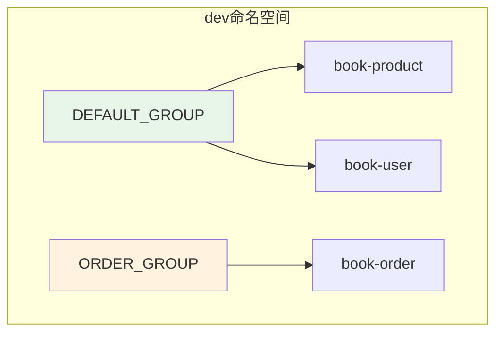
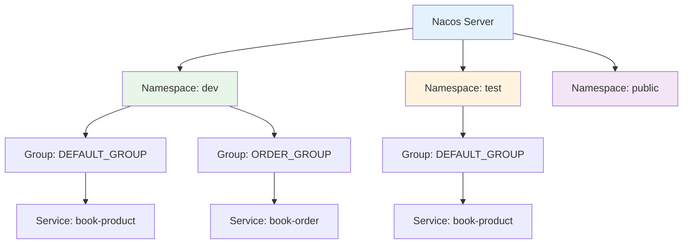

# Nacos Group分组与多环境切换

## 课程目标

- 理解 Group 在服务注册与发现中的作用
- 掌握为服务配置独立 Group 的方法
- 掌握 Namespace 与 Group 的分工与配合方式
- 掌握环境切换的三种方式：直接修改配置文件、Spring Profiles、环境变量
- 重点掌握在 IDEA 中通过 Spring Profiles 手工切换环境的方法
- 完成图书管理系统多环境切换的实战配置


## 回顾与导入

在上一讲中，我们通过 Namespace 实现了 dev/test 两套环境的隔离。三个服务都注册到了 dev 命名空间，test 命名空间中也部署了独立的 book-product 实例。不同命名空间的服务互相不可见，环境隔离已经生效。

但还有两个问题没有解决：

| 问题                   | 说明                                                         |
| ---------------------- | ------------------------------------------------------------ |
| **同一环境内如何分组** | dev 命名空间内，如果不同业务线的服务需要逻辑隔离，Namespace 不够用 |
| **如何快速切换环境**   | 每次切换环境都要手动修改 `application.yml` 中的 `namespace`，容易出错且效率低 |

本讲将围绕这两个问题展开：

- **Group 分组**：在同一个 Namespace 内，通过 Group 实现业务线隔离。
- **环境切换**：通过 Spring Profiles 等方式，让同一套代码在不同环境间灵活切换。




## Group分组核心概念

### Group在服务注册中的作用

Group 是 Nacos 分级模型中的第二层，位于 Namespace 之下、Service 之上。



它的核心作用是**在同一个 Namespace 内实现服务的逻辑分组**。

| 特性           | 说明                                               |
| -------------- | -------------------------------------------------- |
| **逻辑隔离**   | 同一 Namespace 内，不同 Group 的服务默认互相不可见 |
| **业务线划分** | 适合按业务线、项目、团队进行分组                   |
| **配置共享**   | 同一 Group 内的服务可以共享配置（配置中心场景）    |
| **灵活组合**   | 与 Namespace 组合使用，实现多维度的隔离            |

### Namespace与Group的分工

| 维度           | Namespace                   | Group                                |
| -------------- | --------------------------- | ------------------------------------ |
| **隔离级别**   | 环境级隔离（dev/test/prod） | 业务线级隔离（order/product/user）   |
| **数据可见性** | 不同 Namespace 完全不可见   | 同 Namespace 内不同 Group 默认不可见 |
| **常用场景**   | 环境隔离、多租户            | 业务线隔离、灰度分组                 |
| **配置复杂度** | 需要创建多个 Namespace      | 只需修改 `group` 配置项              |
| **推荐用法**   | 切环境                      | 切业务线                             |

> **重要原则：** 不要用 Group 来替代 Namespace 做环境隔离。Namespace 的隔离更彻底（不同 Namespace 的数据在逻辑存储层面就是独立的），而 Group 的隔离仅是服务发现层面的。生产环境推荐“Namespace 切环境，Group 切业务线”。

### 分组配置的命名规范

| 配置项       | 推荐命名                                        | 说明                             |
| ------------ | ----------------------------------------------- | -------------------------------- |
| Namespace ID | `dev`、`test`、`prod`                           | 简短、明确，按环境命名           |
| Group        | `DEFAULT_GROUP`、`ORDER_GROUP`、`PDODUCT_GROUP` | 全大写，下划线分隔，按业务线命名 |


## 为订单服务配置独立Group

### 场景说明

在图书管理系统中，我们可以按业务线将服务分组：

| 服务         | 业务线 | Group           |
| ------------ | ------ | --------------- |
| book-product | 商品   | `DEFAULT_GROUP` |
| book-user    | 用户   | `DEFAULT_GROUP` |
| book-order   | 订单   | `ORDER_GROUP`   |

这样，book-order 注册在 `ORDER_GROUP` 下，而 book-product 和 book-user 注册在 `DEFAULT_GROUP` 下。默认情况下，book-order 无法发现 `DEFAULT_GROUP` 下的服务，除非显式指定 Group。

### 修改book-order的Group配置

打开 `book-order/src/main/resources/application.yml`，将 `group` 修改为 `ORDER_GROUP`：

```yaml
spring:
  cloud:
    nacos:
      discovery:
        server-addr: 127.0.0.1:8848
        namespace: dev
        group: ORDER_GROUP    # 订单业务线分组
        metadata:
          env: dev
```

### 启动并验证

重启 book-order 服务，然后在 Nacos 控制台中：

1. 命名空间选择 **“开发环境”**
2. 进入 **“服务管理” → “服务列表”**
3. 观察服务列表中的分组信息

**预期结果：**

| 服务名         | 分组            | 实例数 |
| -------------- | --------------- | ------ |
| `book-product` | `DEFAULT_GROUP` | 1      |
| `book-user`    | `DEFAULT_GROUP` | 1      |
| `book-order`   | `ORDER_GROUP`   | 1      |

### 验证Group隔离效果

在 dev 命名空间中，book-order 默认只能发现 `ORDER_GROUP` 下的服务。如果 book-order 尝试通过 `DiscoveryClient` 查询 `book-product`，默认情况下会查询 `ORDER_GROUP` 下的 book-product，但 book-product 注册在 `DEFAULT_GROUP`，因此**查询不到**。

```java
// 在 book-order 中调用（默认 Group 为 ORDER_GROUP）
List<ServiceInstance> instances = discoveryClient.getInstances("book-product");
// 返回空列表，因为 book-product 注册在 DEFAULT_GROUP
```

> **说明：** Spring Cloud 的 `DiscoveryClient` 抽象不支持按 Group 查询，它使用的是全局配置的 Group。因此，在实际项目中，通常不会用 Group 来隔离同一环境内需要互相调用的服务。Group 更适合用于**不需要互相调用**的业务线隔离，或者配合灰度发布场景使用。

### 恢复配置

为了后续课程中 book-order 能正常调用 book-product，建议将 book-order 的 Group 恢复为 `DEFAULT_GROUP`：

```yaml
spring:
  cloud:
    nacos:
      discovery:
        group: DEFAULT_GROUP
```

> **实践建议：** 在图书管理系统中，三个服务需要互相调用，因此建议统一使用 `DEFAULT_GROUP`。Group 的隔离能力更适合用于多业务线共存的大型系统。


## 环境切换的三种方式

### 方式一：直接修改配置文件

最简单的方式，直接修改 `application.yml` 中的 `namespace` 值：

```yaml
spring:
  cloud:
    nacos:
      discovery:
        namespace: dev   # 切换环境时改为 test
```

**优点：** 简单直接，无需额外配置。
**缺点：** 每次切换都要修改文件，容易出错，且无法同时运行多个环境。
**适用场景：** 本地开发调试，临时切换。

### 方式二：使用Spring Profiles（重点）

Spring Profiles 是 Spring Boot 提供的多环境配置机制。通过为不同环境创建独立的配置文件，可以在启动时动态选择激活哪个环境。

#### 步骤一：创建多环境配置文件

在 `src/main/resources` 目录下，创建以下配置文件：

| 文件名                 | 用途                                           | 关键配置                      |
| ---------------------- | ---------------------------------------------- | ----------------------------- |
| `application.yml`      | 主配置，存放公共配置，并设置默认激活的 Profile | `spring.profiles.active: dev` |
| `application-dev.yml`  | 开发环境专属配置                               | `namespace: dev`              |
| `application-test.yml` | 测试环境专属配置                               | `namespace: test`             |

**主配置文件 `application.yml` 示例：**

```yaml
# 公共配置：所有环境共享
spring:
  application:
    name: book-product
  profiles:
    active: dev          # 默认激活开发环境

# 其他公共配置...
```

**开发环境配置 `application-dev.yml` 示例：**

```yaml
server:
  port: 8081

spring:
  cloud:
    nacos:
      discovery:
        server-addr: 127.0.0.1:8848
        namespace: dev          # 关键：指定 dev 命名空间 ID
        group: DEFAULT_GROUP
        metadata:
          env: dev
```

**测试环境配置 `application-test.yml` 示例：**

```yaml
server:
  port: 8084                    # 同机运行需改端口避免冲突

spring:
  cloud:
    nacos:
      discovery:
        server-addr: 127.0.0.1:8848
        namespace: test         # 关键：指定 test 命名空间 ID
        group: DEFAULT_GROUP
        metadata:
          env: test
```

#### 步骤二：在IDEA中切换Profile

IDEA 提供了两种设置方式，**推荐使用第一种**，操作更直观。

**方式1：使用 “Active profiles” 选项（推荐）**

1. 在左侧选中你的 Spring Boot 启动配置
2. 在右侧面板找到 **`Active profiles`** 输入框
3. 填入环境标识：**`dev`** 或 **`test`**
4. 点击 `Apply` → `OK` 保存

这种方式会传递 `-Dspring.profiles.active=dev`，**优先级最高**，会覆盖 `application.yml` 中的默认值。

**方式2：使用 “Program arguments” 或 “VM options”**

| 方式                          | 位置                                  | 填写内容                       |
| ----------------------------- | ------------------------------------- | ------------------------------ |
| **Program arguments**（推荐） | `Configuration` → `Program arguments` | `--spring.profiles.active=dev` |
| **VM options**                | `Configuration` → `VM options`        | `-Dspring.profiles.active=dev` |

#### 步骤三：创建多个运行配置，一键切换

如果需要在 `dev` 和 `test` 之间频繁切换，可以为每个环境创建**独立的运行配置**：

1. 在 `Edit Configurations` 界面，点击左上角 `+` → 选择 `Spring Boot`
2. 命名为 `BookProduct-Dev`，Main class 选择启动类，`Active profiles` 填 `dev`
3. 再次点击 `+`，创建 `BookProduct-Test`，`Active profiles` 填 `test`
4. 以后只需在 IDEA 右上角的运行配置下拉框中切换即可

#### 步骤四：验证Profile是否生效

启动应用后，观察控制台日志，应该出现类似以下输出：

```
The following 1 profile is active: "dev"
```

同时，在 Nacos 控制台中：

- 切换到 **`dev` 命名空间**，应能看到 `book-product` 服务
- 切换到 **`test` 命名空间**，应能看到另一个 `book-product` 实例（如果启动了测试环境）

### 方式三：使用环境变量

通过环境变量注入命名空间，适用于容器化部署：

```bash
export NACOS_NAMESPACE=dev
java -jar book-product.jar
```

**application.yml 中引用环境变量：**

```yaml
spring:
  cloud:
    nacos:
      discovery:
        namespace: ${NACOS_NAMESPACE:public}
```

> **默认值说明：** `${NACOS_NAMESPACE:public}` 表示如果环境变量 `NACOS_NAMESPACE` 未设置，则默认使用 `public`。

### 三种方式对比

| 方式             | 优点               | 缺点                 | 适用场景        |
| ---------------- | ------------------ | -------------------- | --------------- |
| 直接修改配置文件 | 简单直接           | 每次切换都要改文件   | 本地开发调试    |
| Spring Profiles  | 一套代码适配多环境 | 需要维护多份配置文件 | 团队协作开发    |
| 环境变量         | 适合容器化         | 需要配合 CI/CD 工具  | Docker/K8s 部署 |


## 常见问题排查

### Spring Profiles未生效

| 可能原因                        | 排查方法                                             |
| ------------------------------- | ---------------------------------------------------- |
| `spring.profiles.active` 未配置 | 检查主配置文件或启动参数中是否设置了 active profile  |
| 配置文件命名错误                | 确认文件名格式为 `application-{profile}.yml`         |
| IDEA 配置未保存                 | 检查 Run Configuration 中的 Active profiles 是否正确 |
| 多个配置源冲突                  | 检查是否有环境变量或命令行参数覆盖了配置             |

### Group隔离导致服务无法发现

| 可能原因                    | 排查方法                               |
| --------------------------- | -------------------------------------- |
| 消费者与提供者 Group 不一致 | 确认两者的 `group` 配置是否相同        |
| 需要跨 Group 调用           | 将需要互相调用的服务配置为同一个 Group |
| 误用 Group 做环境隔离       | 环境隔离应使用 Namespace，而不是 Group |


## 小结

本讲我们学习了：

1. **Group 分组**：在同一个 Namespace 内实现服务的逻辑分组，适合业务线隔离。
2. **Namespace 与 Group 的分工**：Namespace 切环境，Group 切业务线，两者配合使用。
3. **Group 隔离效果**：同一 Namespace 内，不同 Group 的服务默认互相不可见。
4. **环境切换三种方式**：直接修改配置文件、Spring Profiles、环境变量。
5. **Spring Profiles 实战**：创建 `application-dev.yml` 和 `application-test.yml`，通过 IDEA 的 Active profiles 一键切换。
7. **常见问题排查**：Spring Profiles 未生效、Group 隔离导致服务无法发现等。


## 作业

### 作业一：完成Group分组配置

1. 将 book-order 的 `group` 配置为 `ORDER_GROUP`，重启服务。
2. 在 Nacos 控制台中验证 book-order 注册在 `ORDER_GROUP` 下，而 book-product 和 book-user 注册在 `DEFAULT_GROUP` 下。
3. 在 book-order 中调用 `DiscoveryClient.getInstances("book-product")`，验证是否返回空列表。
4. 将 book-order 的 `group` 恢复为 `DEFAULT_GROUP`，验证服务发现恢复正常。

### 作业二：使用Spring Profiles实现环境切换

1. 为 book-product 创建 `application-dev.yml` 和 `application-test.yml` 两个配置文件，分别配置 `dev` 和 `test` 命名空间。
2. 在 `application.yml` 中配置 `spring.profiles.active` 的默认值为 `dev`。
3. 在 IDEA 中创建两个运行配置：`BookProduct-Dev` 和 `BookProduct-Test`，分别设置 Active profiles 为 `dev` 和 `test`。
4. 分别启动两个配置，验证服务注册到了正确的命名空间。
