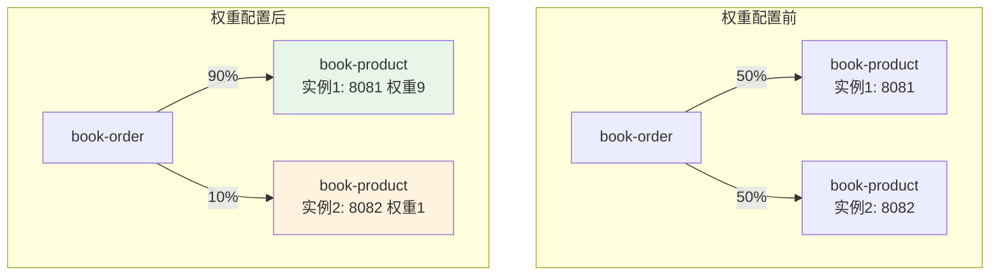
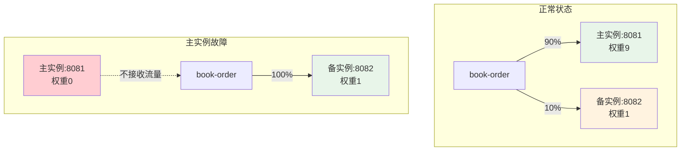

# Nacos权重路由

## 课程目标

- 理解Nacos服务路由的核心机制与权重在流量分配中的作用
- 掌握在Nacos控制台中动态调整实例权重的方法
- 掌握基于`DiscoveryClient`手动实现加权随机选择的完整流程
- 掌握通过权重配置实现主备实例流量倾斜的完整流程
- 理解权重路由与后续灰度发布、故障转移之间的关系
- 完成图书服务主备实例的权重配置与流量验证


## 回顾与导入

到目前为止，我们通过Namespace实现了dev/test两套环境的隔离，三个服务都成功注册到了各自的命名空间。但此时同一服务下的多个实例，接收到的流量是**完全均等**的——因为默认的负载均衡策略会等概率地从健康实例列表中选择一个实例。

这在很多实际场景中并不合理。来看几个真实的需求：

| 场景         | 需求                                                     | 传统方案的痛点                             |
| ------------ | -------------------------------------------------------- | ------------------------------------------ |
| **主备部署** | 主服务器性能强，备服务器性能弱，希望主服务器承担更多流量 | 均等分配导致备服务器过载或主服务器资源浪费 |
| **灰度发布** | 新版本实例只接收10%的流量进行验证                        | 无法在负载均衡层面控制流量比例             |
| **性能差异** | 新机器配置高、旧机器配置低                               | 一刀切的均等分配无法发挥硬件优势           |
| **故障转移** | 某实例出现异常但未完全宕机，希望逐步减少其流量           | 只能手动下线，无法平滑过渡                 |

Nacos提供的**权重路由**功能正是为了解决这些问题。通过为每个服务实例分配不同的权重值，可以精确控制流量在不同实例之间的分配比例。




## 权重路由核心原理

### 权重的工作机制

Nacos的权重路由功能基于服务实例的元数据实现。每个服务实例都可以配置一个权重值（weight），Nacos会根据权重值计算每个实例的流量分配比例。

权重的核心机制如下：

| 特性           | 说明                                                         |
| -------------- | ------------------------------------------------------------ |
| **相对值**     | 权重是相对值，不是百分比。权重为3和1的两个实例，分别接收75%和25%的流量 |
| **客户端执行** | Nacos服务端只负责存储和推送权重值，**不强制执行流量分配**。实际的路由决策由客户端（框架自动实现，或本课程中由我们手写实现）完成 |
| **动态生效**   | 权重修改后无需重启服务，权重值会伴随实例信息被推送到Nacos客户端 |

### 流量分配的计算公式

假设有N个健康实例，每个实例的权重为`w_i`，则实例`i`被选中的概率为：

```
P(实例i) = w_i / (w_1 + w_2 + ... + w_N)
```

**示例：**

| 实例  | 权重 | 流量占比      |
| ----- | ---- | ------------- |
| 实例A | 9    | 9/(9+1) = 90% |
| 实例B | 1    | 1/(9+1) = 10% |

> **重要提示：** Nacos的权重路由是**概率性**的，不是严格计数。请求次数少时比例波动较大，请求样本越大，实际比例越接近理论比例。


## 实战准备：启动多实例环境

### 启动两个book-product实例

为了演示权重路由的效果，我们需要启动两个book-product实例。在dev命名空间下，两个实例使用不同的端口。启动后，在Nacos控制台中切换到 **“开发环境”** 命名空间，进入 **“服务管理” → “服务列表”** ，点击`book-product`进入服务详情页。

**预期结果：** 实例列表中显示2个实例：

| 实例  | IP        | 端口 | 健康状态 | 权重 |
| ----- | --------- | ---- | -------- | ---- |
| 实例1 | 127.0.0.1 | 8081 | 健康     | 1.0  |
| 实例2 | 127.0.0.1 | 8082 | 健康     | 1.0  |

### 让 book-product 汇报自己的端口

为了后续能直观看出"本次调用到底落到了哪个实例"，我们在book-product的`ProductController`中新增一个"自报家门"的接口，直接返回当前实例的端口号：

```java
@Slf4j
@RestController
@RequestMapping("/api/products")
public class ProductController {

    @Value("${server.port}")
    private String port;

    @GetMapping("/{id}")
    public Result<ProductVO> detail(@PathVariable("id") Long id) {
        log.info("book-product 实例 {} 被调用", port);
        return Result.success(productService.getDetail(id));
    }

    /**
     * 返回当前实例的端口，用于验证权重路由效果
     * 注意：使用字面量路径，Spring MVC 会优先匹配，不会落入 /{id}
     */
    @GetMapping("/instance-port")
    public String instancePort() {
        log.info("book-product 实例 {} 被调用（instance-port）", port);
        return port;
    }
}
```

该接口返回字符串类型的端口号（如 `"8081"`），book-order 调用后会直接拿到这个字符串，便于统计。


## 手动实现加权随机选择

### 为什么需要自己写

`DiscoveryClient.getInstances("book-product")`返回的是一份**原始实例列表**，每个实例都带着`weight`属性，但**列表本身不按权重排序**，也不提供"按权重挑选"的方法。所以我们必须自己实现选择逻辑。

好消息是：Nacos客户端内部的加权随机算法本身并不复杂，核心就是"按权重累加，命中随机数"——理解并实现一遍，就真正理解权重路由了。

### 编写 `WeightedInstanceSelector`

在book-order中新建一个工具类：

```java
public class WeightedInstanceSelector {

    public static ServiceInstance choose(List<ServiceInstance> instances) {
        if (instances == null || instances.isEmpty()) {
            return null;
        }

        // 过滤掉权重 <= 0 的实例（权重缺失时按 1.0 处理），剩下的才是真正参与抽样的候选集
        List<ServiceInstance> candidates = instances.stream()
                .filter(i -> parseWeight(i) > 0)
                .toList();
        if (candidates.isEmpty()) {
            // 所有实例权重都为 0，等同于"全部摘流"，无可选实例
            return null;
        }

        // 计算候选集的总权重，作为随机数的上界
        double totalWeight = candidates.stream()
                .mapToDouble(WeightedInstanceSelector::parseWeight)
                .sum();

        // 在 [0, totalWeight) 区间内取一个均匀分布的随机数
        double random = ThreadLocalRandom.current().nextDouble(totalWeight);

        // 按实例顺序累加权重，随机数首次小于累计值时，即命中该实例
        double cursor = 0.0;
        for (ServiceInstance instance : candidates) {
            cursor += parseWeight(instance);
            if (random < cursor) {
                return instance;
            }
        }

        // 理论上循环内一定会返回；这里兜底返回最后一个实例，避免浮点精度等极端情况返回 null
        return candidates.get(candidates.size() - 1);
    }

    private static double parseWeight(ServiceInstance instance) {
        // 优先读取标准键名 "weight"
        String weightStr = instance.getMetadata().get("weight");

        if (weightStr == null || weightStr.isBlank()) {
            // 兼容部分 Nacos 版本使用的 "nacos.weight" 键名
            weightStr = instance.getMetadata().get("nacos.weight");
        }

        if (weightStr == null || weightStr.isBlank()) {
            // metadata 中确实没有权重信息，按默认权重参与分配
            return 1.0;
        }

        try {
            return Double.parseDouble(weightStr);
        } catch (NumberFormatException e) {
            // 权重值格式非法时，退化为默认权重，避免影响整体选择流程
            return 1.0;
        }
    }
}
```

**算法解读：**

假设实例A权重`9`、实例B权重`1`，总权重为`10`。随机数`random`在`[0, 10)`均匀分布。

| `random` 落点 | 累加过程                   | 命中实例 |
| ------------- | -------------------------- | -------- |
| `[0, 9)`      | 累计到A时已超过            | A        |
| `[9, 10)`     | 累计到A不够，累加到B才超过 | B        |

因此A被选中的概率是`9/10 = 90%`，B是`1/10 = 10%`——这正是公式`P(i) = w_i / Σw`的代码化实现。

### 改造 `DiscoveryController`

把原来的`instances.get(0)`换成`WeightedInstanceSelector.choose(instances)`：

```java
@Slf4j
@RestController
@RequestMapping("/api/discovery")
@RequiredArgsConstructor
public class DiscoveryController {

    private final DiscoveryClient discoveryClient;
    private final RestTemplate restTemplate;   // 普通 RestTemplate，不能带 @LoadBalanced

    @GetMapping("/book/{id}")
    public Result<String> getBookById(@PathVariable("id") Long id) {
        List<ServiceInstance> instances = discoveryClient.getInstances("book-product");
        if (instances == null || instances.isEmpty()) {
            return Result.error(503, "图书服务暂时不可用，请稍后重试");
        }

        // 关键改动：加权随机选择，而不是写死 get(0)
        ServiceInstance instance = WeightedInstanceSelector.choose(instances);
        if (instance == null) {
            return Result.error(503, "所有实例权重均为0，暂无可用实例");
        }

        String baseUrl = instance.getUri().toString();
        log.info("选中图书服务实例：{}:{})",
                instance.getHost(), instance.getPort());

        String requestUrl = baseUrl + "/api/products/" + id;
        log.info("发起远程调用：{}", requestUrl);

        try {
            String result = restTemplate.getForObject(requestUrl, String.class);
            return Result.success(result);
        } catch (Exception e) {
            log.error("调用图书服务失败", e);
            return Result.error(500, "调用图书服务失败：" + e.getMessage());
        }
    }

    /**
     * 验证权重路由：返回被选中实例的端口
     */
    @GetMapping("/book/instance-port")
    public Result<String> getBookInstancePort() {
        List<ServiceInstance> instances = discoveryClient.getInstances("book-product");
        if (instances == null || instances.isEmpty()) {
            return Result.error(503, "图书服务暂时不可用");
        }

        ServiceInstance instance = WeightedInstanceSelector.choose(instances);
        if (instance == null) {
            return Result.error(503, "所有实例权重均为0，暂无可用实例");
        }

        log.info("选中图书服务实例：{}:{})",
                instance.getHost(), instance.getPort());

        String requestUrl = instance.getUri() + "/api/products/instance-port";
        try {
            String port = restTemplate.getForObject(requestUrl, String.class);
            return Result.success("调用实例端口: " + port);
        } catch (Exception e) {
            log.error("调用图书服务失败", e);
            return Result.error(500, "调用失败：" + e.getMessage());
        }
    }
}
```


## 验证权重路由效果

### 基线：权重 1.0 : 1.0，观察均等分配

**先确认**：此时Nacos控制台两个book-product实例的权重都是默认的`1.0`。

**操作**：连续调用50次接口：

```http
### 连续调用50次，每次返回被选中实例的端口
GET {{order_url}}/api/discovery/book/instance-port
```

**预期现象**：返回的端口字符串中，`8081`和`8082`大致各占一半（各25次左右）。由于是概率性路由，20次中偶尔出现30:20或20:30都正常，但**不会出现一边倒**。

如果此时出现"全是8081"或"全是8082"，说明加权逻辑没有正确生效，请检查：

- `WeightedInstanceSelector.choose`是否被调用（而不是`get(0)`）；
- Nacos客户端是否已经拉到最新的实例列表（权重/实例变更后默认约10秒内生效，可稍等或重启book-order）。

### 统计方式

#### 方式一：通过 book-order 日志统计

book-order的`DiscoveryController`每次选择实例后都会打印：

```
选中图书服务实例：127.0.0.1:8081 (weight=1.0)
选中图书服务实例：127.0.0.1:8082 (weight=0.1)
```

直接在日志中统计`8081`与`8082`出现的行数，即可得到实际流量分布。

#### 方式二：通过 book-product 端日志统计

book-product的`ProductController`中也有：

```
book-product 实例 8081 被调用（instance-port）
```

同样能在两个book-product实例的日志里分别统计被调用次数，双重验证。

> **注意**：由于权重路由是概率性的，请求样本越大，实际比例越接近理论比例。建议至少调用**50次**再下结论。


## 主备实例配置实战

### 主备场景分析

在图书管理系统中，主备部署是一种常见的容灾方案：

| 角色       | 实例 | 权重 | 定位                       |
| ---------- | ---- | ---- | -------------------------- |
| **主实例** | 8081 | 9    | 承担绝大部分流量，性能最优 |
| **备实例** | 8082 | 1    | 承担少量流量，保持热备状态 |

### 配置主备权重

在Nacos控制台中，将两个实例的权重设置为9和1。

> **为什么备实例不设为0？** 备实例保持10%的流量有以下几个好处：
> 1. **热备验证**：备实例持续处理少量请求，确保其代码和配置始终可用
> 2. **快速切换**：当主实例故障时，备实例已处于运行状态，可立即承接全部流量
> 3. **性能监控**：备实例的监控指标持续更新，便于对比分析

**验证**：等待约10秒后连续调用50次`/api/discovery/book/instance-port`，预期8081约45次、8082约5次。

### 模拟主实例故障

将主实例（8081）的权重设置为`0`，模拟主实例故障或维护：

| 实例 | 原权重 | 新权重 | 效果         |
| ---- | ------ | ------ | ------------ |
| 8081 | 9      | 0      | 不再接收流量 |
| 8082 | 1      | 1      | 接收全部流量 |

**验证**：`WeightedInstanceSelector`会过滤掉权重为0的实例，因此连续调用50次，预期**全部路由到8082实例**。

### 恢复主实例

将主实例（8081）的权重从`0`恢复为`9`，备实例保持`1`。流量分配恢复到90%/10%的状态。



## 注意事项

1. **权重路由是概率性的**：调用次数少时比例波动大，建议至少观察50次以上的调用结果。

2. **备实例建议保持非零权重**：备实例保持少量流量（如10%）可以验证其可用性，并在主实例故障时快速承接全部流量。

3. **权重为0即"下线流量"**：`WeightedInstanceSelector`会过滤掉权重为0的实例，效果等同于"保留实例但不下发流量"。

4. **客户端缓存延迟**：Nacos客户端默认每10秒拉取一次实例列表，权重修改后最多10秒才生效。修改权重后建议先等待再验证。

   2

## 小结

本节课我们学习了：

1. **权重路由的核心原理**：Nacos根据权重值计算流量分配比例，服务端只负责存储和推送权重，客户端（手动或框架）负责执行路由决策。

2. **控制台操作**：在Nacos服务详情页中编辑实例权重，权重为浮点数，常见范围 `0 ~ 10000`。

4. **手动加权随机实现**：核心是`P(i) = w_i / Σw`，配合过滤权重为0实例、累加比较的算法，代码与公式一一对应。

5. **主备实例配置**：主实例权重9、备实例权重1，实现90%/10%的流量倾斜，备实例保持热备状态。

6. **权重为0的特殊用法**：临时摘除实例、模拟故障、对比测试等场景。

7. **流量验证方法**：通过book-order日志或book-product日志统计各实例被调用次数。


## 作业

### 作业一：完成权重配置与验证

1. 启动两个book-product实例（端口8081和8082），注册到dev命名空间。
2. 在book-product中新增`/api/products/instance-port`接口，返回当前实例端口。
3. 在book-order中实现`WeightedInstanceSelector`，并改造`DiscoveryController`使用它。
4. 在Nacos控制台中将8082实例的权重修改为`0.2`，8081保持`1.0`，等待约10秒。
5. 编写一个批量测试脚本，连续调用50次`/api/discovery/book/instance-port`接口，统计返回的端口号中`8081`和`8082`各出现的次数。

### 作业二：主备实例流量切换演练

1. 将8081实例权重设为`9`，8082实例权重设为`1`，模拟主备部署。
2. 连续调用50次`/api/discovery/book/instance-port`，记录流量分布。
3. 将8081实例权重设为`0`，模拟主实例故障。
4. 再次调用50次，验证所有流量是否都路由到8082。
5. 恢复8081权重为`9`，验证流量分配是否恢复到90%/10%。
