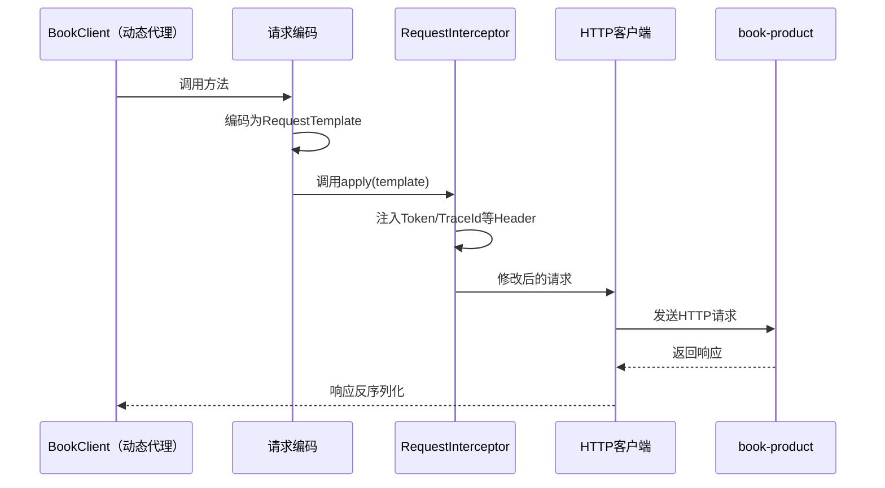

# OpenFeign拦截器

## 课程目标

- 理解`RequestInterceptor`拦截器的定位与执行时机
- 掌握通过拦截器统一传递认证Token、TraceId等请求头的方法
- 掌握拦截器的两种配置方式（全局Bean vs 局部配置类）
- 完成`BookClient`Token透传改造


## 回顾与导入

在上一节中，我们完成了`BookClient`的定义和注解改造，订单服务已经能通过Feign调用图书服务。但此时有一个问题没有解决：

> **场景：** book-order需要将用户请求中的JWT Token透传给book-product，以便图书服务做权限校验。如果在每个Feign方法上都写`@RequestHeader("Authorization") String token`，一旦新增方法就很容易遗漏，而且调用方需要在每个调用点手动传入token，侵入性极强。

拦截器可以**一次配置，全局生效**，所有Feign请求自动带上所需Header。本节内容详细介绍OpenFeign的拦截器机制。


## OpenFeign拦截器

### RequestInterceptor核心机制

`RequestInterceptor`是OpenFeign提供的**请求拦截扩展点**。Spring Cloud会自动扫描容器中所有实现了该接口的Bean，在每次Feign请求发出之前调用`apply`方法，允许对即将发出的HTTP请求进行修改。

```java
public interface RequestInterceptor {
    void apply(RequestTemplate template);
}
```

`RequestTemplate`代表即将发送的HTTP请求，可以修改URL、请求头、请求体等。执行时机在**Feign完成请求编码之后、HTTP客户端真正发出请求之前**。



### 核心场景一：统一透传认证Token

这是拦截器最典型的用途。调用方无需在每个Feign方法上声明`@RequestHeader`，拦截器自动从当前请求上下文中提取Token并注入。

**步骤一：创建拦截器**

在book-order中创建`FeignAuthInterceptor`：

```java
@Component
public class FeignAuthInterceptor implements RequestInterceptor {

    private static final String AUTH_HEADER = "Authorization";

    @Override
    public void apply(RequestTemplate template) {
        // 从当前HTTP请求上下文中获取原始请求
        ServletRequestAttributes attributes =
                (ServletRequestAttributes) RequestContextHolder.getRequestAttributes();

        HttpServletRequest request = attributes.getRequest();
        String token = request.getHeader(AUTH_HEADER);

        if (StringUtils.hasText(token)) {
            template.header(AUTH_HEADER, token);
        }
    }
}
```

> **关键点：** `RequestContextHolder`基于`ThreadLocal`保存当前请求信息。Feign调用通常发生在同一线程中，因此可以读取到进入book-order时的原始请求头。

**步骤二：验证Token透传**

book-product中添加一个需要读取Token的测试接口：

```java
@GetMapping("/products/{id}/auth")
public Result<ProductDto> getByIdWithAuth(@PathVariable("id") Long id,
       @RequestHeader(value = "Authorization", required = false) String token) {
    log.info("收到的Token: " + token);
    return Result.success(productService.getBookById(id));
}
```

在book-order的bookClient中，定义远程调用客户端方法：

```java
@GetMapping("/products/{id}/auth")
Result<ProductDto> getByIdWithAuth(@PathVariable("id") Long id);
```

在book-order的Controller中，将用户请求的Token通过Feign调用透传：

```java
@GetMapping("/products/{id}/auth")
public Result<ProductDto> getProductWithAuth(@PathVariable Long id,
      @RequestHeader("Authorization") String token) {
    // 拦截器会自动将当前请求的Authorization头注入Feign请求
    return bookClient.getByIdWithAuth(id);
}
```

调用book-order的接口并携带`Authorization: Bearer test-token`，验证book-product收到的Token与传入的一致。

### 核心场景二：传递TraceId（链路追踪铺垫）

在微服务调用链中，TraceId需要在服务间传递，才能将一次请求在多个服务中的日志关联起来。拦截器可以自动将当前线程MDC中的TraceId注入Feign请求头：

```java
@Component
public class FeignTraceInterceptor implements RequestInterceptor {

    @Override
    public void apply(RequestTemplate template) {
        String traceId = MDC.get("traceId");
        if (StringUtils.hasText(traceId)) {
            template.header("X-Trace-Id", traceId);
        }
    }
}
```

> **课程衔接：**后续课程的可观测性部分将使用Micrometer Tracing自动完成TraceId的跨服务传播，届时拦截器不再是必须的。但在尚未引入链路追踪框架的阶段，拦截器是手动传递TraceId的轻量方案。

### 拦截器的配置方式：全局 vs 局部

拦截器有两种生效方式，理解它们的区别是避免“配置污染”的关键。

**方式一：全局拦截器（@Component / @Bean）**

```java
@Component   // 注册为Spring Bean，对所有Feign客户端生效
public class FeignAuthInterceptor implements RequestInterceptor { ... }
```

只要拦截器被注册为Spring容器中的Bean，Spring Cloud就会将它注入到**每一个**Feign客户端中。

**方式二：局部拦截器（通过@FeignClient的configuration）**

```java
// 配置类：不加 @Configuration
public class BookFeignConfig {
    @Bean
    public RequestInterceptor bookAuthInterceptor() {
        return new BookAuthInterceptor();
    }
}

@FeignClient(name = "book-product", configuration = BookFeignConfig.class)
public interface BookClient { ... }
```

局部拦截器只对声明了`configuration`的那个Feign客户端生效。


### 拦截器执行顺序

当存在多个拦截器时，可以通过`@Order`或实现`Ordered`接口控制执行顺序。`AnnotationAwareOrderComparator.sort(interceptors)` 会对拦截器列表排序，`@Order`值越小越先执行。

```java
@Component
@Order(1)   // 先执行：注入TraceId
public class FeignTraceInterceptor implements RequestInterceptor { ... }

@Component
@Order(2)   // 后执行：注入Token
public class FeignAuthInterceptor implements RequestInterceptor { ... }
```

| 典型顺序 | 拦截器        | 理由                                                |
| -------- | ------------- | --------------------------------------------------- |
| 1（先）  | TraceId拦截器 | 越早注入，后续拦截器和HTTP客户端日志越能带上TraceId |
| 2（后）  | Token拦截器   | 依赖当前请求上下文，在TraceId之后执行即可           |


## 实战：整合拦截器到BookClient

### 验证清单

| 验证项       | 操作                                                         | 预期结果                                                     |
| ------------ | ------------------------------------------------------------ | ------------------------------------------------------------ |
| 日志输出     | 调用`getById(1L)`                                            | 控制台输出`---> GET .../api/products/1` 和 `<--- HTTP/1.1 200` |
| Token透传    | 调用`getByIdWithAuth`，Header携带`Authorization: Bearer test` | book-product返回`收到的Token: Bearer test`                   |
| 无Token场景  | 不携带`Authorization`调用`getById(1L)`                       | 请求正常发出，不因拦截器缺少Token而报错                      |
| 局部配置隔离 | 确认`BookFeignLogConfig`未加`@Configuration`                 | 日志级别仅对`book-product`生效                               |

### 拦截器未生效

| 可能原因                       | 排查方法                                                     |
| ------------------------------ | ------------------------------------------------------------ |
| 拦截器未注册为Bean             | 全局拦截器需要`@Component`或`@Bean`                          |
| 局部拦截器配置类未被引用       | 检查`@FeignClient(configuration = ...)`是否正确指定          |
| `RequestContextHolder`返回null | 确认调用发生在同一线程；熔断/异步场景需要额外传递上下文      |
| 拦截器执行了但Header被覆盖     | 检查是否有其他拦截器或Feign方法上的`@RequestHeader`覆盖了同名Header |


## 小结

本节课我们学习了：

1. **`RequestInterceptor`核心机制**：在Feign请求发出前调用`apply(RequestTemplate template)`，可修改Header、URL等。
2. **拦截器核心场景**：统一透传Token、传递TraceId，实现“一次配置，全局生效”。
3. **全局 vs 局部拦截器**：`@Component`注册为全局；不加`@Configuration`的配置类 + `@FeignClient(configuration = ...)`实现局部。`@Configuration`会导致局部配置“污染”全局。
4. **拦截器执行顺序**：通过`@Order`控制，TraceId类拦截器优先执行。
5. **实战整合**：`BookClient`配置BASIC日志 + 全局TraceId/Token拦截器，验证日志输出和Token透传效果。


## 作业

### 作业一：实现Token透传拦截器

1. 创建`FeignAuthInterceptor`，从`RequestContextHolder`获取当前请求的`Authorization`头并注入Feign请求。
2. 在book-product中添加测试接口`GET /api/products/{id}/auth`，返回收到的Token。
3. 在book-order的Controller中调用该Feign方法，通过IDEA HTTP Request携带`Authorization: Bearer test-token`，验证book-product收到的Token与传入一致。
4. 不携带Token再次调用，验证请求正常发出，拦截器不会因缺少Token而报错。

### 作业二：拦截器顺序验证

1. 创建两个拦截器：`TraceInterceptor`（`@Order(1)`）注入`X-Trace-Id`，`AuthInterceptor`（`@Order(2)`）注入`Authorization`。
2. 在book-product的接口中打印所有请求头，验证两个Header都被正确注入。
3. 将两个拦截器的`@Order`值互换，观察执行顺序是否变化（可通过在`apply`方法中打印日志验证）。
