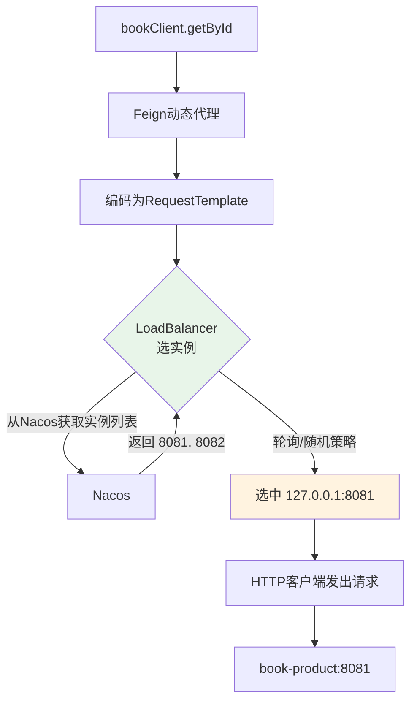
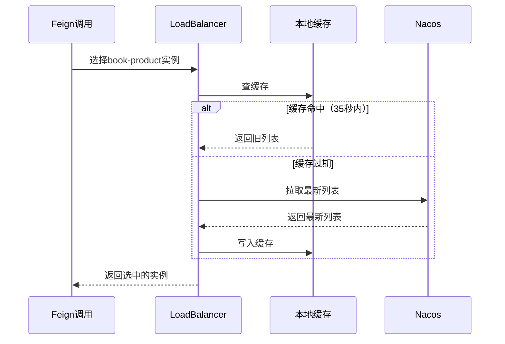

# OpenFeign与LoadBalancer集成

## 课程目标

- 理解OpenFeign与Spring Cloud LoadBalancer的协作关系：Feign负责“发请求”，LoadBalancer负责“挑实例”
- 掌握LoadBalancer的默认负载均衡策略（轮询）及其在多实例下的表现
- 掌握通过`LoadBalancerLifecycle`观察最终选中实例IP和端口的方法
- 理解LoadBalancer默认**35秒实例列表缓存**带来的感知延迟，以及Nacos场景下的推荐配置
- 完成两个book-product实例下的Feign负载均衡验证，观察请求在两个实例间的分布


## 回顾与导入

在上一节中，我们为`BookClient`配置了拦截器。但有一个问题一直没有被正面回答：**当book-product有多个实例时，Feign的请求到底发给了哪一个？**

来看一个真实场景：

> **场景：** book-product扩容到了两个实例（8081、8082），book-order通过`BookClient.getById()`调用。book-order的开发者以为“Feign会自动负载均衡”，但实际上，如果LoadBalancer没有正确参与，请求可能**始终打到8081**，8082完全闲置。扩容等于白扩。

注意，Feign的底层组成：

| 组件                          | 职责                                       |
| ----------------------------- | ------------------------------------------ |
| Feign Core                    | 解析接口、生成动态代理、编码请求           |
| **Spring Cloud LoadBalancer** | **根据服务名获取实例列表，并按策略挑一个** |
| Nacos Discovery               | 提供实例列表                               |

`@FeignClient(name = "book-product")`中的`book-product`只是一个**服务名**，Feign自己并不知道8081和8082的存在。真正把服务名解析成具体实例地址的，是LoadBalancer。

本节的核心任务就是：**让LoadBalancer的“挑实例”过程可见、可验证**。


## 核心原理：Feign调用链中的LoadBalancer

### 调用链全景

一次`bookClient.getById(1L)`的完整调用链如下：



关键点：LoadBalancer在**请求编码之后、HTTP客户端发出之前**介入，将`http://book-product/api/products/1`中的`book-product`替换为具体的`127.0.0.1:8081`。

### 默认负载均衡策略：轮询

Spring Cloud LoadBalancer官方提供了`ReactiveLoadBalancer`接口，并内置了**轮询（Round-Robin）** 和**随机（Random）** 两种实现。默认生效的是**轮询策略（`RoundRobinLoadBalancer`）** 。

轮询的行为是：按照固定顺序将请求依次分配给每个实例——1号、2号、3号、再回到1号。如果两个book-product实例的健康状态相同、权重相同（默认1.0），轮询会让请求在8081和8082之间交替。轮询算法：

```java
// 伪代码，展示核心逻辑
private Response<ServiceInstance> getInstanceResponse(List<ServiceInstance> instances) {
    if (instances.isEmpty()) {
        // 记录警告日志并返回空响应
        return new EmptyResponse();
    }
    // 对单实例列表进行优化，直接返回
    if (instances.size() == 1) {
        return new DefaultResponse(instances.get(0));
    }
    // 1. 原子自增，并通过位与运算消除符号位
    int pos = this.position.incrementAndGet() & Integer.MAX_VALUE;
    // 2. 对实例数量取模
    ServiceInstance instance = instances.get(pos % instances.size());
    return new DefaultResponse(instance);
}
```

普通轮询的取模算法非常直接：通过原子计数器记录当前请求的序列号，然后对实例节点总数取模，得到具体下标，再从列表取实例。


## 实战：实例可见和负载均衡

现在启动两个book-product服务实例，端口分别为8081和8082.

### 问题：Feign默认日志不打印实例IP

Feign的`BASIC`或`FULL`日志会打印**服务名**级别的URL（如`GET http://book-product/api/products/1`），但**不会打印最终选中的实例IP和端口**。当两个实例都可能被选中时，仅凭Feign日志无法判断请求到底打到了哪一台。

### 解决方案：自定义LoadBalancerLifecycle

Spring Cloud LoadBalancer提供了`LoadBalancerLifecycle`接口，允许在负载均衡的不同阶段插入回调：

| 回调方法                                                     | 触发时机       |
| ------------------------------------------------------------ | -------------- |
| `onStart(Request<RC> request)`                               | 负载均衡开始前 |
| `onStartRequest(Request<RC> request, Response<T> lbResponse)` | 实例选择完成后 |
| `onComplete(CompletionContext<RES, T, RC> completionContext)` | 请求完成后     |

在`onStartRequest`中，可以从`Response`中提取LoadBalancer选中的`ServiceInstance`，打印其IP和端口。

**在book-order中创建生命周期监听器：**

```java
@Component
public class InstanceLoggingLoadBalancerLifecycle
        implements LoadBalancerLifecycle<RequestDataContext, ResponseData, ServiceInstance> {

    @Override
    public void onStart(Request<RequestDataContext> request) {
        // 可选
    }

    @Override
    public void onStartRequest(Request<RequestDataContext> request,
                               Response<ServiceInstance> lbResponse) {
        ServiceInstance instance = lbResponse.getServer();
        if (instance != null) {
            System.out.println("[LB选中实例] " + instance.getHost() + ":" + instance.getPort());
        }
    }

    @Override
    public void onComplete(CompletionContext<ResponseData, ServiceInstance, RequestDataContext> ctx) {
        // 可选
    }
}
```

> **说明：** `LoadBalancerLifecycle`会被LoadBalancer自动发现并注册，不需要额外配置。每次Feign调用经过LoadBalancer时，`onStartRequest`都会触发，输出最终选中的实例。

配置Feign日志（辅助观察），确保book-order的`application.yml`中Feign日志可用。

### 调用Feign接口

通过book-order的Controller连续调用`getById`接口：

```http
### 连续执行，观察控制台输出的实例IP:端口
GET {{order_url}}/api/order/product/1
```

### 预期输出

**book-order控制台的`[LB选中实例]`输出应交替出现：**

```
[LB选中实例] 127.0.0.1:8081
[LB选中实例] 127.0.0.1:8082
[LB选中实例] 127.0.0.1:8081
[LB选中实例] 127.0.0.1:8082
```

**Feign日志同时输出：**

```
[BookClient#getById] ---> GET http://book-product/api/products/1 HTTP/1.1
[BookClient#getById] <--- HTTP/1.1 200 (32ms)
```

> **观察要点：** Feign日志中的URL仍然是`http://book-product/...`（服务名级别），而`[LB选中实例]`揭示了实际的IP:端口。两者结合，才能完整还原“请求发给了谁”。

### 如果两个实例的请求分布明显不均

如果连续多次调用后，`[LB选中实例]`几乎总是同一个端口，检查以下原因：

| 可能原因                      | 排查方法                                                     |
| ----------------------------- | ------------------------------------------------------------ |
| 只有一个实例健康              | 在Nacos控制台确认两个实例都是“健康”状态                      |
| LoadBalancer缓存未刷新        | 实例2启动后，LoadBalancer的缓存可能还是旧的单实例列表。等待**35秒**后重试（见下文缓存机制） |
| 配置了`@FeignClient(url=...)` | `url`会绕过LoadBalancer，Feign直接向指定地址发请求，多实例不会被轮询 |
| 自定义了负载均衡策略          | 检查是否有自定义`ReactorLoadBalancer` Bean覆盖了默认轮询。后续课程会介绍自定义负载均衡策略 |


## 关键机制：35秒实例缓存与Nacos场景的坑

### 默认缓存行为

Spring Cloud LoadBalancer为了避免每次Feign调用都向注册中心拉取实例列表，内置了一层**本地缓存**。默认缓存TTL为**35秒**，默认初始容量为256。在这35秒内，LoadBalancer**优先使用缓存中的实例列表**，即使Nacos中实例已经发生了变化。



### Nacos场景下缓存带来的问题

Nacos 2.x之后使用gRPC长连接**实时推送**实例变更，Nacos Client内存中已经维护了最新的实例列表。但LoadBalancer的这层缓存会**屏蔽掉Nacos的实时推送**：

| 场景         | 缓存开启时的表现                                     | 缓存关闭时的表现      |
| ------------ | ---------------------------------------------------- | --------------------- |
| 新实例启动   | 最长35秒内，流量不会路由到新实例                     | 立即可见              |
| 实例优雅下线 | 最长35秒内，流量仍可能路由到已下线实例               | 立即停止路由          |
| 实例宕机     | 取决于Nacos心跳超时 + LoadBalancer缓存，感知延迟叠加 | 仅受Nacos心跳超时影响 |

**推荐配置（Nacos场景）：**

```yaml
spring:
  cloud:
    loadbalancer:
      cache:
        enabled: false
```

关闭LoadBalancer缓存后，每次负载均衡直接读取Nacos Client内存中的实时实例列表，**不会增加注册中心的网络压力**，因为`getInstances`是纯内存操作。

如果生产环境 QPS 非常高、服务数量很多，也可以先评估性能影响；折中做法是把 TTL 缩短，例如：

```yaml
spring:
  cloud:
    loadbalancer:
      cache:
        enabled: true
        ttl: 5s
```

> **注意：** `cache.ttl`仅在`cache.enabled=true`时生效。


## 小结

本节课我们学习了：

1. **Feign与LoadBalancer的协作关系**：Feign负责编码和发送请求，LoadBalancer负责从服务名解析出具体实例。
2. **默认轮询策略**：在健康状态和权重相同时，请求在两个实例间交替分布。Nacos权重、自定义策略等内容将在后续课程中展开。
3. **`LoadBalancerLifecycle`监听器**：通过`onStartRequest`回调打印最终选中的实例IP和端口，弥补Feign日志的不足。
4. **35秒实例缓存**：LoadBalancer默认缓存实例列表35秒，会屏蔽Nacos的实时变更推送；Nacos场景推荐配置`cache.enabled: false`。
5. **多实例验证**：启动两个book-product实例，观察`[LB选中实例]`输出是否交替出现，确认负载均衡生效。


## 作业

### 作业一：完成多实例负载均衡验证

1. 启动两个book-product实例（8081、8082），确认Nacos控制台中两个实例均为健康。
2. 在book-order中创建`InstanceLoggingLoadBalancerLifecycle`，开启Feign的`BASIC`日志。
3. 在`application.yml`中配置`spring.cloud.loadbalancer.cache.enabled: false`。
4. 连续调用`BookClient.getById()` 10次，记录`[LB选中实例]`的输出，验证两个实例是否交替出现。
5. 截图控制台输出和Nacos服务列表。

### 作业二：缓存关闭与实例下线的感知

1. 在`cache.enabled: false`的前提下，启动两个实例，确认轮询生效。
2. 优雅下线8082实例（或直接停止进程）。
3. 立即调用Feign接口，观察`[LB选中实例]`是否**立即**只显示8081，不再尝试8082。
4. 将`cache.enabled`改为`true`，重复上述实验，观察下线后是否仍有一段时间的调用可能路由到已下线实例。
