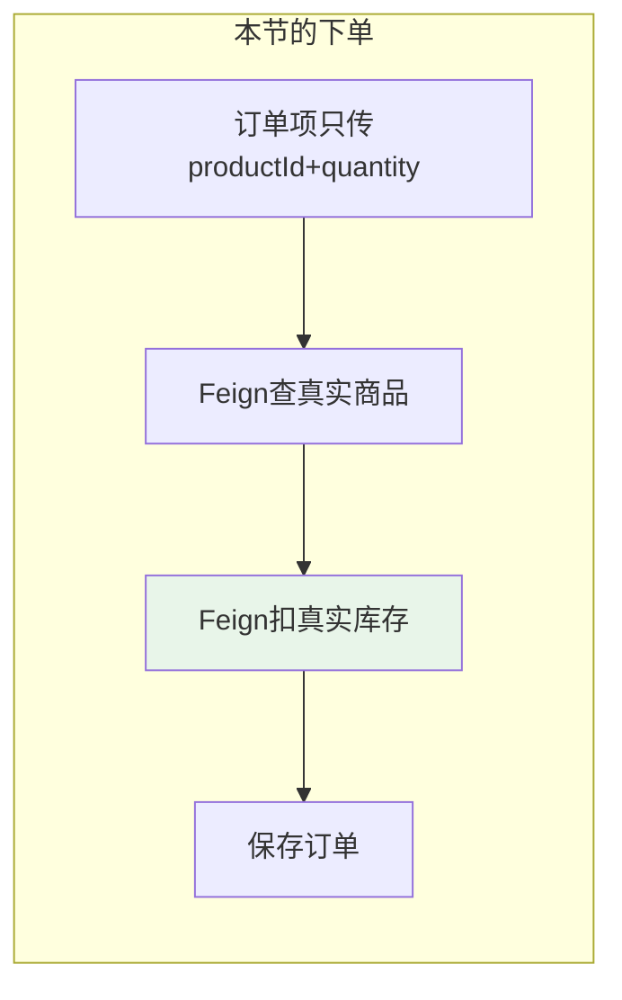
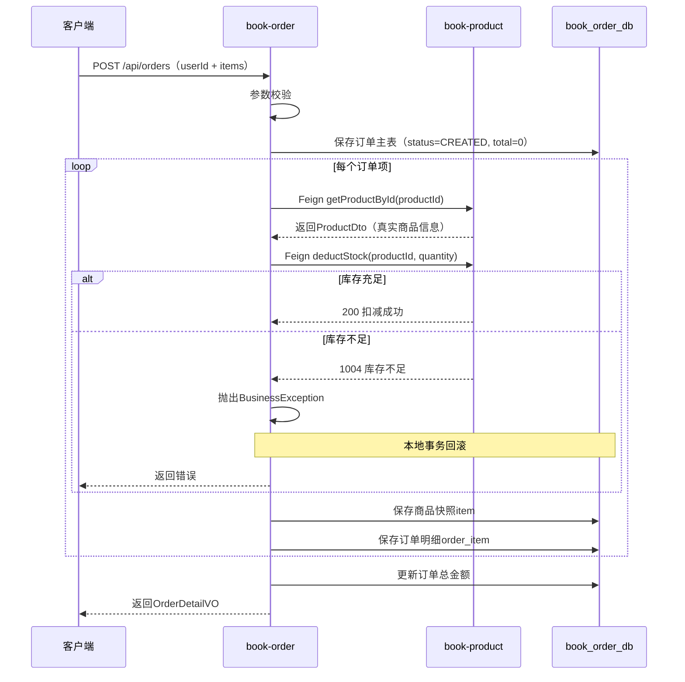

# 订单-图书远程调用重构

## 课程目标

- 掌握订单创建时调用图书服务扣减库存的完整业务流程设计
- 掌握通过Feign查询图书真实信息、替换前端模拟数据的改造方法
- 掌握远程调用的超时两个维度（`connectTimeout`、`readTimeout`）与正确配置前缀
- 理解Spring Cloud OpenFeign默认不重试的设计，掌握写操作禁止重试的安全边界
- 掌握写操作远程调用的安全设计：禁止重试、超时控制、失败处理、幂等意识
- 理解本地事务与远程调用的边界问题，复现分布式事务不一致场景
- 完成下单扣库存流程的端到端验证，为引入Seata分布式事务做好铺垫


## 回顾与导入

到目前为止，`BookClient`已经是一个功能完备、性能可靠的远程调用客户端：

```java
@FeignClient(name = "book-product", path = "/api")
public interface BookClient {
    @GetMapping("/products/{id}")
    Result<ProductDto> getProductById(@PathVariable("id") Long id);

    @GetMapping("/products/query")
    Result<List<ProductDto>> query(@SpringQueryMap ProductQuery query);

    @PostMapping("/stock/deduct")
    Result<Void> deductStock(@RequestBody StockDeductRequest request);
}
```

但回到业务本身，`OrderServiceImpl.createOrder`至今还停留在“闭门造车”的状态：

```java
// 目前写法：商品信息由前端传入，库存从未被真正扣减
Item item = BeanUtil.copyProperties(itemReq, Item.class);
itemMapper.insert(item);
```

这里有两个明显的“假”：

| 问题         | 目前做法                           | 真实业务应该               |
| ------------ | ---------------------------------- | -------------------------- |
| **商品信息** | 前端传入`title`、`author`、`price` | 从图书服务查询真实数据     |
| **库存**     | 从未扣减，库存永远不变             | 下单时调用图书服务扣减库存 |

本节的任务就是把这“两假”变成“两真”：用`BookClient.getProductById()`查真实商品信息，用`BookClient.deductStock()`扣真实库存。同时，本节会暴露一个新的问题——**本地事务回滚了，但库存已经扣了**。这个问题正是后续引入分布式事务框架Seata的起点。

需要特别说明：`getProductById`是GET查询，`deductStock`是POST写操作，两者的超时与重试策略必须区别对待。在改造业务代码之前，先在下单流程中把这个问题看清楚，本节会在“三、写操作的安全设计”中系统地处理超时与重试。




## 一、下单扣库存的流程设计

### 完整业务流程

一次下单请求的完整流程如下（一种可能的方案）：



### 关键决策：先扣库存还是先建订单

| 方案                          | 流程                     | 优点                     | 缺点                                     |
| ----------------------------- | ------------------------ | ------------------------ | ---------------------------------------- |
| **方案A：先扣库存，后建订单** | 扣库存 → 建订单 → 建明细 | 库存不足时订单表无脏数据 | 扣库存成功后建订单失败，库存无法回滚     |
| **方案B：先建订单，后扣库存** | 建订单 → 扣库存 → 建明细 | 符合业务直觉             | 扣库存失败时订单需回滚，远程调用无法回滚 |

### 失败场景分析

**方案A**的失败场景分析：

| 失败场景                         | 方案A下的中间状态                                            | 本地事务行为                          | 远程调用状态                                 | 结果                                     |
| -------------------------------- | ------------------------------------------------------------ | ------------------------------------- | -------------------------------------------- | ---------------------------------------- |
| 第一个订单项库存不足             | 流程停在扣库存阶段；尚未进入建订单阶段；订单主表、明细均未插入 | 未开启本地事务，不涉及订单回滚        | 第一次扣库存返回失败，未成功扣减             | 订单未创建，库存未扣 ✅                   |
| 第二个订单项库存不足             | 第一个订单项已扣库存成功；第二个订单项扣减失败后流程中止；尚未进入建订单阶段；订单主表、明细均未插入 | 未开启本地事务，不涉及订单回滚        | 第一个商品库存已扣，第二个未扣               | **订单未创建，但第一个商品库存已扣** ❌   |
| 扣库存超时                       | 流程停在当前订单项扣库存调用；后续订单项未处理；尚未进入建订单阶段；订单主表、明细均未插入 | 未开启本地事务，不涉及订单回滚        | 当前项图书服务可能已扣成功，但订单服务不知道 | **订单未创建，库存可能已扣** ❌           |
| 图书服务不可用                   | 流程停在扣库存调用；后续订单项未处理；尚未进入建订单阶段；订单主表、明细均未插入 | 未开启本地事务，不涉及订单回滚        | 扣库存调用未成功，库存未扣                   | 订单未创建，库存未扣 ✅                   |
| 全部库存扣减成功，建订单主表失败 | 全部订单项库存已扣成功；流程进入本地事务建订单主表；主表插入失败，明细未建 | 本地事务回滚/插入失败，订单主表未提交 | 全部订单项库存已扣成功                       | **订单未创建，全部库存已扣且无法回滚** ❌ |
| 订单主表创建成功，建订单明细失败 | 全部库存已扣成功；本地事务中订单主表已插入但未提交；部分明细可能已插入，随后随事务回滚 | 本地事务回滚订单主表和已插入明细      | 全部订单项库存已扣成功                       | **订单未创建，全部库存已扣且无法回滚** ❌ |

**方案B**的失败场景分析：

| 失败场景             | 方案B下的中间状态                                            | 本地事务行为           | 远程库存状态                             | 最终结果                           |
| -------------------- | ------------------------------------------------------------ | ---------------------- | ---------------------------------------- | ---------------------------------- |
| 第一个订单项库存不足 | 订单主表已插入但未提交；尚无明细                             | 回滚订单主表           | 第一次扣库存返回失败，未成功扣减         | 最终无订单，库存未扣 ✅             |
| 第二个订单项库存不足 | 订单主表已插入；第一个订单项已扣库存并已建快照/明细；第二个扣库存失败 | 回滚订单主表和已建明细 | 第一个商品库存已扣，第二个未扣           | 最终无订单，但第一个商品库存已少 ❌ |
| 扣库存超时           | 订单主表已插入，可能已有前面订单项成功                       | 回滚订单主表和已建明细 | 当前项远程可能已扣成功，但订单服务不知道 | 最终无订单，库存可能已少 ❌         |
| 图书服务不可用       | 订单主表已插入；扣库存调用未成功                             | 回滚订单主表及已建明细 | 未成功扣减                               | 最终无订单，库存未扣 ✅             |

> **核心问题：** 上面表格中的❌，它们不是代码bug，而是**本地事务与远程调用的边界问题**。本节会复现这个问题，但不在本节解决。后续课程将引入Seata并通过AT、TCC、Saga等模式系统性解决它。

本节采用**方案B**：先保存订单主表（仅主表，明细尚未创建），再循环处理每个订单项（查商品 → 扣库存 → 建快照 → 建明细）。这样订单主表作为“事务锚点”，本地事务可以统一回滚订单主表和明细，但**远程扣减的库存无法随本地事务回滚**——这正是本节要暴露的核心问题。


## 二、改造订单服务

### 2.1 简化OrderItemRequest

原本的`OrderItemRequest`包含`title`、`author`、`price`，这些是前端传入的“模拟数据”。改造后，这些字段应该由订单服务通过Feign从图书服务查询获得，前端只需传`productId`和`quantity`。

**改造后：**

```java
@Data
public class OrderItemRequest {

    @NotNull(message = "商品ID不能为空")
    private Long productId;

    @NotNull(message = "数量不能为空")
    @Min(value = 1, message = "数量至少为1")
    private Integer quantity;
}
```

> **兼容性说明：** 这个改动会使原先的`.http`测试文件失效（原来的请求体包含`title`、`author`、`price`）。这是有意的演进——前端不应该提供商品价格，否则用户可以篡改价格。商品价格必须以服务端查询结果为准。

### 2.2 在OrderServiceImpl中注入BookClient

```java
@Service
@RequiredArgsConstructor
public class OrderServiceImpl extends ServiceImpl<OrderMapper, Order>
        implements OrderService {

    private final ItemMapper itemMapper;
    private final OrderItemMapper orderItemMapper;
    private final BookClient bookClient;   // 新增

    // ... 其他方法
}
```

### 2.3 改造createOrder方法

```java
@Override
@Transactional(rollbackFor = Exception.class)
public OrderDetailVO createOrder(OrderCreateRequest request) {

    if (request.getItems() == null || request.getItems().isEmpty()) {
        throw new BusinessException("订单项不能为空");
    }

    // 1. 保存订单主表（事务锚点，总金额暂为0）
    Order order = new Order();
    order.setOrderNumber(generateOrderNumber());
    order.setUserId(request.getUserId());
    order.setTotalAmount(0.0);
    order.setStatus("CREATED");
    this.save(order);

    double totalAmount = 0.0;
    List<OrderDetailVO.OrderItemVO> itemVOs = new ArrayList<>();

    for (OrderItemRequest itemReq : request.getItems()) {

        // 2. 调用图书服务查询真实商品信息
        Result<ProductDto> productResult = bookClient.getProductById(itemReq.getProductId());
        if (productResult == null || productResult.getData() == null) {
            throw new ResourceNotFoundException("图书", itemReq.getProductId());
        }
        ProductDto product = productResult.getData();

        // 3. 调用图书服务扣减库存（写操作，失败即抛异常触发本地事务回滚）
        StockDeductRequest stockReq = new StockDeductRequest();
        stockReq.setProductId(itemReq.getProductId());
        stockReq.setQuantity(itemReq.getQuantity());

        Result<Void> stockResult = bookClient.deductStock(stockReq);
        if (stockResult == null || stockResult.getCode() != 200) {
            String msg = stockResult != null ? stockResult.getMessage() : "未知错误";
            throw new BusinessException("扣减库存失败: " + msg);
        }

        // 4. 创建商品快照（使用图书服务返回的真实信息）
        Item item = new Item();
        item.setProductId(product.getId());
        item.setTitle(product.getTitle());
        item.setAuthor(product.getAuthor());
        item.setPrice(product.getPrice());
        itemMapper.insert(item);

        // 5. 创建订单明细
        OrderItem orderItem = new OrderItem();
        orderItem.setOrderId(order.getId());
        orderItem.setItemId(item.getId());
        orderItem.setQuantity(itemReq.getQuantity());
        orderItem.setPrice(product.getPrice());
        orderItemMapper.insert(orderItem);

        // 6. 组装VO
        OrderDetailVO.OrderItemVO itemVO = new OrderDetailVO.OrderItemVO();
        itemVO.setItemId(item.getId());
        itemVO.setProductId(product.getId());
        itemVO.setTitle(product.getTitle());
        itemVO.setAuthor(product.getAuthor());
        itemVO.setPrice(product.getPrice());
        itemVO.setQuantity(itemReq.getQuantity());
        itemVO.setSubtotal(product.getPrice() * itemReq.getQuantity());
        itemVOs.add(itemVO);

        totalAmount += itemVO.getSubtotal();
    }

    // 7. 更新订单总金额
    order.setTotalAmount(totalAmount);
    this.updateById(order);

    // 8. 组装返回
    OrderDetailVO detailVO = new OrderDetailVO();
    detailVO.setOrder(BeanUtil.copyProperties(order, OrderVO.class));
    detailVO.setItems(itemVOs);
    return detailVO;
}
```

### 2.4 改造要点说明

| 改造点     | 原始实现                                            | 本节实现                                              |
| ---------- | --------------------------------------------------- | ----------------------------------------------------- |
| 商品信息   | `BeanUtil.copyProperties(itemReq, Item.class)`      | 从`bookClient.getProductById()`返回的`ProductDto`中取 |
| 价格来源   | 前端传入                                            | 图书服务返回（防止篡改）                              |
| 库存       | 不扣                                                | `bookClient.deductStock()`扣减                        |
| 失败处理   | 无远程调用，不会失败                                | 扣库存失败抛`BusinessException`，触发本地事务回滚     |
| 订单项参数 | `productId`、`quantity`、`title`、`author`、`price` | 仅`productId`、`quantity`                             |


## 三、写操作的安全设计

`createOrder`中出现了两次远程调用：`getProductById`（GET）和`deductStock`（POST）。两者的安全策略完全不同——GET可以有限重试，POST绝不能重试。本节从**超时**和**重试**两个维度出发，把写操作的远程调用安全边界讲清楚。

### 3.1 超时的两个维度

OpenFeign的超时分为两个层面，分别对应TCP连接建立和响应等待两个阶段：

| 超时类型     | 参数             | 含义                                             | 触发场景                               |
| ------------ | ---------------- | ------------------------------------------------ | -------------------------------------- |
| **连接超时** | `connectTimeout` | 建立TCP连接的最大等待时间                        | 服务端口未监听、网络不通、防火墙拦截   |
| **读取超时** | `readTimeout`    | 连接建立后，从发送请求到接收完响应的最大等待时间 | 服务端处理慢、数据库慢查询、响应体过大 |

两者是**串联关系**：连接超时生效于“三次握手”阶段，读取超时生效于“连接已建立、等待数据返回”阶段。

### 3.2 超时配置：写操作要留足余量

扣库存的超时需要比查询更谨慎：

| 超时场景     | 后果                                                         |
| ------------ | ------------------------------------------------------------ |
| **超时太短** | 图书服务可能还在执行，订单服务已判定失败并回滚，但库存可能已被扣减 |
| **超时太长** | 订单服务线程被长时间阻塞，影响吞吐                           |

**推荐配置：**

```yaml
spring:
  cloud:
    openfeign:
      client:
        config:
          default:
            connectTimeout: 3000
            readTimeout: 5000
          book-product:
            connectTimeout: 2000
            readTimeout: 5000        # 扣库存是写操作，留足5秒
```

> **按服务而非按方法配置：** Feign的超时是**按服务**配置的，`getProductById`和`deductStock`共用同一个`readTimeout`。如果查询和写操作需要不同超时，需要拆分Feign客户端（使用`contextId`方案）。

### 3.3 超时与下游P99的关系

超时配置不是拍脑袋决定的，它应该与下游接口的实际耗时对齐：

```
readTimeout ≥ 下游接口的 P99 响应时间
```

| 接口类型                 | P99参考 | 推荐`readTimeout`      |
| ------------------------ | ------- | ---------------------- |
| 查询（`getProductById`） | 200ms   | 2000ms（留足余量）     |
| 扣库存（`deductStock`）  | 500ms   | 5000ms（写操作更保守） |

> **超时太长或太短都有问题：** 太短会导致正常请求被误判失败；太长会在下游故障时长时间占用调用方线程。**写操作的超时尤其不能太短**——超时后“库存可能已扣”的不确定性窗口会变大，这正是第四节中要复现的分布式事务问题来源之一。

### 3.4 Spring Cloud OpenFeign默认不重试

这是一个容易误解的点：

| 框架                       | 默认重试行为                            |
| -------------------------- | --------------------------------------- |
| 原生Feign                  | 对IO异常和`RetryableException`自动重试  |
| **Spring Cloud OpenFeign** | **默认不重试**（`Retryer.NEVER_RETRY`） |

Spring Cloud OpenFeign默认创建一个`Retryer.NEVER_RETRY` Bean，**禁用重试**。这意味着：在不做任何重试配置的情况下，调用超时或失败后**立即抛出异常**，不会自动重试。

**这对下单扣库存是安全的默认值。** 扣库存是写操作，重试会导致库存被扣两次。

### 3.5 重试的安全边界：POST禁止重试

重试的前提是**操作可以安全地重复执行**：

| HTTP方法   | 是否幂等   | 重试建议                 |
| ---------- | ---------- | ------------------------ |
| `GET`      | 是         | 可以有限重试             |
| `PUT`      | 是（幂等） | 谨慎重试，需确认业务语义 |
| `DELETE`   | 是（幂等） | 谨慎重试，需确认业务语义 |
| **`POST`** | **否**     | **默认禁止重试**         |

如果后续需要为GET查询启用重试，可以引入`spring-retry`：

```xml
<dependency>
    <groupId>org.springframework.retry</groupId>
    <artifactId>spring-retry</artifactId>
</dependency>
```

并配置LoadBalancer重试：

```yaml
spring:
  cloud:
    loadbalancer:
      retry:
        enabled: true
        max-retries-on-next-service-instance: 1
        max-retries-on-same-service-instance: 0
        retry-on-all-operations: false     # 仅GET重试
```

> **关键点：** `retry-on-all-operations`默认为`false`，即**仅对GET请求重试**。不要轻易将其改为`true`，否则POST扣库存会被重试，导致重复扣减。

### 3.6 幂等性：网络层的重复投递

虽然HTTP层禁止了重试，但网络层仍可能发生重复投递（TCP重传、代理重发）。严格的扣库存接口应该具备**幂等性**——同一笔订单的同一商品，重复扣减只生效一次。

**生产环境的常见方案：** 在`StockDeductRequest`中增加`requestId`（如订单号+商品ID），图书服务用唯一索引或Redis做去重。

> **本节取舍：** 幂等性的完整实现涉及图书服务侧的改造（唯一索引、去重表），超出本节“订单-图书调用”的范围。本节先建立“写操作必须考虑幂等”的意识，具体实现在后续课程或项目中展开。


## 四、端到端验证

### 4.1 准备测试数据

确认book-product的`product`表中有可用的图书数据：

```sql
-- 库存充足的图书
INSERT INTO product (title, author, price, stock, sales, category)
VALUES ('Spring Boot 实战', 'Craig Walls', 79.0, 100, 0, '编程');

-- 库存较少的图书（用于验证库存不足）
INSERT INTO product (title, author, price, stock, sales, category)
VALUES ('Java 核心技术', 'Cay Horstmann', 89.0, 2, 0, '编程');
```

### 4.2 场景一：正常下单（库存充足）

```http
POST {{order_url}}/api/orders
Content-Type: application/json

{
  "userId": 1,
  "items": [
    {
      "productId": 1,
      "quantity": 2
    }
  ]
}
```

**预期结果：**

| 验证项       | 预期                                                       |
| ------------ | ---------------------------------------------------------- |
| 订单创建成功 | 返回`OrderDetailVO`，`totalAmount = 79.0 × 2 = 158.0`      |
| 商品快照     | `item`表中新增一条，`title`、`author`、`price`来自图书服务 |
| 订单明细     | `order_item`表中新增一条                                   |
| **库存扣减** | `product`表中id=1的`stock`从100变为98                      |
| **销量增加** | `sales`从0变为2                                            |

**验证SQL：**

```sql
SELECT id, title, stock, sales FROM product WHERE id = 1;
-- 预期：stock=98, sales=2
```

### 4.3 场景二：库存不足

使用库存只有2的图书（id=2），下单数量为5：

```http
POST {{order_url}}/api/orders
Content-Type: application/json

{
  "userId": 1,
  "items": [
    {
      "productId": 2,
      "quantity": 5
    }
  ]
}
```

**预期结果：**

| 验证项 | 预期                                 |
| ------ | ------------------------------------ |
| 响应   | `code=1000`，`message`包含"库存不足" |
| 订单表 | **不新增**订单记录（本地事务回滚）   |
| 库存   | id=2的`stock`仍为2（未扣减）         |

> **说明：** 图书服务的`deductStock`使用条件更新`WHERE stock >= quantity`，库存不足时影响行数为0，抛出`BusinessException`，返回`code=1000`。订单服务收到非200响应后抛出异常，本地事务回滚。

### 4.4 场景三：图书服务不可用

停止book-product的所有实例，再次下单：

```http
POST {{order_url}}/api/orders
Content-Type: application/json

{
  "userId": 1,
  "items": [
    {
      "productId": 1,
      "quantity": 1
    }
  ]
}
```

**预期结果：** 请求在约2秒（`connectTimeout`）后失败，返回"图书服务暂时不可用"或LoadBalancer的"无可用实例"异常。订单表不新增记录。

### 4.5 场景四：复现分布式事务问题（重点）

这是本节最重要的验证，它暴露了本地事务无法覆盖远程调用的问题。

**准备：** 两本图书，id=1库存充足（100），id=2库存只有2。

**请求：** 同时下单两本图书，第一本数量1（库存充足），第二本数量5（库存不足）：

```http
POST {{order_url}}/api/orders
Content-Type: application/json

{
  "userId": 1,
  "items": [
    {
      "productId": 1,
      "quantity": 1
    },
    {
      "productId": 2,
      "quantity": 5
    }
  ]
}
```

**预期结果：**

| 验证项         | 预期               | 说明                           |
| -------------- | ------------------ | ------------------------------ |
| 响应           | 返回"库存不足"错误 | 第二个订单项失败               |
| 订单表         | **不新增**订单记录 | 本地事务回滚 ✅                 |
| 商品快照       | **不新增**         | 本地事务回滚 ✅                 |
| **id=1的库存** | **从100变为99**    | **远程调用已执行，无法回滚** ❌ |
| id=2的库存     | 仍为2              | 第二个扣减失败                 |

**验证SQL：**

```sql
SELECT id, stock FROM product WHERE id IN (1, 2);
-- 预期：id=1 stock=99（被扣了但订单没建成），id=2 stock=2
```

```sql
SELECT COUNT(*) FROM orders;
-- 预期：没有新增订单
```

> **这就是分布式事务问题：** 订单服务回滚了本地事务，但图书服务已经扣减了第一个商品的库存。订单不存在，库存却少了。在生产环境中，这会导致“库存凭空消失”，是必须解决的问题。本节的任务是**把问题清晰地暴露出来**，为后续课程建立问题意识。
>
> **超时配置在这里也有影响：** 场景三中，如果`connectTimeout`过短，图书服务可能还在执行扣减，订单服务已判定失败——这与场景四的“部分成功”本质相同，都是**远程调用的不确定性**导致的。


## 小结

本节课我们学习了：

1. **下单扣库存的完整流程**：保存订单主表 → 循环处理订单项（查商品 → 扣库存 → 建快照 → 建明细）→ 更新总金额。
2. **OrderItemRequest的精简**：去掉`title`、`author`、`price`，只保留`productId`和`quantity`，商品信息以服务端查询为准，防止用户篡改价格。
3. **OrderServiceImpl的改造**：注入`BookClient`，用`getProductById()`查询真实商品信息，用`deductStock()`扣减真实库存。
4. **超时的两个维度**：`connectTimeout`（连接建立）和`readTimeout`（响应等待），必须显式配置，使用新前缀`spring.cloud.openfeign.client.config`。
6. **Spring Cloud OpenFeign默认不重试**：`Retryer.NEVER_RETRY`是安全默认值；重试仅对GET开启，POST扣库存禁止重试；
7. **写操作的安全设计**：POST不重试、超时留余量、幂等性意识。
8. **端到端验证的四个场景**：正常下单、库存不足、图书服务不可用、多订单项部分失败。
9. **分布式事务问题的暴露**：本地事务回滚但远程扣减已执行，订单不存在但库存已减少——这是后续Seata要解决的核心问题。
10. **第三部分的收官**：从`RestTemplate`到OpenFeign，从注解到日志、拦截器、超时重试、负载均衡，最终落地到真实的业务场景。


## 作业

### 作业一：完成下单扣库存流程

1. 按课程内容改造`OrderItemRequest`和`OrderServiceImpl.createOrder`。
2. 在`product`表中准备两本图书：一本库存100，一本库存2。
3. 正常下单库存充足的图书（数量2），验证：
   - 订单创建成功，总金额正确
   - `item`表中的`title`、`author`、`price`来自图书服务
   - `product`表的`stock`减少2，`sales`增加2
4. 截图响应结果和数据库验证SQL的输出。

### 作业二：验证失败场景

1. 下单库存不足的图书（数量5），验证订单表不新增记录、库存不变。
2. 停止book-product所有实例，再次下单，验证Feign调用失败、订单不创建。
3. 截图每个场景的响应和数据库状态。

### 作业三：复现分布式事务问题（重点）

1. 准备两本图书：id=1库存100，id=2库存2。
2. 下单请求包含两个订单项：id=1数量1，id=2数量5。
3. 验证：
   - 响应返回“库存不足”
   - `orders`表没有新增记录
   - **id=1的库存从100变为99**
