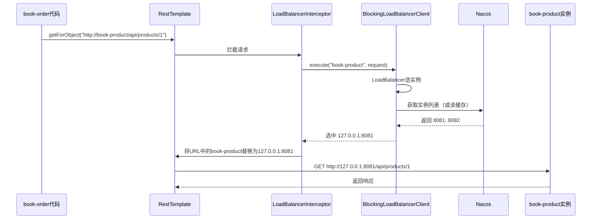
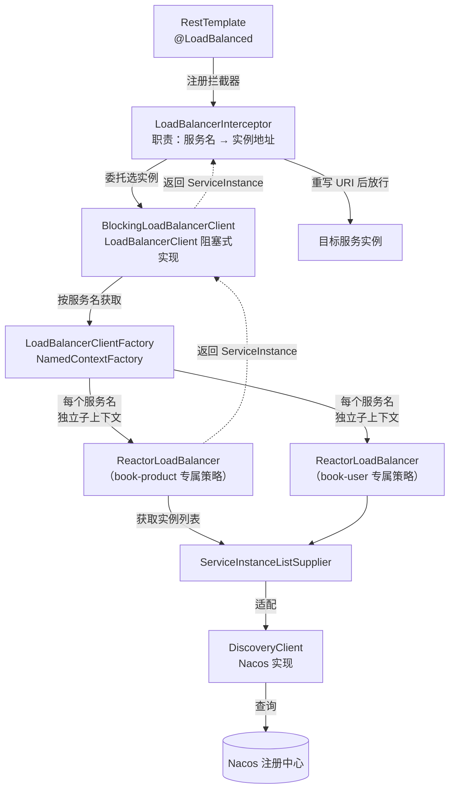

# Spring Cloud LoadBalancer快速上手

## 课程目标

- 理解`@LoadBalanced`注解的定位：一个“标记”，而不是负载均衡的实现本身
- 掌握`@LoadBalanced RestTemplate`的配置方法和调用方式
- 理解`LoadBalancerInterceptor`在请求发出前的“替换host”机制
- 掌握`BlockingLoadBalancerClient`与`LoadBalancerClientFactory`的协作关系
- 掌握`ServiceInstanceListSupplier`的默认装配与自定义扩展方式
- 理解`@LoadBalanced RestTemplate`与OpenFeign两种调用方式在LoadBalancer层面的异同
- 完成book-order通过`@LoadBalanced RestTemplate`调用book-product多实例的验证


## 回顾与导入

到目前为止，**book-order中真正在用的调用方式始终是OpenFeign**——`BookClient`的`@FeignClient(name = "book-product")`在底层自动完成了服务发现和负载均衡。

如果不使用OpenFeign，有没有更轻量的方式让`RestTemplate`也具备“用服务名调服务”的能力？答案是`@LoadBalanced`注解：

```java
@Bean
@LoadBalanced
public RestTemplate restTemplate() {
    return new RestTemplate();
}

// 调用时直接使用服务名
restTemplate.getForObject("http://book-product/api/products/1", Result.class);
```

这段代码的“神奇”之处在于：`book-product`并不是一个可解析的域名，但请求却成功了。真正完成“服务名→实例地址”转换的，是`@LoadBalanced`注解背后**隐式注册的拦截器**。

本节的核心任务是：**把`@LoadBalanced`从“魔法”拆解成“机制”**，理解它为什么能让`RestTemplate`具备负载均衡能力，以及在什么场景下应该选择它、什么场景下应该继续用OpenFeign。


## @LoadBalanced是什么：一个标记，而不是实现

### 注解本身“什么也没做”

查看`@LoadBalanced`的源码，会发现它极其简单：

```java
@Target({ ElementType.FIELD, ElementType.PARAMETER, ElementType.METHOD })
@Retention(RetentionPolicy.RUNTIME)
@Documented
@Inherited
@Qualifier
public @interface LoadBalanced {
}
```

注解上没有任何“负载均衡算法”的实现逻辑。它的本质是一个**标记注解**，配合`@Qualifier`使用，作用是**告诉Spring：这个`RestTemplate` Bean需要被负载均衡基础设施“加工”一下**。

官方文档对这一点的表述非常直接：`@LoadBalanced`注解会为`RestTemplate`添加一个`LoadBalancerInterceptor`。真正干活的是拦截器，不是注解。

### 没有@LoadBalanced时会发生什么

如果不加`@LoadBalanced`，`RestTemplate`就是一个普通的HTTP客户端：

```java
// 没有 @LoadBalanced
restTemplate.getForObject("http://book-product/api/products/1", Result.class);
```

请求发出前，`RestTemplate`会尝试把`book-product`当作一个**真实的主机名**去解析。由于`book-product`不是可解析的域名，会抛出`UnknownHostException`。这与手动拼接`http://127.0.0.1:8081/...`的方式在本质上是不同的——手动拼接时，URL中已经是真实的IP和端口。

### 加了@LoadBalanced之后发生了什么

`@LoadBalanced`标记的Bean会被Spring Cloud LoadBalancer的自动配置**识别并增强**：为这个`RestTemplate`添加`LoadBalancerInterceptor`。当`RestTemplate`发出请求时，拦截器在**请求真正发出之前**介入：



关键点：`LoadBalancerInterceptor`拦截请求后，把服务名`book-product`**委托给`LoadBalancerClient`去解析**。`BlockingLoadBalancerClient`根据服务名选出一个`ServiceInstance`，拦截器再把原URL中的`book-product`**替换**为该实例的`host:port`，最后`RestTemplate`用替换后的URL发出真实请求。


## 核心组件：谁在真正做决策

### 核心组件

#### LoadBalancerInterceptor

`LoadBalancerInterceptor`实现了`ClientHttpRequestInterceptor`，是`@LoadBalanced RestTemplate`实现负载均衡的入口。它的职责很单一：**在请求发出前，把“服务名host”替换为“实例host”**。具体选哪个实例，它不负责，而是委托给`LoadBalancerClient`。

#### BlockingLoadBalancerClient

`BlockingLoadBalancerClient`是`LoadBalancerClient`接口的阻塞式实现，专用于`RestTemplate`这类同步调用。它内部持有`LoadBalancerClientFactory`，根据服务名获取对应的`ReactorLoadBalancer`，执行实例选择，然后把结果返回给拦截器。

#### LoadBalancerClientFactory：每个服务一个子上下文

`LoadBalancerClientFactory`是`NamedContextFactory`的实现，它为**每个服务名创建独立的Spring子上下文**。这意味着：

| 能力     | 说明                                                |
| -------- | --------------------------------------------------- |
| 策略隔离 | book-product的负载均衡策略不会影响book-user         |
| 配置隔离 | 通过`@LoadBalancerClient`为不同服务指定不同的配置类 |

#### ServiceInstanceListSupplier：实例列表的来源

`ReactorLoadBalancer`不直接访问Nacos，它从`ServiceInstanceListSupplier`获取实例列表。Spring Cloud LoadBalancer提供了基于`DiscoveryClient`的实现，从Nacos获取可用实例。

### 组件结构图



| 阶段       | 组件                                                       | 做什么                                                    | 不做什么                                      |
| ---------- | ---------------------------------------------------------- | --------------------------------------------------------- | --------------------------------------------- |
| ① 拦截     | `LoadBalancerInterceptor`                                  | 提取服务名，触发选实例                                    | 不负责选择算法                                |
| ② 获取 LB  | `BlockingLoadBalancerClient` + `LoadBalancerClientFactory` | 按 serviceId 拿到**专属子上下文的** `ReactorLoadBalancer` | 不持有实例列表                                |
| ③ 选实例   | `ReactorLoadBalancer` + `ServiceInstanceListSupplier`      | 拉列表 + 按策略选一个                                     | 不直接访问 Nacos（由 `DiscoveryClient` 适配） |
| ④ 改写放行 | `LoadBalancerInterceptor`                                  | 把 `http://book-product` 换成 `http://ip:port`            | 不参与业务请求处理                            |

**核心要点**：`LoadBalancerClientFactory` 作为 `NamedContextFactory`，是"**策略隔离**"的关键——每次 `getInstance(serviceId)` 都会为对应服务创建/复用一个 Spring 子上下文，从而让 `book-product` 和 `book-user` 的负载均衡策略、配置类互不干扰。


## 实战：配置@LoadBalanced RestTemplate

### 步骤一：确认依赖

`spring-cloud-starter-loadbalancer`已通过OpenFeign的传递依赖引入。确认book-order的`pom.xml`中`spring-boot-starter-web`存在（提供`RestTemplate`）。

### 步骤二：声明@LoadBalanced Bean

在book-order的配置类中：

```java
@Configuration
public class RestTemplateConfig {

    @Bean
    @LoadBalanced
    public RestTemplate loadBalancedRestTemplate() {
        return new RestTemplate();
    }
}
```

### 步骤三：使用服务名调用

在`OrderService`中注入并使用：

```java
@Service
@RequiredArgsConstructor
public class OrderService {

    private final RestTemplate loadBalancedRestTemplate;

    public ProductDto getProductById(Long productId) {
        String url = "http://book-product/api/products/" + productId;

        ParameterizedTypeReference<Result<ProductDto>> typeRef =
                new ParameterizedTypeReference<>() {};

        ResponseEntity<Result<ProductDto>> response =
                loadBalancedRestTemplate.exchange(url, HttpMethod.GET, null, typeRef);

        Result<ProductDto> result = response.getBody();
        return result.getData();
    }
}
```

> **关键点：** URL中的host是**服务名**`book-product`，不是IP或域名。`LoadBalancerInterceptor`会把它替换为实际选中的实例地址。


## 验证：实例可见与负载均衡

### 让选中的实例可见

Feign日志和`RestTemplate`的普通日志都不会打印最终选中的IP和端口。复用`InstanceLoggingLoadBalancerLifecycle`：

```java
@Component
public class InstanceLoggingLoadBalancerLifecycle
        implements LoadBalancerLifecycle<RequestDataContext, ResponseData, ServiceInstance> {

    @Override
    public void onStartRequest(Request<RequestDataContext> request,
                               Response<ServiceInstance> lbResponse) {
        ServiceInstance instance = lbResponse.getServer();
        if (instance != null) {
            System.out.println("[LB选中实例] " + instance.getHost() + ":" + instance.getPort());
        }
    }

    // onStart / onComplete 略
}
```

> **说明：** `LoadBalancerLifecycle`对`@LoadBalanced RestTemplate`和`@FeignClient`**同时生效**，因为两者在底层都经过`LoadBalancerClientFactory`。

### 使用IDEA HTTP Request验证

连续执行以下请求，观察`[LB选中实例]`输出：

```http
### 通过 @LoadBalanced RestTemplate 调用图书服务
GET {{order_url}}/api/order/product/1
```

**预期输出（book-order控制台）：**

```
[LB选中实例] 127.0.0.1:8081
[LB选中实例] 127.0.0.1:8082
[LB选中实例] 127.0.0.1:8081
[LB选中实例] 127.0.0.1:8082
```


## 与OpenFeign的对比

`@LoadBalanced RestTemplate`和`@FeignClient`在LoadBalancer层面是**同一套基础设施**，但使用方式不同：

| 维度             | `@LoadBalanced RestTemplate`            | `@FeignClient`                 |
| ---------------- | --------------------------------------- | ------------------------------ |
| 调用方式         | 手动拼接URL，调用`getForObject`等方法   | 声明式接口，像本地方法一样调用 |
| 负载均衡触发方式 | 注解标记Bean，自动添加拦截器            | Feign内部自动集成LoadBalancer  |
| 服务名位置       | URL中的host                             | `@FeignClient(name = ...)`     |
| 实例可见         | `LoadBalancerLifecycle`                 | 同左                           |
| 配置策略         | `@LoadBalancerClient`绑定               | 同左                           |
| 适用场景         | 简单调用、临时验证、无法使用Feign的场景 | 接口契约清晰、调用点多的场景   |

> **选择建议：** 如果项目已经全面使用OpenFeign，`@LoadBalanced RestTemplate`更多用于**轻量验证**或**第三方库强制要求`RestTemplate`**的场景。两者可以共存，但建议团队约定统一的主调用方式，避免维护两套调用风格。


## 小结

本节课我们学习了：

1. **`@LoadBalanced`的定位**：一个标记注解，本身不包含负载均衡逻辑，作用是让Spring Cloud为`RestTemplate`添加`LoadBalancerInterceptor`。

2. **拦截器机制**：`LoadBalancerInterceptor`在请求发出前，把URL中的服务名替换为`LoadBalancerClient`选中的实例`host:port`。

3. **核心组件协作**：`LoadBalancerClientFactory`（服务级子容器）→ `ReactorLoadBalancer`（选实例）→ `ServiceInstanceListSupplier`（提供实例列表）→ `BlockingLoadBalancerClient`（阻塞式适配`RestTemplate`）。

4. **`@LoadBalanced RestTemplate`的配置**：`@Bean` + `@LoadBalanced`，调用时URL的host写服务名。

5. **实例可见性**：通过`LoadBalancerLifecycle`观察最终选中的IP和端口，该监听器对`RestTemplate`和Feign同时生效。

6. **与OpenFeign的对比**：底层共用LoadBalancer，区别在调用方式；`@LoadBalanced RestTemplate`适合轻量验证和特定场景，OpenFeign适合接口契约清晰的日常调用。

   

## 作业

### 作业一：完成@LoadBalanced RestTemplate的基本配置与验证

1. 在book-order中声明一个带`@LoadBalanced`的`RestTemplate` Bean，命名为`loadBalancedRestTemplate`。
2. 编写Service方法，通过`http://book-product/api/products/{id}`调用图书服务。
3. 启动两个book-product实例（8081、8082），使用IDEA HTTP Request连续调用10次，记录`[LB选中实例]`输出，验证两个实例是否交替出现。
4. 截图控制台输出和Nacos服务列表。

### 作业二：对比@LoadBalanced与OpenFeign

1. 在同一个Controller中，分别通过`@LoadBalanced RestTemplate`和`BookClient`（Feign）调用同一个图书查询接口。
2. 为两者分别开启`LoadBalancerLifecycle`观察（两者共用同一个监听器即可）。
3. 连续调用5次`RestTemplate`路径和5次Feign路径，记录`[LB选中实例]`序列。
4. 制作对比表格，从“调用代码简洁度”“实例选择一致性”“配置复杂度”三个维度比较两种方式。
