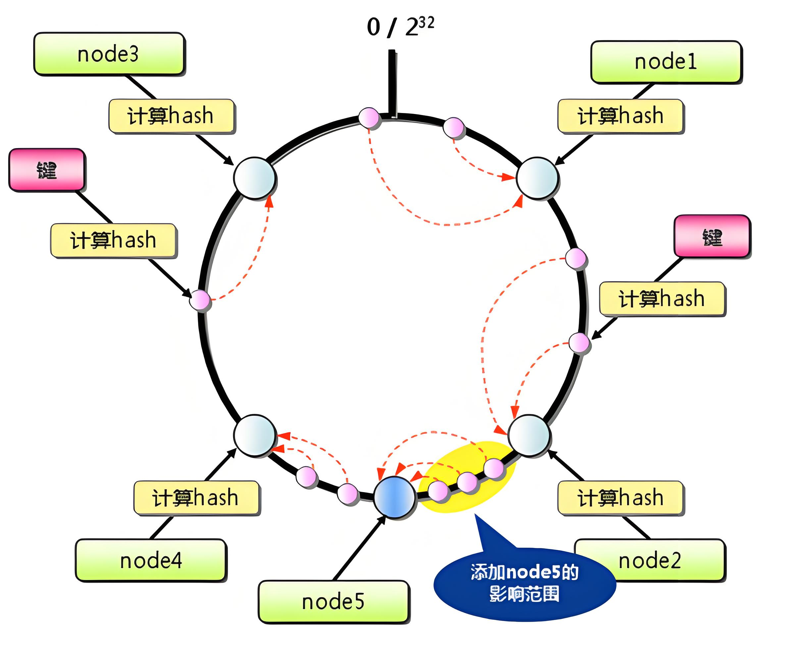

# 负载均衡算法与LoadBalancer

## 课程目标

- 理解负载均衡算法的分类：静态 vs 动态、无状态 vs 有状态
- 掌握轮询、加权轮询、随机/加权随机、一致性哈希等常见算法的原理与适用场景
- 理解Spring Cloud LoadBalancer内置负载均衡策略
- 掌握默认轮询策略的行为特征与验证方法
- 掌握为指定服务切换随机策略的完整配置：`RandomLoadBalancerConfig` + `@LoadBalancerClient`
- 能够根据业务场景在轮询与随机之间做出合理选择


## 回顾与导入

前面我们验证了Feign与LoadBalancer的集成，并配置`spring.cloud.loadbalancer.nacos.enabled=true`启用了Nacos权重感知。当时使用的`NacosLoadBalancer`内部是**加权随机**算法——每次请求独立地按权重概率抽取一个实例。

更根本地，负载均衡算法本身是一组**独立于框架的调度策略**。Spring Cloud LoadBalancer只内置了轮询和随机两种，加权随机来自`NacosLoadBalancer`。理解这些算法的原理和边界，才能在遇到“流量不均”“会话丢失”“灰度比例不准”等问题时，知道该换哪种算法，或者该写一个什么样的自定义策略。

本节先讲算法原理和框架边界，再落地验证轮询与随机两种内置策略。自定义策略的开发流程与平滑加权轮询的手写实现，将在下一节展开。


## 负载均衡核心算法原理

### 负载均衡算法分类

负载均衡算法可以从两个维度分类：

| 维度                 | 类型   | 含义                                                 | 典型算法                       |
| -------------------- | ------ | ---------------------------------------------------- | ------------------------------ |
| **是否依赖实时状态** | 静态   | 只根据预设规则分配，不感知后端实时负载               | 轮询、随机、加权轮询、加权随机 |
|                      | 动态   | 根据后端实时指标（连接数、响应时间、活跃请求数）分配 | 最少连接、最小活跃数、最快响应 |
| **是否保持请求粘性** | 无状态 | 同一客户端的连续请求可能落到不同实例                 | 轮询、随机、加权               |
|                      | 有状态 | 同一特征（IP、参数）的请求稳定落到同一实例           | 一致性哈希、IP哈希             |

### 常见负载均衡算法

#### 简单轮询

**原理：** 用一个计数器记录当前请求序号，通过取模运算得到实例下标。

```
index = counter++ % instanceCount
```

普通轮询的取模算法非常直接：通过原子计数器记录当前请求的序列号，然后对集群节点总数取模，得到具体下标，再从列表取实例。具体实现方式可以参考《OpenFeign与LoadBalancer集成》讲中内容

| 优点               | 缺点                                                       |
| ------------------ | ---------------------------------------------------------- |
| 实现简单，绝对均匀 | 不感知实例性能差异，性能弱的实例和性能强的实例承受相同流量 |

#### 加权轮询

**原理：** 为每个实例配置权重，权重高的实例在一次“大轮次”中被连续选中多次。

例如权重 `A:4, B:2, C:6`，一种基础实现会在一轮中产生 `A,A,A,A,B,B,C,C,C,C,C,C` 的序列。这种实现的问题是**权重偏差越大，偏移越严重**——高权重实例在一轮的前段被集中选中，后段完全闲置，流量分布很不平滑。

#### 随机与加权随机

**随机：** 每次请求从实例列表中随机选一个。实现最简单，长期看分布均匀，但**短期波动大**。

**加权随机：** 每次请求独立地按权重比例抽取。常见实现是“区间法”：

1. 计算所有健康实例的权重总和 `totalWeight`
2. 为每个实例生成一个累积区间 `[cumulative, cumulative + weight)`
3. 生成 `[0, totalWeight)` 的随机数，用二分查找定位落在哪个区间

Nacos的加权随机实现正是基于这一思路：生成`[0~1]`范围的随机数，通过二分法查找递增数组`weights[]`接近的index，再从注册节点列表中返回节点；非健康节点或权重≤0的实例不会被选择。关于加权随机算法的参考实现方法可以参考《Nacos权重路由》讲中`WeightedInstanceSelector`类的实现。

#### 一致性哈希

**原理：** 将哈希值空间组织成一个`0 ~ 2^32-1`的圆环，将实例（通过IP或IP+端口）哈希到环上，将请求（通过某个特征，如用户ID、sessionId）也哈希到环上，然后**顺时针找到第一个实例**。



**虚拟节点：** 如果每个物理实例只在环上占一个点，实例数量少时容易出现**数据倾斜**——大量请求落在同一个实例上。解决方案是为每个物理实例生成多个虚拟节点，均匀分散在环上。

一致性哈希的核心价值是**最小化节点变动的影响**：当某个实例下线时，只有落在该实例及其虚拟节点上的请求会被重新路由，其他请求不受影响。这正是它适合**有状态服务、缓存、WebSocket长连接**的原因。

| 优点                       | 缺点                             |
| -------------------------- | -------------------------------- |
| 请求粘性，相同特征稳定路由 | 实现复杂度高                     |
| 节点变动影响范围小         | 需要设计合适的哈希特征           |
| 通过虚拟节点解决倾斜       | 虚拟节点过多会增加内存和查找开销 |

### Spring Cloud LoadBalancer的内置策略与边界

Spring Cloud LoadBalancer**默认只提供了`RoundRobinLoadBalancer`（轮询）和`RandomLoadBalancer`（随机）两种请求分配算法**；一致性哈希等策略需要自行实现自定义负载均衡器。

| 策略         | 实现类                   | 默认                                            |
| ------------ | ------------------------ | ----------------------------------------------- |
| 轮询         | `RoundRobinLoadBalancer` | **是**                                          |
| 随机         | `RandomLoadBalancer`     | 否                                              |
| 加权随机     | 无内置                   | 由Spring Cloud Alibaba的`NacosLoadBalancer`提供 |
| 平滑加权轮询 | 无内置                   | 需要手写（下一讲介绍）                          |
| 一致性哈希   | 无内置                   | 需要手写                                        |


## 验证默认轮询策略

### 确认默认策略

Spring Cloud LoadBalancer的默认策略是`RoundRobinLoadBalancer`。在不做任何自定义配置的情况下，book-order对book-product的调用就使用轮询。

确认方式：检查book-order的`application.yml`中**没有**以下配置：

```yaml
# 不应存在，否则会覆盖默认轮询
spring:
  cloud:
    loadbalancer:
      configurations: weighted
      nacos:
        enabled: true
```

> **重要：** 如果开启了`spring.cloud.loadbalancer.nacos.enabled=true`，实际生效的是`NacosLoadBalancer`（加权随机），会干扰本节对“默认轮询”的验证。验证轮询前，**必须关闭该开关**。

### 通过Feign验证轮询

**调用Feign接口：**

```http
### 连续执行6次，观察 [LB选中实例] 输出
GET {{order_url}}/api/order/product/1
```

**预期输出（严格交替）：**

```
[LB选中实例] 127.0.0.1:8081
[LB选中实例] 127.0.0.1:8082
[LB选中实例] 127.0.0.1:8081
[LB选中实例] 127.0.0.1:8082
[LB选中实例] 127.0.0.1:8081
[LB选中实例] 127.0.0.1:8082
```

**特征：** 严格`8081 → 8082 → 8081 → 8082`交替，不会出现连续两次同一实例（前提是两个实例健康状态相同、权重相同）。

### 通过@LoadBalanced RestTemplate验证轮询

**调用RestTemplate接口：**

```http
### 连续执行6次，观察 [LB选中实例] 输出
GET {{order_url}}/api/order/product/lb/1
```

**预期输出：** 同样是严格交替。


## 切换到随机策略

### 随机策略的配置类

Spring Cloud LoadBalancer没有提供“通过配置项直接切换策略”的开关（除了`configurations: weighted`这种特定配置）。切换为随机策略需要**声明一个`RandomLoadBalancer` Bean**，并通过`@LoadBalancerClient`绑定到目标服务。

```java
public class RandomLoadBalancerConfig {

    @Bean
    public ReactorLoadBalancer<ServiceInstance> randomLoadBalancer(
            Environment environment,
            LoadBalancerClientFactory loadBalancerClientFactory) {
        String name = environment.getProperty(LoadBalancerClientFactory.PROPERTY_NAME);
        return new RandomLoadBalancer(
                loadBalancerClientFactory.getLazyProvider(name, ServiceInstanceListSupplier.class),
                name);
    }
}
```

**代码说明：**

| 部分                                     | 作用                                                 |
| ---------------------------------------- | ---------------------------------------------------- |
| `environment.getProperty(PROPERTY_NAME)` | 获取当前子上下文对应的服务名（这里是`book-product`） |
| `getLazyProvider(...)`                   | 懒加载`ServiceInstanceListSupplier`，避免循环依赖    |
| `new RandomLoadBalancer(...)`            | 创建随机策略实例                                     |

> **关键提醒：** `RandomLoadBalancerConfig`**不要加`@Configuration`**。加了之后会被父容器扫描，`ReactorLoadBalancer` Bean会对所有服务生效，覆盖掉book-user、book-order等其他服务的默认策略。

### 绑定到book-product

在book-order的启动类上添加：

```java
@SpringBootApplication
@EnableFeignClients
@LoadBalancerClient(name = "book-product", configuration = RandomLoadBalancerConfig.class)
public class BookOrderApplication { ... }
```

> **`@LoadBalancerClient`的作用：** 把`RandomLoadBalancerConfig`注册到`book-product`这个服务名的**子上下文**中，只影响book-product的调用。

### 重启并验证

重启book-order，连续调用Feign接口10次：

```http
GET {{order_url}}/api/order/product/1
```

预期输出：可能出现连续两次甚至三次同一实例。10次中8081和8082各约5次，但**顺序不可预测**。

### 通过@LoadBalanced RestTemplate验证

随机策略同样对`@LoadBalanced RestTemplate`生效——因为`LoadBalancerLifecycle`和`ReactorLoadBalancer`都是服务名级别的子上下文，与调用方式无关：

```http
GET {{order_url}}/api/order/product/lb/1
```

连续调用10次，`[LB选中实例]`同样呈现随机分布。

### 只影响book-product

通过`@LoadBalancerClient(name = "book-product", ...)`绑定的策略，**只对book-product生效**。book-order如果还调用book-user，book-user仍然使用默认轮询：

```java
// book-user的Feign客户端，未绑定自定义策略
@FeignClient(name = "book-user")
public interface UserClient { ... }
```

调用book-user时，`[LB选中实例]`仍然严格交替（如果book-user有两个实例）。

### 多个服务使用不同策略

如果book-product用随机、book-user用轮询（默认），只需要为book-product绑定`RandomLoadBalancerConfig`，book-user不做任何配置。如果需要为多个服务分别指定策略，使用`@LoadBalancerClients`：

```java
@LoadBalancerClients({
    @LoadBalancerClient(name = "book-product", configuration = RandomLoadBalancerConfig.class),
    @LoadBalancerClient(name = "book-user", configuration = SomeOtherConfig.class)
})
```


## 轮询与随机的对比分析

| 场景                           | 推荐策略                         | 理由                                               |
| ------------------------------ | -------------------------------- | -------------------------------------------------- |
| 实例性能完全一致，追求绝对均匀 | **轮询**                         | 严格交替，无短期偏差                               |
| 实例性能有差异，需要按权重分配 | 加权随机或平滑加权轮询（下一节） | 单纯轮询/随机不感知权重                            |
| 灰度发布，新版本需要稳定比例   | **平滑加权轮询**                 | 短期也保持比例，不出现“全旧版本”或“全新版本”的窗口 |
| 无状态服务，实例随时扩缩容     | **随机**                         | 无状态，扩缩容时不需要维护计数器；短期波动可接受   |
| 客户端数量极多，避免“惊群”     | **随机**                         | 大量客户端同时按轮询会形成“同步节拍”，随机可以打散 |


## 注意事项和小节

1. **默认是轮询，不是随机**：Spring Cloud LoadBalancer的默认策略是`RoundRobinLoadBalancer`。验证前先确认没有其他配置覆盖默认行为。而加权随机由`NacosLoadBalancer`提供

2. **随机策略需要显式绑定**：通过`RandomLoadBalancerConfig` + `@LoadBalancerClient`切换。没有配置项可以“一键切换为随机”。

3. **配置类不加`@Configuration`**：加了会导致策略全局生效，影响所有服务。

4. **`@LoadBalancerClient`的name必须精确匹配**：必须与`@FeignClient`的`name`或`@LoadBalanced`调用的服务名完全一致。

5. **关闭缓存再做实验**：`cache.enabled: false`，否则35秒的缓存会干扰观察。

6. **Feign和RestTemplate共享策略**：同一服务名的子上下文是共享的，切换策略后两种调用方式同时生效，不需要分别配置。

7. **轮询的“绝对均匀”有前提**：两个实例健康状态相同、权重相同、未启用Nacos权重感知。任一条件不满足，轮询序列都会被打破。


## 作业

### 作业一：验证默认轮询策略

1. 确认book-order未启用`nacos.enabled`和自定义策略，关闭缓存。
2. 启动两个book-product实例（8081、8082）。
3. 连续调用Feign接口6次，记录`[LB选中实例]`序列，验证是否严格交替。
4. 连续调用`@LoadBalanced RestTemplate`接口6次，记录序列，验证是否同样严格交替。
5. 启动第三个book-product实例（8083），连续调用9次，验证是否按`8081→8082→8083`循

### 作业二：切换随机策略并验证

1. 创建`RandomLoadBalancerConfig`（不加`@Configuration`）。
2. 在启动类上通过`@LoadBalancerClient(name = "book-product", configuration = RandomLoadBalancerConfig.class)`绑定。
3. 重启book-order，连续调用Feign接口12次，记录`[LB选中实例]`序列。
4. 连续调用`@LoadBalanced RestTemplate`接口12次，记录序列。
