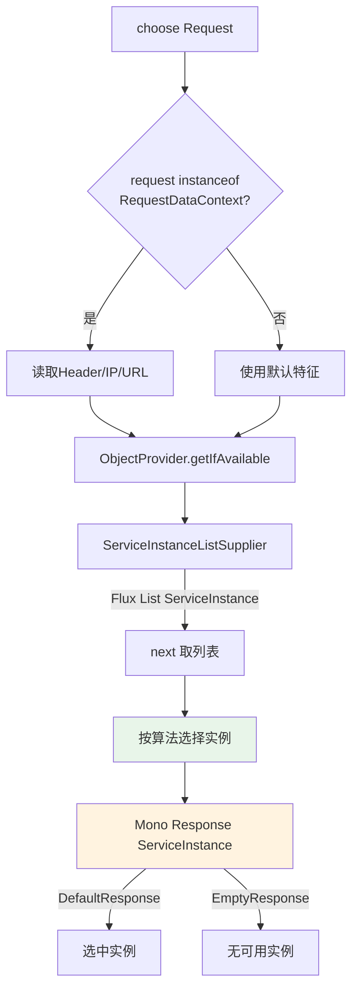

# 自定义负载均衡算法

## 课程目标

- 掌握自定义负载均衡的完整开发流程：实现接口 → 编写算法 → 注册Bean → 绑定服务 → 验证
- 理解Reactor核心对象：`Mono`、`Flux`、`Request`、`Response`、`RequestDataContext`、`ServiceInstanceListSupplier`
- 掌握`ReactorServiceInstanceLoadBalancer`接口的职责与返回值语义
- 手写一个线程安全的平滑加权轮询负载均衡器，复用Nacos权重
- 完成平滑加权轮询与加权随机的对比验证，观察短期分布差异


## 回顾与导入

到目前为止，我们明确了Spring Cloud LoadBalancer的边界：框架内置只有轮询和随机，加权随机由`NacosLoadBalancer`补充，平滑加权轮询和一致性哈希需要自定义。

同时，我们也搞清楚了`@LoadBalanced RestTemplate`如何通过拦截器把服务名替换成实例地址，以及`LoadBalancerClientFactory`、`ServiceInstanceListSupplier`、`ReactorLoadBalancer`、`LoadBalancerLifecycle`这些核心组件的协作关系。

本节把这些知识落到“写一个自己的策略”上。以**平滑加权轮询**为案例，完整走一遍自定义负载均衡的开发流程。


## 自定义负载均衡的开发流程

无论实现哪种算法，自定义负载均衡都遵循同一个五步流程：

| 步骤            | 动作                                                         | 关键点                         |
| --------------- | ------------------------------------------------------------ | ------------------------------ |
| 1. **实现接口** | 编写类实现`ReactorServiceInstanceLoadBalancer`               | 核心是`choose(Request)`方法    |
| 2. **编写算法** | 从`ServiceInstanceListSupplier`获取实例列表，按算法选出实例  | 处理空列表、并发安全           |
| 3. **注册Bean** | 在配置类中声明`ReactorServiceInstanceLoadBalancer` Bean      | 配置类**不加`@Configuration`** |
| 4. **绑定服务** | 通过`@LoadBalancerClient(name = "...", configuration = ...)`绑定 | `name`必须与服务名一致         |
| 5. **验证**     | 通过`LoadBalancerLifecycle`观察选中实例，对比不同策略的分布  | 关闭缓存，确保权重实时生效     |

这五步中，**第2步是算法差异所在**，其余四步对所有策略都是相同的。理解了这一点，就可以把平滑加权轮询、一致性哈希等算法“套”进这个流程。


## Reactor核心对象介绍

`ReactorServiceInstanceLoadBalancer`的接口签名涉及多个Reactor对象。如果不理解它们的语义，写自定义策略时容易“照猫画虎但不知其所以然”。

### Mono：0或1个元素的异步序列

`Mono<T>`表示**异步的、最多一个元素**的序列。它有两种结果：

| 结果               | 含义       |
| ------------------ | ---------- |
| `Mono.just(value)` | 包含一个值 |
| `Mono.empty()`     | 不包含值   |

在负载均衡中，`choose`方法返回`Mono<Response<ServiceInstance>>`——**要么选中一个实例，要么返回空响应**。这是异步编程模型：调用方订阅这个`Mono`，当实例选择完成后得到结果。

```java
// 有实例可选
return Mono.just(new DefaultResponse(selected));

// 无实例可选
return Mono.just(new EmptyResponse());
```

> **为什么用`Mono`而不是直接返回对象？** Spring Cloud LoadBalancer的底层是响应式的，`Mono`允许实例选择与后续的HTTP调用以非阻塞方式组合。对于`RestTemplate`这类同步调用，`BlockingLoadBalancerClient`会在内部把`Mono`“阻塞”成同步结果，开发者感知不到异步。

### Flux：0到N个元素的异步序列

`Flux<T>`表示**异步的、0到N个元素**的序列。在负载均衡中，`ServiceInstanceListSupplier.get(request)`返回`Flux<List<ServiceInstance>>`——每次发射一个**实例列表**，而不是单个实例。

```java
// supplier.get(request) 的类型是 Flux<List<ServiceInstance>>
supplier.get(request)
    .next()                              // 取第一个发射的列表
    .map(instances -> select(instances)) // 对列表执行选择逻辑
```

> **注意：** `Flux<List<ServiceInstance>>`是“列表的流”，不是“实例的流”。`next()`取出的是一个`List<ServiceInstance>`。

### Request：负载均衡请求的抽象

`Request<T>`代表一次负载均衡请求，泛型`T`是上下文类型。对于`RestTemplate`和Feign调用，上下文通常是`RequestDataContext`，它包含：

| 方法                                    | 内容                                              |
| --------------------------------------- | ------------------------------------------------- |
| `getClientRequest().getHeaders()`       | 请求头（可用于提取`X-Forwarded-For`、灰度标记等） |
| `getClientRequest().getRemoteAddress()` | 客户端地址                                        |
| `getClientRequest().getUrl()`           | 请求URL                                           |

自定义策略可以通过`Request`读取请求特征，实现基于Header、IP、用户ID的粘性或路由。

### Response：负载均衡响应的抽象

`Response<T>`是`choose`方法的返回内容，有两个常用实现：

| 实现类                             | 含义             |
| ---------------------------------- | ---------------- |
| `DefaultResponse(ServiceInstance)` | 成功选中一个实例 |
| `EmptyResponse()`                  | 没有可用实例     |

### RequestDataContext

`RequestDataContext`是`Request`的默认上下文实现，是自定义策略读取请求信息的入口。判断和提取方式：

```java
if (request instanceof RequestDataContext) {
    RequestDataContext ctx = (RequestDataContext) request;
    // 读取请求头
    List<String> headers = ctx.getClientRequest().getHeaders().get("X-Some-Header");
    // 读取客户端地址
    InetSocketAddress address = ctx.getClientRequest().getRemoteAddress();
}
```

### ServiceInstanceListSupplier：实例列表的来源

`ServiceInstanceListSupplier`是响应式的实例列表提供者。它不是由自定义策略直接访问Nacos，而是由Spring Cloud LoadBalancer装配好的“获取+缓存”链。

自定义策略通过`ObjectProvider<ServiceInstanceListSupplier>`**延迟获取**它，避免在Bean初始化阶段产生循环依赖：

```java
private final ObjectProvider<ServiceInstanceListSupplier> supplierProvider;

// 在 choose 中获取
ServiceInstanceListSupplier supplier = supplierProvider.getIfAvailable();
```

> **为什么用`ObjectProvider`而不是直接注入？** `ServiceInstanceListSupplier`的构建依赖`LoadBalancerClientFactory`，而`LoadBalancerClientFactory`又需要加载策略Bean。如果直接注入，会形成循环依赖。`ObjectProvider`把获取时机推迟到`choose`调用时，打破循环。

### 对象关系全景




## ReactorServiceInstanceLoadBalancer接口详解

```java
public interface ReactorServiceInstanceLoadBalancer {
    Mono<Response<ServiceInstance>> choose(Request request);
}
```

| 要素         | 说明                                                         |
| ------------ | ------------------------------------------------------------ |
| **输入**     | `Request`，包含请求上下文（Header、IP、URL等）               |
| **输出**     | `Mono<Response<ServiceInstance>>`，异步的实例选择结果        |
| **职责**     | 从候选实例中选一个，不负责获取实例列表（由`ServiceInstanceListSupplier`负责） |
| **异常处理** | 无实例时返回`Mono.just(new EmptyResponse())`，不要抛出异常   |
| **线程安全** | 如果算法有状态（如平滑加权轮询的`currentWeight`），需要保证并发安全 |

**选择逻辑与实例获取的职责分离**，是理解这个接口的关键：

| 组件                                 | 职责                                 |
| ------------------------------------ | ------------------------------------ |
| `ServiceInstanceListSupplier`        | 提供候选实例列表（从Nacos获取+缓存） |
| `ReactorServiceInstanceLoadBalancer` | 从候选列表中**选一个**               |


## 手写平滑加权轮询负载均衡器

### 平滑加权轮询（SWRR）

平滑加权轮询（Smooth Weighted Round-Robin）是对基础加权轮询的改进，也是Nginx采用的算法。核心思想是：**每次选择“当前权重”最大的实例，选中后将其当前权重减去总权重，然后所有实例的当前权重各自加上自身权重**。

每个实例维护两个权重：

| 权重            | 含义               | 变化           |
| --------------- | ------------------ | -------------- |
| `weight`        | 固定权重（配置值） | 不变           |
| `currentWeight` | 当前权重（动态值） | 每次请求时变化 |

**算法步骤（每次请求）：**

1. 所有实例的 `currentWeight += weight`（初始时`currentWeight = 0`）
2. 选出 `currentWeight` 最大的实例
3. 被选中实例的 `currentWeight -= 所有实例weight之和`

**示例：** 实例A权重5，实例B权重1，实例C权重1。总权重 = 7。

| 请求序号 | 累加后 currentWeight | 选中                        | 选中后调整 |
| -------- | -------------------- | --------------------------- | ---------- |
| 初始     | A:0, B:0, C:0        | -                           | -          |
| 1        | A:5, B:1, C:1        | **A**                       | A:5-7=-2   |
| 2        | A:3, B:2, C:2        | **A**                       | A:3-7=-4   |
| 3        | A:1, B:3, C:3        | **B**（B与C并列，取第一个） | B:3-7=-4   |
| 4        | A:6, B:-3, C:4       | **A**                       | A:6-7=-1   |
| 5        | A:4, B:-2, C:5       | **C**                       | C:5-7=-2   |
| 6        | A:9, B:-1, C:-1      | **A**                       | A:9-7=2    |
| 7        | A:7, B:0, C:0        | **A**                       | A:7-7=0    |

7次请求的选中序列为：**A, A, B, A, C, A, A**。A出现了5次，B和C各1次，且分布是**穿插的**，而不是“前5次全A、后2次B/C”。与基础加权轮询的`A,A,A,A,A,B,C`相比，平滑性显著提升。

### 完整实现

```java
public class SmoothWeightedRoundRobinLoadBalancer
        implements ReactorServiceInstanceLoadBalancer {

    private final String serviceId;
    private final ObjectProvider<ServiceInstanceListSupplier> supplierProvider;

    /** 每个实例的当前权重，key = ip:port */
    private final Map<String, AtomicInteger> currentWeights = new ConcurrentHashMap<>();

    public SmoothWeightedRoundRobinLoadBalancer(
            String serviceId,
            ObjectProvider<ServiceInstanceListSupplier> supplierProvider) {
        this.serviceId = serviceId;
        this.supplierProvider = supplierProvider;
    }

    @Override
    public Mono<Response<ServiceInstance>> choose(Request request) {
        ServiceInstanceListSupplier supplier = supplierProvider.getIfAvailable();
        if (supplier == null) {
            return Mono.just(new EmptyResponse());
        }
        return supplier.get(request).next().map(this::select);
    }

    private Response<ServiceInstance> select(List<ServiceInstance> instances) {
        if (instances == null || instances.isEmpty()) {
            return new EmptyResponse();
        }

        // 1. 清理已下线实例的 currentWeight，防止 Map 无限增长
        currentWeights.keySet().removeIf(key ->
                instances.stream().noneMatch(i -> keyOf(i).equals(key)));

        // 2. 累加：每个实例的 currentWeight += weight
        int totalWeight = 0;
        for (ServiceInstance instance : instances) {
            int weight = getWeight(instance);
            if (weight <= 0) {
                continue;
            }
            totalWeight += weight;
            currentWeights.computeIfAbsent(keyOf(instance),
                    k -> new AtomicInteger(0)).addAndGet(weight);
        }

        if (totalWeight <= 0) {
            return new EmptyResponse();
        }

        // 3. 选出 currentWeight 最大的实例
        ServiceInstance selected = null;
        int maxCurrent = Integer.MIN_VALUE;
        for (ServiceInstance instance : instances) {
            int weight = getWeight(instance);
            if (weight <= 0) {
                continue;
            }
            int current = currentWeights.get(keyOf(instance)).get();
            if (current > maxCurrent) {
                maxCurrent = current;
                selected = instance;
            }
        }

        if (selected == null) {
            return new EmptyResponse();
        }

        // 4. 被选中实例的 currentWeight -= totalWeight
        currentWeights.get(keyOf(selected)).addAndGet(-totalWeight);

        System.out.println("[SWRR] 选中 " + keyOf(selected)
                + " weight=" + getWeight(selected)
                + " currentWeight=" + currentWeights.get(keyOf(selected)).get());

        return new DefaultResponse(selected);
    }

    private String keyOf(ServiceInstance instance) {
        return instance.getHost() + ":" + instance.getPort();
    }

    private int getWeight(ServiceInstance instance) {
        String weight = instance.getMetadata().get("nacos.weight");
        if (weight == null) {
            return 1;
        }
        try {
            return (int) Math.round(Double.parseDouble(weight));
        } catch (NumberFormatException e) {
            return 1;
        }
    }
}
```

### 代码要点与Reactor对象对应

| 代码位置                            | 对应的Reactor对象/概念                                    |
| ----------------------------------- | --------------------------------------------------------- |
| `choose(Request request)`           | 接口的唯一方法，输入负载均衡请求                          |
| `supplierProvider.getIfAvailable()` | 通过`ObjectProvider`延迟获取`ServiceInstanceListSupplier` |
| `supplier.get(request).next()`      | `Flux<List<ServiceInstance>>`取第一个列表                 |
| `.map(this::select)`                | 把实例列表映射为`Response<ServiceInstance>`               |
| `Mono.just(new EmptyResponse())`    | 无实例时的异步空响应                                      |
| `new DefaultResponse(selected)`     | 选中实例的响应                                            |


## 注册与绑定

### 配置类

```java
public class SmoothWeightedLoadBalancerConfig {

    @Bean
    public ReactorServiceInstanceLoadBalancer smoothWeightedLoadBalancer(
            Environment environment,
            LoadBalancerClientFactory loadBalancerClientFactory) {
        String name = environment.getProperty(LoadBalancerClientFactory.PROPERTY_NAME);
        return new SmoothWeightedRoundRobinLoadBalancer(
                name,
                loadBalancerClientFactory.getLazyProvider(name,
                        ServiceInstanceListSupplier.class));
    }
}
```

> **关键：** `SmoothWeightedLoadBalancerConfig`**不加`@Configuration`**。加了会被父容器扫描，平滑加权轮询会对所有服务生效，破坏服务级隔离。

### 绑定到book-product

```java
@SpringBootApplication
@EnableFeignClients
@LoadBalancerClient(name = "book-product", configuration = SmoothWeightedLoadBalancerConfig.class)
public class BookOrderApplication { ... }
```

### 关闭冲突配置

```yaml
spring:
  cloud:
    loadbalancer:
      nacos:
        enabled: false    # 避免NacosLoadBalancer覆盖自定义策略
      cache:
        enabled: false    # 权重修改立即生效
```


## 验证：平滑加权轮询 vs 加权随机

### 实验准备

- book-product两个实例：8081权重5，8082权重1。
- book-order绑定`SmoothWeightedLoadBalancerConfig`，关闭缓存和`nacos.enabled`。
- 保留`InstanceLoggingLoadBalancerLifecycle`，同时观察`[LB选中实例]`和`[SWRR]`日志。

### 平滑加权轮询的输出

连续调用`BookClient.getById()` 12次，`[SWRR]`日志应呈现类似序列：

```
[SWRR] 选中 127.0.0.1:8081
[SWRR] 选中 127.0.0.1:8081
[SWRR] 选中 127.0.0.1:8082
[SWRR] 选中 127.0.0.1:8081
[SWRR] 选中 127.0.0.1:8081
[SWRR] 选中 127.0.0.1:8081
[SWRR] 选中 127.0.0.1:8082
...
```

**特征：** 8082不会连续出现两次，也不会长时间“消失”。权重5:1的长期比例仍然是约83%/17%，但**8082被均匀地穿插在序列中**。

### 对比加权随机

将book-order的策略切回`NacosLoadBalancer`（`spring.cloud.loadbalancer.nacos.enabled=true`）并去掉`@LoadBalancerClient`注解，同样调用12次，观察`[LB选中实例]`序列。可能出现的序列是：

```
8081, 8081, 8081, 8081, 8081, 8081, 8081, 8081, 8082, 8081, 8081, 8081
```

或者8082出现在前几次，后几次全部是8081。**短期分布不均匀**是加权随机的固有特征，长期比例才收敛。

| 对比维度             | 平滑加权轮询               | 加权随机（NacosLoadBalancer） |
| -------------------- | -------------------------- | ----------------------------- |
| 12次调用中8082的位置 | 均匀穿插（约每6次出现1次） | 可能集中出现或长时间不出现    |
| 长期比例             | 权重比例                   | 权重比例                      |
| 短期平滑性           | **高**                     | 低                            |
| 适用场景             | 灰度发布、稳定比例         | 一般流量分配、实现简单        |

### 验证权重变更

在Nacos控制台将8081权重改为9、8082改为1，关闭缓存的情况下，`[SWRR]`序列中8082的出现频率应进一步降低，但仍然**均匀穿插**，而不是集中出现。


## 小结

本节课我们学习了：

1. **自定义负载均衡的五步开发流程**：实现`ReactorServiceInstanceLoadBalancer` → 编写算法 → 注册Bean（不加`@Configuration`）→ `@LoadBalancerClient`绑定 → 验证。
2. **Reactor核心对象**：`Mono`（0或1个元素的异步序列）、`Flux`（0到N个元素的异步序列）、`Request`（请求上下文）、`Response`（`DefaultResponse`/`EmptyResponse`）、`RequestDataContext`（读取Header/IP/URL）、`ServiceInstanceListSupplier`（实例列表来源）。
3. **`ObjectProvider`的作用**：延迟获取`ServiceInstanceListSupplier`，打破循环依赖。
4. **`ReactorServiceInstanceLoadBalancer`接口**：输入`Request`，输出`Mono<Response<ServiceInstance>>`；只负责“选一个”，不负责获取实例列表。
5. **平滑加权轮询的完整实现**：用`ConcurrentHashMap<String, AtomicInteger>`维护每个实例的`currentWeight`，严格按“累加→选最大→减总和”执行。
6. **注册与绑定规范**：`SmoothWeightedLoadBalancerConfig`不加`@Configuration`，通过`@LoadBalancerClient`绑定到book-product；关闭`nacos.enabled`和缓存，避免冲突。
7. **验证对比**：平滑加权轮询在12次调用中让低权重实例均匀穿插，加权随机可能出现短期聚集。
8. **五步流程的复用**：换算法只改第2步“编写算法”，其余四步相同。本节以平滑加权轮询为案例完成了自定义策略的完整开发。后续课程将在此基础上实现基于请求Header的灰度流量路由（标签化负载均衡），这是自定义策略在灰度发布场景的延伸。


## 作业

### 作业一：手写平滑加权轮询并验证

1. 按课程内容实现`SmoothWeightedRoundRobinLoadBalancer`，绑定到book-product。
2. 设置权重5:1，连续调用12次，记录`[SWRR]`日志。
3. 切换到`NacosLoadBalancer`（开启`nacos.enabled`），同样调用12次，记录`[LB选中实例]`序列。
4. 制作对比表格，从“短期平滑性”“实现复杂度”“适用场景”三个维度比较两种策略。

### 作业二：实现简单轮询并对比

1. 实现一个`SimpleRoundRobinLoadBalancer`，使用`AtomicInteger`计数器 + 取模选择实例。
2. 绑定到book-product，连续调用10次，验证两个实例是否严格交替。
3. 将计数器改为普通`int`并加上`synchronized`，对比`AtomicInteger`方案的吞吐差异（可用简单循环计时）。
4. 对比手写轮询与框架内置`RoundRobinLoadBalancer`的行为差异。
