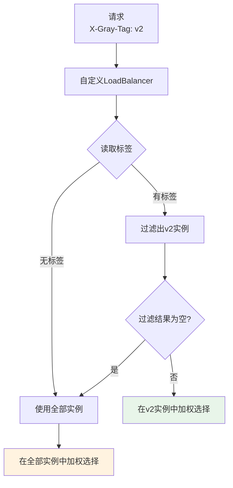
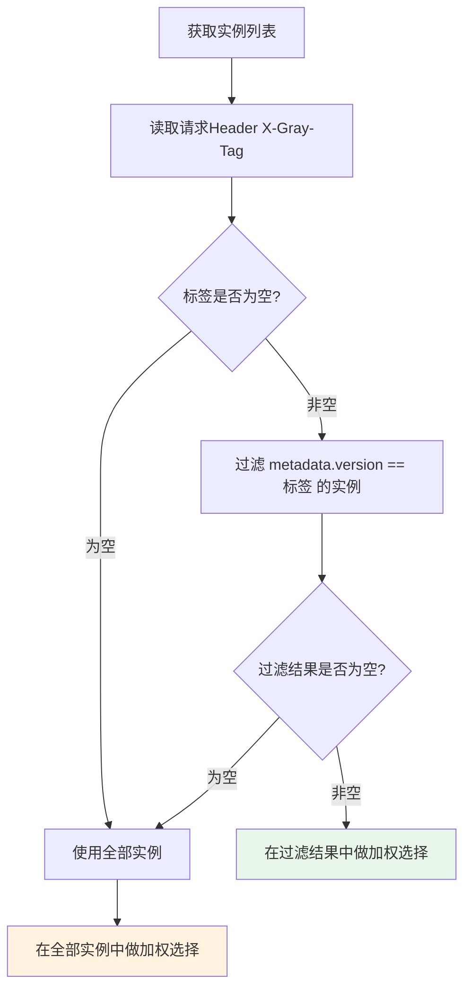

# 标签化负载均衡与灰度发布

## 课程目标

- 理解灰度发布的核心概念与常见策略，明确“标签化负载均衡”在灰度发布中的定位
- 掌握通过Nacos实例元数据为服务打标签的方法
- 掌握通过请求Header传递灰度标签的实现方式
- 掌握在`ReactorServiceInstanceLoadBalancer`中实现“按标签过滤 + 加权选择”的完整逻辑
- 掌握灰度降级策略：标签无匹配、灰度实例故障时如何回退到稳定版本
- 完成book-product v1/v2双版本部署，实现“普通用户走v1、灰度用户走v2”的端到端验证


## 回顾与导入

上一节我们完成了自定义负载均衡的五步开发流程，以平滑加权轮询为例，实现了“按权重分配流量”。但权重解决的是**版本内部**的流量分配问题——例如v1版本的两个实例之间如何分流量。

灰度发布要解决的是另一个问题：**不同版本之间**的流量分配。

> **场景：** book-product发布了v2版本，新增了“按分类搜索”的功能。直接全量上线风险太大——如果v2有隐藏bug，所有用户都会受影响。更安全的做法是：先让**1%的内部用户**使用v2，观察一段时间无异常后，逐步扩大到10%、50%，最后全量切换。这个过程就是灰度发布。

灰度发布有多种实现方式：

| 方式               | 原理                                             | 局限                        |
| ------------------ | ------------------------------------------------ | --------------------------- |
| 按IP灰度           | 白名单指定IP走v2                                 | 无法按用户维度精细控制      |
| 按用户ID灰度       | 用户ID取模决定走哪个版本                         | 需要修改业务代码或路由逻辑  |
| **标签化负载均衡** | **请求Header携带标签，负载均衡器按标签过滤实例** | 需要网关/前端配合传递Header |
| 按流量比例灰度     | 负载均衡器按比例随机分配                         | 无法控制“哪些用户”进入灰度  |

本节采用**标签化负载均衡**：在请求Header中携带一个灰度标签（如`X-Gray-Tag: v2`），自定义负载均衡器读取该标签，从实例列表中**只保留与标签匹配的实例**，再在匹配的实例中做加权选择。如果标签为空或没有匹配实例，则**降级到全部实例**。



## 灰度发布核心概念

### 灰度发布的阶段划分

一次完整的灰度发布通常包含五个阶段：

| 阶段                   | 流量分配                    | 目的                                   |
| ---------------------- | --------------------------- | -------------------------------------- |
| **阶段一：部署新版本** | v2接收0%流量                | 新版本实例启动并注册，但不接收业务流量 |
| **阶段二：小范围灰度** | v2接收1%~5%流量（内部用户） | 观察新版本的核心指标、错误日志         |
| **阶段三：扩大灰度**   | v2接收10%~50%流量           | 逐步验证新版本在更大流量下的稳定性     |
| **阶段四：全量切换**   | v2接收100%流量              | 新版本成为唯一版本                     |
| **阶段五：旧版本下线** | v1下线                      | 释放资源                               |

每个阶段都需要**可观测的验证指标**：错误率、响应延迟、关键业务指标。如果任一指标异常，应立即回滚——将灰度标签撤销，所有流量回到v1。

### 标签化负载均衡的定位

标签化负载均衡是“按规则路由”的一种实现：

| 维度         | 权重/轮询/随机   | 标签化负载均衡           |
| ------------ | ---------------- | ------------------------ |
| 路由依据     | 实例的权重、顺序 | **请求的特征**（Header） |
| 流量分配粒度 | 无差别           | 可按用户、按场景精细控制 |
| 典型场景     | 版本内部负载均衡 | **版本之间的灰度路由**   |

它与上一节自定义策略是**互补关系**：标签化负载均衡负责“选哪个版本”，加权轮询负责“版本内选哪个实例”。在本节的实现中，两者会组合使用——**先按标签过滤，再在过滤结果中做加权选择**。


## 标签化负载均衡的核心原理

### 实例标签：Nacos元数据

实例标签通过Nacos的**实例元数据（metadata）** 实现。在第7节注册服务时，我们已经配置过`metadata`：

```yaml
spring:
  cloud:
    nacos:
      discovery:
        metadata:
          version: 1.0.0
          env: dev
```

灰度发布中，用`metadata`的某个键（如`version`）标识实例的版本：

| 实例   | 端口 | metadata.version |
| ------ | ---- | ---------------- |
| v1实例 | 8081 | `v1`             |
| v2实例 | 8082 | `v2`             |

> **元数据的键名可自定义**：`version`、`gray-tag`、`release`都可以。关键是**负载均衡器和实例配置使用同一个键名**。本节使用`version`。

### 请求标签：Header

请求标签通过HTTP Header传递。命名建议：

| Header           | 用途                             |
| ---------------- | -------------------------------- |
| `X-Gray-Tag`     | 灰度标签（本节使用）             |
| `X-User-Id`      | 用户ID（可结合灰度规则计算标签） |
| `X-Gray-Version` | 目标版本号                       |

本节的约定：请求Header `X-Gray-Tag` 的值表示“希望路由到的版本”。例如`X-Gray-Tag: v2`表示希望走v2实例。

### 匹配与降级逻辑

负载均衡器的核心逻辑：



**降级设计要点：**

| 降级场景               | 处理方式                   | 理由                                 |
| ---------------------- | -------------------------- | ------------------------------------ |
| 请求未携带`X-Gray-Tag` | 使用全部实例               | 普通用户不感知灰度，正常走默认流量   |
| 标签值无匹配实例       | 降级到全部实例             | 避免灰度实例故障导致灰度用户请求失败 |
| 灰度实例全部不健康     | 过滤后为空，降级到全部实例 | 同上的容错逻辑                       |


## 部署v1/v2双版本实例

### v1实例配置

book-product的v1实例（8081）配置：

```yaml
server:
  port: 8081

spring:
  application:
    name: book-product
  cloud:
    nacos:
      discovery:
        namespace: dev
        group: DEFAULT_GROUP
        metadata:
          version: v1        # 标识为v1版本
```

### v2实例配置

v2实例（8082）使用相同的代码，只修改端口和版本标签：

```yaml
server:
  port: 8082

spring:
  application:
    name: book-product
  cloud:
    nacos:
      discovery:
        namespace: dev
        group: DEFAULT_GROUP
        metadata:
          version: v2        # 标识为v2版本
```

> **说明：** 本节不修改book-product的业务代码，只通过元数据区分版本。真实场景中，v2通常是新代码——可能是新增了接口、修改了业务逻辑。元数据的`version`标签是“部署层面的标识”，与代码无关。

### 验证注册

在Nacos控制台（dev命名空间）的`book-product`服务详情中，确认两个实例的元数据：

| 实例 | 端口 | metadata.version | 健康状态 |
| ---- | ---- | ---------------- | -------- |
| v1   | 8081 | `v1`             | 健康     |
| v2   | 8082 | `v2`             | 健康     |


## 实现标签化负载均衡器

### 完整实现

标签化负载均衡器的核心是：**读取Header标签 → 过滤实例 → 在过滤结果中做加权选择**。本节在过滤之后复用上一节的平滑加权轮询逻辑作为最终选择器。

```java
public class GrayTagLoadBalancer implements ReactorServiceInstanceLoadBalancer {

    /** 请求头中的灰度标签 */
    private static final String GRAY_HEADER = "X-Gray-Tag";

    /** 实例元数据中的版本键 */
    private static final String VERSION_KEY = "version";

    private final String serviceId;
    private final ObjectProvider<ServiceInstanceListSupplier> supplierProvider;

    /** 平滑加权轮询的状态：key = ip:port */
    private final Map<String, AtomicInteger> currentWeights = new ConcurrentHashMap<>();

    public GrayTagLoadBalancer(String serviceId,
                               ObjectProvider<ServiceInstanceListSupplier> supplierProvider) {
        this.serviceId = serviceId;
        this.supplierProvider = supplierProvider;
    }

    @Override
    public Mono<Response<ServiceInstance>> choose(Request request) {
        ServiceInstanceListSupplier supplier = supplierProvider.getIfAvailable();

        // 1. 读取请求头中的灰度标签
        String grayTag = extractGrayTag();

        return supplier.get(request).next().map(instances -> {
            if (instances == null || instances.isEmpty()) {
                return new EmptyResponse();
            }

            // 2. 按标签过滤实例
            List<ServiceInstance> candidates = instances;
            if (grayTag != null && !grayTag.isBlank()) {
                List<ServiceInstance> matched = instances.stream()
                        .filter(i -> grayTag.equals(i.getMetadata().get(VERSION_KEY)))
                        .collect(Collectors.toList());

                // 3. 过滤结果为空时降级到全部实例
                if (!matched.isEmpty()) {
                    candidates = matched;
                } else {
                    System.out.println("[GRAY] 标签 " + grayTag + " 无匹配实例，降级到全部实例");
                }
            }

            // 4. 在候选实例中做平滑加权选择
            return selectByWeight(candidates);
        });
    }

    private String extractGrayTag() {
        // 从当前HTTP请求上下文中获取消息头
        RequestAttributes attrs = RequestContextHolder.getRequestAttributes();
        if (attrs instanceof ServletRequestAttributes sra) {
            String version = sra.getRequest().getHeader(GRAY_HEADER);
            if (version != null && !version.isBlank()) return version;
        }
        return null;
    }

    private Response<ServiceInstance> selectByWeight(List<ServiceInstance> instances) {
        // 清理已下线实例的 currentWeight
        currentWeights.keySet().removeIf(key ->
                instances.stream().noneMatch(i -> keyOf(i).equals(key)));

        // 累加：currentWeight += weight
        int totalWeight = 0;
        for (ServiceInstance instance : instances) {
            int weight = getWeight(instance);
            if (weight <= 0) continue;
            totalWeight += weight;
            currentWeights.computeIfAbsent(keyOf(instance), k -> new AtomicInteger(0))
                    .addAndGet(weight);
        }
        if (totalWeight <= 0) {
            return new EmptyResponse();
        }

        // 选 currentWeight 最大
        ServiceInstance selected = null;
        int max = Integer.MIN_VALUE;
        for (ServiceInstance instance : instances) {
            int weight = getWeight(instance);
            if (weight <= 0) continue;
            int current = currentWeights.get(keyOf(instance)).get();
            if (current > max) {
                max = current;
                selected = instance;
            }
        }
        if (selected == null) {
            return new EmptyResponse();
        }

        // 被选中实例 currentWeight -= totalWeight
        currentWeights.get(keyOf(selected)).addAndGet(-totalWeight);

        System.out.println("[GRAY] 选中 " + keyOf(selected)
                + " version=" + selected.getMetadata().get(VERSION_KEY));
        return new DefaultResponse(selected);
    }

    private String keyOf(ServiceInstance instance) {
        return instance.getHost() + ":" + instance.getPort();
    }

    private int getWeight(ServiceInstance instance) {
        String weight = instance.getMetadata().get("nacos.weight");
        if (weight == null) return 1;
        try {
            return (int) Math.round(Double.parseDouble(weight));
        } catch (NumberFormatException e) {
            return 1;
        }
    }
}
```

### 代码要点解析

| 代码位置                           | 作用                         | 对应原理         |
| ---------------------------------- | ---------------------------- | ---------------- |
| `extractGrayTag`                   | 从HTTP请求中读取`X-Gray-Tag` | 请求标签         |
| `filter(i -> grayTag.equals(...))` | 按`metadata.version`过滤实例 | 实例标签匹配     |
| `if (!matched.isEmpty())`          | 过滤结果为空时降级           | 灰度降级策略     |
| `selectByWeight`                   | 在候选实例中做平滑加权选择   | 与上一节算法复用 |

> **设计要点：** 灰度过滤与加权选择是**两层逻辑**——先按标签选“版本”，再在版本内按权重选“实例”。如果v2有多个实例（如8082、8083），过滤后仍然可以在它们之间做负载均衡。

### 配置类与绑定

```java
public class GrayTagLoadBalancerConfig {

    @Bean
    public ReactorServiceInstanceLoadBalancer grayTagLoadBalancer(
            Environment environment,
            LoadBalancerClientFactory loadBalancerClientFactory) {
        String name = environment.getProperty(LoadBalancerClientFactory.PROPERTY_NAME);
        return new GrayTagLoadBalancer(
                name,
                loadBalancerClientFactory.getLazyProvider(name,
                        ServiceInstanceListSupplier.class));
    }
}
```

在book-order启动类上绑定：

```java
@SpringBootApplication
@EnableFeignClients
@LoadBalancerClient(name = "book-product", configuration = GrayTagLoadBalancerConfig.class)
public class BookOrderApplication { ... }
```


## 端到端验证

### 验证一：无标签请求走全部实例

不带`X-Gray-Tag`调用10次：

```http
### 无灰度标签，应在v1和v2之间按权重分配
GET {{order_url}}/api/order/product/1
```

**预期输出：**

```
[GRAY] 选中 127.0.0.1:8081 version=v1
[GRAY] 选中 127.0.0.1:8082 version=v2
[GRAY] 选中 127.0.0.1:8081 version=v1
[GRAY] 选中 127.0.0.1:8082 version=v2
...
```

**结论：** 无标签时，普通用户按默认策略在v1/v2之间分配。**灰度阶段一的“0%流量”目标**，可以通过在灰度期间**不配置无标签请求的路由规则**，或者**只在特定Header下才路由到v2**实现——本节的无标签请求会自然分配到v2，这是“阶段四全量切换”之前需要注意的风险点。

> **阶段一的正确做法：** 在灰度初期，如果不想让普通用户进入v2，需要在负载均衡器中**进一步限制**——例如只有`X-Gray-Tag: v2`时才允许选中v2，无标签请求**只使用v1实例**。这需要修改`extractGrayTag`为空的处理逻辑：空标签时过滤掉v2实例。本节为了演示“标签化”的通用性，采用“无标签走全部实例”的逻辑；生产环境可根据阶段需求调整。

### 验证二：灰度标签请求走v2

带`X-Gray-Tag: v2`调用10次：

```http
### 灰度用户，应只走v2
GET {{order_url}}/api/order/product/1
X-Gray-Tag: v2
```

**预期输出：** 所有请求都选中8082（`version=v2`）。

```
[GRAY] 选中 127.0.0.1:8082 version=v2
[GRAY] 选中 127.0.0.1:8082 version=v2
...
```

### 验证三：灰度标签请求走v1

带`X-Gray-Tag: v1`调用5次：

```http
GET {{order_url}}/api/order/product/1
X-Gray-Tag: v1
```

**预期输出：** 所有请求都选中8081（`version=v1`）。

### 验证四：标签无匹配时降级

带`X-Gray-Tag: v3`（不存在的版本）调用5次：

```http
GET {{order_url}}/api/order/product/1
X-Gray-Tag: v3
```

**预期输出：**

```
[GRAY] 标签 v3 无匹配实例，降级到全部实例
[GRAY] 选中 127.0.0.1:8081 version=v1
[GRAY] 标签 v3 无匹配实例，降级到全部实例
[GRAY] 选中 127.0.0.1:8082 version=v2
...
```

**结论：** 无匹配标签时，降级到全部实例，避免请求失败。

### 验证五：v2实例故障时降级

停止v2实例（8082），带`X-Gray-Tag: v2`调用5次：

**预期输出：**

```
[GRAY] 标签 v2 无匹配实例，降级到全部实例
[GRAY] 选中 127.0.0.1:8081 version=v1
```

**结论：** 灰度实例故障时，灰度用户降级到v1，业务不中断。这是灰度发布中**最重要的容错设计**——灰度版本出问题时，用户不能因此不可用。


## 注意事项

1. **标签化负载均衡只负责“路由”，不负责“决定谁进灰度”**：灰度用户范围的判定（内部用户、1%比例）通常在网关层完成，负载均衡器只按Header路由。

2. **降级逻辑是灰度安全的底线**：标签无匹配、灰度实例故障时，必须降级到全部实例，避免灰度用户不可用。

3. **无标签请求的默认路由要按阶段调整**：灰度初期应只允许v1，全量切换后才允许v2。本节演示的“无标签走全部实例”适用于全量切换后的阶段。

4. **元数据键和Header名要统一**：负载均衡器、实例配置、网关三处必须使用相同的键名，否则路由静默失效。

5. **灰度不是“只上不下”**：每个灰度阶段都要有明确的回滚预案——撤销标签是最快的回滚方式。

   

## 小结

本节课我们学习了：

1. **灰度发布的核心概念**：五个阶段（部署、小范围灰度、扩大灰度、全量切换、旧版本下线），每个阶段都需要可观测的验证指标和回滚预案。
2. **标签化负载均衡的定位**：按请求Header路由，与权重/轮询等“版本内负载均衡”互补。
3. **实例标签**：通过Nacos元数据`metadata.version`标识实例版本（v1/v2）。
4. **请求标签**：通过`X-Gray-Tag` Header传递灰度意图。
5. **标签化负载均衡器的实现**：读取Header → 按`metadata.version`过滤实例 → 过滤结果为空时降级到全部实例 → 在候选实例中做平滑加权选择。
6. **降级策略**：无标签、标签无匹配、灰度实例故障，三种场景都降级到全部实例，保证业务可用性。
7. **端到端验证**：无标签走全部、`v2`标签走v2、`v1`标签走v1、`v3`标签降级、v2故障时降级。


## 作业

### 作业一：完成v1/v2双版本部署与标签验证

1. 启动book-product的v1实例（8081，`metadata.version=v1`）和v2实例（8082，`metadata.version=v2`）。
2. 在Nacos控制台确认两个实例的元数据正确显示。
3. 实现`GrayTagLoadBalancer`，绑定到book-product。
4. 分别用无标签、`X-Gray-Tag: v1`、`X-Gray-Tag: v2`调用10次，记录`[GRAY]`日志，验证路由是否符合预期。
5. 截图控制台输出和Nacos实例列表。

### 作业二：验证降级策略

1. 用`X-Gray-Tag: v3`（不存在的版本）调用5次，验证是否降级到全部实例。
2. 停止v2实例（8082），用`X-Gray-Tag: v2`调用5次，验证是否降级到v1。
3. 重启v2实例，等待注册成功，再次用`X-Gray-Tag: v2`调用，验证是否恢复路由到v2。
4. 撰写验证报告，记录每个场景的日志和结论。
