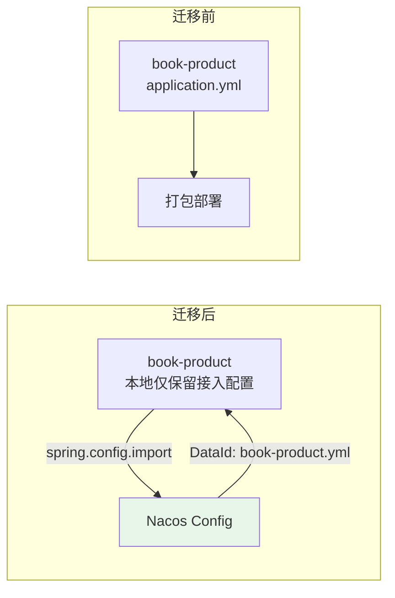
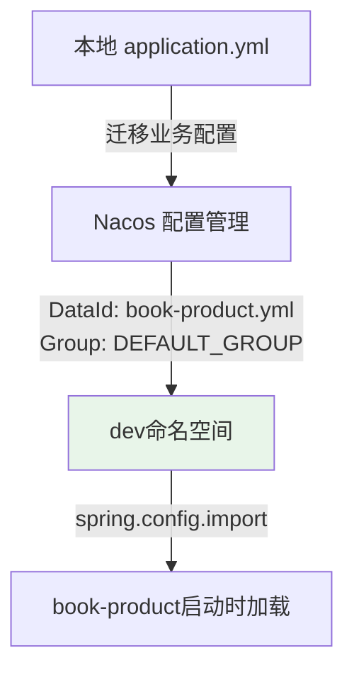

# Nacos Config集成与配置迁移

## 课程目标

- 理解配置中心在微服务架构中的定位，以及它要解决的“配置分散、变更需重启”问题
- 掌握Spring Cloud Alibaba版本接入Nacos Config的正确方式
- 完成book-product的配置从本地`application.yml`迁移到Nacos的完整流程：依赖确认 → 本地保留接入配置 → 在Nacos创建DataId → 迁移业务配置 → 验证启动
- 掌握通过`@RefreshScope`和`@ConfigurationProperties`验证配置动态刷新的方法
- 理解“本地只保留接入配置，业务配置全部上移”的迁移原则


## 回顾与导入

上一个模块我们完成了负载均衡的完整建设。到此为止，book-order、book-product、book-user三个服务的配置仍然分散在各自的`application.yml`中：

```yaml
server:
  port: 8081
spring:
  application:
    name: book-product
  datasource:
    url: jdbc:postgresql://localhost:5432/book_product_db
  cloud:
    nacos:
      discovery:
        server-addr: 127.0.0.1:8848
```

这种“配置跟着代码走”的方式存在三个明显的问题：

| 问题                     | 后果                                                |
| ------------------------ | --------------------------------------------------- |
| **改配置要重新打包重启** | 调整一个超时时间或日志级别，也需要走完整的发布流程  |
| **多环境配置分散**       | dev、test、prod的配置散落在不同文件中，容易改错环境 |
| **配置无法审计**         | 谁在什么时候改了什么配置，没有统一记录              |

配置中心的引入正是为了解决这些问题。Nacos作为“注册中心 + 配置中心”的一站式方案，我们在前面已经用它的注册中心能力完成了服务发现和负载均衡；本模块将启用它的**配置中心**能力，把服务配置从本地“搬”到Nacos统一管理。

本节是配置中心的起点，完成**集成与迁移**：让book-product能够从Nacos读取配置，并把原本在`application.yml`中的业务配置迁移到Nacos上。动态刷新的深入机制、配置分级、灰度发布、加密等内容将在后续节次展开。




## 配置中心核心概念与模型

### 配置中心的定位

配置中心（Config Center）与注册中心（Registry Center）是Nacos的两大核心能力，两者职责不同：

| 维度          | 注册中心                       | 配置中心                                         |
| ------------- | ------------------------------ | ------------------------------------------------ |
| 管理对象      | 服务实例的地址、健康状态、权重 | 应用的配置项（数据库连接、业务参数、日志级别等） |
| 数据变化频率  | 较高（实例上下线）             | 较低（配置发布）                                 |
| 消费方式      | 服务发现、负载均衡             | 启动时加载 + 运行时动态刷新                      |
| Nacos对应能力 | Nacos Discovery                | Nacos Config                                     |

在Spring Cloud Alibaba中，`spring-cloud-starter-alibaba-nacos-config`负责配置中心能力，`spring-cloud-starter-alibaba-nacos-discovery`负责注册中心能力。两者可以独立使用，也可以共存——本项目两者都会使用。

### 配置的寻址模型：DataId

Nacos中的每份配置由`DataId`唯一标识。在Spring Cloud Alibaba的默认约定下，`DataId`的构成是：

```
${spring.cloud.nacos.config.prefix}-${spring.profiles.active}.${spring.cloud.nacos.config.file-extension}
```

| 部分              | 默认值                        | 说明                      |
| ----------------- | ----------------------------- | ------------------------- |
| `prefix`          | `${spring.application.name}`  | 应用名，即`book-product`  |
| `profiles.active` | 无（此时不含横杠和profile段） | 如`dev`、`test`           |
| `file-extension`  | `properties`                  | 配置格式，本课程使用`yml` |

为了避免profile为空导致DataId拼接异常，实际配置中通常会**显式通过`spring.config.import`指定DataId**，而不是完全依赖默认拼接。本节的推荐写法是：

```yaml
spring:
  config:
    import: optional:nacos:book-product.yml
```

> **`optional:`前缀的作用：** 如果Nacos中暂时没有这个DataId，应用不会启动失败，而是继续使用本地配置。这在“先集成、后迁移”的过渡阶段非常有用。但**迁移完成后，建议去掉`optional:`**，让“配置缺失”在启动时就暴露出来，而不是等到运行时才发现某个配置项没读到。


## 迁移前的准备：确认依赖与本地配置

### 确认依赖

确保`pom.xml`中已经包含Nacos Config依赖：

```xml
<dependency>
    <groupId>com.alibaba.cloud</groupId>
    <artifactId>spring-cloud-starter-alibaba-nacos-config</artifactId>
</dependency>
```

### 本地application.yml：只保留“接入配置”

迁移的核心原则是：**本地只保留“如何连上Nacos”的配置，业务配置全部迁移到Nacos**。

迁移前，book-product的`application.yml`包含端口、数据源、MyBatis-Plus、Nacos Discovery等配置。迁移时，需要区分两类配置：

| 配置类型                           | 是否迁移     | 理由                                   |
| ---------------------------------- | ------------ | -------------------------------------- |
| `spring.config.import`             | **不迁移**   | 这是接入配置中心的“入口”，必须在本地   |
| `spring.cloud.nacos.discovery.*`   | 可保留在本地 | 服务发现配置；后续可再迁移，本节先保留 |
| `spring.application.name`          | **不迁移**   | 应用名是启动的基础标识                 |
| `server.port`                      | 迁移         | 属于业务配置                           |
| `spring.datasource.*`              | 迁移         | 数据源配置                             |
| `mybatis-plus.*`                   | 迁移         | ORM配置                                |
| 业务自定义配置（如超时时间、开关） | 迁移         | 最典型的配置中心内容                   |

**迁移后的本地`application.yml`：**

```yaml
spring:
  application:
    name: book-product
  config:
    import: optional:nacos:book-product.yml    # 从Nacos导入配置
  cloud:
    nacos:
      config:
        server-addr: 127.0.0.1:8848
        namespace: dev
        file-extension: yml                     # DataId后缀为yml
      discovery:
        server-addr: 127.0.0.1:8848
        namespace: dev
        group: DEFAULT_GROUP
```

> **`file-extension: yml`必须显式配置。** 默认后缀是`properties`，如果Nacos中的DataId是`book-product.yml`，本地不声明`file-extension: yml`，默认拼接或解析时可能不匹配。


## 在Nacos中创建配置

### 进入配置管理页面

登录Nacos控制台（`http://127.0.0.1:8080`），切换到**dev命名空间**，点击左侧导航栏的“配置管理” → “配置列表”。

### 创建book-product.yml

点击右上角“+”创建配置，填写：

| 配置项   | 填写值                   |
| -------- | ------------------------ |
| Data ID  | `book-product.yml`       |
| Group    | `DEFAULT_GROUP`          |
| 配置格式 | YAML                     |
| 配置内容 | 从本地迁移过来的业务配置 |

**配置内容示例：**

```yaml
server:
  port: 8081

spring:
  datasource:
    driver-class-name: org.postgresql.Driver
    url: jdbc:postgresql://localhost:5432/book_product_db
    username: postgres
    password: your_password

mybatis-plus:
  configuration:
    map-underscore-to-camel-case: true
    log-impl: org.apache.ibatis.logging.stdout.StdOutImpl
  global-config:
    db-config:
      id-type: auto

# 业务自定义配置（用于后续动态刷新验证）
book:
  product:
    page-size: 10
    cache-enabled: true
```

> **DataId的命名必须与本地`spring.config.import`中声明的一致。** 本地写的是`optional:nacos:book-product.yml`，Nacos中的DataId就必须是`book-product.yml`，拼写、大小写、后缀都不能有差异。

### 发布配置

点击“发布”。发布后，在配置列表中能看到`book-product.yml`，状态为“已发布”。




## 验证迁移结果

### 启动book-product

**启动日志中应出现配置加载相关记录：**

```
 [Nacos Config] Listening config: dataId=book-product.yml, group=DEFAULT_GROUP
```

如果日志中没有出现类似记录，或者启动时提示“No spring.config.import property has been defined”，说明`spring.config.import`没有正确配置，或者依赖的导入检查未通过。

### 验证端口与数据源

**验证端口：** book-product的`server.port`已经从本地迁移到Nacos，如果Nacos中的配置是`8081`，服务应正常监听8081。将Nacos中的`server.port`临时改为`8091`，**重启**book-product（端口变更不是动态刷新的典型场景，通常需要重启才能生效），确认服务监听8091而不是8081。验证完成后改回8081。

**验证数据源：** 调用任意需要数据库的接口（如`GET /api/products/1`），确认数据源配置正确加载。如果数据源配置没有从Nacos读到，启动时会因无法连接数据库而失败。

### 验证业务配置已从本地移除

打开本地的`application.yml`，确认`server.port`、`spring.datasource.*`、`mybatis-plus.*`、`book.product.*`等配置**已经删除**。如果本地还保留着这些配置，Nacos中的同名配置会把本地配置给覆盖（Spring Boot的配置优先级中，本地`application.yml`通常低于导入的远程配置），迁移就“看起来生效了但实际上没生效”。

> **检查方法：** 在Nacos中将`book.product.page-size`改为`20`，而本地`application.yml`中不写这一项。如果应用读到的是`20`，说明配置确实来自Nacos；如果读到的是某个默认值或旧值，说明本地可能还有残留。


## 验证动态刷新

配置迁移的最终目的不仅是“启动时从Nacos读配置”，更是“修改配置无需重启”。

### 使用@RefreshScope验证@Value

在book-product中创建一个读取`book.product.page-size`的Controller：

```java
@RestController
@RequestMapping("/api/config")
@RefreshScope
public class ConfigDemoController {

    @Value("${book.product.page-size:10}")
    private Integer pageSize;

    @GetMapping("/page-size")
    public Result<Integer> getPageSize() {
        return Result.success(pageSize);
    }
}
```

**关键点：**

| 要点             | 说明                                                         |
| ---------------- | ------------------------------------------------------------ |
| `@RefreshScope`  | 标记该Bean在配置刷新时重建，`@Value`注入的值随之更新         |
| `@Value`的默认值 | `${book.product.page-size:10}`，配置缺失时使用10，避免启动失败 |
| 刷新触发         | Nacos中修改配置并发布后，Nacos客户端通过gRPC长连接感知变更，触发刷新 |

> **`@RefreshScope`的适用范围：** 它只对通过`@Value`或`@ConfigurationProperties`注入的属性有效。静态字段、构造器注入的属性不会被刷新。对于需要动态刷新的配置类，优先使用`@ConfigurationProperties`（见下）。

### 使用@ConfigurationProperties验证配置类

```java
@Component
@ConfigurationProperties(prefix = "book.product")
@RefreshScope
@Data
public class BookProductProperties {

    private Integer pageSize = 10;
    private Boolean cacheEnabled = true;
}
```

然后在Controller中注入该配置类并返回：

```java
@GetMapping("/properties")
public Result<Integer> getProperties() {
    return Result.success(properties.getPageSize());
}
```

`@ConfigurationProperties`相对于`@Value`的优势：支持批量绑定、类型安全、支持JSR-303校验，更适合“一组配置项”的场景。

### 动态刷新验证步骤

| 步骤 | 操作                                                    | 预期                        |
| ---- | ------------------------------------------------------- | --------------------------- |
| 1    | 启动book-product，调用`GET /api/config/page-size`       | 返回Nacos中的当前值（如10） |
| 2    | 在Nacos控制台将`book.product.page-size`改为20，点击发布 | 配置发布成功                |
| 3    | 不重启book-product，再次调用`GET /api/config/page-size` | 返回20                      |
| 4    | 调用`GET /api/config/properties`                        | `pageSize`字段同步为20      |

> **刷新延迟：** Nacos客户端通过gRPC长连接推送变更，正常情况下刷新在秒级内完成。如果长时间不生效，检查9848端口（gRPC）是否可访问，以及`@RefreshScope`是否加在了正确的Bean上。


## 小结

本节课我们学习了：

1. **配置中心的定位**：管理应用的配置项，支持启动加载和运行时动态刷新，与注册中心的职责不同。

2. **2025.x的两个版本前提**：必须使用`spring.config.import`（bootstrap已废弃）

3. **配置寻址模型**：DataId由prefix、profile、file-extension构成；本课程通过`spring.config.import`显式指定`book-product.yml`。

4. **迁移原则**：本地只保留`spring.config.import`、`spring.cloud.nacos.config.*`、`username/password`、`spring.application.name`；业务配置全部迁移到Nacos。

5. **迁移流程**：确认依赖 → 精简本地配置 → 在Nacos创建DataId → 迁移业务配置 → 启动验证 → 确认本地无残留。

6. **动态刷新验证**：`@RefreshScope` + `@Value`或`@ConfigurationProperties`，修改Nacos配置后无需重启即可生效。

   


## 作业

### 作业一：完成book-product的配置迁移

1. 确认book-product的`pom.xml`中包含`spring-cloud-starter-alibaba-nacos-config`依赖。
2. 按课程内容改造本地`application.yml`：保留接入配置，删除业务配置。
3. 在Nacos控制台（dev命名空间）创建`book-product.yml`，将端口、数据源、MyBatis-Plus配置迁移进去。
4. 启动book-product，确认日志中出现Nacos配置加载记录。
5. 调用`GET /api/products/1`，验证数据源配置正确。
6. 截图本地`application.yml`（业务配置已删除）和Nacos中的配置内容。

### 作业二：验证动态刷新

1. 在book-product中创建`ConfigDemoController`，使用`@RefreshScope` + `@Value`读取`book.product.page-size`。
2. 启动服务，调用`GET /api/config/page-size`，记录返回值。
3. 在Nacos中将`book.product.page-size`从10改为20，发布配置。
4. 不重启服务，再次调用接口，验证返回值是否变为20。
5. 创建`BookProductProperties`（`@ConfigurationProperties(prefix = "book.product")` + `@RefreshScope`），重复上述验证。
6. 截图两次调用的返回值，以及Nacos配置修改记录。

### 作业三：验证DataId不匹配的排查

1. 将本地`spring.config.import`中的DataId临时改为`book-product-config.yml`（与Nacos中的`book-product.yml`不一致）。
2. 重启book-product，观察启动日志，记录配置是否加载成功、是否报错。
3. 检查`GET /api/config/page-size`的返回值，验证配置是否来自Nacos。
4. 将DataId改回正确值，再次验证恢复正常。
5. 撰写排查记录，说明DataId不匹配时的现象和定位方法。
