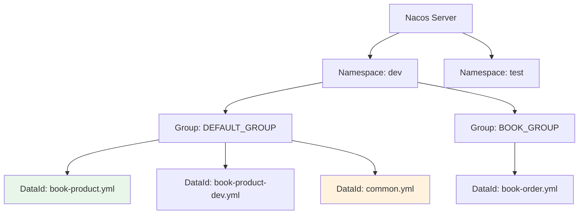
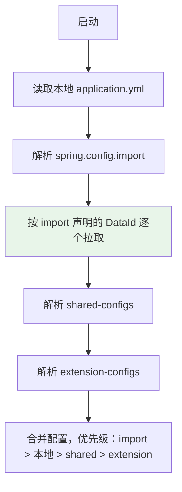
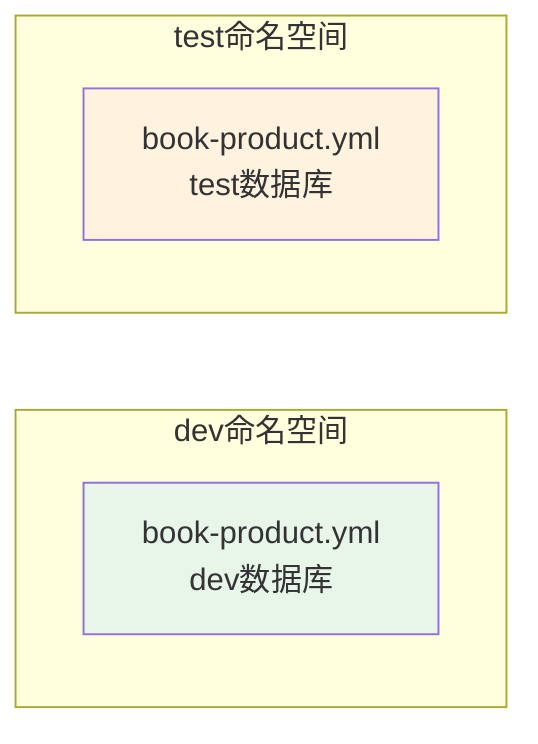
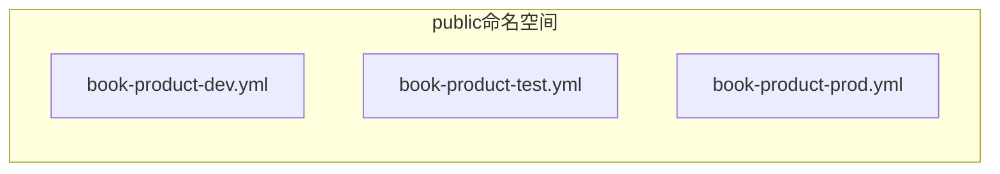
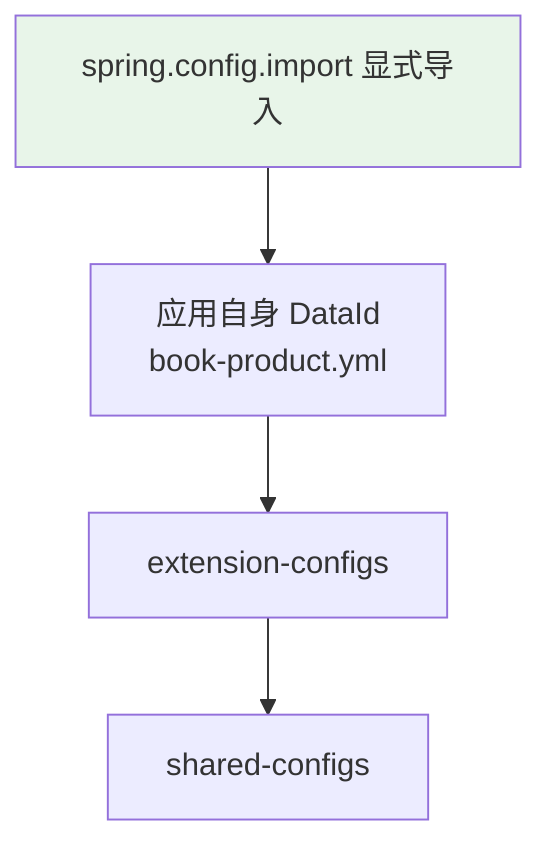

# 配置分级模型与DataId实战

## 课程目标

- 理解Nacos配置中心的三级模型（Namespace / Group / DataId），以及它与服务注册分级模型的异同
- 掌握DataId的默认构成规则（`prefix` - `profile` - `file-extension`）及各段的作用
- 掌握`spring.config.import`显式导入DataId、`shared-configs`共享配置、`extension-configs`扩展配置三种导入方式
- 理解多环境隔离的两种方案：Namespace隔离 vs DataId隔离，掌握各自的适用场景
- 完成book-product在dev/test两套环境下的DataId规划与验证
- 完成公共配置抽取，让book-product与book-user共享同一份数据源基础配置


## 回顾与导入

上一节完成了book-product的配置迁移：业务配置从本地`application.yml`搬到了Nacos的`book-product.yml`中，本地只保留接入配置。但这只是“一份配置”，还没有回答更复杂的问题：

> **场景一：环境区分。** book-product同时有dev、test两套环境，它们的数据库连接不同、日志级别不同。是把配置拆成两份DataId，还是用Namespace隔离？
>
> **场景二：配置共享。** book-product和book-user使用同一个PostgreSQL实例、相同的连接池参数，如果每个服务各复制一份，未来改密码就要改N处。能不能把公共部分抽出来共享？
>
> **场景三：本地调试覆盖。** 开发人员本地调试时，希望临时覆盖Nacos中的某个配置，但又不想改动Nacos上的共享配置，应该怎么办？

这三个问题的答案，都建立在Nacos配置中心的**三级模型**和**DataId的匹配规则**之上。本节先把模型讲清楚，再通过三个实战回答上述问题。


## 配置中心的三级模型

### 三级模型回顾

Nacos的分级存储模型是 **Namespace → Group → DataId** 三层结构。



### 定位唯一一份配置

一份配置的完整定位由三个要素共同决定：

```
Namespace + Group + DataId  →  唯一一份配置
```

这意味着：

| 场景                                   | 是否会冲突                     |
| -------------------------------------- | ------------------------------ |
| 不同Namespace下，相同的Group + DataId  | 不冲突，各自独立               |
| 同一Namespace下，不同Group，相同DataId | 不冲突，各自独立               |
| 同一Namespace、同一Group下，相同DataId | **冲突**，后发布的覆盖先发布的 |

> **实践启示：** 如果两个服务需要使用相同DataId的配置，又希望内容不同，隔离的维度只能是Namespace或Group——绝不能靠“在DataId里加前缀”这种临时手段，那样会破坏命名规范。

### 三级模型与配置匹配的关系

Spring Cloud Alibaba在启动时，会按以下顺序尝试拉取配置：




## DataId的构成规则详解

### 默认构成：prefix - profile - extension

Spring Cloud Alibaba的默认DataId拼接规则是：

```
${prefix}-${spring.profiles.active}.${file-extension}
```

**拼接示例：**

| 场景      | prefix         | profile | extension | 生成的DataId            |
| --------- | -------------- | ------- | --------- | ----------------------- |
| 无profile | `book-product` | 无      | `yml`     | `book-product.yml`      |
| dev环境   | `book-product` | `dev`   | `yml`     | `book-product-dev.yml`  |
| test环境  | `book-product` | `test`  | `yml`     | `book-product-test.yml` |

### 通过spring.config.import显式指定DataId

上一节采用的写法是：

```yaml
spring:
  config:
    import: optional:nacos:book-product.yml
```

**多DataId导入的写法：**

```yaml
spring:
  config:
    import:
      - optional:nacos:book-product.yml
      - optional:nacos:common.yml
```

### DataId命名规范

在图书系统中，建议遵循以下命名规范：

| 用途          | 命名                             | 示例                         |
| ------------- | -------------------------------- | ---------------------------- |
| 服务自身配置  | `${服务名}.yml`                  | `book-product.yml`           |
| 服务+环境配置 | `${服务名}-${profile}.yml`       | `book-product-dev.yml`       |
| 公共配置      | `common-${作用域}.yml`           | `common-datasource.yml`      |
| 临时覆盖配置  | `${服务名}-${profile}-local.yml` | `book-product-dev-local.yml` |

> **规范原则：** 按“作用域从大到小”排列，公共配置放最前，服务配置居中，本地覆盖放最后。这样从DataId就能看出它的用途和覆盖关系。


## 多环境隔离的两种方案

### 方案一：Namespace隔离（推荐）

同一DataId（如`book-product.yml`）在不同Namespace下是两份独立的配置：



**配置方式：**

```yaml
spring:
  cloud:
    nacos:
      config:
        namespace: dev    # dev环境实例用dev命名空间
```

**优点：**

| 优点           | 说明                                        |
| -------------- | ------------------------------------------- |
| 数据完全隔离   | 不同Namespace的配置互不可见，误操作风险最低 |
| 数据ID一致     | 不用为每个环境维护不同的DataId命名          |
| 权限可独立控制 | 可按Namespace授权，生产环境只有特定人员能改 |

**缺点：** Namespace数量会随环境数量增长，如果环境很多（dev/test/staging/prod/多个项目组），管理成本会上升。

### 方案二：DataId隔离

所有环境共用同一Namespace，通过不同DataId区分：



**配置方式：**

```yaml
spring:
  config:
    import: optional:nacos:book-product-dev.yml
```

**优点：**

| 优点            | 说明                                 |
| --------------- | ------------------------------------ |
| Namespace数量少 | 一个Namespace管所有环境              |
| 便于对比        | 在控制台一眼能看到所有环境的配置差异 |

**缺点：**

| 缺点       | 说明                               |
| ---------- | ---------------------------------- |
| 数据未隔离 | 误操作（如改错DataId）的影响范围大 |
| 权限难细分 | 无法按环境隔离访问权限             |
| DataId膨胀 | N个环境 × M个服务 = N×M个DataId    |

### 两种方案的对比与推荐

| 维度         | Namespace隔离            | DataId隔离         |
| ------------ | ------------------------ | ------------------ |
| 数据隔离程度 | **强**（物理隔离）       | 弱（同Namespace）  |
| 权限控制     | 可按Namespace授权        | 难细分             |
| 管理成本     | 中（多Namespace）        | 高（多DataId）     |
| 误操作风险   | 低                       | 较高               |
| 推荐场景     | **生产、测试等长期环境** | 临时验证、个人分支 |

> **推荐组合：** 生产、测试等长期环境用**Namespace隔离**；开发者个人调试用**DataId隔离 + 本地覆盖**（如`book-product-dev-local.yml`）。两种方案不互斥，可以按需组合。


## 实战一：为book-product配置dev/test两套DataId

### 目标

使用**Namespace隔离**方案，在dev和test两个Namespace下各创建一份`book-product.yml`，配置内容不同（数据库不同、日志级别不同），验证不同环境启动时读取各自环境的配置。

### 准备两个Namespace

确认Nacos控制台已有两个命名空间：

| 命名空间名称 | 命名空间ID |
| ------------ | ---------- |
| 开发环境     | `dev`      |
| 测试环境     | `test`     |

### 在dev命名空间创建配置

| 配置项   | 值                 |
| -------- | ------------------ |
| Data ID  | `book-product.yml` |
| Group    | `DEFAULT_GROUP`    |
| 配置格式 | YAML               |

```yaml
server:
  port: 8081

spring:
  datasource:
    driver-class-name: org.postgresql.Driver
    url: jdbc:postgresql://localhost:5432/book_product_db
    username: postgres
    password: admin

logging:
  level:
    com.example.product: DEBUG  
```

### 在test命名空间创建配置

| 配置项   | 值                 |
| -------- | ------------------ |
| Data ID  | `book-product.yml` |
| Group    | `DEFAULT_GROUP`    |
| 配置格式 | YAML               |

```yaml
server:
  port: 8085          # test环境用不同端口

spring:
  datasource:
    driver-class-name: org.postgresql.Driver
    url: jdbc:postgresql://localhost:5432/book_product_db_test
    username: postgres
    password: admin

logging:
  level:
    com.example.product: INFO   # test环境用不同日志级别
```

> **注意：** test环境的端口设为8085，方便与dev环境（8081）区分。同一台机器上同时运行dev和test的book-product实例时，端口不能冲突。

### 本地配置：通过环境变量切换Namespace

在本地的`application.yml`中，将`namespace`改为可被环境变量覆盖的写法：

```yaml
server:
  port: 8081    # 默认端口（Nacos配置会覆盖）

spring:
  application:
    name: book-product
  config:
    import: optional:nacos:book-product.yml
  cloud:
    nacos:
      config:
        server-addr: 127.0.0.1:8848
        namespace: ${NACOS_NAMESPACE:dev}    # 默认dev
        file-extension: yml
      discovery:
        server-addr: 127.0.0.1:8848
        namespace: ${NACOS_NAMESPACE:dev}
```

> **关键：** `${NACOS_NAMESPACE:dev}`表示“优先读环境变量`NACOS_NAMESPACE`，未设置则使用`dev`”。这样通过环境变量就能切换环境，无需修改代码。

### 验证dev环境

**验证项：**

| 验证项               | dev环境的预期                     |
| -------------------- | --------------------------------- |
| 启动日志中的配置来源 | `book-product.yml`（dev命名空间） |
| 服务端口             | 8081                              |
| 日志级别             | `com.example.product`为DEBUG      |

### 验证test环境

**通过IDEA运行配置**

在Run Configuration的`Environment variables`中设置`NACOS_NAMESPACE=test`。

**验证项：**

| 验证项               | test环境的预期                     |
| -------------------- | ---------------------------------- |
| 启动日志中的配置来源 | `book-product.yml`（test命名空间） |
| 服务端口             | 8085                               |
| 日志级别             | `com.example.product`为INFO        |

> **重要对比：** 两个环境的DataId**完全一样**（都是`book-product.yml`），但配置内容不同——差异来自Namespace。这就是Namespace隔离的价值：**DataId命名不受环境数量影响**。


## shared-configs与extension-configs

### 为什么需要共享配置

在上一节迁移方案中，每个服务都各自维护一份完整配置。但book-product和book-user之间存在大量重复配置：

| 重复配置项           | 内容                                               |
| -------------------- | -------------------------------------------------- |
| 数据源连接池参数     | `hikari.maximum-pool-size`、`connection-timeout`等 |
| MyBatis-Plus全局配置 | `map-underscore-to-camel-case`、`id-type`等        |
| 日志通用配置         | `logging.level.root`等                             |

如果每个服务各复制一份，将来调整这些参数需要修改N处，很容易出现“某个服务忘了改”的不一致。

`shared-configs`和`extension-configs`正是Nacos提供的两种“引入外部DataId”的机制。

### shared-configs：共享配置

`shared-configs`用于声明“多个服务共同使用的配置”，它是**共享**语义，优先级**低于**应用自身配置。

```yaml
- optional:nacos:common-datasource.yml?group=DEFAULT_GROUP&refreshEnabled=true
- optional:nacos:common-mybatis.yml?group=DEFAULT_GROUP&refreshEnabled=true
```

| 属性      | 说明                          |
| --------- | ----------------------------- |
| `data-id` | 要共享的DataId                |
| `group`   | 所在分组，默认`DEFAULT_GROUP` |
| `refresh` | 是否支持动态刷新，默认`false` |

### extension-configs：扩展配置

`extension-configs`用于声明“服务自身的额外配置”，优先级**高于**`shared-configs`，但**低于**应用自身配置。

```yaml
- optional:nacos:book-product-ext.yml?group=DEFAULT_GROUP&refreshEnabled=true
```

### 三种配置源的优先级

在配置生效优先级上，从高到低为：



### 配置源选择

| 场景             | 推荐方式                                      |
| ---------------- | --------------------------------------------- |
| 服务主配置       | `spring.config.import`                        |
| 多服务公共配置   | `shared-configs`                              |
| 服务专属附加配置 | `extension-configs` 或 `spring.config.import` |

> **`shared-configs`的`refresh`必须显式设为`true`**：默认不开启刷新，即使Nacos中的共享配置变更了，应用也不会感知。这一点与`spring.config.import`导入的DataId默认支持刷新不同。


## 实战二：抽取公共配置，实现book-product与book-user共享

### 目标

把book-product和book-user共用的MyBatis-Plus全局配置抽取到`common-mybatis.yml`，通过`shared-configs`引入，验证两个服务都能读到，且修改共享配置后两个服务都能刷新。

### 在dev命名空间创建common-mybatis.yml

| 配置项   | 值                   |
| -------- | -------------------- |
| Data ID  | `common-mybatis.yml` |
| Group    | `DEFAULT_GROUP`      |
| 配置格式 | YAML                 |

```yaml
mybatis-plus:
  configuration:
    map-underscore-to-camel-case: true
    log-impl: org.apache.ibatis.logging.stdout.StdOutImpl
  global-config:
    db-config:
      id-type: auto
      logic-delete-field: deleted
      logic-delete-value: 1
      logic-not-delete-value: 0
```

### book-product引入共享配置

**从book-product.yml中删除MyBatis-Plus配置**（已迁移到共享配置），并在本地`application.yml`中添加：

```yaml
- optional:nacos:common-mybatis.yml?group=DEFAULT_GROUP&refreshEnabled=true
```

### book-user同样引入

在book-user的`application.yml`中添加相同的`shared-configs`配置，并删除book-user.yml中的MyBatis-Plus配置。

### 验证共享配置生效

**验证一：两个服务都能读到共享配置**

启动book-product和book-user，调用任意数据库查询接口。如果配置读取正确，MyBatis-Plus的驼峰映射生效，SQL日志也能正常输出。

**验证二：共享配置修改后两个服务都刷新**

| 步骤 | 操作                                                         | 预期                |
| ---- | ------------------------------------------------------------ | ------------------- |
| 1    | 在Nacos中将`common-mybatis.yml`的`log-impl`改为`org.apache.ibatis.logging.nologging.NoLoggingImpl` | 发布成功            |
| 2    | 重启book-product，调用查询接口                               | SQL日志不再输出     |
| 3    | 重启book-user，调用查询接口                                  | SQL日志同样不再输出 |

### 验证优先级：服务自身配置覆盖共享配置

| 步骤 | 操作                                                         | 预期                              |
| ---- | ------------------------------------------------------------ | --------------------------------- |
| 1    | 在`book-product.yml`中显式添加`mybatis-plus.configuration.log-impl: org.apache.ibatis.logging.stdout.StdOutImpl` | 发布                              |
| 2    | 重启book-product（服务自身配置的加载是启动时确定的）         | 日志恢复输出                      |
| 3    | 观察book-user                                                | 仍然无SQL日志（它没有自己的覆盖） |

**结论：** 服务自身配置的优先级高于`shared-configs`，可以用于“共享配置基础值 + 服务级个性化覆盖”。


## 实战三：本地调试覆盖远程配置

### 场景说明

开发人员在本地调试时，希望把book-product的日志级别临时调为`TRACE`，但Nacos上的`book-product.yml`是团队共用的，不能因为个人调试而修改。

### 实现方案：导入一个本地专用的DataId

在Nacos中创建一份`book-product-dev-local.yml`（仅用于个人调试），通过`spring.config.import`放在最后导入，利用“**后导入优先**”的规则实现覆盖：

```yaml
spring:
  config:
    import:
      - optional:nacos:book-product.yml
      - optional:nacos:book-product-dev-local.yml
```

**`book-product-dev-local.yml`的内容：**

```yaml
logging:
  level:
    com.example.product: TRACE
```


## 小结

本节课我们学习了：

1. **配置中心三级模型**：Namespace → Group → DataId，与服务注册的三级模型层级相同但用法不同；三者共同定位唯一一份配置。
2. **DataId默认构成**：`prefix` - `profile` - `file-extension`；profile为空时整段消失；`spring.config.import`可以显式指定DataId，跳过默认拼接。
3. **多环境隔离的两种方案**：Namespace隔离（数据物理隔离、权限可细分、推荐用于长期环境）vs DataId隔离（Namespace数量少、便于对比、推荐用于临时验证）。
4. **`shared-configs`与`extension-configs`**：前者用于多服务公共配置，后者用于服务专属附加配置
5. **多环境实战**：通过`${NACOS_NAMESPACE:dev}`环境变量切换Namespace，DataId不变而配置内容不同。
6. **共享配置实战**：将MyBatis-Plus全局配置抽取到`common-mybatis.yml`，两个服务通过`shared-configs`引入，一处修改、两处生效。
8. **本地覆盖实战**：导入`-local.yml`专用DataId，实现个人调试不影响团队配置。


## 作业

### 作业一：完成多环境DataId配置

1. 在dev和test两个Namespace下各创建一份`book-product.yml`，配置不同的端口、数据源、日志级别。
2. 在本地`application.yml`中使用`${NACOS_NAMESPACE:dev}`切换命名空间。
3. 分别以dev和test启动book-product，验证端口、日志级别、数据源是否正确。
4. 截图两个环境的启动日志和Nacos配置列表。

### 作业二：完成共享配置抽取

1. 在dev命名空间创建`common-mybatis.yml`，包含MyBatis-Plus全局配置。
2. 从`book-product.yml`中删除MyBatis-Plus配置，在本地`application.yml`中添加`shared-configs`引入共享配置。
3. 对book-user做同样的改造。
4. 启动两个服务，验证数据库查询正常。
5. 在Nacos中修改`common-mybatis.yml`的`log-impl`，验证两个服务都能生效。
6. 截图修改前后的SQL日志差异。
