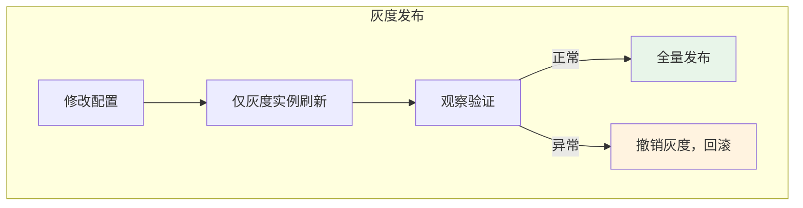
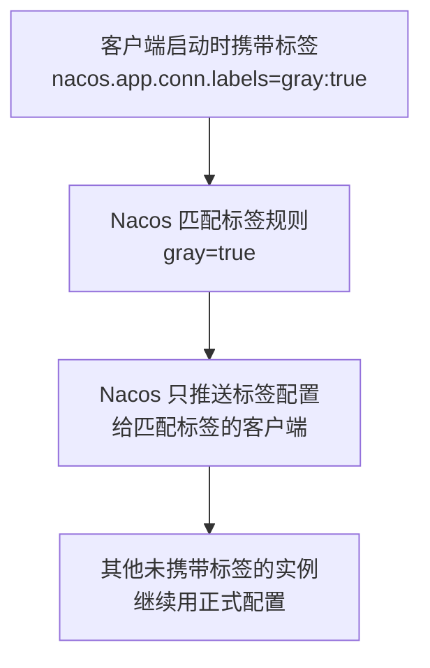

# 配置灰度发布实战

## 课程目标

- 理解配置灰度发布的核心价值：把配置变更的风险从全量降到局部
- 掌握 Nacos Beta 发布的完整流程：发布灰度配置 → 指定实例 IP → 验证 → 全量发布或回滚
- 了解标签发布的基本原理（企业版功能）
- 掌握使用 Actuator 验证配置值与配置来源的方法
- 完成 book-product 配置的灰度发布与回滚演练


## 回顾与导入

到目前为止我们完成了配置中心的集成、分级与共享。配置已经从本地搬到了 Nacos，支持多环境隔离和动态刷新。但配置变更的风险一直没有被正面处理：

> **场景：** book-product 有 2 个实例在运行。运维人员要开启一个新功能开关 `new-search-enabled: true`。直接全量发布，2 个实例几乎同时刷新。如果新逻辑有 bug，所有用户同时受影响。
>
> 更安全的做法：**先让 1 个实例接收新配置**，观察无异常后再全量。这就是配置灰度发布。

配置灰度发布与前面介绍的代码灰度发布解决同一类问题——控制变更影响范围，但作用对象不同：

| 维度     | 代码灰度     | 配置灰度（本节） |
| -------- | ------------ | ---------------- |
| 变更对象 | 代码版本     | 配置内容         |
| 路由依据 | 请求 Header  | **实例维度**     |
| 回滚方式 | 撤销灰度标签 | 撤销 Beta 发布   |



---

## 实验环境与 Actuator 准备

本节验证配置是否生效时，会频繁使用 Spring Boot Actuator 的 `/actuator/env` 端点。该端点**默认不会通过 HTTP 暴露**，因此必须先完成以下准备。

### 1. 确认已集成 Nacos Config

本节默认项目已经完成 Nacos 配置中心集成。只有 Nacos Config 集成正确，后续才能在 Actuator 中看到配置属性的来源。

### 2. 添加 Actuator 依赖

在 `book-product` 的 `pom.xml` 中添加：

```xml
<dependency>
    <groupId>org.springframework.boot</groupId>
    <artifactId>spring-boot-starter-actuator</artifactId>
</dependency>
```

### 3. 暴露 Actuator 端点

在 `application.yml` 或 `bootstrap.yml` 中添加：

```yaml
management:
  endpoints:
    web:
      exposure:
        include: env,refresh,health
```

### 4. 验证 Actuator 是否可用

启动 book-product 后，先访问健康检查端点：

```http
GET http://127.0.0.1:8081/actuator/health
```

预期响应类似：

```json
{
  "status": "UP"
}
```

再访问配置端点：

```http
GET http://127.0.0.1:8081/actuator/env
```

预期返回 JSON，并能看到 `propertySources`。

### 5. 单属性查询格式说明

查询单个配置项时，使用：

```http
GET http://127.0.0.1:8081/actuator/env/book.product.new-search-enabled
```

该路径中的 `book.product.new-search-enabled` 是属性名。


## 配置灰度发布的核心概念

配置灰度发布是指在发布配置变更时，**先让一部分实例接收新配置**，观察运行状态，确认无异常后再扩大到全部实例的发布方式。

### Nacos 的两种灰度方式

| 方式          | 路由依据    | 适用场景                          | 操作复杂度               |
| ------------- | ----------- | --------------------------------- | ------------------------ |
| **Beta 发布** | 指定实例 IP | 精确控制哪几个实例先接收新配置    | 低（控制台勾选 IP）      |
| **标签发布**  | 客户端标签  | 按实例分组灰度，如“机房 A 先灰度” | 中（需客户端打标签+API） |

### ⚠️ 核心辨析：服务元数据 vs 配置标签

在 Nacos 中，存在两套不同的“标签/元数据”机制，初学者极易混淆。**配置灰度不依赖注册中心的实例元数据**，而是依赖客户端请求配置时携带的专属标签。

| 机制                                    | 作用域       | 配置方式               | 效果                                                         |
| :-------------------------------------- | :----------- | :--------------------- | :----------------------------------------------------------- |
| `spring.cloud.nacos.discovery.metadata` | **注册中心** | 实例的 application.yml | 用于网关/负载均衡器挑选实例（例如挑选灰度实例发送 HTTP 请求） |
| `nacos.app.conn.labels`                 | **配置中心** | JVM 启动参数或环境变量 | 用于 Nacos 服务端决定是否下发标签灰度配置给该实例            |

### 灰度配置的存储模型

灰度期间，同一个 DataId 存在多个版本：

| 版本      | 哪些实例读取   |
| --------- | -------------- |
| 正式配置  | 非灰度实例     |
| Beta 配置 | Beta 指定的 IP |
| 标签配置  | 匹配标签的实例 |

> **关键：** 灰度期间**正式配置没有被修改**。Beta 配置和标签配置是“叠加层”，只在匹配的实例上生效。撤销灰度时，只需删除叠加层，正式配置原样保留——这是灰度发布“可回滚”的基础。


## Beta 发布实战

Beta 发布是最常用、最直观的灰度方式：直接指定要灰度的实例 IP。

### 前提：确认实例 IP

在 Nacos 控制台的 dev 命名空间，进入“服务管理”→“服务列表”→点击 `book-product`，确认实例的 IP 和端口。

> **本机模拟的注意点：** 同一台机器上启动两个实例，IP 都是 `127.0.0.1`，Beta 发布按 IP 匹配无法区分端口，会同时命中两个实例。要演示“只灰度一个实例”，需用 Docker 分配不同 IP，或**在实验时只启动一个实例做 Beta 验证**。

### 创建 Beta 发布

**步骤一：进入配置详情**

Nacos 控制台 → dev 命名空间 → “配置管理” → “配置列表” → 找到 `book-product.yml`，点击进入详情。

**步骤二：修改配置内容**

将用于验证的配置项改为新值：

```yaml
book:
  product:
    page-size: 10
    cache-enabled: true
    new-search-enabled: true      # 新增，灰度值
```

**步骤三：勾选“Beta 发布”**

在编辑页面底部勾选“Beta 发布”（不是直接点击“发布”）。

**步骤四：指定灰度 IP**

在弹出的输入框中填写要灰度的实例 IP（如 `127.0.0.1`），点击“发布 Beta”。

**步骤五：观察状态**

发布成功后，配置列表中 `book-product.yml` 显示“Beta 发布中”，并标注灰度 IP。

> **重要：** Beta 发布不会修改正式配置。新启动的实例（非 Beta IP）读到的仍是旧配置。

### 验证 Beta 发布生效

**在灰度实例上验证：**

```http
GET http://127.0.0.1:8081/api/config/properties
```

**预期：** `newSearchEnabled: true`。

**用 Actuator 确认配置来源：**

```http
GET http://127.0.0.1:8081/actuator/env/book.product.new-search-enabled
```

**预期响应：**

```json
{
  "property": {
    "source": "DEFAULT_GROUP@book-product.yml",
    "value": "******"
  }
}
```

> **说明：** 灰度实例的配置来源仍是 `book-product.yml`，但值是 Beta 版本的内容。Nacos 推送时，Beta 配置覆盖正式配置推送给匹配的客户端。

### 全量发布或撤销

| 目标                         | 操作                                  |
| ---------------------------- | ------------------------------------- |
| 灰度验证通过，正式采用新配置 | 点击“发布”，用 Beta 内容覆盖正式配置  |
| 灰度验证失败，回滚           | 点击“撤销 Beta”，灰度实例回到正式配置 |

> **回滚速度：** 撤销 Beta 后，Nacos 通过 gRPC 推送正式配置，生效通常在秒级。这是配置灰度相对于代码回滚的最大优势——**不需要重新部署**。


## 标签发布原理（拓展）

Beta 发布按 IP 精确指定，适合“小范围验证”。当需要按**逻辑分组**灰度时（如“机房 A 的实例先灰度”），使用标签发布。

> **⚠️ 版本限制提示：** 在 开源Nacos 3.0.3 版本中，无法直接通过控制台操作标签。因此，本节内容主要为了解其设计理念，为日后升级版本或使用商业版（如阿里云 MSE）打下基础。

### 标签发布的原理

标签发布基于 Nacos 客户端向配置中心发起请求时携带的**专属标签（Labels）**。



### 客户端打标签方式

如果未来升级了 Nacos 服务端，在 book-product 启动时，可以通过 JVM 参数注入配置中心标签（**请注意，这不是注册中心的 metadata**）：

```bash
-Dnacos.app.conn.labels="gray=true"
```
*(如果是 IDEA 启动，请在 VM options 中填入上述参数)*

启动后，该实例在请求 Nacos 配置中心时，就会带上 `gray=true` 的标签。服务端通过 API 接收到标签匹配规则后，即可实现精准的配置下发。


## 灰度发布的完整流程

### 阶段一：准备

| 步骤 | 操作                                                         |
| ---- | ------------------------------------------------------------ |
| 1    | 确认 book-product 实例运行正常，配置为 `new-search-enabled: false` |
| 2    | 确认 Actuator 依赖已添加，`env` 端点已暴露，`/actuator/health` 返回 `UP` |
| 3    | 用 `/actuator/env` 确认配置来源                              |
| 4    | 记录当前正式配置内容（用于回滚对比）                         |

### 阶段二：Beta 发布

| 步骤 | 操作                                                         |
| ---- | ------------------------------------------------------------ |
| 1    | 在 Nacos 中 Beta 发布 `new-search-enabled: true`，指定灰度 IP |
| 2    | 验证灰度实例读到新值                                         |
| 3    | 用 `/actuator/env/book.product.new-search-enabled` 确认值和来源 |
| 4    | 观察灰度实例的业务日志、错误率、响应时间                     |

### 阶段三：全量发布

| 步骤 | 操作                                   |
| ---- | -------------------------------------- |
| 1    | 确认灰度期间无异常                     |
| 2    | 点击“发布”，用灰度配置覆盖正式配置     |
| 3    | 验证所有实例（包括新启动的）都读到新值 |

### 阶段四：回滚演练

| 步骤 | 操作                                                     |
| ---- | -------------------------------------------------------- |
| 1    | 重新 Beta 发布一个“故意错误”的配置（如 `page-size: -1`） |
| 2    | 验证灰度实例读到错误值                                   |
| 3    | 点击“撤销 Beta”                                          |
| 4    | 验证灰度实例立即回到正式配置                             |

> **回滚演练是本节最重要的验证。** 灰度发布的价值不仅在于“能灰度”，更在于“能快速回滚”。必须实际演练一次撤销操作。


## 小结

本节课我们学习了：

1. **配置灰度发布的价值**：把配置变更的风险从全量降到局部，避免“一处配置错误、全部实例异常”。
2. **Nacos 的两种灰度方式**：Beta 发布（控制台按 IP 精确指定）和标签发布（按客户端连接标签匹配）。
3. **Beta 发布流程**：修改配置 → 勾选 Beta 发布 → 指定灰度 IP → 验证 → 全量发布或撤销。
4. **版本限制认知**：在开源 Nacos 中，Beta 发布是首选。标签发布需要 Nacos 的企业版支持。
5. **核心概念辨析**：配置灰度标签（`nacos.app.conn.labels`）≠ 服务发现元数据（`discovery.metadata`）。
6. **灰度配置的存储模型**：正式配置不变，Beta/标签配置是叠加层；撤销即删除叠加层，正式配置原样保留。
7. **回滚演练的重要性**：灰度发布的价值在于“能快速回滚”，必须实际验证撤销操作。


## 作业

### 作业一：完成 Beta 发布验证

1. 确认 `book-product` 已添加 `spring-boot-starter-actuator` 依赖，并配置 `management.endpoints.web.exposure.include: env,refresh,health`。
2. 启动 book-product 1个实例（8081），确认 `/actuator/health` 返回 `UP`，且 `new-search-enabled` 初始为 `false`。
3. 在 Nacos 控制台中，勾选“Beta 发布”并发布 `new-search-enabled: true`，指定灰度 IP 为 `127.0.0.1`。
4. 用 `/actuator/env/book.product.new-search-enabled` 分别验证灰度实例值和来源。
5. 截图 Beta 发布状态和实例的配置值对比。
6. 点击“撤销 Beta”，验证灰度实例是否回到 `false`。

### 作业二：完成灰度发布全流程演练

1. 按“阶段一至阶段四”的流程，完整演练一次 Beta 灰度发布：
   - 准备：记录初始配置，确认 Actuator 可用
   - Beta 发布：单实例灰度
   - 全量发布：用新配置覆盖正式配置
   - 回滚演练：Beta 发布错误配置并撤销
2. 每个阶段记录：操作步骤、实例状态、`/actuator/env` 的返回。
