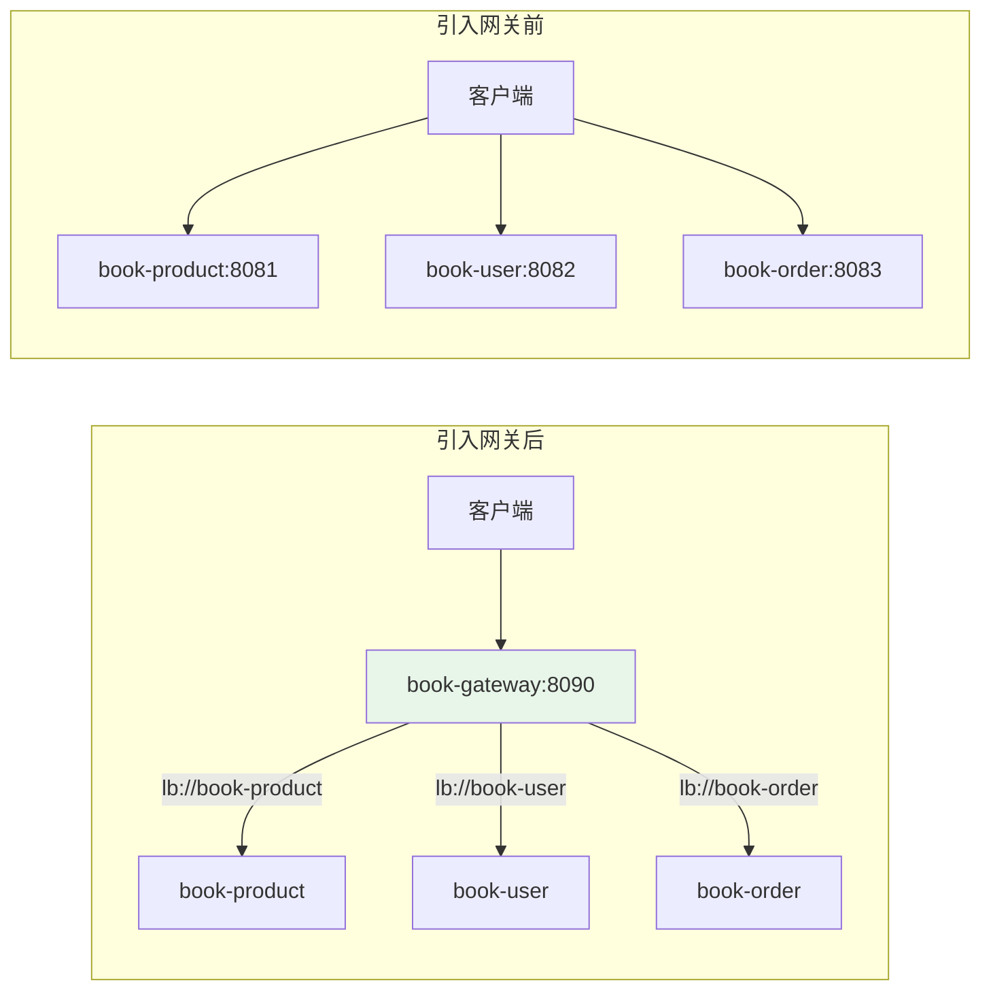
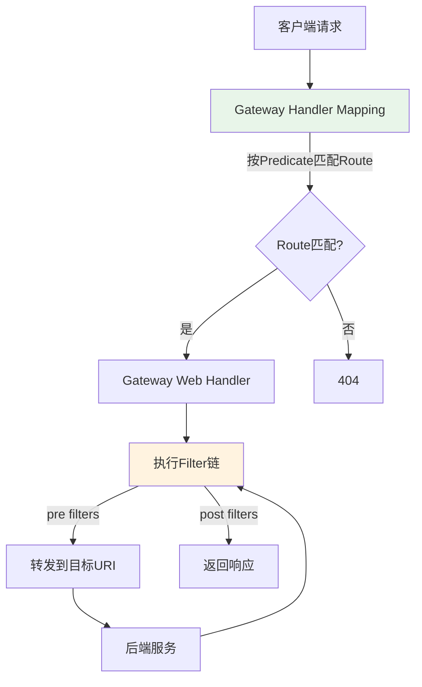

# Gateway快速上手与请求转发


## 课程目标

- 理解API网关在微服务架构中的定位，以及它要解决的“统一入口”问题
- 掌握Spring Cloud Gateway的三个核心概念：Route、Predicate、Filter
- 掌握`book-gateway`模块的创建与Nacos 3.x集成方法
- 掌握显式路由的配置方式：`lb://`协议、Path断言、StripPrefix/RewritePath过滤器
- 完成book-product、book-user、book-order三个服务通过网关的统一入口转发验证
- 理解Gateway与Feign、LoadBalancer在流量路径上的分工


## 回顾与导入

在引入网关之前，三个服务是**直接暴露**给客户端的：

| 服务         | 端口 | 客户端直接访问                         |
| ------------ | ---- | -------------------------------------- |
| book-product | 8081 | `http://localhost:8081/api/products/1` |
| book-user    | 8082 | `http://localhost:8082/api/users/1`    |
| book-order   | 8083 | `http://localhost:8083/api/orders/1`   |

这种模式存在几个明显的问题：

| 问题                       | 后果                                           |
| -------------------------- | ---------------------------------------------- |
| **客户端需要知道多个地址** | 前端配置多个后端地址，服务扩容或迁移时前端要改 |
| **跨域配置分散**           | 每个服务各自处理CORS，配置不一致               |
| **认证鉴权无处统一**       | 每个服务都要实现Token校验，逻辑重复            |
| **限流、日志无法集中**     | 无法在入口层统一控制                           |

网关的引入就是为了解决这些问题：客户端只访问网关，由网关统一转发到后端服务。客户端不需要知道book-product在8081还是8082，只需要知道网关在8090。




## Gateway核心概念

### 三个基本概念

Spring Cloud Gateway的路由模型由三个概念构成，这部分在 Spring Cloud 2025.0.0 中**没有变化**：

| 概念                  | 定义                                                      | 作用                                                   |
| --------------------- | --------------------------------------------------------- | ------------------------------------------------------ |
| **Route（路由）**     | 网关的基本构建块，由ID、目标URI、断言集合和过滤器集合定义 | 一条路由规则：匹配什么请求 → 转发到哪里 → 经过什么处理 |
| **Predicate（断言）** | 对HTTP请求的匹配条件（路径、方法、Header、参数等）        | 所有断言都为`true`时，路由才匹配                       |
| **Filter（过滤器）**  | 请求转发前后的处理逻辑                                    | 可以修改请求（如重写路径、添加Header）或响应           |

> Route是“规则”，Predicate是“条件”，Filter是“加工”。三者组合，决定了请求的完整转发路径。

### 请求处理流程



客户端请求到达网关后，`Gateway Handler Mapping`先做断言判断，看哪个Route的Predicate全部为`true`；匹配到Route后，请求进入Filter链，先执行“pre”过滤器，再转发到目标URI，收到响应后执行“post”过滤器。

### lb://协议：网关与服务发现的衔接

`uri`是Route的目标地址。如果直接写`http://localhost:8081`，网关就失去了“服务发现”的能力——book-product扩容或迁移时，网关配置要跟着改。

Spring Cloud Gateway使用`lb://`协议来衔接服务发现：`lb://book-product`表示“通过LoadBalancer从注册中心获取`book-product`的实例列表，选一个实例转发”。

| URI写法                 | 含义                     | 是否经过服务发现 |
| ----------------------- | ------------------------ | ---------------- |
| `http://localhost:8081` | 直接转发到固定地址       | 否               |
| `lb://book-product`     | 通过LoadBalancer选择实例 | **是**           |

> **与前面内容的关系：** 网关的`lb://`和Feign的`@FeignClient`在底层共享同一套LoadBalancer。网关是“客户端到服务”的负载均衡入口，Feign是“服务到服务”的负载均衡调用。这一分工在 SCA 2025.0.0.0 中保持不变。


## 创建book-gateway模块

### 步骤一：创建模块

在父工程`book-manager`下新建`book-gateway`模块。父工程的依赖管理需使用 Spring Cloud 2025.0.0 与 Spring Cloud Alibaba 2025.0.0.0。

### 步骤二：确认依赖（版本关键变更）

Spring Cloud 2025.0.0 对 Gateway 的模块和 Starter 做了**重命名**：旧坐标 `spring-cloud-starter-gateway` 已被弃用，新坐标是 **`spring-cloud-starter-gateway-server-webflux`**。使用旧坐标时，启动日志中会出现弃用警告。同时，Spring Cloud Gateway 基于 **WebFlux + Netty** 运行，**不能运行在传统 Servlet 容器中**，因此类路径中绝不能出现 `spring-boot-starter-web`。

`book-gateway`的`pom.xml`：

```xml
<dependencies>
    <!-- 内部模块：book-common 中的 web 依赖应保持 provided 范围 -->
    <dependency>
        <groupId>com.example</groupId>
        <artifactId>book-common</artifactId>
        <version>${project.version}</version>
    </dependency>

    <!-- Spring Cloud Gateway（SCA 2025.0.0.0 / Spring Cloud 2025.0.0 新坐标） -->
    <dependency>
        <groupId>org.springframework.cloud</groupId>
        <artifactId>spring-cloud-starter-gateway-server-webflux</artifactId>
    </dependency>

    <!-- Nacos 服务发现（lb:// 依赖它） -->
    <dependency>
        <groupId>com.alibaba.cloud</groupId>
        <artifactId>spring-cloud-starter-alibaba-nacos-discovery</artifactId>
    </dependency>
  
  	<dependency>
    		<groupId>org.springframework.cloud</groupId>
    		<artifactId>spring-cloud-starter-loadbalancer</artifactId>
		</dependency>

    <!-- 可观测性/健康检查（可选，推荐） -->
    <dependency>
        <groupId>org.springframework.boot</groupId>
        <artifactId>spring-boot-starter-actuator</artifactId>
    </dependency>
</dependencies>
```

### 步骤三：启动类

```java
@SpringBootApplication(scanBasePackages = "com.example")
@EnableDiscoveryClient
public class BookGatewayApplication {
    public static void main(String[] args) {
        SpringApplication.run(BookGatewayApplication.class, args);
    }
}
```

### 步骤四：本地application.yml

```yaml
server:
  port: 8090

spring:
  application:
    name: book-gateway
  cloud:
    nacos:
      discovery:
        server-addr: 127.0.0.1:8848
        namespace: dev
```


## 配置显式路由

### 路由配置结构

在`application.yml`中添加 `spring.cloud.gateway.server.webflux.routes`：

```yaml
spring:
  cloud:
    gateway:
      server:
        webflux:
          routes:
            - id: book-product-route
              uri: lb://book-product
              predicates:
                - Path=/api/products/**
            - id: book-user-route
              uri: lb://book-user
              predicates:
                - Path=/api/users/**
            - id: book-order-route
              uri: lb://book-order
              predicates:
                - Path=/api/orders/**
```

| 字段         | 说明                                | 本例取值                |
| ------------ | ----------------------------------- | ----------------------- |
| `id`         | 路由唯一标识，自定义                | `book-product-route`    |
| `uri`        | 目标地址，`lb://`表示经LoadBalancer | `lb://book-product`     |
| `predicates` | 匹配条件列表，全部为`true`才匹配    | `Path=/api/products/**` |

> **Path断言的含义：** `/api/products/**`匹配`/api/products/`后面的任意路径。由于book-product的Controller路径本身就是`/api/products`，网关**不需要重写路径**，直接转发即可。

### 三个路由的转发效果

| 客户端请求                                 | 网关匹配的Route      | 转发到                                        |
| ------------------------------------------ | -------------------- | --------------------------------------------- |
| `GET http://localhost:8090/api/products/1` | `book-product-route` | `lb://book-product` → 实例的`/api/products/1` |
| `GET http://localhost:8090/api/users/1`    | `book-user-route`    | `lb://book-user` → 实例的`/api/users/1`       |
| `GET http://localhost:8090/api/orders/1`   | `book-order-route`   | `lb://book-order` → 实例的`/api/orders/1`     |


## 实战一：验证基本请求转发

### 启动网关

启动日志中应包含：

```
Netty started on port 8090
```

Gateway 使用 Netty（WebFlux）而非 Tomcat，启动日志中**不会出现 Tomcat 的相关信息**。如果出现 Tomcat 启动记录或因 Servlet 容器冲突而启动失败，请首先检查 `book-common` 的 `spring-boot-starter-web` 是否被传递到了网关模块。

### 通过网关调用图书服务

```http
### 通过网关查询图书（与直接调用book-product的响应一致）
GET http://localhost:8090/api/products/1
```

**预期结果：** 返回与 `GET http://localhost:8081/api/products/1` 完全一致的 `Result` 格式响应。

### 通过网关调用用户和订单服务

```http
### 通过网关查询用户
GET http://localhost:8090/api/users/1

### 通过网关查询订单
GET http://localhost:8090/api/orders/1
```

**预期：** 与直接调用 8082、8083 的响应一致。

### 验证服务发现生效

启动第二个 book-product 实例（端口 8084，避免与 book-user 的 8082 冲突），连续通过网关调用 `/api/products/1` 多次。网关的 `lb://book-product` 会通过 LoadBalancer 在两个实例之间分配请求（默认轮询）。可通过两个实例的日志确认请求是否交替到达。

> **与负载均衡模块的呼应：** 网关的 `lb://` 使用的是同一套 LoadBalancer 策略。如果 book-order 中配置了自定义策略（如平滑加权轮询），它只影响 book-order 的 Feign 调用，**不影响网关**。网关的负载均衡策略是独立的。


## 实战二：路径前缀处理——StripPrefix与RewritePath

### 什么时候需要路径处理

上面的路由配置之所以“直接转发”就能工作，是因为网关的 Path 断言和 book-product 的 Controller 路径完全重合（都是 `/api/products`）。但在实际项目中，网关的路径前缀往往和后端服务的路径不一致：

| 网关对外路径                      | 后端服务实际路径  | 需要处理                   |
| --------------------------------- | ----------------- | -------------------------- |
| `/product-service/api/products/1` | `/api/products/1` | 去掉`/product-service`前缀 |
| `/api/v1/products/1`              | `/api/products/1` | 将`/api/v1`重写为`/api`    |

### StripPrefix：去掉路径前缀

如果网关路径比后端路径多了一个前缀，使用 `StripPrefix` 过滤器去掉它。

```yaml
spring:
  cloud:
    gateway:
      server:
        webflux:
          routes:
            - id: book-product-strip-route
              uri: lb://book-product
              predicates:
                - Path=/product-service/**
              filters:
                - StripPrefix=1
```

`StripPrefix=1` 表示“去掉路径的第一段”：

| 客户端请求                        | 去掉第一段后转发到 |
| --------------------------------- | ------------------ |
| `/product-service/api/products/1` | `/api/products/1`  |

**验证：**

```http
### 使用StripPrefix
GET http://localhost:8090/product-service/api/products/1
```

**预期：** 返回图书数据，与直接调用 `/api/products/1` 一致。

### RewritePath：正则重写路径

如果路径变换不是简单的“去掉前缀”，使用 `RewritePath`，它接受一个正则表达式和一个替换字符串：

```yaml
- id: book-product-rewrite-route
  uri: lb://book-product
  predicates:
    - Path=/api/v1/**
  filters:
    - RewritePath=/api/v1/(?<segment>.*), /api/$\{segment}
```

| 客户端请求           | 重写后转发到      |
| -------------------- | ----------------- |
| `/api/v1/products/1` | `/api/products/1` |

> **`$\{segment}`的写法：** 在 YAML 中，`$` 后面跟 `{` 时需要用 `\` 转义，写成 `$\{segment}`，否则 YAML 解析可能出错。`?<segment>.*` 是 Java 正则的命名捕获组，把 `/api/v1/` 后面的所有内容捕获为命名分组 `segment`。

**验证：**

```http
### 使用RewritePath
GET http://localhost:8090/api/v1/products/1
```

**预期：** 返回图书数据。

### StripPrefix与RewritePath的选择

| 场景                          | 推荐过滤器                                                   |
| ----------------------------- | ------------------------------------------------------------ |
| 只需去掉固定前缀              | `StripPrefix`                                                |
| 需要正则替换、路径结构变化    | `RewritePath`                                                |
| 同时使用`lb()`和`RewritePath` | **`RewritePath`应在`lb()`之前**（即先重写路径，再解析服务名） |


## 自动路由：discovery.locator

除了手动声明每一条 Route，Gateway 还支持自动路由。开启后，网关为 Nacos 中的每个服务自动创建一条路由，规则是 `/{服务名}/**`。

```yaml
spring:
  cloud:
    gateway:
      server:
        webflux:
          discovery:
            locator:
              enabled: true
```

开启后，无需手动写 `routes`，即可通过以下路径访问：

| 客户端请求                                              | 自动转发到                               |
| ------------------------------------------------------- | ---------------------------------------- |
| `GET http://localhost:8090/book-product/api/products/1` | `lb://book-product` 的 `/api/products/1` |
| `GET http://localhost:8090/book-user/api/users/1`       | `lb://book-user` 的 `/api/users/1`       |

> **自动路由的局限：** 路径中强制包含服务名（`/book-product/...`），暴露了内部服务名；无法做精细的路径重写和过滤器配置。生产环境推荐显式路由，自动路由适合快速验证和内部调试。


## 小结

本节课我们学习了：

1. **API 网关的定位**：客户端统一入口，隐藏后端服务地址，为跨域、鉴权、限流提供集中处理点。

2. **Gateway 的三个核心概念**：Route（规则）、Predicate（匹配条件）、Filter（请求/响应加工）。

3. **`lb://` 协议**：通过 LoadBalancer 从 Nacos 获取实例并转发，与 Feign 共享同一套服务发现基础设施。

4. **`book-gateway` 模块的创建**：使用新坐标 `spring-cloud-starter-gateway-server-webflux`，确认无 `spring-boot-starter-web`，集成 Nacos 3.x Discovery。

5. **显式路由配置**：`spring.cloud.gateway.server.webflux.routes`，三要素 `id`、`uri`、`predicates`

6. **路径处理**：`StripPrefix` 去掉固定前缀，`RewritePath` 正则重写路径；过滤器语法不变，但配置层级随前缀迁移。

7. **自动路由**：`spring.cloud.gateway.server.webflux.discovery.locator.enabled=true`，路径为 `/{服务名}/**`，适合快速验证，生产推荐显式路由。


## 作业

### 作业一：完成book-gateway的创建与三条路由转发

1. 创建 `book-gateway` 模块，使用 **`spring-cloud-starter-gateway-server-webflux`** 依赖（确认无 `spring-boot-starter-web`）。
2. 配置 `application.yml`，在 `spring.cloud.gateway.server.webflux.routes` 下添加三条显式路由：`/api/products/**` → `lb://book-product`，`/api/users/**` → `lb://book-user`，`/api/orders/**` → `lb://book-order`。
3. 确认 Nacos 服务端为 3.x，启动网关和三个后端服务，分别通过网关调用三个服务的接口。
4. 截图三个接口的响应结果，并与直接调用后端服务的响应对比。

### 作业二：验证StripPrefix与RewritePath

1. 在 `spring.cloud.gateway.server.webflux.routes` 下添加一条路由：`Path=/product-service/**`，`uri=lb://book-product`，`filters=StripPrefix=1`。
2. 通过 `GET /product-service/api/products/1` 调用，验证返回图书数据。
3. 添加一条路由：`Path=/api/v1/products/**`，`uri=lb://book-product`，`filters=RewritePath=/api/v1/(?<segment>.*), /api/$\{segment}`。
4. 通过 `GET /api/v1/products/1` 调用，验证路径被正确重写。
5. 截图两条路由的配置和调用结果。

### 作业三：验证网关的负载均衡

1. 启动两个 book-product 实例（例如 8081 和 8084，避开 book-user 的 8082）。
2. 通过网关连续调用 `/api/products/1` 6 次。
3. 观察两个 book-product 实例的日志，确认请求是否在两个实例之间交替。
