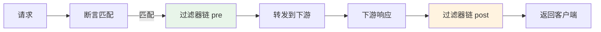

# 过滤器工厂实战

## 课程目标

- 理解过滤器（Filter）在Gateway请求链路中的位置，以及它与断言（Predicate）的分工
- 掌握两种过滤器作用域：路由过滤器（`routes[].filters`）与默认过滤器（`default-filters`）
- 掌握六类最常用的过滤器工厂：请求头类、请求参数类、响应头类、路径类、状态码类、请求头移除类的配置语法
- 理解过滤器执行顺序的排序规则：`order`值、`default-filters`与`routes[].filters`的合并方式、`pre`/`post`两阶段的执行方向
- 完成图书管理系统网关的过滤器实战：请求头注入、路径重写、响应标记、敏感头移除
- 掌握过滤器配置的典型坑点与排查方法


## 回顾与导入

上一节我们掌握了断言工厂：`Path`、`Method`、`Header`、`Query`等断言决定了“一个请求该不该走这条路由”。但断言只回答了“去不去”，没有回答“**去的过程中要不要对请求和响应做加工**”。

来看几个真实的需求：

> **场景一：** 所有经过网关转发到book-product的请求，都需要自动携带`X-Request-Source: gateway`头，方便下游服务识别“请求来自网关”而不是客户端直连。
>
> **场景二：** 客户端调用的是`/api/v1/products/**`，但book-product的实际路径是`/api/products/**`。网关需要在转发前**改写路径**，去掉`/v1`。
>
> **场景三：** 客户端可能在请求中携带`Authorization`头，但book-product自己不做鉴权（由网关统一处理）。网关在转发前**移除**这个敏感头，避免下游服务误用。
>
> **场景四：** 所有经过网关的响应，都需要添加一个`X-Gateway-Processed: true`响应头，便于客户端和监控系统识别“响应经过了网关”。

这些需求的共同点是：**在断言匹配之后、请求转发到下游之前（或响应返回客户端之前），对HTTP消息进行加工**。这正是过滤器（Filter）的职责。




## 过滤器工厂的核心概念

### 过滤器与断言的分工

| 组件                  | 回答的问题                          | 执行时机         |
| --------------------- | ----------------------------------- | ---------------- |
| **断言（Predicate）** | 这个请求**该不该**走这条路由？      | 路由匹配阶段     |
| **过滤器（Filter）**  | 请求/响应在转发过程中**怎么加工**？ | 路由匹配成功之后 |

> **一句话区分：** 断言决定“去不去”，过滤器决定“怎么去、回来时带什么”。

### 两种作用域：路由过滤器与默认过滤器

Gateway的过滤器按作用范围分为两类：

| 类型           | 配置位置                                | 生效范围                 |
| -------------- | --------------------------------------- | ------------------------ |
| **路由过滤器** | `spring.cloud.gateway.routes[].filters` | **只对当前这条路由生效** |
| **默认过滤器** | `spring.cloud.gateway.default-filters`  | **对所有路由生效**       |

**路由过滤器示例：**

```yaml
spring:
  cloud:
    gateway:
      routes:
        - id: book-product-route
          uri: lb://book-product
          predicates:
            - Path=/api/products/**
          filters:
            - AddRequestHeader=X-Request-Source, gateway
            - StripPrefix=0
```

**默认过滤器示例：**

```yaml
spring:
  cloud:
    gateway:
      default-filters:
        - AddResponseHeader=X-Gateway-Processed, true
      routes:
        - id: book-product-route
          uri: lb://book-product
          predicates:
            - Path=/api/products/**
```

> **默认过滤器 ≠ GlobalFilter。** `default-filters`本质上是**路由过滤器的一种批量声明方式**——它会被合并到每条路由的过滤器链中，但仍然是`GatewayFilter`。真正的全局过滤器（`GlobalFilter`）是代码级实现，下一节会讲。默认过滤器的优势是：配置声明，不需要写代码。

### 过滤器执行顺序

过滤器链的排序规则是理解和排查过滤器行为的基础。

**排序依据：** 每个过滤器都有一个`order`值（整数）。`order`值**越小，优先级越高**，在**“pre”阶段越先执行**，在**“post”阶段越后执行**：

| 阶段     | 执行方向              | 示例（order: 默认A=0, 默认B=1, 路由C=0） |
| -------- | --------------------- | ---------------------------------------- |
| **pre**  | `order`小的先执行     | 默认A → 路由C → 默认B                    |
| **post** | `order`小的**后**执行 | 默认B → 路由C → 默认A                    |


## 六类常用过滤器工厂实战

### 请求头类：AddRequestHeader、SetRequestHeader、RemoveRequestHeader

**AddRequestHeader：添加请求头（不覆盖已有值）**

```yaml
filters:
  - AddRequestHeader=X-Request-Source, gateway
  - AddRequestHeader=X-Client-Version, 2.0
```

| 参数       | 说明       |
| ---------- | ---------- |
| 第一个参数 | Header名称 |
| 第二个参数 | Header值   |

> **`AddRequestHeader`与`SetRequestHeader`的区别：** `AddRequestHeader`在Header不存在时添加，存在时**保留原值并追加**；`SetRequestHeader`无论是否存在都**覆盖**为指定值。

**RemoveRequestHeader：移除敏感请求头**

```yaml
filters:
  - RemoveRequestHeader=Authorization
```

**图书系统场景：** book-product不需要直接处理客户端的`Authorization`头，鉴权由网关统一负责，网关在转发前移除它。

### 请求参数类：AddRequestParameter、RemoveRequestParameter

**AddRequestParameter：给请求添加查询参数**

```yaml
filters:
  - AddRequestParameter=from, gateway
```

效果：所有经过该路由的请求，URL中都会带上`?from=gateway`（如果已有其他参数，则追加）。

**RemoveRequestParameter：移除敏感查询参数**

```yaml
filters:
  - RemoveRequestParameter=password
```

> **注意：** 这些参数操作作用于**URL查询参数**，不修改请求体。

### 响应头类：AddResponseHeader

```yaml
filters:
  - AddResponseHeader=X-Gateway-Processed, true
  - AddResponseHeader=X-Gateway-Version, 1.0
```

**图书系统场景：** 为所有经过网关的响应添加`X-Gateway-Processed: true`，便于客户端和监控识别响应经过了网关处理。

> **默认过滤器的典型用途：** `AddResponseHeader`非常适合放在`default-filters`中，让**所有路由**的响应都带上统一的标记，而不需要在每条路由中重复声明。

### 路径类：StripPrefix、PrefixPath、RewritePath

已做介绍，不再展开。

### 状态码类：SetStatus

```yaml
filters:
  - SetStatus=401
```

**图书系统场景：** 对于某些需要“网关层直接拦截”的路由（如内部管理接口），可以在断言匹配后直接用`SetStatus`返回401或403，而不需要转发到下游。

### 过滤器工厂速查表

| 类别     | 过滤器                   | 短写法示例                            | 典型用途             |
| -------- | ------------------------ | ------------------------------------- | -------------------- |
| 请求头   | `AddRequestHeader`       | `AddRequestHeader=X-Source, gateway`  | 注入来源标识、追踪ID |
| 请求头   | `SetRequestHeader`       | `SetRequestHeader=X-Version, 2.0`     | 强制覆盖Header值     |
| 请求头   | `RemoveRequestHeader`    | `RemoveRequestHeader=Authorization`   | 移除敏感头           |
| 请求参数 | `AddRequestParameter`    | `AddRequestParameter=from, gateway`   | 统计来源、传递标记   |
| 请求参数 | `RemoveRequestParameter` | `RemoveRequestParameter=password`     | 移除敏感参数         |
| 响应头   | `AddResponseHeader`      | `AddResponseHeader=X-Processed, true` | 标记网关处理         |
| 路径     | `StripPrefix`            | `StripPrefix=1`                       | 去掉固定前缀         |
| 路径     | `PrefixPath`             | `PrefixPath=/api`                     | 添加固定前缀         |
| 路径     | `RewritePath`            | `RewritePath=/v1/(?<s>.*), /$\{s}`    | 正则重写路径         |
| 状态码   | `SetStatus`              | `SetStatus=401`                       | 网关层直接拦截       |


## 实战一：为book-product路由注入请求头并标记响应

### 目标

所有经过网关转发到book-product的请求，自动携带`X-Request-Source: gateway`请求头；所有响应自动携带`X-Gateway-Processed: true`响应头。

### 配置

```yaml
default-filters:
  - AddResponseHeader=X-Gateway-Processed, true
routes:
  - id: book-product-route
    uri: lb://book-product
    predicates:
      - Path=/api/products/**
    filters:
      - AddRequestHeader=X-Request-Source, gateway
```

**设计说明：** `AddResponseHeader`放在`default-filters`中，对所有路由生效；`AddRequestHeader`放在book-product的路由过滤器中，只对图书服务生效。

### 验证

**验证请求头注入：**

使用Postman确认下游收到的请求头中包含`X-Request-Source`。

**验证响应头标记：**

```http
GET http://localhost:8090/api/products/1
```

查看响应头，应包含：

```
X-Gateway-Processed: true
```

### 思考：如果请求中已经有X-Request-Source会怎样

`AddRequestHeader`在Header**已存在**时不会覆盖，而是**保留原值并追加**。如果客户端伪造了`X-Request-Source: client-direct`，下游可能收到多个值。如果需要强制覆盖，改用`SetRequestHeader`。


## 实战二：路径重写与敏感头移除

### 目标

客户端通过`/api/v1/products/**`访问图书服务，网关去掉`/v1`；同时移除客户端可能携带的`Authorization`头（鉴权由网关后续统一处理）。

### 配置

```yaml
- id: book-product-v1-route
  uri: lb://book-product
  predicates:
    - Path=/api/v1/products/**
  filters:
    - RewritePath=/api/v1/(?<segment>.*), /api/$\{segment}
    - RemoveRequestHeader=Authorization
```

### 验证

| 请求                                                   | 下游收到的路径    | 下游收到的Header  |
| ------------------------------------------------------ | ----------------- | ----------------- |
| `GET /api/v1/products/1`                               | `/api/products/1` | 无`Authorization` |
| `GET /api/v1/products/1` + `Authorization: Bearer xxx` | `/api/products/1` | 无`Authorization` |


## 实战三：使用默认过滤器统一标记所有响应

### 目标

所有经过网关的响应，无论走哪条路由，都携带`X-Gateway-Processed: true`。

### 配置

```yaml
spring:
  cloud:
    gateway:
      default-filters:
        - AddResponseHeader=X-Gateway-Processed, true
```

### 验证

分别通过网关调用book-product、book-user、book-order的接口，检查响应头中是否都包含`X-Gateway-Processed: true`。

> **默认过滤器的价值：** 对于“所有路由都需要”的加工逻辑，`default-filters`避免了在每条路由中重复声明。但它仍然是`GatewayFilter`，只在路由匹配成功后执行——如果请求没有匹配任何路由（404），默认过滤器不会执行。


## 小结

本节课我们学习了：

1. **过滤器与断言的分工**：断言决定“去不去”，过滤器决定“怎么去、回来时带什么”。

2. **两种作用域**：路由过滤器（`routes[].filters`）只对当前路由生效；默认过滤器（`default-filters`）对所有匹配成功的路由生效，但仍然是`GatewayFilter`，不是`GlobalFilter`。

3. **六类常用过滤器工厂**：请求头类（`AddRequestHeader`/`SetRequestHeader`/`RemoveRequestHeader`）、请求参数类（`AddRequestParameter`/`RemoveRequestParameter`）、响应头类（`AddResponseHeader`）、路径类（`StripPrefix`/`PrefixPath`/`RewritePath`）、状态码类（`SetStatus`）。

4. **执行顺序的核心规则**：`order`值越小，`pre`阶段越先执行、`post`阶段越后执行；`default-filters`排在`routes[].filters`之前；路径过滤器应排在`lb()`之前。

5. **图书系统实战**：请求头注入（`X-Request-Source`）、响应标记（`X-Gateway-Processed`）、路径重写（去掉`/v1`）、敏感头移除（`Authorization`）。

   


## 作业

### 作业一：完成请求头注入与响应标记

1. 按实战一的配置，为book-product路由添加`AddRequestHeader=X-Request-Source, gateway`，并在`default-filters`中添加`AddResponseHeader=X-Gateway-Processed, true`。
2. 通过网关调用`/api/products/1`，确认响应头中包含`X-Gateway-Processed: true`。
3. 在book-product中临时添加一个回显请求头的接口，确认下游收到了`X-Request-Source: gateway`。
4. 截图响应头和下游回显结果。

### 作业二：完成路径重写与敏感头移除

1. 添加一条路由：`Path=/api/v1/products/**`，`RewritePath=/api/v1/(?<segment>.*), /api/$\{segment}`，`RemoveRequestHeader=Authorization`。
2. 通过`GET /api/v1/products/1`调用，验证返回图书数据。
3. 携带`Authorization: Bearer test`调用，验证book-product没有收到该Header（通过回显接口或日志确认）。
4. 截图调用结果和Header验证。

### 作业三：验证默认过滤器的覆盖范围

1. 确认`default-filters`中只有`AddResponseHeader=X-Gateway-Processed, true`。
2. 分别通过网关调用book-product、book-user、book-order的接口，检查三个响应是否都带有该Header。
3. 调用一个**不存在的路径**（如`/api/unknown/1`），检查404响应是否带有该Header。
4. 解释为什么404响应不带默认过滤器的标记。
