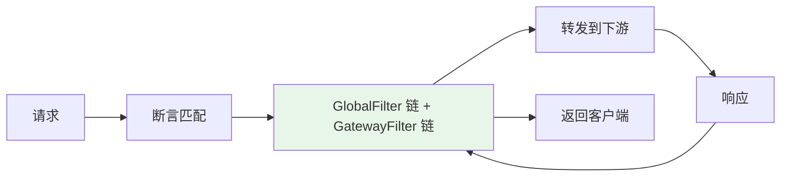
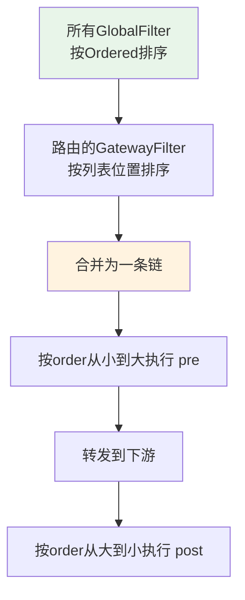
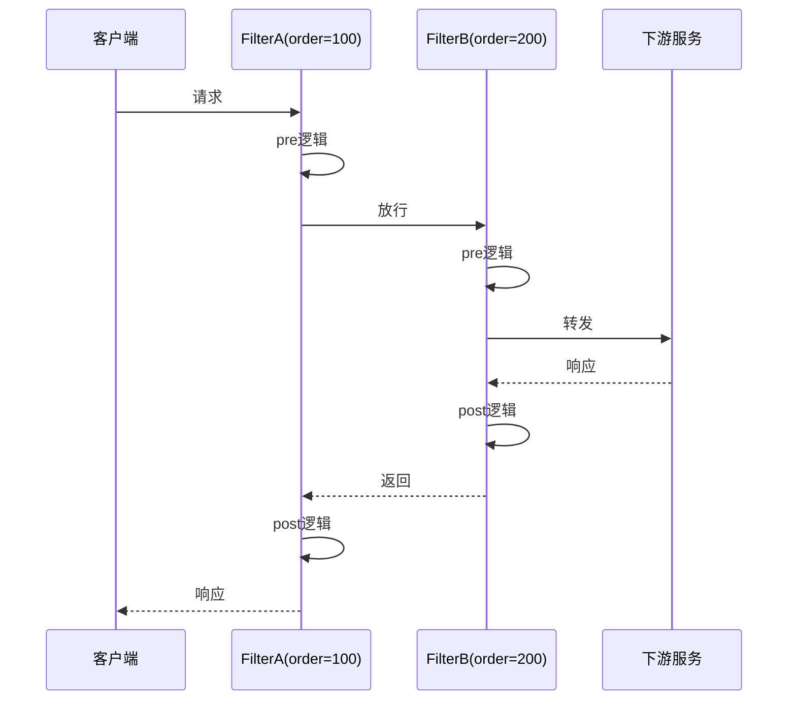

# 自定义全局过滤器实战

## 课程目标

- 理解`GlobalFilter`与`GatewayFilter`的本质区别，明确什么时候必须用全局过滤器
- 掌握`GlobalFilter`接口的方法签名与响应式编程模型：`Mono<Void>`、`chain.filter()`、`exchange`
- 掌握`Ordered`接口与`@Order`注解控制过滤器执行顺序的方法
- 完成两个生产级全局过滤器的实战：请求日志记录、请求耗时统计
- 掌握`ServerWebExchange`的常用方法：读写请求头、设置响应头、传递属性
- 理解全局过滤器在鉴权、限流等横切逻辑中的定位，为后续实现限流、降级等操作打好基础


## 回顾与导入

上一节我们掌握了内置过滤器工厂：`AddRequestHeader`、`RewritePath`、`AddResponseHeader`等。这些过滤器通过**配置**声明，能覆盖大部分“对请求/响应做简单加工”的场景。但它们有两个根本局限：

> **场景一：** 需要记录**每一个请求**的完整信息——路径、方法、客户端IP、响应状态码、耗时。用`default-filters`配置一个`AddRequestHeader`做不到“记录日志”这种**带逻辑**的操作，因为内置过滤器都是“固定的动作”，没有“读取请求 → 判断 → 输出日志”的能力。
>
> **场景二：** 需要统计耗时并写入响应头。这个动作需要在请求**发出前**记录开始时间，在响应**返回后**计算差值。配置式的过滤器只能在某个固定阶段做固定的事，无法跨越“pre”和“post”两个阶段。
>
> **场景三：** 需要在请求没有匹配任何路由时（404）也记录一条日志。上一级已经讲到过：`default-filters`只在路由匹配成功后生效，404请求不会经过任何`GatewayFilter`。

这些需求都需要**代码级**的过滤器，且必须对**所有请求**（包括未匹配路由的）生效。这正是`GlobalFilter`的用武之地。




## GlobalFilter与GatewayFilter的核心区别

### 两者的本质差异

| 维度             | `GatewayFilter`                                  | `GlobalFilter`                                               |
| ---------------- | ------------------------------------------------ | ------------------------------------------------------------ |
| **声明方式**     | 配置式（`filters`或`default-filters`）           | **代码式**（实现接口，注册为Bean）                           |
| **生效范围**     | 路由过滤器：单条路由；默认过滤器：匹配成功的路由 | **所有经过网关的请求**，包括未匹配路由的请求                 |
| **能力边界**     | 固定的内置动作（加Header、重写路径等）           | 任意逻辑（读写请求/响应、调用外部服务、统计、中断）          |
| **跨阶段能力**   | 单阶段（pre或post之一）                          | **可以同时覆盖pre和post**（通过`chain.filter().then()`或`doFinally`） |
| **执行顺序控制** | 通过列表位置或`order`                            | 通过`Ordered`接口或`@Order`注解                              |
| **典型场景**     | 路径重写、Header增删、响应标记                   | 请求日志、耗时统计、鉴权、限流、链路追踪                     |

> **一句话区分：** `GatewayFilter`是“配置能做的事”，`GlobalFilter`是“代码才能做的事”。当需求需要读取请求内容、做条件判断、跨阶段统计、或对404也生效时，必须用`GlobalFilter`。

### 两者的合并执行

在一次请求的处理中，`GlobalFilter`和`GatewayFilter`会被合并成一个**统一的过滤器链**，按`order`值排序后依次执行：



> **合并规则：** 当一个请求匹配到某条路由时，Gateway会把**所有`GlobalFilter`**和**该路由的所有`GatewayFilter`**（包括`default-filters`）合并，按`order`排序后执行。`GlobalFilter`不因为“是全局的”就排在前面或后面——排序完全由`order`决定。


## GlobalFilter接口与响应式编程模型

### 接口签名

```java
public interface GlobalFilter {
    Mono<Void> filter(ServerWebExchange exchange, GatewayFilterChain chain);
}
```

| 参数/返回值          | 说明                                                         |
| -------------------- | ------------------------------------------------------------ |
| `ServerWebExchange`  | 当前请求-响应的上下文，包含请求、响应、属性、会话等          |
| `GatewayFilterChain` | 过滤器链，调用`chain.filter(exchange)`表示“放行，执行下一个过滤器” |
| `Mono<Void>`         | 响应式结果，表示“异步完成，无返回值”                         |

### 三个关键操作

**放行（继续执行链）：**

```java
return chain.filter(exchange);
```

**中断（不再执行后续过滤器，直接返回响应）：**

```java
exchange.getResponse().setStatusCode(HttpStatus.UNAUTHORIZED);
return exchange.getResponse().setComplete();
```

> **中断的典型场景：** 鉴权失败、限流拒绝、参数校验不通过。

**在放行前后做加工（pre + post）：**

```java
// pre：请求转发前
long start = System.currentTimeMillis();
exchange.getAttributes().put("startTime", start);

// 放行，并在响应完成后执行 post
return chain.filter(exchange).then(Mono.fromRunnable(() -> {
    Long startTime = exchange.getAttribute("startTime");
    long cost = System.currentTimeMillis() - startTime;
    // post：响应返回后
}));
```

### ServerWebExchange的常用方法

| 方法                            | 作用                                          |
| ------------------------------- | --------------------------------------------- |
| `getRequest()`                  | 获取请求对象（`ServerHttpRequest`）           |
| `getResponse()`                 | 获取响应对象（`ServerHttpResponse`）          |
| `getAttributes()`               | 获取请求级别的属性Map，用于在过滤器间传递数据 |
| `getRequest().getPath()`        | 请求路径                                      |
| `getRequest().getMethod()`      | 请求方法                                      |
| `getRequest().getHeaders()`     | 请求头                                        |
| `getResponse().getHeaders()`    | 响应头（可在转发前或响应后修改）              |
| `getResponse().setStatusCode()` | 设置响应状态码                                |

> **`getAttributes()`是跨过滤器传值的核心。** 一个过滤器在`pre`阶段写入，后续过滤器或`post`阶段读取。


## 实战一：请求日志全局过滤器

### 目标

记录每一个经过网关的请求：请求方法、路径、客户端IP、响应状态码、耗时。日志格式统一，便于后续接入日志分析系统。

### 实现

```java
@Slf4j
@Component
public class RequestLogGlobalFilter implements GlobalFilter, Ordered {

    @Override
    public Mono<Void> filter(ServerWebExchange exchange, GatewayFilterChain chain) {
        ServerHttpRequest request = exchange.getRequest();
        String method = request.getMethod().name();
        String path = request.getPath().value();
        long start = System.currentTimeMillis();

        log.info("[网关请求] {} {}", method, path);

        return chain.filter(exchange).doFinally(signalType -> {
            long cost = System.currentTimeMillis() - start;
            Integer status = exchange.getResponse().getStatusCode().value();
            log.info("[网关响应] {} {} 状态码={} 耗时={}ms 完成信号={}",
                    method, path, status, cost, signalType);
        });
    }

    @Override
    public int getOrder() {
        return Ordered.HIGHEST_PRECEDENCE + 100;
    }
}
```

### 关键设计点

| 设计点                                     | 说明                                                         |
| ------------------------------------------ | ------------------------------------------------------------ |
| `doFinally`                                | 无论请求成功、异常还是被取消，都会执行。这是记录耗时和状态码的**正确姿势**——`then`只在成功时执行，异常时不会触发 |
| `getOrder()`返回`HIGHEST_PRECEDENCE + 100` | 日志过滤器应**尽早执行**（pre阶段最早），这样它记录的耗时覆盖了几乎所有后续处理 |
| `signalType`                               | `doFinally`的参数，表示完成信号类型（`ON_COMPLETE`、`ON_ERROR`、`CANCEL`），可用于区分正常完成和异常 |

### 验证

通过网关调用任意接口：

```http
GET http://localhost:8090/api/products/1
```

**控制台日志：**

```
[网关请求] GET /api/products/1
[网关响应] GET /api/products/1 状态码=200 耗时=45ms 完成信号=onComplete
```


## 实战二：请求耗时统计全局过滤器

### 目标

统计每个请求的耗时，并根据耗时分级：

| 耗时范围       | 级别     | 处理                                              |
| -------------- | -------- | ------------------------------------------------- |
| < 200ms        | 正常     | 仅记录DEBUG日志                                   |
| 200ms ~ 1000ms | 慢请求   | 记录WARN日志                                      |
| > 1000ms       | 极慢请求 | 记录ERROR日志，并添加响应头`X-Slow-Request: true` |

### 实现

```java
@Slf4j
@Component
public class RequestCostGlobalFilter implements GlobalFilter, Ordered {

    private static final String START_TIME_ATTR = "requestStartTime";
    private static final long SLOW_THRESHOLD_MS = 200L;
    private static final long VERY_SLOW_THRESHOLD_MS = 1000L;

    @Override
    public Mono<Void> filter(ServerWebExchange exchange, GatewayFilterChain chain) {
        exchange.getAttributes().put(START_TIME_ATTR, System.currentTimeMillis());

        return chain.filter(exchange).doFinally(signalType -> {
            Long start = exchange.getAttribute(START_TIME_ATTR);
            long cost = System.currentTimeMillis() - start;
            ServerHttpRequest request = exchange.getRequest();
            String path = request.getPath().value();
            String method = request.getMethod().name();

            if (cost > VERY_SLOW_THRESHOLD_MS) {
                log.error("[极慢请求] {} {} 耗时={}ms", method, path, cost);
                // 修改响应头
                exchange.getResponse().beforeCommit(() -> {
                    exchange.getResponse().getHeaders().add("X-Slow-Request", "true");
                    return Mono.empty();
                });
            } else if (cost > SLOW_THRESHOLD_MS) {
                log.warn("[慢请求] {} {} 耗时={}ms", method, path, cost);
            } else {
                log.debug("[正常请求] {} {} 耗时={}ms", method, path, cost);
            }
        });
    }

    @Override
    public int getOrder() {
        return Ordered.HIGHEST_PRECEDENCE + 200;
    }
}
```

### 关键设计点

| 设计点                                       | 说明                                                         |
| -------------------------------------------- | ------------------------------------------------------------ |
| 用`getAttributes()`存储开始时间              | 属性在`pre`阶段写入，`post`阶段读取，实现跨阶段数据传递      |
| `getOrder()`返回`HIGHEST_PRECEDENCE + 200`   | 排在日志过滤器之后（日志过滤器是+100），这样日志过滤器记录的耗时包含本过滤器的全部执行时间 |
| 使用`beforeCommit`确保在响应真正提交前修改头 | 极慢请求还要添加响应头，`doFinally`中修改响应头在响应已提交后可能无效，需注意时机 |

### 验证

**验证正常耗时：** 调用`/api/products/1`，日志中应输出DEBUG级别的`[正常请求]`。

**验证慢请求：** 在book-product的某个接口中人为添加`Thread.sleep(500)`，调用后日志输出WARN级别的`[慢请求]`。

**验证极慢请求：** 添加`Thread.sleep(1500)`，调用后日志输出ERROR级别的`[极慢请求]`，并检查响应头中是否有`X-Slow-Request: true`（如果不生效，说明响应已提交，属预期行为）。


## 全局过滤器的执行顺序控制

### Ordered接口与@Order注解

```java
// 方式一：实现Ordered接口
@Component
public class FilterA implements GlobalFilter, Ordered {
    @Override
    public int getOrder() {
        return 100;
    }
}

// 方式二：@Order注解
@Component
@Order(200)
public class FilterB implements GlobalFilter {
}
```

两种方式等价，`@Order`注解的优先级略高于`Ordered`接口（如果同时存在，`@Order`生效）。**建议统一使用`Ordered`接口**，因为`getOrder()`方法更显式，且在Spring Cloud Gateway的文档中，`Ordered`是官方推荐的方式。

### 常用Order值参考

| Order值                                             | 典型用途                       |
| --------------------------------------------------- | ------------------------------ |
| `Ordered.HIGHEST_PRECEDENCE`（`Integer.MIN_VALUE`） | 最前置的过滤器，如TraceId注入  |
| `HIGHEST_PRECEDENCE + 100`                          | 请求日志（尽早记录）           |
| `HIGHEST_PRECEDENCE + 200`                          | 耗时统计（在日志之后）         |
| `0`（默认）                                         | 普通过滤器                     |
| `Ordered.LOWEST_PRECEDENCE`（`Integer.MAX_VALUE`）  | 最后置的过滤器，如响应最终加工 |

### 两个过滤器的pre/post执行顺序

假设FilterA的order=100，FilterB的order=200：



| 阶段 | 执行顺序                            |
| ---- | ----------------------------------- |
| pre  | A（100）→ B（200），order小的先执行 |
| post | B（200）→ A（100），order大的先执行 |

> **记忆方式：** 与上一节一致——`pre`像进门，order小的先进；`post`像出门，order小的后出。日志过滤器（order=100）的`doFinally`会在耗时过滤器（order=200）的`doFinally`**之后**执行，因此日志中记录的耗时包含了耗时过滤器的全部执行时间。


## 注意事项

1. **`GlobalFilter`对所有请求生效，包括404请求**：这是它相对`default-filters`的核心优势，但也要注意——日志过滤器会对所有请求打日志，高频扫描请求可能产生大量日志，需要评估日志量。

2. **必须调用`chain.filter(exchange)`才能放行**：不调用会中断请求；调用后返回的Mono是后续链的执行结果，不能吞掉。

3. **记录耗时用`doFinally`而非`then`**：`then`只在成功时执行，异常和取消时不会触发；`doFinally`覆盖所有完成信号。

4. **`getAttributes()`是跨过滤器传值的唯一正确方式**：不要在过滤器之间用静态变量或ThreadLocal传递数据，响应式模型下线程可能切换。

5. **order值决定一切**：不要假设“全局过滤器一定先于路由过滤器执行”，排序只看order。需要精确控制时，显式设置order。

6. **响应式编程不要阻塞**：过滤器中不要做阻塞IO（如JDBC查询、同步HTTP调用），会阻塞Netty的事件循环。需要调用外部服务时，使用响应式客户端（`WebClient`）或提交到弹性线程池。

   


## 小结

本节课我们学习了：

1. **`GlobalFilter`与`GatewayFilter`的本质区别**：配置式 vs 代码式；单路由 vs 所有请求；固定动作 vs 任意逻辑；单阶段 vs 跨阶段。

2. **`GlobalFilter`接口的三要素**：`ServerWebExchange`（上下文）、`GatewayFilterChain`（放行）、`Mono<Void>`（异步结果）。

3. **三个关键操作**：放行（`chain.filter`）、中断（`setComplete`）、pre+post（`chain.filter().then()`或`doFinally`）。

4. **`ServerWebExchange`的常用方法**：读写请求/响应、`getAttributes()`跨过滤器传值。

5. **请求日志全局过滤器**：记录方法、路径、客户端IP、状态码、耗时；用`doFinally`确保异常时也记录；`getOrder()`靠前执行。

6. **耗时统计全局过滤器**：用`getAttributes()`存开始时间；按耗时分级输出日志；响应头修改注意提交时机。

7. **执行顺序控制**：`Ordered`接口或`@Order`注解；`pre`阶段order小的先执行，`post`阶段order大的先执行。

   


## 作业

### 作业一：完成请求日志全局过滤器

1. 按实战一实现`RequestLogGlobalFilter`，记录请求方法、路径、响应状态码、耗时。
2. 通过网关调用book-product、book-user、book-order的正常接口，验证日志输出。
3. 调用一个不存在的路径（404），验证日志是否同样输出——这是`GlobalFilter`相对`default-filters`的关键优势。
4. 截图正常请求和404请求的日志。

### 作业二：完成耗时统计全局过滤器

1. 按实战二实现`RequestCostGlobalFilter`，按耗时分级输出日志。
2. 在book-product的某个接口中人为添加`Thread.sleep(500)`，调用后验证WARN级别的`[慢请求]`日志。
3. 添加`Thread.sleep(1500)`，验证ERROR级别的`[极慢请求]`日志。

### 作业三：验证过滤器执行顺序

1. 创建两个简单的全局过滤器`FilterA`（order=100）和`FilterB`（order=200），在`pre`和`post`阶段分别打印日志。
2. 调用任意接口，记录日志中`FilterA`和`FilterB`在pre和post阶段的输出顺序。
3. 将两个过滤器的order值互换，再次验证。
4. 制作执行顺序表格，验证“pre阶段order小的先执行，post阶段order大的先执行”。
