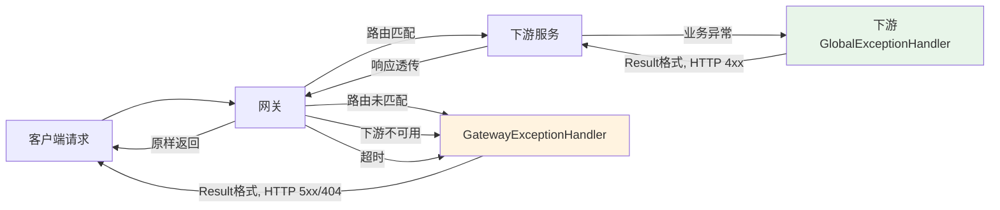

# Gateway全局异常处理

## 课程目标

- 理解Gateway基于WebFlux的异常处理模型，以及它与Spring MVC `@RestControllerAdvice`的根本差异
- 掌握网关层常见异常的来源与分类：路由未匹配、下游不可用、超时、过滤器异常、断言/过滤器配置错误
- 掌握`ErrorWebExceptionHandler`接口的注册方法与响应式返回模型
- 完成book-gateway全局异常处理器的实现，将各类异常统一转换为`Result`格式响应
- 掌握HTTP状态码与业务状态码的双层映射策略
- 理解网关异常处理与服务端异常处理的分工，避免“网关把下游的错误响应也改写”


## 回顾与导入

到目前为止我们完成了Gateway的路由、断言、过滤器和自定义全局过滤器。正常请求的链路已经打通：客户端 → 网关 → 后端服务 → 网关 → 客户端。

但异常请求的结果是Spring Boot WebFlux的默认错误响应：

```java
{
  "timestamp": "2026-11-21T10:30:00.123+00:00",
  "path": "/api/user/123",
  "status": 500,
  "error": "Internal Server Error",
  "message": "Failed to handle request [GET http://localhost:8080/api/user/123]",
  "requestId": "0204dca5-1"
}
```

**字段结构、错误信息格式，都与commm模块中定义的`Result`完全不同**。我们希望的结果是：`Result`格式，`code=500`，`message`不暴露内部细节。前端如果按`Result`的`code`/`message`字段解析，遇到网关异常时会解析失败。

本节的目标是：**让网关返回的错误响应，与后端服务的`Result`格式保持一致**，前端只需要一套解析逻辑。


## Gateway异常处理的核心差异

### 为什么不能直接用@RestControllerAdvice

Spring Boot课程中所介绍的`GlobalExceptionHandler`使用`@RestControllerAdvice` + `@ExceptionHandler`。这套机制在Spring MVC中工作良好，但在Gateway中**完全不生效**：

| 维度                    | Spring MVC（book-product等）                     | Spring Cloud Gateway                      |
| ----------------------- | ------------------------------------------------ | ----------------------------------------- |
| 编程模型                | 同步阻塞（Servlet）                              | **响应式（WebFlux + Netty）**             |
| 异常处理入口            | `DispatcherServlet` + `HandlerExceptionResolver` | `WebHandler` + `ErrorWebExceptionHandler` |
| `@RestControllerAdvice` | 生效                                             | **不生效**                                |
| 返回类型                | 直接返回对象                                     | `Mono<Void>` + 手动写响应体               |

> **根本原因：** Gateway基于WebFlux，请求处理链是响应式的。`@RestControllerAdvice`依赖Spring MVC的`HandlerExceptionResolver`体系，而Gateway的`DispatcherHandler`使用的是`WebExceptionHandler`体系，两者不通用。在Gateway中添加`@RestControllerAdvice`，不会拦截任何网关异常。

### ErrorWebExceptionHandler的定位

WebFlux的异常处理有两级：

| 处理器                         | 作用范围                                       |
| ------------------------------ | ---------------------------------------------- |
| `WebExceptionHandler`          | 局部，注册在`WebHandler`链中                   |
| **`ErrorWebExceptionHandler`** | **全局，兜底处理所有未被前面处理器消费的异常** |

Spring Boot为WebFlux自动配置了`DefaultErrorWebExceptionHandler`。我们可以**覆盖它**，用自己的实现替换。

### 网关异常的来源分类

在实现之前，先明确网关会抛出哪些异常：

| 异常来源                | 典型异常类                                           | 场景                              |
| ----------------------- | ---------------------------------------------------- | --------------------------------- |
| **路由未匹配**          | `ResponseStatusException`（404）                     | 请求路径不匹配任何路由            |
| **下游服务不可用**      | `NotFoundException`（Spring Cloud LoadBalancer）     | `lb://book-product`找不到任何实例 |
| **下游超时**            | `TimeoutException`、`ResponseStatusException`（504） | 后端服务响应超时                  |
| **下游返回错误状态**    | 无异常（响应透传）                                   | 后端返回4xx/5xx，网关默认透传     |
| **过滤器异常**          | 自定义`RuntimeException`                             | 全局过滤器中抛出未捕获异常        |
| **断言/过滤器配置错误** | `IllegalArgumentException`、`PatternSyntaxException` | 启动或首次请求时暴露              |


## 实战一：实现Gateway全局异常处理器

### 响应体的构造

网关是WebFlux的，不能直接用`Result`对象返回（需要序列化后写入响应体）。这里直接复用`book-common`中的`Result`结构，手动序列化：

```java
@Slf4j
@Component
@Order(Ordered.HIGHEST_PRECEDENCE)
@RequiredArgsConstructor
public class GatewayExceptionHandler implements ErrorWebExceptionHandler {

    private final ObjectMapper objectMapper;

    @Override
    public Mono<Void> handle(ServerWebExchange exchange, Throwable ex) {
        ServerHttpResponse response = exchange.getResponse();

        // 如果响应已提交（如流式响应已开始），无法再写错误体，直接返回
        if (response.isCommitted()) {
            log.warn("[网关异常] 响应已提交，无法处理异常: {}", ex.getMessage());
            return Mono.error(ex);
        }

        String path = exchange.getRequest().getPath().value();
        HttpStatus httpStatus;
        Integer code;
        String message;

        // ==================== 1. 路由未匹配（404） ====================
        if (ex instanceof ResponseStatusException rse
                && rse.getStatusCode().value() == 404) {
            httpStatus = HttpStatus.NOT_FOUND;
            code = ResultCode.NOT_FOUND.getCode();
            message = "请求的资源不存在: " + path;

        // ==================== 2. 下游服务不可用（503） ====================
        } else if (ex instanceof org.springframework.cloud.gateway.support.NotFoundException) {
            httpStatus = HttpStatus.SERVICE_UNAVAILABLE;
            code = ResultCode.SERVICE_UNAVAILABLE.getCode();
            message = "下游服务暂时不可用，请稍后重试";

        // ==================== 3. 下游超时（504） ====================
        } else if (ex instanceof TimeoutException
                || ex.getCause() instanceof TimeoutException) {
            httpStatus = HttpStatus.GATEWAY_TIMEOUT;
            code = 504;
            message = "下游服务响应超时，请稍后重试";

        // ==================== 4. 其他未预期异常（500） ====================
        } else {
            httpStatus = HttpStatus.INTERNAL_SERVER_ERROR;
            code = ResultCode.INTERNAL_ERROR.getCode();
            message = "网关内部错误，请稍后重试";
            log.error("[网关异常] 未预期异常，path={}", path, ex);
        }

        log.warn("[网关异常] path={}, status={}, message={}", path, httpStatus.value(), message);

        // 写响应
        response.setStatusCode(httpStatus);
        response.getHeaders().setContentType(MediaType.APPLICATION_JSON);

        Result<Void> body = Result.error(code, message);
        byte[] bytes;
        try {
            bytes = objectMapper.writeValueAsBytes(body);
        } catch (Exception e) {
            bytes = ("{\"code\":" + code + ",\"message\":\"" + message + "\"}").getBytes(StandardCharsets.UTF_8);
        }

        DataBuffer buffer = response.bufferFactory().wrap(bytes);
        return response.writeWith(Mono.just(buffer));
    }
}
```

### 关键设计点

| 设计点                               | 说明                                                         |
| ------------------------------------ | ------------------------------------------------------------ |
| `@Order(Ordered.HIGHEST_PRECEDENCE)` | 排在Spring Boot自动配置的`DefaultErrorWebExceptionHandler`**之前**，优先处理异常；否则默认处理器会先消费异常 |
| `response.isCommitted()`判断         | 如果响应已经开始写入，无法再修改状态码和响应体，只能把异常继续抛出 |
| 异常分类映射                         | 按异常类型映射到不同的HTTP状态码和业务状态码，消息对用户友好、不暴露内部细节 |
| `Result.error(code, message)`        | 复用`book-common`的统一响应结构；`data`为`null`，前端解析方式与后端一致 |
| 500异常记录堆栈                      | 未预期异常必须记录完整堆栈，便于排查；对外只返回通用消息，不暴露内部信息 |

### 关键类的依赖说明

| 类                                                           | 来源                          | 说明                    |
| ------------------------------------------------------------ | ----------------------------- | ----------------------- |
| `ErrorWebExceptionHandler`                                   | `spring-boot-starter-webflux` | Gateway已传递引入       |
| `org.springframework.cloud.gateway.support.NotFoundException` | Gateway                       | `lb://`找不到实例时抛出 |
| `ResultCode`、`Result`                                       | `book-common`                 | 已定义                  |
| `ObjectMapper`                                               | Spring Boot自动配置           | 直接注入                |


## 实战二：处理ExceptionHandler的冲突

先做一个测试，执行：

```http
GET http://localhost:8090/api/products/1
```

返回：

```JSON
{
  "code": 500,
  "message": "系统内部错误，请稍后重试",
  "timestamp": 1795239224056
}
```

**网关进程里意外注册了`GlobalExceptionHandler`这个`@RestControllerAdvice`，它抢先消费了`NotFoundException`，导致`GatewayExceptionHandler`没有机会处理。**

### 为什么会出现这个现象

`GlobalExceptionHandler`位于`book-common`，类上标注了`@RestControllerAdvice`。如果`book-gateway`的启动类使用了`scanBasePackages = "com.example"`，`book-common`就会被扫描到，`GlobalExceptionHandler`被注册为一个**普通的Spring Bean**。

在WebFlux环境下，`@RestControllerAdvice`虽然不能像在Spring MVC中那样通过`HandlerExceptionResolver`工作，但Spring Boot的WebFlux自动配置会把它识别为一个`WebExceptionHandler`（通过`WebFluxConfigurer`或`ControllerAdviceBean`机制），从而**排在`GatewayExceptionHandler`之后或之前参与异常处理**。从你的日志看，`GlobalExceptionHandler`的`handleException`先执行了，返回了500的`Result`，而`GatewayExceptionHandler`的503分支根本没有走到。

日志中的关键证据：

```
c.e.c.handler.GlobalExceptionHandler : 系统异常
org.springframework.cloud.gateway.support.NotFoundException: 503 SERVICE_UNAVAILABLE
...
[网关响应] GET /api/products/1 状态码=500
```

`NotFoundException`（本应映射为503）被`GlobalExceptionHandler`的`Exception.class`分支兜住，返回了500。

### 两种处理方案

#### 方案一：网关的启动类不扫描`com.example`

这是最干净的做法。`book-gateway`**不应该**依赖`book-common`的`@RestControllerAdvice`，因为网关是WebFlux，业务服务的异常处理体系对它没有意义。

**修改`BookGatewayApplication`：**

```java
@SpringBootApplication(scanBasePackages = "com.example.gateway")
@EnableDiscoveryClient
public class BookGatewayApplication {
    public static void main(String[] args) {
        SpringApplication.run(BookGatewayApplication.class, args);
    }
}
```

同时确认`book-gateway`的`pom.xml`中对`book-common`的依赖是否必要。如果网关只需要`Result`和`ResultCode`（用于`GatewayExceptionHandler`构造响应体），可以保留依赖，但**扫描范围必须排除`com.example.common.handler`**。

如果确实需要扫描`com.example`（例如网关也要用`book-common`中的其他Bean），可以在启动类上排除`GlobalExceptionHandler`。

> **注意：** `@SpringBootApplication`的`exclude`属性用于排除**自动配置类**，不能直接排除普通`@Component`。排除普通Bean的正确方式是通过`@ComponentScan`的`excludeFilters`：

```java
@SpringBootApplication
@ComponentScan(
    basePackages = "com.example",
    excludeFilters = @ComponentScan.Filter(
        type = FilterType.ASSIGNABLE_TYPE,
        classes = GlobalExceptionHandler.class
    )
)
@EnableDiscoveryClient
public class BookGatewayApplication { ... }
```

#### 方案二：让`GlobalExceptionHandler`只在Servlet环境生效

在`GlobalExceptionHandler`上添加条件注解，让它**只在WebApplicationType.SERVLET（即Spring MVC）环境下注册**：

```java
@Slf4j
@RestControllerAdvice
@ConditionalOnWebApplication(type = ConditionalOnWebApplication.Type.SERVLET)
public class GlobalExceptionHandler {
    // ...
}
```

这样：

| 模块                                  | WebApplicationType | `GlobalExceptionHandler`是否注册 |
| ------------------------------------- | ------------------ | -------------------------------- |
| book-product / book-user / book-order | SERVLET            | **是**                           |
| book-gateway                          | REACTIVE           | **否**                           |

> **这是最优雅的方案**：一处修改，所有Servlet服务继续生效，网关自动排除。不需要改网关的扫描范围，也不需要维护排除列表。`book-common`作为公共模块，本就不应该把Servlet专用的异常处理器强加给WebFlux模块。

### 推荐选择

**首选方案二**：在`GlobalExceptionHandler`上加`@ConditionalOnWebApplication(type = ConditionalOnWebApplication.Type.SERVLET)`。

**如果不想改`book-common`**（例如它被其他团队共用），则采用方案一的变体：在网关启动类上用`@ComponentScan`的`excludeFilters`排除`GlobalExceptionHandler`。


## 验证

修改后，重新触发503场景：

```http
GET http://localhost:8080/api/products/1
```

**预期日志：**

```
[网关异常] path=/api/products/1, status=503, message=下游服务暂时不可用，请稍后重试
```

**预期响应：**

```json
{
  "code": 503,
  "message": "下游服务暂时不可用，请稍后重试",
  "timestamp": 1762934400000
}
```

**HTTP状态码：** 503（不再是500）。

同时确认`GlobalExceptionHandler`的日志不再出现在网关进程中——它只在book-product、book-user、book-order的日志中出现。


### 验证一：404 路由未匹配

```http
GET http://localhost:8090/api/unknown/1
```

**预期响应：**

```json
{
  "code": 404,
  "message": "请求的资源不存在: /api/unknown/1",
  "timestamp": 1762934400000
}
```

**HTTP状态码：** 404。

### 验证二：503 下游服务不可用

停止book-product的所有实例，调用：

```http
GET http://localhost:8090/api/products/1
```

**预期响应：**

```json
{
  "code": 503,
  "message": "下游服务暂时不可用，请稍后重试",
  "timestamp": 1762934400000
}
```

**HTTP状态码：** 503。

> **观察日志：** 网关控制台中应输出`[网关异常] path=/api/products/1, status=503`。

### 验证三：504 下游超时

在book-product的接口中人为添加`Thread.sleep(15000)`，并在网关的`lb://`调用中配置较短的超时（Gateway默认的`HttpClient`超时可以通过`spring.cloud.gateway.httpclient.response-timeout`配置）：

```yaml
spring:
  cloud:
    gateway:
      server:
        webflux:
          httpclient:
            response-timeout: 3s
```

调用该接口，预期在3秒后返回：

```json
{
  "code": 504,
  "message": "下游服务响应超时，请稍后重试",
  "timestamp": 1762934400000
}
```

**HTTP状态码：** 504。

### 验证四：500 过滤器异常

在上一节的`RequestLogGlobalFilter`中临时添加一行故意抛异常的代码：

```java
if (request.getPath().value().contains("boom")) {
    throw new RuntimeException("测试异常");
}
```

调用：

```http
GET http://localhost:8090/api/products/boom
```

**预期响应：**

```json
{
  "code": 500,
  "message": "网关内部错误，请稍后重试",
  "timestamp": 1762934400000
}
```

**HTTP状态码：** 500。

**日志：** 网关控制台应输出完整的异常堆栈（因为500级别的异常需要排查根因）。

### 验证五：下游服务返回错误，网关透传

让book-product返回一个业务异常（如查询不存在的图书）：

```http
GET http://localhost:8080/api/products/999
```

**预期响应：** book-product的`GlobalExceptionHandler`返回的`Result`格式，**HTTP状态码由book-product决定**（如400或404），网关**原样透传**，不会改写。

> **关键区分：** 这是“下游返回错误状态”，不是“网关异常”。网关的`GatewayExceptionHandler`不会拦截这类响应——下游的`Result`已经是统一格式，网关只需要透传。如果网关试图“统一改写下游响应”，会破坏下游服务的错误语义（如book-order返回的业务错误码1004“库存不足”，会被网关改成500），这是**错误的做法**。

与下游异常的边界



| 场景                | 由谁处理                        | 是否改写     |
| ------------------- | ------------------------------- | ------------ |
| 下游业务异常        | 下游的`GlobalExceptionHandler`  | 网关**透传** |
| 网关路由未匹配      | 网关的`GatewayExceptionHandler` | 网关**生成** |
| 下游服务不可达/超时 | 网关的`GatewayExceptionHandler` | 网关**生成** |
| 网关自身过滤器异常  | 网关的`GatewayExceptionHandler` | 网关**生成** |


## 小结

本节课我们学习了：

1. **Gateway异常处理与Spring MVC的根本差异**：WebFlux响应式模型下，`@RestControllerAdvice`不生效，必须使用`ErrorWebExceptionHandler`。

2. **网关异常的来源分类**：路由未匹配（404）、下游服务不可用（503）、下游超时（504）、过滤器异常（500）、下游返回错误状态（网关透传）。

3. **`ErrorWebExceptionHandler`的实现要点**：`@Order(HIGHEST_PRECEDENCE)`排在默认处理器之前；`response.isCommitted()`判断；异常分类映射；写响应体。

4. **响应体构造**：复用`book-common`的`Result`结构，手动序列化后写入`DataBuffer`。

5. **网关异常与下游异常的边界**：网关只处理“网关自身产生的异常”，不改写下游的响应——否则会破坏下游的业务错误语义。

   


## 作业

### 作业一：实现网关全局异常处理器

1. 在`book-gateway`中创建`GatewayExceptionHandler`，实现`ErrorWebExceptionHandler`接口，`@Order(Ordered.HIGHEST_PRECEDENCE)`。
2. 实现异常分类映射：404、503、504、500四类。
3. 复用`book-common`的`Result`和`ResultCode`，构造统一响应体。
4. 调用不存在的路径，验证返回的JSON格式与`Result`一致，HTTP状态码为404。
5. 截图响应结果。

### 作业二：验证下游服务不可用与超时

1. 停止book-product所有实例，通过网关调用`/api/products/1`，验证返回503和统一格式。
2. 在book-product的接口中添加`Thread.sleep(15000)`，配置网关的`response-timeout: 3s`，调用后验证返回504和统一格式。
3. 在两个场景下，截图网关的异常日志和返回给客户端的响应体。

### 作业三：验证下游错误透传

1. 通过网关调用book-product的`GET /api/products/999`（不存在的图书），验证返回的是**book-product的`Result`格式**（`code=1001`），而不是网关的500。
2. 通过网关调用book-order的`POST /api/orders`（库存不足场景），验证返回的是**book-order的业务错误码**（`code=1004`），网关原样透传。
3. 解释为什么网关的`GatewayExceptionHandler`没有拦截这两个响应。
