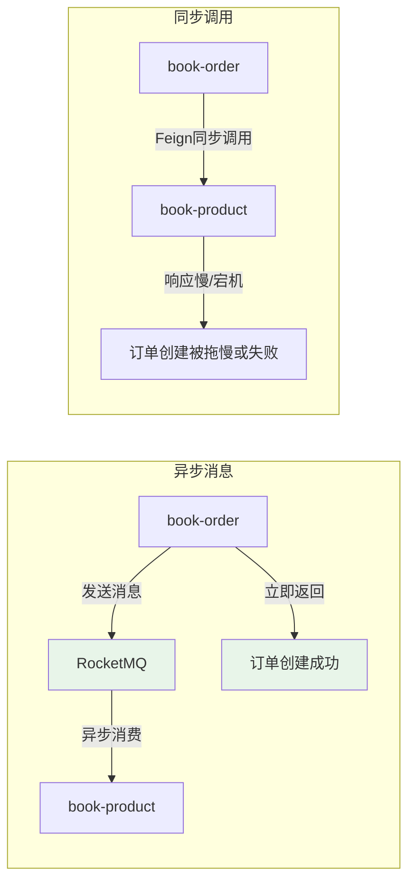
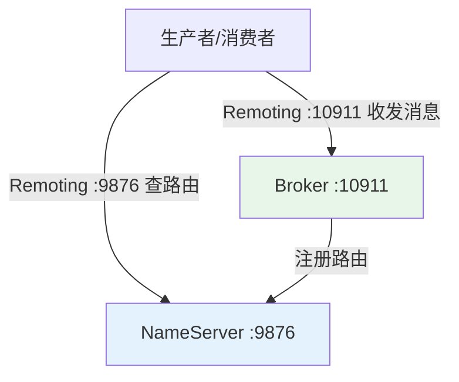

# RocketMQ部署与第一个消息

## 课程目标

- 理解RocketMQ在微服务架构中的定位，以及它要解决的“同步调用耦合”问题
- 掌握RocketMQ 5.x的核心架构：NameServer、Broker、Proxy的职责与关系
- 完成RocketMQ 单机版的下载、启动与验证
- 掌握RocketMQ控制台的部署，能够通过可视化界面查看消息
- 完成第一个消息的发送与消费：命令行工具验证 + Spring Boot集成验证


## 回顾与导入

到目前为止我们完成了Gateway的建设，客户端通过统一入口访问后端服务。但服务之间的调用仍然是**同步的**：

> **场景：** book-order创建订单后，需要通知库存服务扣减库存。目前的做法是使用`BookClient.deductStock()`——同步Feign调用。如果库存服务响应慢，订单创建接口就被拖慢；如果库存服务宕机，订单创建直接失败。
>
> 更合理的做法是：订单创建成功后，**发送一条消息**到消息队列，库存服务**异步消费**这条消息去扣库存。订单服务不关心库存服务是否在线、响应多快，只需要保证消息发出去即可。

这就是消息队列的核心价值：**异步解耦**。我们将引入RocketMQ，实现订单创建后的异步通知、延迟取消、顺序消费等能力。



本节是消息队列分的起点：先把RocketMQ跑起来，完成第一个消息的收发。

> **前置条件：** JDK 17+（Nacos 3.x要求，RocketMQ同样兼容）；本机内存建议8G以上（RocketMQ默认JVM参数较大，内存不足时需要调整启动脚本）。


## RocketMQ核心架构

### 三个核心组件

RocketMQ 5.x的架构由三个核心组件构成：

| 组件           | 职责                                                         | 类比                                |
| -------------- | ------------------------------------------------------------ | ----------------------------------- |
| **NameServer** | 路由注册中心，维护Topic与Broker的映射关系                    | 类似Nacos，但只管路由，不管消息存储 |
| **Broker**     | 消息存储与转发的核心，负责接收生产者消息、存储、投递给消费者 | 类似数据库，但存的是消息            |
| **Proxy**      | RocketMQ 5.x新增的组件，提供gRPC协议接入，兼容多语言客户端   | 类似Gateway，统一接入层             |

> **RocketMQ 5.x的变化：** 4.x时代客户端直接连接NameServer和Broker，使用Remoting协议。5.x引入了Proxy，客户端通过gRPC连接Proxy，由Proxy负责与Broker交互。这使得多语言客户端（Java、Go、C++等）的接入更加统一。

### 单机部署的最小拓扑

本节不使用Proxy，最小化部署复杂度：



| 组件       | 端口  | 说明           |
| ---------- | ----- | -------------- |
| NameServer | 9876  | 路由注册中心   |
| Broker     | 10911 | 消息存储与收发 |

> **端口说明：**课程使用的`rocketmq-spring-boot-starter`基于**Remoting协议**，直接与NameServer和Broker通信，**完全不依赖Proxy**。少一个组件，就少一层配置和端口冲突的麻烦。 


## 下载与启动RocketMQ

### 环境要求

| 要求     | 说明                                                         |
| -------- | ------------------------------------------------------------ |
| JDK      | 1.8+（RocketMQ本身），本课程用JDK 17运行Spring Boot应用，RocketMQ服务端用JDK 8或17均可 |
| 内存     | 建议8G+，RocketMQ默认JVM参数较大，内存不足需调整`runserver.sh`和`runbroker.sh` |
| 操作系统 | Linux/macOS推荐，Windows需使用`cmd`脚本                      |

### 下载二进制包

从Apache RocketMQ官网（https://rocketmq.apache.org/download）下载5.3.2版本的二进制包（`rocketmq-all-5.3.2-bin-release.zip`）。本课程选择5.3.2，与Spring Cloud Alibaba 2025.0.0.0对应的RocketMQ版本5.3.1接近。或者可以使用镜像地址（https://mirrors.aliyun.com/apache/rocketmq/5.3.2/），下载速度比较快。

**目录结构：**

```
rocketmq-all-5.3.2-bin-release/
├── bin/                    # 启动脚本
│   ├── mqnamesrv          # NameServer启动脚本
│   ├── mqbroker           # Broker启动脚本
│   └── mqadmin            # 管理工具
├── conf/                   # 配置文件
│   └── broker.conf        # Broker配置
└── lib/                    # 依赖Jar
```

Windows下需要设置两个环境变量：

| 变量名          | 值                                        | 说明                           |
| --------------- | ----------------------------------------- | ------------------------------ |
| `ROCKETMQ_HOME` | `D:\tools\rocketmq-all-5.3.2-bin-release` | RocketMQ安装目录               |
| `NAMESRV_ADDR`  | `127.0.0.1:9876`                          | NameServer地址（工具脚本使用） |

### 启动NameServer

```bash
./mqnamesrv.cmd
```

**预期日志：**

```
The Name Server boot success. serializeType=JSON
```

> **日志路径：** 默认在`logs/rocketmqlogs/`下。如果启动失败，先检查该目录下的日志文件，常见原因是内存不足或端口被占用。

### 启动Broker

RocketMQ 5.x的Broker：

```bash
./mqbroker.cmd -n 127.0.0.1:9876
```

**预期日志：**

```
The broker[broker-a, 127.0.0.1:10911] boot success.
```

> **`-n 127.0.0.1:9876`** 指定NameServer地址。Broker启动后会向NameServer注册自己的路由信息。


## 部署RocketMQ控制台

### 为什么需要控制台

命令行工具能收发消息，但无法直观查看Topic列表、消息堆积、消费进度。RocketMQ控制台（`rocketmq-dashboard`）提供了可视化管理界面。

### 下载与启动

从阿里云镜像（https://mirrors.aliyun.com/apache/rocketmq/rocketmq-dashboard/）下载`rocketmq-dashboard`的源码包，通过 `java -jar` 命令编译成Jar包并启动。

```bash
java -jar rocketmq-dashboard-2.1.0.jar --rocketmq.config.namesrvAddr=127.0.0.1:9876
```

**访问控制台：**

```
http://localhost:8082
```

> **端口提醒：** `rocketmq-dashboard`默认使用8082，可能与其他服务冲突。启动控制台时可通过`--server.port=8180`修改端口：

```cmd
java -jar rocketmq-dashboard-2.0.0.jar --rocketmq.config.namesrvAddr=127.0.0.1:9876 --server.port=8180
```


## 实战一：命令行工具发送与消费消息

### 设置NameServer地址

RocketMQ的工具脚本需要知道NameServer地址，通过环境变量设置，已完成。

### 发送消息

```bash
./tools.cmd org.apache.rocketmq.example.quickstart.Producer
```

**预期输出：**

```
SendResult [sendStatus=SEND_OK, msgId=...]
```

### 消费消息

```bash
./tools.cmd org.apache.rocketmq.example.quickstart.Consumer
```

**预期输出：**

```
ConsumeMessageThread_1 Receive New Messages: [MessageExt...]
```

> **说明：** RocketMQ 5.x支持自动创建Topic和ConsumerGroup。当生产者和消费者使用不存在的Topic时，RocketMQ会自动创建，无需提前通过`mqadmin`创建。命令行示例中使用的Topic是`TopicTest`。

### 在控制台查看

打开`http://localhost:8082`，在“Topic”标签页中应能看到`TopicTest`，点击进入可以查看消息列表和消费进度。


## 实战二：Spring Boot集成发送第一个消息

### 版本对应关系

Spring Boot集成RocketMQ有两种方式：

| 方式                                     | 依赖                               | 适用场景                      |
| ---------------------------------------- | ---------------------------------- | ----------------------------- |
| `rocketmq-spring-boot-starter`           | `rocketmq-client`（Remoting协议）  | 传统方式，成熟稳定            |
| `rocketmq-v5-client-spring-boot-starter` | `rocketmq-client-java`（gRPC协议） | RocketMQ 5.x推荐，与Proxy对接 |

本节使用`rocketmq-spring-boot-starter`，因为它与Spring Cloud Alibaba的集成更成熟，且后续课程（延迟消息、顺序消息）的示例也更丰富。版本选择**2.3.0**（与RocketMQ 5.x客户端兼容）。

### 在book-order中引入依赖

```xml
<dependency>
    <groupId>org.apache.rocketmq</groupId>
    <artifactId>rocketmq-spring-boot-starter</artifactId>
    <version>2.3.0</version>
</dependency>
```

### 配置application.yml

```yaml
rocketmq:
  name-server: 127.0.0.1:9876
  producer:
    group: book-order-producer-group
    send-message-timeout: 3000
```

> **注意：** `rocketmq-spring-boot-starter` 2.2.0以上版本使用`rocketmq.name-server`前缀，旧版本使用`spring.rocketmq.name-server`。本课程使用2.3.0，因此用`rocketmq.name-server`。

### 编写生产者

在book-order中创建一个简单的消息发送Service：

```java
@Slf4j
@Service
@RequiredArgsConstructor
public class OrderMessageProducer {

    private final RocketMQTemplate rocketMQTemplate;

    /**
     * 发送第一个消息
     * Topic: order-topic, Tag: created
     */
    public void sendOrderCreatedMessage(Long orderId) {
        String message = "订单已创建，orderId=" + orderId;
        rocketMQTemplate.syncSend("order-topic:created", message);
        log.info("[RocketMQ] 消息已发送: {}", message);
    }
}
```

> **Topic与Tag的写法：** `rocketmq-spring-boot-starter`的`syncSend`方法第一个参数格式为`topic:tag`，冒号分隔。如果只写`topic`，没有Tag。

### 暴露测试接口

```java
@RestController
@RequestMapping("/api/mq")
@RequiredArgsConstructor
public class MqTestController {

    private final OrderMessageProducer producer;

    @GetMapping("/send/{orderId}")
    public Result<String> sendMessage(@PathVariable Long orderId) {
        producer.sendOrderCreatedMessage(orderId);
        return Result.success("消息已发送，orderId=" + orderId);
    }
}
```

### 启动并验证

**步骤一：** 启动book-order（确保RocketMQ的NameServer和Broker已运行）。

**步骤二：** 调用测试接口：

```http
GET http://localhost:8083/api/mq/send/1001
```

**预期响应：**

```json
{
  "code": 200,
  "message": "操作成功",
  "data": "消息已发送，orderId=1001"
}
```

**步骤三：** 查看book-order日志：

```
[RocketMQ] 消息已发送: 订单已创建，orderId=1001
```

**步骤四：** 在RocketMQ控制台查看消息：

进入`http://localhost:8180` → Topic → `order-topic` → 消息列表，应能看到发送的消息内容。


## 实战三：编写消费者并验证消息消费

### 创建消费者

在book-order中创建消费者：

```java
@Slf4j
@Component
@RocketMQMessageListener(
        topic = "order-topic",
        selectorExpression = "created",
        consumerGroup = "book-order-consumer-group"
)
public class OrderCreatedConsumer implements RocketMQListener<String> {

    @Override
    public void onMessage(String message) {
        log.info("[RocketMQ消费者] 收到消息: {}", message);
        // 后续课程将在这里实现库存扣减、积分发放等逻辑
    }
}
```

### 验证消费

重启book-order，再次调用发送接口：

```http
GET http://localhost:8083/api/mq/send/1002
```

**预期日志（book-order控制台）：**

```
[RocketMQ] 消息已发送: 订单已创建，orderId=1002
[RocketMQ消费者] 收到消息: 订单已创建，orderId=1002
```

**控制台验证：** 在RocketMQ控制台的`order-topic`消息列表中，可以看到消息的消费状态为“已消费”。


## 小结

本节课我们学习了：

1. **RocketMQ的架构**：NameServer（路由注册）、Broker（消息存储）、Proxy（gRPC接入），5.x版本通过Proxy统一客户端接入。

2. **单机部署**：启动NameServer（`mqnamesrv`）和Broker（`mqbroker`），验证启动日志。

3. **控制台部署**：启动`rocketmq-dashboard`，可视化查看Topic和消息。

4. **命令行验证**：使用`tools`命令的Producer和Consumer完成第一个消息的收发。

5. **Spring Boot集成**：引入`rocketmq-spring-boot-starter`，配置`rocketmq.name-server`，使用`RocketMQTemplate`发送消息。

6. **消费者实现**：`@RocketMQMessageListener`注解声明Topic、Tag、ConsumerGroup，实现`RocketMQListener`接口消费消息。

   


## 作业

### 作业一：完成RocketMQ单机部署

1. 下载RocketMQ 5.3.2二进制包并解压。
2. 根据本机内存调整`runserver.sh`和`runbroker.sh`的JVM参数。
3. 启动NameServer和Broker+Proxy，截图启动日志中的“boot success”信息。
4. 使用`tools.sh`的Producer和Consumer完成命令行消息收发，截图输出。

### 作业二：部署RocketMQ控制台

1. 使用Docker启动`rocketmq-dashboard`。
2. 访问控制台，截图“集群”页面中Broker的状态。
3. 在控制台的“Topic”页面中找到`TopicTest`，截图消息列表。

### 作业三：完成Spring Boot集成

1. 在book-order中引入`rocketmq-spring-boot-starter` 2.3.0。
2. 配置`rocketmq.name-server`和`rocketmq.producer.group`。
3. 创建`OrderMessageProducer`和`OrderCreatedConsumer`。
4. 启动book-order，调用`/api/mq/send/1001`，验证：
   - 接口返回成功
   - 生产者日志输出“消息已发送”
   - 消费者日志输出“收到消息”
   - 控制台中`order-topic`有消息且状态为已消费
5. 截图各环节的日志和控制台消息状态。
