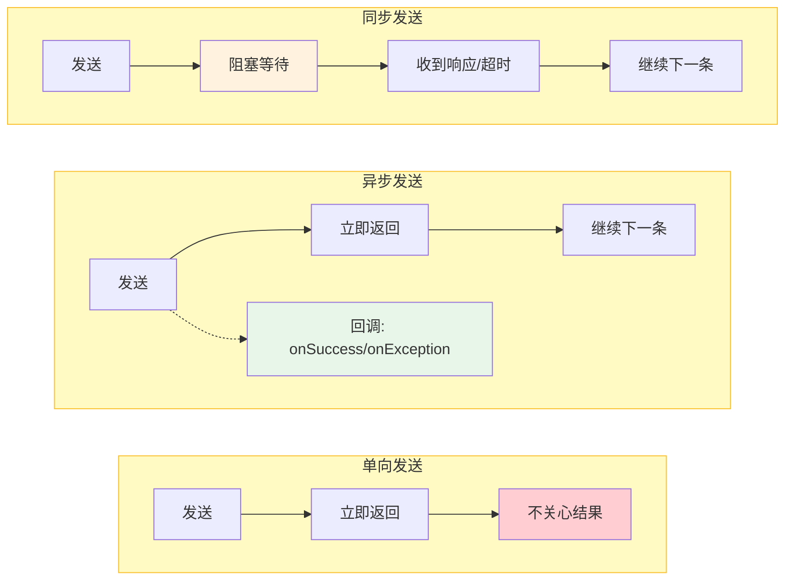

# RocketMQ消息发送方式实战

## 课程目标

- 理解RocketMQ三种消息发送方式的核心差异：同步发送、异步发送、单向发送
- 掌握三种方式在`RocketMQTemplate`中的API用法：`syncSend`、`asyncSend`、`sendOneWay`
- 理解每种方式的可靠性、吞吐量、延迟特征，能够根据业务场景做出合理选择
- 掌握异步发送的回调处理与阻塞等待策略
- 完成订单系统中三种发送方式的实战对比，明确“订单创建消息”为什么必须用同步发送


## 回顾与导入

前面我们演示了消息发送和消费的基本流程，今天我们关注消息发送环节。发送端有一个关键选择没有讲清楚：**消息发送有哪几种方式，具体应该怎么发？**

来看上一节我们一直使用的发送方式：

```java
rocketMQTemplate.syncSend("order-topic:created", message);
```

这是**同步发送**——发送方调用后阻塞等待，直到Broker返回响应才继续。它可靠，但每次发送都要等待一个网络往返。

如果订单系统在促销期间每秒要发送上千条消息，同步发送的吞吐量会成为瓶颈。但如果换成“发出去就不管”的方式，又担心消息丢失。这就是本节要解决的问题：**RocketMQ提供了三种发送方式，每种方式在可靠性和性能之间有不同的取舍。**

| 发送方式 | 一句话描述                     | 可靠性 | 吞吐量 |
| -------- | ------------------------------ | ------ | ------ |
| 同步发送 | 等Broker确认后再继续           | 高     | 低     |
| 异步发送 | 发出去后不等，通过回调处理结果 | 高     | 中     |
| 单向发送 | 发出去后完全不管               | 低     | 最高   |




## 三种发送方式的核心原理

### 同步发送（syncSend）

**原理：** 发送方调用`syncSend`后**阻塞当前线程**，等待Broker返回响应。只有收到响应（成功或失败）后，才继续执行下一行代码。

| 维度     | 说明                                                         |
| -------- | ------------------------------------------------------------ |
| 可靠性   | **最高**。发送成功即代表消息已写入Broker，失败会抛出异常，调用方可以立即感知并处理 |
| 吞吐量   | **最低**。每条消息都要等待一个网络往返，吞吐量受限于网络延迟和Broker处理速度 |
| 延迟     | 较高，取决于Broker响应时间                                   |
| 适用场景 | 订单创建、支付通知、金融交易等**消息绝不能丢**的场景         |

**在book-order中的使用：**

```java
SendResult result = rocketMQTemplate.syncSend("order-topic:created", message);
if (result.getSendStatus() != SendStatus.SEND_OK) {
    // 发送失败，需要处理
    throw new BusinessException("订单消息发送失败");
}
```

> **关键：** `syncSend`返回`SendResult`，必须检查`SendStatus`。`SEND_OK`表示成功，其他状态（如`FLUSH_DISK_TIMEOUT`）表示消息可能未可靠持久化。

### 异步发送（asyncSend）

**原理：** 发送方调用`asyncSend`后**立即返回**，不阻塞当前线程。消息的发送结果通过`SendCallback`回调通知。

| 维度     | 说明                                                         |
| -------- | ------------------------------------------------------------ |
| 可靠性   | **高**。与同步发送一样，Broker会返回响应，只是通过回调异步处理 |
| 吞吐量   | **中高**。发送方不需要等待每条消息的响应，可以连续发送多条   |
| 延迟     | 低，发送动作本身很快                                         |
| 适用场景 | 对响应时间敏感、但消息不能丢的场景，如实时数据处理、视频转码通知 |

**在book-order中的使用：**

```java
rocketMQTemplate.asyncSend("order-topic:created", message, new SendCallback() {
    @Override
    public void onSuccess(SendResult sendResult) {
        log.info("[异步发送] 成功: msgId={}", sendResult.getMsgId());
    }

    @Override
    public void onException(Throwable throwable) {
        log.error("[异步发送] 失败，需要补偿处理", throwable);
        // 这里不能简单忽略，需要记录到本地表或触发重试
    }
});
```

> **异步发送的陷阱：** 如果`onException`中只是打印日志而不做补偿，消息就真的丢了。异步发送的可靠性取决于**回调中的失败处理是否到位**。生产环境通常需要在`onException`中将失败消息写入本地数据库，由定时任务补偿发送。

### 单向发送（sendOneWay）

**原理：** 发送方调用`sendOneWay`后**立即返回**，不等待响应，也没有回调。发送方完全不关心消息是否到达Broker。

| 维度     | 说明                                         |
| -------- | -------------------------------------------- |
| 可靠性   | **最低**。消息可能丢失，发送方无法感知       |
| 吞吐量   | **最高**。发送动作耗时极短，通常在微秒级别   |
| 延迟     | 最低                                         |
| 适用场景 | 日志收集、监控数据上报等**可容忍丢失**的场景 |

**在book-order中的使用：**

```java
rocketMQTemplate.sendOneWay("log-topic:access", accessLog);
// 不检查结果，不关心是否成功
```

> **单向发送绝不用于业务消息。** 订单创建、库存扣减、支付通知等场景，消息丢失意味着业务数据不一致，必须使用同步或异步发送。

### 三种方式的对比总结

| 维度           | 同步发送           | 异步发送              | 单向发送   |
| -------------- | ------------------ | --------------------- | ---------- |
| 是否阻塞       | 是                 | 否                    | 否         |
| 是否有发送结果 | 有（`SendResult`） | 有（回调）            | 无         |
| 可靠性         | 最高               | 高                    | 最低       |
| 吞吐量         | 低                 | 中高                  | 最高       |
| 失败感知       | 立即（异常）       | 回调（`onException`） | 无法感知   |
| 适用场景       | 订单、支付         | 通知、转码            | 日志、监控 |


## 实战一：在book-order中实现三种发送方式

### 改造OrderMessageProducer

在上一节的`OrderMessageProducer`基础上，增加三种发送方式的方法：

```java
@Slf4j
@Service
@RequiredArgsConstructor
public class OrderMessageProducer {

    private final RocketMQTemplate rocketMQTemplate;

    private static final String TOPIC_TAG = "order-topic:created";

    /**
     * 同步发送：订单创建消息（必须可靠）
     */
    public void sendOrderCreatedSync(Long orderId) {
        String message = "订单已创建，orderId=" + orderId;
        SendResult result = rocketMQTemplate.syncSend(TOPIC_TAG, message);

        if (result.getSendStatus() != SendStatus.SEND_OK) {
            log.error("[同步发送] 失败: orderId={}, status={}", orderId, result.getSendStatus());
            throw new RuntimeException("订单消息发送失败: " + result.getSendStatus());
        }
        log.info("[同步发送] 成功: orderId={}, msgId={}", orderId, result.getMsgId());
    }

    /**
     * 异步发送：订单创建消息（高性能，但需处理回调失败）
     */
    public void sendOrderCreatedAsync(Long orderId) {
        String message = "订单已创建，orderId=" + orderId;

        rocketMQTemplate.asyncSend(TOPIC_TAG, message, new SendCallback() {
            @Override
            public void onSuccess(SendResult sendResult) {
                log.info("[异步发送] 成功: orderId={}, msgId={}", orderId, sendResult.getMsgId());
            }

            @Override
            public void onException(Throwable throwable) {
                log.error("[异步发送] 失败，需补偿: orderId={}", orderId, throwable);
                // 生产环境：写入本地失败表，由定时任务补偿发送
            }
        });
    }

    /**
     * 单向发送：仅用于日志/监控类消息
     */
    public void sendAccessLog(Long orderId) {
        String message = "用户访问订单，orderId=" + orderId;
        rocketMQTemplate.sendOneWay("log-topic:access", message);
        // 不检查结果
    }
}
```

### 暴露测试接口

```java
@RestController
@RequestMapping("/api/mq")
@RequiredArgsConstructor
public class MqTestController {

    private final OrderMessageProducer producer;

    @GetMapping("/sync/{orderId}")
    public Result<String> syncSend(@PathVariable("orderId") Long orderId) {
        producer.sendOrderCreatedSync(orderId);
        return Result.success("同步发送成功");
    }

    @GetMapping("/async/{orderId}")
    public Result<String> asyncSend(@PathVariable("orderId") Long orderId) {
        producer.sendOrderCreatedAsync(orderId);
        return Result.success("异步发送已提交");
    }

    @GetMapping("/oneway/{orderId}")
    public Result<String> onewaySend(@PathVariable("orderId") Long orderId) {
        producer.sendAccessLog(orderId);
        return Result.success("单向发送已执行");
    }
}
```

> **注意：** 单向发送的Topic是`log-topic`，与订单消息的`order-topic`分开。单向发送的消息不应该进入订单业务消费者的处理范围。


## 实战二：验证三种发送方式的行为差异

### 验证一：同步发送的阻塞行为

**步骤：** 连续调用`/api/mq/sync/1`和`/api/mq/sync/2`。

**观察：** 两个请求的响应时间相近，每次调用都等待Broker确认后才返回。如果Broker响应慢，调用方会明显感觉到延迟。

### 验证二：异步发送的非阻塞行为

**步骤：** 连续调用`/api/mq/async/1`和`/api/mq/async/2`。

**观察：** 接口响应非常快（几乎立即返回），日志中`[异步发送] 成功`可能在接口返回之后才出现。回调的执行时间取决于Broker的响应速度，但不阻塞调用方。

### 验证三：单向发送的无感知行为

**步骤：** 调用`/api/mq/oneway/1`。

**观察：** 接口立即返回，**没有任何发送结果日志**。消息可能成功，也可能失败，发送方无从知晓。

### 验证四：回调失败的模拟（异步发送）

**步骤：** 停止RocketMQ Broker，调用`/api/mq/async/1`。

**观察：** 接口仍然立即返回成功（因为异步发送不等待响应），但几秒后日志中出现`[异步发送] 失败`。这揭示了异步发送的关键风险：**接口返回成功不代表消息发送成功**。

> **对比：** 如果停止Broker后调用`/api/mq/sync/1`，接口会阻塞直到超时，然后抛出异常。调用方能**立即感知**失败。

### 验证五：消息到达确认

在RocketMQ控制台中查看`order-topic`，确认同步和异步发送的消息都到达了Broker。`log-topic`中的单向消息也应到达（如果Broker正常）。


## 注意事项

1. **同步发送必须检查`SendStatus`**：`syncSend`返回`SendResult`，只有`SEND_OK`才是真正成功，其他状态需要处理。

2. **异步发送的可靠性取决于回调**：`onException`中必须做补偿（如写入本地失败表），只打印日志等于放弃消息。

3. **单向发送绝不用于业务消息**：订单、库存、支付等场景必须使用同步或异步发送。

4. **异步发送不阻塞接口返回**：接口返回成功不代表消息发送成功，这是异步发送的核心特征，也是它的风险来源。

5. **不要因为“异步发送吞吐量高”就在订单创建中使用异步发送。** 订单消息是业务核心数据，异步发送的`onException`回调如果处理不当（比如只打印日志），消息丢失后业务数据会永久不一致。

6. **Topic分离**：日志类单向消息应使用独立的Topic（如`log-topic`），不要与业务消息混用。

7. **经验法则：** 如果消息丢失会导致“钱少了、货少了、订单状态错了”，就用同步发送。如果消息丢失只是“少了一条统计记录”，可以用异步或单向。

   


## 小结

本节课我们学习了：

1. **同步发送**：阻塞等待Broker响应，可靠性最高，吞吐量最低，适用于订单、支付等消息不能丢的场景。
2. **异步发送**：立即返回，通过`SendCallback`处理结果，吞吐量中高，可靠性取决于回调中的失败处理。
3. **单向发送**：立即返回，无任何结果反馈，可靠性最低，仅适用于日志、监控等可容忍丢失的场景。
4. **`RocketMQTemplate`的API**：`syncSend`返回`SendResult`、`asyncSend`接收`SendCallback`、`sendOneWay`无返回值。
5. **实战验证**：同步发送阻塞感知、异步发送快速返回但回调延迟、单向发送无感知；Broker故障时三种方式的表现差异。
6. **选择原则**：业务关键消息用同步，对响应时间敏感但可补偿用异步，可容忍丢失用单向。


## 作业

### 作业一：完成三种发送方式的代码实现

1. 按课程内容改造`OrderMessageProducer`，实现`sendOrderCreatedSync`、`sendOrderCreatedAsync`、`sendAccessLog`三个方法。
2. 创建对应的测试接口。
3. 分别调用三个接口，记录接口响应时间和控制台日志。
4. 截图三种方式的日志差异，解释为什么异步发送的日志可能出现在接口返回之后。

### 作业二：验证发送失败时的行为差异

1. 停止RocketMQ Broker。
2. 分别调用同步发送和异步发送接口。
3. 观察：
   - 同步接口是否阻塞、是否抛出异常
   - 异步接口是否立即返回、回调中是否出现异常日志
4. 重启Broker，验证消息是否正常发送。
5. 制作对比表格，记录三种方式在Broker故障时的表现。

### 作业三：为订单系统设计发送策略

1. 列出book-order中所有需要发送消息的场景（订单创建、订单取消、库存扣减通知、积分发放等）。
2. 为每个场景选择发送方式，并说明理由。
3. 思考：如果订单创建使用异步发送，接口返回“下单成功”但消息最终发送失败，用户看到的“成功”和实际业务状态不一致，应该如何处理？提示：**数据存储+定时任务**
