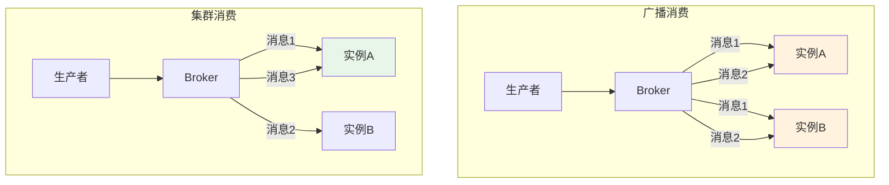

# RocketMQ消息消费方式实战

## 课程目标

- 理解RocketMQ消费端的两个核心维度：**消费模式**（集群/广播）与**消费类型**（Push/Simple/Pull）的区别
- 掌握`@RocketMQMessageListener`中`messageModel`与`consumeMode`的配置方法
- 理解集群消费的**负载均衡机制**与队列数量的关系，避免“加实例不提升吞吐”的误区
- 掌握基于**数据库唯一约束**的消费幂等实现
- 掌握广播消费的适用场景与限制，完成本地缓存刷新的实战
- 了解PushConsumer与PullConsumer的差异，能够根据业务场景选择合适的消费者类型
- 完成订单系统中“集群消费处理订单”与“广播消费刷新配置”的对比实战


## 回顾与导入

讲完消息发送，今天系统讨论：**消息到底以什么方式被消费？**

回顾前面我们使用的消费者：

```java
@RocketMQMessageListener(
    topic = "order-topic",
    consumerGroup = "book-order-consumer-group"
)
```

这里没有显式配置`messageModel`，所以它使用的是**默认的集群消费模式**——多个book-order实例分摊消息，每条消息只被一个实例消费。这在订单处理场景下是正确的。

但如果场景换成“book-product的每个实例都需要刷新本地缓存”呢？集群消费就不适用了——只有一个实例会收到通知，其他实例的缓存仍然是旧的。这时需要**广播消费**。

RocketMQ的消费方式可以从两个维度理解：

| 维度         | 选项                                         | 控制属性       | 解决的问题                                         |
| ------------ | -------------------------------------------- | -------------- | -------------------------------------------------- |
| **消费模式** | 集群消费 / 广播消费                          | `messageModel` | 一条消息被**一个**实例消费，还是被**所有**实例消费 |
| **消费类型** | PushConsumer / SimpleConsumer / PullConsumer | 消费者实现方式 | 消息是**推**给消费者，还是消费者主动**拉**         |

本节聚焦**消费模式**（集群 vs 广播），这是订单系统和配置刷新场景中最常用的选择。消费类型（Push/Pull）作为补充了解，帮助理解RocketMQ的底层模型。




## 消费模式的核心概念

### 集群消费（Clustering）

**默认模式。** RocketMQ认为任意一条消息只需要被消费组内的**任意一个**消费者处理即可。

| 特性     | 说明                                                 |
| -------- | ---------------------------------------------------- |
| 消息分配 | 同一ConsumerGroup的多个实例**分摊**消息              |
| 消费位点 | 由**服务端**保存，客户端提交                         |
| 适用场景 | 订单处理、数据同步等需要负载均衡的场景               |
| 扩展性   | 通过增加消费者实例提升消费能力，但受**队列数量**限制 |

> **关键限制：** 如果Topic的总队列数小于消费者数量，多余的消费者**分配不到队列**，即使增加实例也无法提升消费能力。例如Topic只有4个队列，启动6个消费者，其中2个会空闲。

### 广播消费（Broadcasting）

**每条消息被消费组内的每个消费者各消费一次**。

| 特性     | 说明                                                       |
| -------- | ---------------------------------------------------------- |
| 消息分配 | 每个实例收到**全量**消息                                   |
| 消费位点 | 由**客户端自己**保存                                       |
| 适用场景 | 配置刷新、本地缓存同步等需要所有实例感知的场景             |
| 限制     | **不支持顺序消息**、**不维护消费进度**、**消费失败不重试** |

> **广播消费的可靠性边界：** 由于消费位点由客户端保存，且失败不重试，广播模式**不适合**“必须成功处理”的业务消息。它只适合“通知”类消息——某个实例没收到，下次全量刷新时还能补上。

### 两种模式的关键差异

| 维度         | 集群消费         | 广播消费                                   |
| ------------ | ---------------- | ------------------------------------------ |
| 消息被谁消费 | 组内**一个**实例 | 组内**所有**实例                           |
| 消费位点存储 | 服务端           | 客户端                                     |
| 消费失败重试 | **支持**         | **不支持**                                 |
| 顺序消息     | 支持             | **不支持**                                 |
| 消费能力扩展 | 受队列数限制     | **无法通过扩实例提升**（每个实例都收全量） |
| 适用场景     | 业务消息处理     | 配置/缓存同步                              |


## 实战一：集群消费与幂等性

### 准备

**步骤一：确认`OrderCreatedConsumer`的配置**

前面演示的消费者使用的是默认集群模式，无需修改。确认`messageModel`未显式设置（或显式设为`CLUSTERING`）。

```java
@Slf4j
@Component
@RocketMQMessageListener(
        topic = "order-topic",
        selectorExpression = "created",
        consumerGroup = "book-order-consumer-group"
)
public class OrderCreatedConsumer implements RocketMQListener<String> {

    @Override
    public void onMessage(String message) {
        log.info("[RocketMQ消费者] 收到消息: {}", message);
        // 后续课程将在这里实现库存扣减、积分发放等逻辑
    }
}
```

**步骤二：启动两个book-order实例**

端口分别为 8083 和 8084。

### 集群模式消息消费效果

#### 消息分摊

**步骤：** 通过任意实例的接口发送10条消息（`orderId`从1到10）。

**预期：** 两个实例的日志中，每条消息只出现**一次**，且两个实例的消费数量大致各半。

**观察方式：** 在book-order日志中搜索`[业务处理] 开始处理订单创建消息`，统计两个实例各自的条数。

#### 队列数量对消费能力的限制

**步骤一：** 查看`order-topic`的队列数量。在RocketMQ控制台的Topic详情页中，可以看到队列数（默认自动创建的Topic通常是4个队列）。

**步骤二：** 启动第**5**个book-order实例（8086、8087、8088）。

**步骤三：** 发送10条消息，观察5个实例的消费分布。

**预期：** 由于队列数（4）小于实例数（5），**至少有一个实例分配不到队列**，不会消费任何消息。这验证了集群消费的扩展性受队列数限制。

> **生产建议：** Topic的队列数应在创建时规划好，通常设置为“预期最大消费者实例数”的2倍以上。

#### 重平衡与重复消费

**步骤：** 在消息消费过程中，停止其中一个book-order实例。

**预期：** 被停止实例上未消费完的消息，会触发**重平衡**，重新分配给剩余实例。由于消费位点提交不是实时的，重平衡期间可能出现**少量重复消费**。这正是接下来要介绍幂等性设计的价值所在——即使重复消费，业务逻辑也不会重复执行。


### 消费幂等性：基于数据库唯一约束

#### 为什么需要幂等

RocketMQ保证的是**至少一次（At Least Once）** 投递，以下场景会导致重复消费：

| 场景       | 原因                                                       |
| ---------- | ---------------------------------------------------------- |
| 发送时重复 | 生产者发送成功但Broker应答失败，生产者重发                 |
| 投递时重复 | 消费者处理成功但ACK应答丢失，Broker重新投递                |
| Rebalance  | Broker或消费者重启、扩缩容时触发重平衡，部分消息被重新分配 |

> **结论：** 重复消费是**必然事件**，不是异常。消费者必须自行保证幂等性。

#### 幂等设计的核心原则

**绝不依赖Message ID做幂等判断。** Message ID在重复投递时保持不变，但生产者在“发送时重复”场景下会产生两个Message ID不同、内容相同的消息。**必须使用业务唯一键**（如`orderId`）作为幂等依据。

#### 方案：数据库唯一约束

本课程尚未引入Redis，使用**数据库唯一索引**实现幂等，这是最经典、最可靠的方案，也是生产环境推荐的“最终兜底”手段。

**步骤一：创建消息消费记录表**

在`book_order_db`中创建表：

```sql
CREATE TABLE IF NOT EXISTS mq_consume_record (
    id BIGSERIAL PRIMARY KEY,
    consumer_group VARCHAR(100) NOT NULL,
    biz_key VARCHAR(100) NOT NULL,
    topic VARCHAR(100) NOT NULL,
    status VARCHAR(20) NOT NULL DEFAULT 'PROCESSING',
    created_at TIMESTAMP DEFAULT CURRENT_TIMESTAMP,
    updated_at TIMESTAMP DEFAULT CURRENT_TIMESTAMP,
    CONSTRAINT uk_consumer_group_biz_key UNIQUE (consumer_group, biz_key)
);

CREATE INDEX idx_mq_consume_record_status ON mq_consume_record(status);
```

| 字段             | 说明                                                         |
| ---------------- | ------------------------------------------------------------ |
| `consumer_group` | 消费者组，隔离不同消费者的幂等判断                           |
| `biz_key`        | 业务唯一键（如`orderId`），与`consumer_group`组成唯一约束    |
| `status`         | `PROCESSING`（处理中）、`SUCCESS`（已完成）、`FAILED`（失败） |

> **唯一约束`uk_consumer_group_biz_key`是幂等的核心**：同一ConsumerGroup对同一业务键，数据库层面保证只有一条记录，重复插入会抛出唯一约束异常。

**步骤二：创建Entity和Mapper**

```java
@Data
@TableName("mq_consume_record")
public class MqConsumeRecord {

    @TableId(type = IdType.AUTO)
    private Long id;

    private String consumerGroup;
    private String bizKey;
    private String topic;
    private String status;

    @TableField(fill = FieldFill.INSERT)
    private LocalDateTime createdAt;

    @TableField(fill = FieldFill.INSERT_UPDATE)
    private LocalDateTime updatedAt;
}
```

```java
@Mapper
public interface MqConsumeRecordMapper extends BaseMapper<MqConsumeRecord> {
}
```

**步骤三：改造消费者**

```java
@Slf4j
@Component
@RequiredArgsConstructor
@RocketMQMessageListener(
        topic = "order-topic",
        selectorExpression = "created",
        consumerGroup = "book-order-consumer-group"
)
public class OrderCreatedConsumer implements RocketMQListener<String> {

    private static final String CONSUMER_GROUP = "book-order-consumer-group";
    private static final String TOPIC = "order-topic";

    private final MqConsumeRecordMapper consumeRecordMapper;

    @Override
    public void onMessage(String message) {
        Long orderId = extractOrderId(message);
        if (orderId == null) {
            log.warn("[消费者] 消息格式异常，无法提取orderId: {}", message);
            return;
        }

        String bizKey = String.valueOf(orderId);

        // 1. 幂等检查：查询消费记录
        LambdaQueryWrapper<MqConsumeRecord> query = new LambdaQueryWrapper<>();
        query.eq(MqConsumeRecord::getConsumerGroup, CONSUMER_GROUP)
             .eq(MqConsumeRecord::getBizKey, bizKey);
        MqConsumeRecord existing = consumeRecordMapper.selectOne(query);

        if (existing != null && "SUCCESS".equals(existing.getStatus())) {
            log.info("[消费者] 消息已处理过，跳过: orderId={}", orderId);
            return;
        }

        // 2. 首次处理：插入消费记录（唯一约束防重）
        if (existing == null) {
            MqConsumeRecord record = new MqConsumeRecord();
            record.setConsumerGroup(CONSUMER_GROUP);
            record.setBizKey(bizKey);
            record.setTopic(TOPIC);
            record.setStatus("PROCESSING");
            try {
                consumeRecordMapper.insert(record);
            } catch (DuplicateKeyException e) {
                // 并发场景：另一个实例已插入，说明正在处理或已处理
                log.info("[消费者] 并发重复消息，跳过: orderId={}", orderId);
                return;
            }
        }

        // 3. 执行业务逻辑
        try {
            // TODO：执行具体业务逻辑
            updateStatus(CONSUMER_GROUP, bizKey, "SUCCESS");
            log.info("[消费者] 订单创建消息处理完成: orderId={}", orderId);
        } catch (Exception e) {
            updateStatus(CONSUMER_GROUP, bizKey, "FAILED");
            log.error("[消费者] 订单创建消息处理失败: orderId={}", orderId, e);
            throw new RuntimeException("消费失败", e);
        }
    }

    private void updateStatus(String group, String bizKey, String status) {
        LambdaQueryWrapper<MqConsumeRecord> query = new LambdaQueryWrapper<>();
        query.eq(MqConsumeRecord::getConsumerGroup, group)
             .eq(MqConsumeRecord::getBizKey, bizKey);
        MqConsumeRecord update = new MqConsumeRecord();
        update.setStatus(status);
        consumeRecordMapper.update(update, query);
    }

    private Long extractOrderId(String message) {
        try {
            return Long.parseLong(message.replaceAll(".*orderId=(\\d+).*", "$1"));
        } catch (NumberFormatException e) {
            return null;
        }
    }
}
```

#### 关键设计点

| 设计点                        | 说明                                                         |
| ----------------------------- | ------------------------------------------------------------ |
| **唯一约束**                  | `(consumer_group, biz_key)`的唯一索引是幂等的最终保障，数据库层面拒绝重复插入 |
| **先查后插**                  | 查询已有记录，`SUCCESS`状态直接跳过，避免重复执行业务        |
| **DuplicateKeyException捕获** | 并发场景下两个实例同时插入，一个成功一个抛异常，捕获后视为“已处理” |
| **状态流转**                  | `PROCESSING` → `SUCCESS` / `FAILED`，失败时允许重试（重试时查询到`FAILED`状态会重新处理） |
| **失败时更新状态而非删除**    | 数据库方案保留失败记录，便于排查；重试时看到`FAILED`会重新执行业务 |

#### 幂等记录的清理

`mq_consume_record`表会随消息量增长。生产环境需要定期清理：

```sql
-- 清理30天前的成功记录
DELETE FROM mq_consume_record
WHERE status = 'SUCCESS'
  AND created_at < NOW() - INTERVAL '30 days';
```

> **清理周期：** 应大于消息的最大重试窗口（约2小时）和业务可能的重发窗口。30天是保守值，可根据业务调整。


## 实战二：广播消费实现本地缓存刷新

### 场景说明

book-product的每个实例都缓存了图书分类数据（如`ConcurrentHashMap`）。当分类数据在数据库中被修改后，需要**所有实例**都刷新本地缓存。如果使用集群消费，只有一个实例会收到通知，其他实例的缓存仍然是旧的。

### 创建广播消费者

在book-product中创建：

```java
@Slf4j
@Component
@RocketMQMessageListener(
        topic = "config-update-topic",
        consumerGroup = "book-product-config-consumer",
        messageModel = MessageModel.BROADCASTING
)
public class ConfigUpdateConsumer implements RocketMQListener<String> {

    private final CategoryCache categoryCache;

    public ConfigUpdateConsumer(CategoryCache categoryCache) {
        this.categoryCache = categoryCache;
    }

    @Override
    public void onMessage(String message) {
        log.info("[配置刷新] 收到分类更新通知: {}", message);
        categoryCache.refresh();
        log.info("[配置刷新] 本地缓存已刷新");
    }
}
```

**本地缓存（示例）：**

```java
@Component
@Slf4j
public class CategoryCache {

    private volatile Map<String, String> cache = new ConcurrentHashMap<>();

    public void refresh() {
        // 模拟从数据库重新加载分类数据
        Map<String, String> newCache = new ConcurrentHashMap<>();
        newCache.put("编程", "PROGRAMMING");
        newCache.put("文学", "LITERATURE");
        this.cache = newCache;
        log.info("[缓存] 分类数据已重新加载，条目数={}", newCache.size());
    }
}
```

### 发送配置更新消息

在book-product中创建发送接口（或通过book-order发送，本节为简化放在book-product）：

```java
@RestController
@RequestMapping("/api/config")
@RequiredArgsConstructor
public class ConfigUpdateController {

    private final RocketMQTemplate rocketMQTemplate;

    @GetMapping("/refresh-category")
    public Result<String> refreshCategory() {
        rocketMQTemplate.syncSend("config-update-topic:refresh", "分类数据已更新");
        return Result.success("刷新通知已发送");
    }
}
```

### 验证广播效果

**步骤一：** 启动两个book-product实例（8081和8082）。

**步骤二：** 调用任意实例的`/api/config/refresh-category`接口。

**步骤三：** 观察两个实例的日志。

**预期：** **两个实例都输出** `[配置刷新] 收到分类更新通知` 和 `[缓存] 分类数据已重新加载`。这验证了广播模式下每个实例都收到了消息。

> **对比：** 如果将`messageModel`改为`CLUSTERING`（或删除该属性），再次测试，只有**一个**实例会收到通知。

### 广播模式的注意事项

| 注意点                | 说明                                                         |
| --------------------- | ------------------------------------------------------------ |
| 消费失败不重试        | 如果某个实例刷新缓存失败，消息不会重试；下次全量刷新时补上   |
| 不支持顺序消息        | 广播模式下`consumeMode = ORDERLY`会失效                      |
| ConsumerGroup仍需唯一 | 广播模式下，同一Group的每个实例都消费全量消息；不同Group互不影响 |


## 消费类型简介：PushConsumer与PullConsumer

`messageModel`控制“消息被谁消费”，而**消费类型**控制“消息怎么到达消费者”。RocketMQ 5.x支持三种消费者类型：

| 类型                     | 工作方式                                        | 适用场景                         |
| ------------------------ | ----------------------------------------------- | -------------------------------- |
| **PushConsumer**（默认） | SDK在后台拉取消息，通过监听器**回调**给业务代码 | 绝大多数业务场景，开发简单       |
| **SimpleConsumer**       | 业务方主动调用接口获取消息，自行控制消费节奏    | 消息处理时长不可控的场景         |
| **PullConsumer**         | 业务方按队列主动拉取，完全自主控制              | 流处理框架，仅推荐在特定场景使用 |

> **本课程使用的`@RocketMQMessageListener` + `RocketMQListener`就是PushConsumer的封装。** 它是最简单、最常用的方式：开发者只关心`onMessage`里的业务逻辑，消息的拉取、位点提交、重试都由SDK管理。

**PushConsumer的关键约束：**

| 约束     | 说明                                                         |
| -------- | ------------------------------------------------------------ |
| 同步消费 | `onMessage`方法必须**同步完成**消费逻辑，不能把消息扔给其他线程后提前返回 |
| 消费超时 | 如果`onMessage`执行时间过长，SDK会判定消费超时并触发重试，可能导致重复消息 |
| 顺序消费 | 配置`consumeMode = ORDERLY`时，同一队列的消息串行消费        |

> **为什么本课程不展开PullConsumer？** PullConsumer需要业务方自行管理拉取线程、位点提交、重平衡，开发复杂度高。PushConsumer已经覆盖了订单系统99%的场景。理解PushConsumer的“本质是拉模式的封装”即可，不需要在业务代码中使用PullConsumer。


## 小结

本节课我们学习了：

1. **消费模式的两个维度**：`messageModel`控制“消息被谁消费”（集群/广播），消费者类型控制“消息怎么到达”（Push/Simple/Pull）。
2. **集群消费**：默认模式，消息在组内分摊，支持重试和顺序，扩展受队列数限制。
3. **消费幂等性**：重复消费是必然事件；必须基于业务唯一键（非Message ID）做幂等。
4. **广播消费**：每个实例收全量消息，不支持重试和顺序，位点客户端保存，适用于配置刷新和缓存同步。
5. **PushConsumer的约束**：`onMessage`必须同步完成，不能异步分发后提前返回；它是本课程使用的消费者类型。


## 作业

### 作业一：验证集群消费的负载均衡

1. 启动两个book-order实例（8083和8084），确认`OrderCreatedConsumer`使用默认集群模式。
2. 发送10条消息（orderId从1到10），统计两个实例各自消费的条数。
3. 启动第5个实例，再次发送10条消息，观察是否有实例完全收不到消息。
4. 在RocketMQ控制台查看`order-topic`的队列数，解释观察到的现象。
5. 截图两个场景的消费统计和Topic队列数。

### 作业二：实现基于数据库的消费幂等

1. 在`book_order_db`中创建`mq_consume_record`表，包含唯一约束`(consumer_group, biz_key)`。
2. 创建`MqConsumeRecord`实体和`MqConsumeRecordMapper`。
3. 按课程内容改造`OrderCreatedConsumer`，实现“查记录 → 插入 → 执行业务 → 更新状态”的流程。
4. 发送`orderId=2001`的消息，确认正常消费，查询数据库确认`status='SUCCESS'`。
5. 再次发送`orderId=2001`的消息，验证是否被跳过。
6. 截图日志和数据库记录。

### 作业三：完成广播消费的配置刷新实战

1. 在book-product中创建`CategoryCache`和`ConfigUpdateConsumer`（`messageModel = BROADCASTING`）。
2. 创建`/api/config/refresh-category`接口，发送配置更新消息。
3. 启动两个book-product实例（8081和8082）。
4. 调用刷新接口，验证两个实例的日志中都出现`[配置刷新]`和`[缓存] 分类数据已重新加载`。
5. 将`messageModel`改为`CLUSTERING`，重启两个实例，再次调用，验证只有一个实例收到通知。
6. 截图两种模式下的日志对比。
