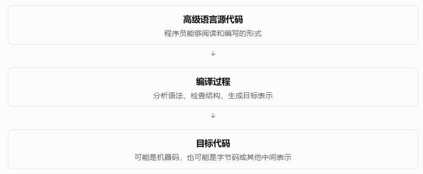
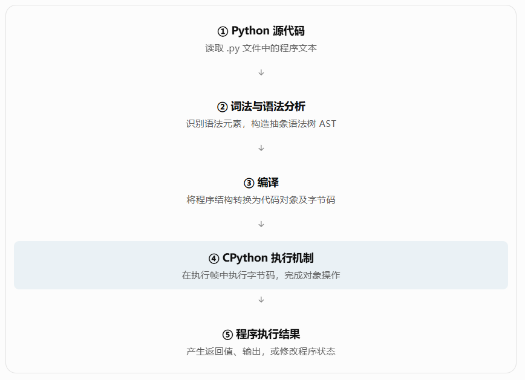
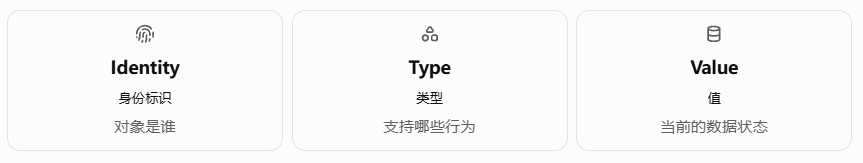
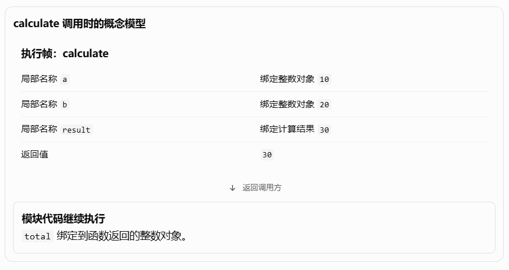

# 课程 8：Python 语言核心精讲

(AI 全栈知识库) (第 8 门课程) (27 章完整体系)

这门课程，我们不把 Python 当成一堆语法规则来学习，而是将它视为一门具有完整**语言规范、对象模型、执行模型、抽象机制和运行时系统**的编程语言。

课程的核心目标是：不仅知道 Python 代码怎么写，更要理解 Python 为什么这样设计、解释器如何执行代码，以及不同语言特性背后的统一逻辑。

后续学习 Python 框架、数据科学、LangGraph、Agent 开发时，应该能够从语言原理出发分析问题，而不是依赖框架提供的现成写法。

## 第一部分：完整课程知识体系

## Python 核心知识的六层架构

**第六层：工程化与 AI 开发生态**

项目管理 · 调试测试 · 性能 · 安全 · AI 技术衔接

**第五层：运行时与并发模型**

I/O · 内存管理 · 多线程 · 多进程 · asyncio

**第四层：程序组织与类型系统**

模块 · 包 · 导入系统 · 类型注解 · 类型检查

**第三层：抽象与协议机制**

函数 · 闭包 · 装饰器 · 迭代器 · 生成器 · 面向对象

**第二层：语言与数据模型**

变量绑定 · 类型 · 对象 · 容器 · 运算 · 流程控制

**第一层：Python 的本质与执行原理**

语言规范 · 解释器 · 编译过程 · 字节码 · 执行模型

这是一张知识依赖图：越往下，越接近语言底层；越往上，越接近真实项目。我们的学习顺序是从下往上。

## 第二部分：完整章节安排

### 第一篇：语言本质与基础模型

目标：先理解 Python 是怎样工作的，再学习 Python 语法。

| 章节 | 主题 | 核心内容 |
|--------|--------|--------|
| **第 1 章** | Python 的本质与运行机制 | 语言与解释器、编译执行、字节码、虚拟机、对象引用 |
| 第 2 章 | Python 的运行环境 | CPython、REPL、脚本、模块执行、版本、环境隔离 |
| 第 3 章 | Python 语法体系 | 词法、缩进、表达式、语句、运算符、赋值语义 |
| 第 4 章 | Python 对象模型 | 对象身份、类型、值、变量绑定、可变性、对象比较 |

### 第二篇：内置类型与数据组织

目标：理解 Python 如何表达、存储、运算和组织数据。

| 章节 | 主题 | 核心内容 |
|--------|--------|--------|
| 第 5 章 | 标量类型与数值计算 | int、float、bool、None、数值精度、运算规则 |
| 第 6 章 | 字符串与二进制数据 | str、bytes、Unicode、编码解码、格式化 |
| 第 7 章 | 序列数据结构 | list、tuple、range、索引、切片、序列操作 |
| 第 8 章 | 映射与集合 | dict、set、哈希机制、键的约束、数据结构复杂度 |
| 第 9 章 | 流程控制 | if、for、while、match、推导式、控制流逻辑 |

### 第三篇：抽象能力与语言协议

目标：从写简单代码，进入理解 Python 语言机制的阶段。

| 章节 | 主题 | 核心内容 |
|--------|--------|--------|
| 第 10 章 | 函数系统 | 函数对象、参数绑定、参数种类、返回值、递归 |
| 第 11 章 | 作用域与函数式能力 | LEGB、闭包、函数对象、装饰器、高阶函数 |
| 第 12 章 | 迭代与生成机制 | 迭代协议、迭代器、yield、生成器、惰性计算 |
| 第 13 章 | 面向对象编程 | 类、实例、属性、继承、封装、多态、MRO |
| 第 14 章 | Python 数据模型与高级协议 | 魔术方法、描述符、property、super、元类 |

### 第四篇：程序运行与组织机制

目标：理解 Python 如何构建大型程序，以及代码运行时的关键约束。

| 章节 | 主题 | 核心内容 |
|--------|--------|--------|
| 第 15 章 | 异常处理系统 | 异常传播、调用栈、try、raise、异常设计 |
| 第 16 章 | 资源与上下文管理 | with、上下文管理协议、资源生命周期 |
| 第 17 章 | 模块、包与导入系统 | import、sys.modules、模块查找、包与循环导入 |
| 第 18 章 | 类型注解与类型系统 | typing、泛型、Protocol、静态检查、鸭子类型 |
| 第 19 章 | 内存管理与对象生命周期 | 引用计数、垃圾回收、循环引用、浅拷贝、深拷贝 |

### 第五篇：I/O、并发与异步运行模型

目标：掌握 Python 在服务端、自动化、数据处理和 Agent 系统中的运行基础。

| 章节 | 主题 | 核心内容 |
|--------|--------|--------|
| 第 20 章 | 文件系统与数据交换 | pathlib、文件 I/O、文本流、JSON、CSV、序列化 |
| 第 21 章 | 标准库核心能力 | collections、itertools、functools、datetime、re 等 |
| 第 22 章 | 并发与并行 | threading、multiprocessing、锁、GIL、自由线程构建 |
| 第 23 章 | asyncio 异步编程 | 协程、事件循环、Task、Future、取消、结构化并发 |

### 第六篇：Python 工程能力与 AI 技术衔接

目标：从语言学习过渡到能够理解和维护真实 Python 项目。

| 章节 | 主题 | 核心内容 |
|--------|--------|--------|
| 第 24 章 | 运行时探查与性能优化 | 反射、inspect、性能分析、性能瓶颈 |
| 第 25 章 | 依赖管理与工程结构 | venv、pip、pyproject.toml、包发布、依赖锁定 |
| 第 26 章 | 测试、调试与代码质量 | 单元测试、Mock、日志、调试、代码规范、安全 |
| 第 27 章 | Python 与 AI 全栈体系的连接 | HTTP、JSON、异步 I/O、类型建模、框架运行机制 |

### 课程内容的边界

这门课聚焦 Python 语言本身，不会提前把 FastAPI、NumPy、Pandas、LangChain、LangGraph 等独立知识体系展开成框架教程。

但涉及这些框架赖以工作的语言机制时，我们会解释其底层联系。例如：

- 为什么 LangGraph 大量使用 `TypedDict`、类型注解和函数。
- 为什么 Agent 的工具调用经常使用 `async` / `await`。
- 为什么 Python 装饰器适合实现路由注册、工具注册和日志切面。
- 为什么异步并不天然意味着多核并行。
- 为什么可变对象、共享引用和状态管理会影响 AI 工作流的正确性。

这些问题会在相关章节逐步得到完整解释。

课程以现代 Python 3 为主线，并以最常见的 CPython 实现解释底层机制。对于不同解释器或版本之间存在差异的行为，我们会明确区分。根据官方发布文档，Python 3.15 已于 2026 年 10 月 9 日发布。 [Python 3.15.2 documentation](https://docs.python.org/3.15/whatsnew/3.15.html?utm_source=chatgpt.com)

---

# 第一章：Python 的本质与运行机制

(正式开始) 第一篇 · 语言本质与基础模型

这一章要解决一个根本问题：

**当我们写下一段 Python 代码并运行时，计算机内部究竟发生了什么？**

理解这个问题，需要建立三个核心认识：

1. Python 是一门编程语言，而 CPython 是实现这门语言的一种解释器。
2. Python 程序不是简单地从第一行源码直接解释到最后一行，中间存在编译与执行机制。
3. Python 程序的运行，本质上涉及对象的创建与操作、名称的绑定与查找，以及代码块的执行。

这三个认识，将贯穿整个课程。

## 1.1 Python 究竟是什么？

### 一、编程语言的本质

首先，不要把 Python 理解为一个软件工具。

**Python 首先是一套用于描述计算过程的语言规则。**

它规定了：

- 哪些代码是合法的，属于语法规则（Syntax）。
- 一段合法代码表达什么含义，属于语义规则（Semantics）。
- 程序如何组织数据、计算结果和控制执行顺序。
- 对象具有什么行为，以及不同对象如何交互。

例如：

```python
a = 10
b = 20

result = a + b

print(result)
```

这段代码表达的是一种计算逻辑：

首先把名称 `a` 与整数对象 `10` 关联，把名称 `b` 与整数对象 `20` 关联；然后计算加法，把计算结果与 `result` 关联；最后通过 `print` 输出结果。

程序员负责描述逻辑，但描述本身并不能使 CPU 自动完成计算。

中间还需要一个能够理解和执行 Python 规则的软件系统。

这就是 Python 解释器。

### 二、Python 语言与 Python 解释器不是同一个概念

可以把两者理解为：

| 概念 | 职责 |
|--------|--------|
| Python 语言 | 定义代码应该如何编写、具有怎样的语义 |
| Python 解释器 | 实现语言规则，并让程序真正运行 |
| Python 标准库 | 提供文件、时间、网络、数据处理等常用能力 |
| Python 第三方生态 | 在语言与标准库之上构建框架和应用能力 |

最常见的 Python 解释器叫作 **CPython**。

CPython、PyPy 等实现支持大量共同的 Python 语言特性，但具体的执行优化、内存管理和性能表现可能不同。

例如，CPython 主要使用 C 实现，并采用字节码执行机制；PyPy 则以即时编译（JIT）等运行时优化能力著称。

因此，我们需要区分：

**语言规定的行为**，与**某种解释器为了实现这些行为而采用的技术**。

这个区分非常重要。

以后学习 GIL、垃圾回收、线程调度、性能优化时，会不断遇到它。

---

## 1.2 Python 是解释型语言，还是编译型语言？

很多入门资料会给出一种说法：

> Java 是编译型语言，Python 是解释型语言。

这是一种便于入门的简化描述，但不够准确。

### 一、先理解什么是编译

编译（Compilation），本质上是把一种代码表示转换成另一种表示的过程。

例如：



关键在于：

**编译的产物不一定是 CPU 可以直接执行的机器码。**

它也可以是供虚拟机执行的字节码。

### 二、解释执行是什么？

解释执行（Interpretation），指程序运行时由解释器读取某种代码表示，并根据其含义执行相应操作。

编译与解释并不是天然互斥的。

一个语言实现完全可以先编译，再解释执行编译结果。

而 CPython 正是采用这种基本思路。

### 三、CPython 的典型执行流程

以如下代码为例：

```python
x = 10
y = 20
print(x + y)
```

在概念层面，可以将 CPython 的执行过程理解为：



这是理解 CPython 最重要的一张流程图。

它告诉我们，**Python 并不是简单地让 CPU 直接执行 `.py` 文件中的文本。**

Python 源码要经过解析和编译，然后由运行时执行相应操作。现代 CPython 还包含解释器指令特化等优化；具体机制随着版本演进。 [Python 3.15.2 documentation](https://docs.python.org/3/library/dis.html?utm_source=chatgpt.com)

下面把这个过程拆开。

### 四、什么是词法分析和语法分析？

假设程序中出现：

```python
result = 10 + 20
```

计算机并不能像人一样直接理解这串字符。

编译器前端需要识别出其中的语言元素。

例如：

| 文本 | 含义 |
|--------|--------|
| `result` | 标识符 |
| `=` | 赋值操作符 |
| `10` | 整数字面量 |
| `+` | 加法操作符 |
| `20` | 整数字面量 |

这与词法分析（Lexical Analysis）相关。

接下来，语法分析（Parsing）还需要理解这些元素之间的结构关系。

它必须知道：

`10 + 20` 是一个表达式，而 `result = ...` 是一条赋值语句。

经过分析，可以抽象成类似这样的结构：

```text
赋值语句
├── 目标：result
└── 值：二元运算
    ├── 左操作数：10
    ├── 运算符：+
    └── 右操作数：20
```

这种体现代码层次关系的结构称为抽象语法树，简称 AST（Abstract Syntax Tree）。

AST 不是为了排版代码，而是为了表达代码的语法结构。

### 五、什么是字节码？

解析完成后，CPython 可以将代码编译成内部的代码对象（Code Object）。

代码对象包含字节码及执行所需的其他信息。

字节码（Bytecode）是一套面向解释器执行的指令表示，而不是一般意义上的 CPU 原生机器码。

可以使用 Python 自带的 `dis` 模块观察：

```python
import dis

def add(a, b):
    return a + b

dis.dis(add)
```

这个程序会输出函数的字节码反汇编结果。

你通常会看到与这些操作对应的指令：

- 加载操作数。
- 执行加法。
- 返回结果。

但具体指令名称、数量、结构会随着 CPython 版本变化。

官方文档也明确指出，CPython 字节码是实现细节，并不保证跨版本稳定。 [Python 3.15.2 documentation](https://docs.python.org/3/library/dis.html?utm_source=chatgpt.com)

这里不需要记住任何字节码指令。

我们真正要理解的是：

**Python 编写的是高级语言逻辑，而运行时会将其转化为更底层的执行操作。**

### 六、什么是 Python 虚拟机？

这里的虚拟机不是指运行完整操作系统的虚拟机。

Python 虚拟机（Python Virtual Machine，通常简称 PVM）是解释执行 Python 字节码的运行机制。

它负责执行指令并维护程序运行所需的状态。

例如，在 CPython 的执行过程中，它需要处理：

- 获取变量绑定的对象。
- 执行对象支持的运算。
- 调用函数。
- 控制条件跳转。
- 处理返回值与异常。

假设有：

```python
result = a + b
```

从运行时语义来看，这不是单纯要求 CPU 执行一个固定的整数加法。

Python 首先需要确定 `a` 和 `b` 分别绑定了什么对象，然后根据对象的类型及运算协议完成操作。

如果 `a` 和 `b` 都是整数，加法表现为数值计算。

如果它们都是字符串，加法表现为字符串拼接。

```python
print(10 + 20)       # 30

print("AI" + "Agent") # AIAgent
```

这里揭示了 Python 非常重要的一种设计思想：

**程序中的运算行为与对象的类型和协议紧密相关。**

这将成为理解 Python 面向对象机制和魔术方法的基础。

---

## 1.3 Python 的核心数据观：一切数据都以对象来表达

这是本章最关键的内容之一。

官方 Python 数据模型首先明确了一个基本原则：

Python 程序中的数据通过对象以及对象之间的关系来表达。 [Python 3.15.2 documentation](https://docs.python.org/3/reference/datamodel.html?utm_source=chatgpt.com)

在 Python 中，整数、字符串、列表、函数、类、模块等都可以作为对象。

例如：

```python
number = 100

name = "Python"

items = [1, 2, 3]

def greet():
    print("Hello")
```

这里至少涉及四类对象：

- 整数对象
- 字符串对象
- 列表对象
- 函数对象

注意最后一项。

**函数本身也是对象。**

`greet` 不仅是一个函数定义时使用的名称，它还可以像其他对象一样被引用、传递和存储。

这正是后面装饰器、高阶函数以及 AI 工具注册机制能够工作的语言基础。

### 一、每个对象都具有三个核心属性

Python 官方数据模型将对象的基本属性归纳为：



看下面的代码：

```python
user = {"name": "Tom", "age": 20}

print(id(user))
print(type(user))
print(user)
```

分别涉及三个问题。

**Identity：这个对象是谁？**

`id(user)` 返回一个在对象生命周期内标识该对象身份的整数。

在 CPython 中，它通常对应对象的内存地址，但这是 CPython 的实现细节，不应该假设所有 Python 解释器都这样实现。

**Type：这个对象是什么类型？**

```python
type(user)
```

返回：

```python
<class 'dict'>
```

这说明它是字典类型的对象。

类型决定对象支持什么操作，例如：

```python
user["name"]
```

字典支持使用键进行数据访问。

**Value：这个对象具有怎样的值？**

```python
{"name": "Tom", "age": 20}
```

这是对象当前表达的数据内容。

对于可变对象，内容可以改变。

```python
user["age"] = 21
```

此时：

- `user` 所引用的仍是原来的字典对象。
- 字典对象的类型仍然是 `dict`。
- 字典对象的内容发生了变化。

所以必须区分三个概念：

**对象身份是否变化、对象类型是什么、对象内容是否变化，是三个不同的问题。**

后面讲对象拷贝、函数传参和内存管理时，我们会经常利用这个区分。

---

## 1.4 Python 的变量究竟是什么？

这一节是 Python 初学者最容易形成错误理解的地方。

有一种常见的理解方式：

> 创建变量，就是创建一个盒子，然后把数据装进去。

它在某些场合有助于理解，但用于解释 Python 时容易产生误导。

更准确的模型是：

**Python 的变量名是名称，赋值使名称与对象建立绑定关系。**

### 一、先理解名称绑定

观察：

```python
a = 100
```

从 Python 语言语义来看，我们关注的是：

1. 右侧表达式产生一个整数对象。
2. 左侧名称 `a` 与该对象建立绑定。

可以将这种关系画成：


这里最重要的是箭头代表的绑定关系。

它不是说名称本身就是整数对象。

名称和对象是两个需要区分的概念。

### 二、多个名称可以绑定同一个对象

```python
a = [1, 2, 3]

b = a
```

第一条赋值创建列表并让 `a` 绑定到它。

第二条赋值将 `b` 绑定到 `a` 当前引用的同一个列表对象。

两个名称指向同一个列表对象，而非两个独立列表。

我们可以通过 `is` 验证：

```python
print(a is b)  # True
```

这里的 `is` 检查对象身份是否相同。

然后执行：

```python
b.append(4)

print(a)
```

输出：

```text
[1, 2, 3, 4]
```

为什么修改 `b`，`a` 看到的内容也变了？

因为根本没有两个列表。

`a` 和 `b` 引用的是同一个对象。

我们调用的是这个对象的修改方法，而不是修改某个名称本身。

### 三、重新赋值不等于修改原对象

继续：

```python
b = [10, 20]
```

这时发生了什么？

首先，右侧创建了另一个列表对象。

然后，名称 `b` 重新绑定到这个新列表。

而 `a` 仍然绑定到原来的列表。

此时：

```python
print(a)  # [1, 2, 3, 4]
print(b)  # [10, 20]
```

这一过程说明：

- `b.append(4)` 是修改一个已有的可变对象。
- `b = [10, 20]` 是让名称重新绑定另一个对象。

二者完全不是同一种操作。

### 四、可变对象与不可变对象

Python 将对象大体分为可变对象（Mutable）与不可变对象（Immutable）。

| 类型 | 可变性 | 示例 |
|--------|--------|--------|
| int | 不可变 | `100` |
| float | 不可变 | `3.14` |
| str | 不可变 | `"Python"` |
| tuple | 不可变 | `(1, 2)` |
| list | 可变 | `[1, 2]` |
| dict | 可变 | `{"a": 1}` |
| set | 可变 | `{1, 2}` |

不可变的意思是：对象创建后，它的内容不能被原地改变。

例如：

```python
x = 10
x = x + 1
```

不要把第二行理解成：

> 把原来的整数对象 10 改成 11。

正确理解是：

1. 求值 `x + 1`，得到整数结果 `11`。
2. 让名称 `x` 重新绑定到结果对象。
3. 原来的 `10` 对象本身没有被修改。

因此：

**赋值改变的是名称绑定，某些对象的方法或运算则可能改变对象本身。**

这个模型足以解释大量看似奇怪的 Python 行为。

后面学习函数传参、默认参数陷阱、列表拷贝、Agent 状态共享时，我们会继续深入。

---

## 1.5 为什么说 Python 是动态类型语言？

Python 有一个重要特点：

```python
value = 100

value = "Hello"

value = [1, 2, 3]
```

同一个名称 `value`，先后可以绑定不同类型的对象。

这个现象和 Python 的动态类型机制有关。

### 一、Python 的类型属于对象

重点不是“变量随意改变类型”。

更准确的说法是：

**对象具有类型，而名称可以在不同时刻绑定不同类型的对象。**

例如：

```python
value = 100
print(type(value))  # <class 'int'>

value = "Hello"
print(type(value))  # <class 'str'>
```

第一阶段，`value` 引用整数对象。

第二阶段，`value` 引用字符串对象。

并不是原来的整数对象变成了字符串。

而是绑定关系改变了。

### 二、动态类型不等于没有类型约束

观察：

```python
a = 10
b = "20"

print(a + b)
```

Python 会抛出：

```text
TypeError
```

原因是内置整数和字符串之间，不支持这样的直接加法。

因此，Python 是动态类型语言，但不能将其理解为完全不检查类型。

Python 还常被描述为具有较强的类型约束，也就是通常所说的强类型语言。

不过需要注意，“强类型”并没有一个跨所有编程语言都完全统一的严格定义。

在这里，我们只需要理解：

- 类型信息与运行时对象相关。
- 许多操作是否有效，需要根据实际对象类型和协议判断。
- Python 不会为了让任意操作成功而自动完成所有类型转换。

### 三、Python 的多态为什么自然？

例如：

```python
def combine(a, b):
    return a + b
```

这个函数没有给参数指定固定的运行时类型。

调用：

```python
combine(10, 20)
```

得到：

```text
30
```

调用：

```python
combine("AI", "Agent")
```

得到：

```text
AIAgent
```

函数代码没有变化。

但是传入对象不同，实际执行的加法行为不同。

这说明 Python 的抽象能力不是单纯依赖提前确定的参数类型。

它还可以依赖对象在运行时提供的行为。

这会逐渐引出两个重要概念：

**多态（Polymorphism）** 和 **鸭子类型（Duck Typing）**。

后面讲面向对象和类型协议时，我们会专门展开。

---

## 1.6 Python 中的代码是如何运行的？

前面讨论了对象和名称。

但程序除了数据，还需要组织执行逻辑。

Python 使用代码块（Code Block）组织可执行代码，并在执行过程中使用执行帧（Execution Frame）维护相关运行状态。

官方执行模型将模块、函数体、类定义等视为代码块，并指出代码块在执行帧中运行。 [Python 3.15.2 documentation](https://docs.python.org/3/reference/executionmodel.html?utm_source=chatgpt.com)

### 一、理解代码块

例如：

```python
def greet(name):
    message = "Hello " + name
    return message
```

这里的函数体构成一个代码块。

但要特别注意：

```python
def greet(name):
    ...
```

执行 `def` 语句，并不代表马上执行函数体。

它会创建相应的函数对象，并将这个函数对象绑定到 `greet` 名称。

只有真正调用函数：

```python
greet("Python")
```

函数体才开始执行。

这个区分在学习装饰器和模块导入时尤其重要。

### 二、理解函数调用与执行帧

看这个函数：

```python
def calculate(a, b):
    result = a + b
    return result

total = calculate(10, 20)
```

程序运行时，在通常的函数调用模型下，会为此次函数调用建立对应的执行帧。

可以把执行帧理解成：

**管理一次代码块执行所需状态的运行时结构。**

它需要支持保存或访问：

- 此次函数调用的局部变量。
- 当前执行到的位置。
- 与函数调用及异常处理有关的状态。
- 返回调用方所需的信息。

在 `calculate(10, 20)` 的函数执行过程中：



这里还有一个重要细节：

函数传参也涉及名称绑定。

调用 `calculate(10, 20)` 时，参数名 `a` 和 `b` 与传入的对象建立局部绑定。

并不是 Python 必然会把整个传入对象复制一份给函数。

所以后面遇到这样的代码：

```python
def update(items):
    items.append("Python")

data = ["AI"]

update(data)

print(data)
```

输出是：

```text
['AI', 'Python']
```

原因很明确：

`items` 和 `data` 在函数调用过程中引用的是同一个列表对象。

这和前面讨论的 `a = b` 使用的是同一套绑定逻辑。

也就是说，**变量赋值、函数参数传递和对象共享，并不是彼此孤立的知识点。**

它们有共同的底层模型。

### 三、函数调用栈

假设有三个函数：

```python
def first():
    second()

def second():
    third()

def third():
    print("Hello")

first()
```

这个过程体现了函数调用的后进先出逻辑。

以后我们学习：

- 递归调用
- 异常传播
- Traceback
- 生成器挂起与恢复
- 协程与 `asyncio`

都会在这个基础上进一步扩展。

---

## 1.7 Python 如何组织名称和作用域？

既然变量是名称绑定，那么解释器还需要解决一个问题：

**当程序使用一个名称时，应该去哪里寻找它绑定的对象？**

这就引出了命名空间（Namespace）和作用域（Scope）。

### 一、什么是命名空间？

可以将命名空间理解为一种管理名称与对象绑定关系的环境。

例如：

```python
name = "Python"
version = 3
```

在模块顶层执行后，相关名称会出现在模块命名空间中。

概念上类似：

```text
模块命名空间

name    -> 字符串对象 "Python"
version -> 整数对象 3
```

注意，这只是用于理解的表示方式，并不意味着 Python 所有命名空间在底层都必然使用相同的数据结构。

### 二、为什么需要作用域？

假设：

```python
name = "Global"

def greet():
    name = "Local"
    print(name)

greet()

print(name)
```

输出：

```text
Local
Global
```

原因是函数内部的 `name` 和模块顶层的 `name`，属于不同的名称绑定。

函数中的局部赋值没有改变模块顶层的同名绑定。

这表明：

同一个文本名称，可以在不同作用域中表示不同的对象。

### 三、LEGB 名称查找模型

对于常见的普通名称查找，Python 可以使用 LEGB 这一模型帮助理解：

| 缩写 | 名称 | 含义 |
|--------|--------|--------|
| L | Local | 当前函数局部作用域 |
| E | Enclosing | 外层函数作用域 |
| G | Global | 当前模块的全局作用域 |
| B | Built-in | 内置名称空间 |

例如：

```python
x = 100

def outer():
    y = 200

    def inner():
        z = 300
        print(x, y, z)

    inner()

outer()
```

在 `inner()` 执行时：

- `z` 在局部作用域找到。
- `y` 在外层函数作用域找到。
- `x` 在模块全局作用域找到。

这里仅是一个基本查找模型。

Python 还有类作用域、注解作用域，以及 `global`、`nonlocal` 等特殊规则，我们在第 11 章会从编译期名称分析和闭包机制的角度展开。

现在只需要记住：

**名称不只是一个字符串，它还存在于特定的作用域环境中。**

### 四、模块为什么重要？

在 Python 中，一个 `.py` 文件通常可以作为一个模块。

模块不仅用于拆分文件，还承担着重要的代码组织职责。

例如：

```python
# math_utils.py

def add(a, b):
    return a + b
```

另一个文件：

```python
import math_utils

result = math_utils.add(10, 20)
```

在普通导入行为中，Python 会加载并初始化相关模块，使模块对象可供当前程序使用。

模块具有自己的命名空间。

因此，访问：

```python
math_utils.add
```

本质上是通过模块对象访问其中的属性。

这里又可以看出 Python 设计的一致性：

**模块是对象，函数也是对象，名称负责绑定对象，属性访问负责寻找对象上的成员。**

关于普通模块导入、缓存、重复导入和导入时执行顶层代码的规则，可以参照官方模块文档。 [Python 3.15.2 documentation](https://docs.python.org/3/tutorial/modules.html?utm_source=chatgpt.com)

---

## 1.8 Python 对象什么时候被销毁？

既然 Python 程序不断创建对象，就必然涉及内存管理。

例如：

```python
data = [1, 2, 3]

data = [4, 5, 6]
```

第一次创建的列表，在第二次赋值之后没有继续通过 `data` 被引用。

那么原来的对象如何处理？

这涉及垃圾回收（Garbage Collection）。

### 一、对象的生命周期

可以从概念上理解为：


但是，失去一个引用不等于对象必然立刻销毁。

因为对象还可能被其他名称、容器或运行时结构引用。

### 二、CPython 的引用计数机制

CPython 主要使用引用计数机制管理对象生命周期，同时使用垃圾回收机制处理循环引用等情况。

例如：

```python
a = [1, 2, 3]

b = a
```

此时，`a` 和 `b` 都引用同一个列表对象。

执行：

```python
del a
```

只是解除名称 `a` 的绑定。

由于 `b` 仍然引用该列表，因此对象仍然可用。

```python
print(b)  # [1, 2, 3]
```

这说明：

**删除名称，不等于强制销毁对象。**

类似地：

```python
b = None
```

会让 `b` 绑定到 `None` 对象。

如果原列表已没有其他引用，原列表就可能成为可回收对象。

但具体的内存释放时机，不应该被当作跨 Python 实现的可靠保证。

官方数据模型明确区分了语言层面的对象生命周期和 CPython 的引用计数实现。 [Python 3.15.2 documentation](https://docs.python.org/3/reference/datamodel.html?utm_source=chatgpt.com)

### 三、为什么还需要垃圾回收？

因为对象之间可能形成循环引用。

```python
a = []
b = []

a.append(b)
b.append(a)
```

两个列表相互引用。

即使后续代码解除了变量 `a` 和 `b` 的绑定，这两个列表仍然彼此引用。

单纯依据相互之间的引用关系，不能判断它们是否已经无法从程序中访问。

这就是循环引用回收机制需要解决的问题。

我们会在第 19 章详细研究对象的可达性、引用计数、循环垃圾回收，以及浅拷贝和深拷贝。

---

## 1.9 用完整程序串联 Python 的运行机制

现在，把本章的几个重要概念合在一起。

```python
def add_item(items, item):
    items.append(item)
    return len(items)

products = ["Python", "Java"]

count = add_item(products, "AI")

print(products)
print(count)
```

输出：

```text
['Python', 'Java', 'AI']
3
```

我们不只是关注最终打印的结果。

要从解释器和对象模型的视角看这段程序。

### 第一阶段：编译与执行准备

CPython 解析源码，将相应代码编译为代码对象和字节码。

这一步使运行时能够按照程序的逻辑执行指令。

### 第二阶段：执行模块顶层代码

当执行到：

```python
def add_item(items, item):
```

Python 创建函数对象，并让 `add_item` 绑定到该对象。

此时函数体并没有因为定义就立即运行。

继续执行：

```python
products = ["Python", "Java"]
```

创建列表对象，并让名称 `products` 绑定它。

### 第三阶段：调用函数

执行：

```python
count = add_item(products, "AI")
```

会进入函数调用流程。

函数的局部参数名 `items` 与 `products` 引用同一个列表对象。

参数名 `item` 与传入的字符串对象建立绑定。

### 第四阶段：修改对象

```python
items.append(item)
```

通过 `items` 找到列表对象，并调用其 `append` 方法。

列表内容由：

```python
["Python", "Java"]
```

变为：

```python
["Python", "Java", "AI"]
```

注意，改变的是列表对象本身。

### 第五阶段：返回结果

```python
return len(items)
```

计算列表长度并返回整数 `3`。

函数调用完成后：

```python
count
```

绑定到返回结果对象。

### 第六阶段：继续执行顶层代码

```python
print(products)
print(count)
```

解释器分别查找名称绑定的对象，再调用 `print` 输出。

这就完成了一次简单但完整的 Python 程序执行过程。

在这个过程中，我们已经看到了 Python 的多个核心机制协同工作：

| 机制 | 在程序中的表现 |
|--------|--------|
| 编译与执行 | 源码被编译并运行 |
| 对象模型 | 列表、字符串、整数、函数都是对象 |
| 名称绑定 | `products`、`items`、`count` 与对象关联 |
| 函数调用 | 建立参数绑定并执行函数体 |
| 可变性 | `append` 原地修改列表 |
| 返回机制 | `return` 将结果返回调用方 |
| 名称查找 | `print` 和 `len` 等名称被解析并调用 |

这就是本章希望建立的整体认识。

---

## 1.10 Python 的设计取舍

理解了底层模型之后，就能更理性地看待 Python 的语言特性。

Python 的设计强调可读性、表达能力和开发效率，但这些选择也会带来相应的权衡。

| 设计特点 | 带来的能力 | 需要理解的代价或约束 |
|--------|--------|--------|
| 动态类型 | 灵活地组合对象与行为 | 一些类型错误要到运行时才暴露 |
| 一致的对象模型 | 函数、类、模块等可以灵活交互 | 需要理解对象引用和生命周期 |
| 高层抽象 | 使用较少代码描述复杂逻辑 | 某些操作需要更多运行时工作 |
| 丰富的内置协议 | 容器、迭代、上下文管理等具有统一接口 | 需要理解底层协议与特殊方法 |
| 自动内存管理 | 减少手动释放对象的负担 | 需要理解资源释放与对象回收的区别 |
| 强大的模块生态 | 可以快速组合第三方能力 | 项目需要合理管理环境、依赖与版本 |

值得特别强调的是：**Python 并不意味着低性能就是必然的。**

真实程序的性能可能取决于解释器优化、算法复杂度、数据结构、C/C++ 扩展、向量化计算、I/O 等因素。

例如，很多 Python 数据科学库之所以能够高效处理大规模数值数据，就是因为大量核心计算并不是依靠普通 Python 循环逐元素完成的。

同样，在 AI Agent 系统中，瓶颈也常常不在 Python 语法执行本身，而在网络请求、模型推理、外部工具和数据处理流程。

所以学习 Python 性能，不能只停留在“解释型语言比编译型语言慢”这种简单判断上。

---

## 本章总结：建立 Python 的五个核心心智模型

第一章内容看起来涉及语言、编译、内存、函数和模块，但它们最终会收敛到五个关键认识。

**模型一：语言与实现分离**

Python 定义语言规则，CPython 等解释器实现这些规则。不要将某一种解释器的内部实现误认为语言本身的全部规定。

---

**模型二：编译与执行是两个不同阶段**

以 CPython 为例，源码经过解析和编译，生成代码对象及字节码，再由运行时执行。

---

**模型三：对象是数据和行为的基础**

对象拥有身份、类型和值。类型决定对象支持哪些操作，可变性决定对象能否被原地修改。

---

**模型四：变量的核心是名称绑定**

名称引用对象。赋值通常改变绑定关系，而不是必然修改已有对象。多个名称可以引用同一个对象。

---

**模型五：代码通过作用域和执行帧组织运行**

名称存在于不同命名空间中，函数调用建立相应的运行状态，代码按照控制流执行并产生结果。

其中最值得记住的一句话是：

> **Python 程序的运行，可以从代码执行、名称绑定和对象操作三个相互协作的维度来理解。**

它不是 Python 执行机制的全部，却是理解这门语言最有用的基础模型之一。

掌握这些之后，后面的列表、字典、函数、装饰器、面向对象、生成器、异步编程，就不再只是彼此分散的语法知识。

## 下一章预告

**第二章：Python 的运行环境与程序执行方式**

我们会继续深入 Python 解释器的组成、脚本与交互式执行的区别、`python` 和 `python -m` 的运行逻辑、程序入口、环境隔离，以及一个 Python 项目究竟是如何被启动的。
