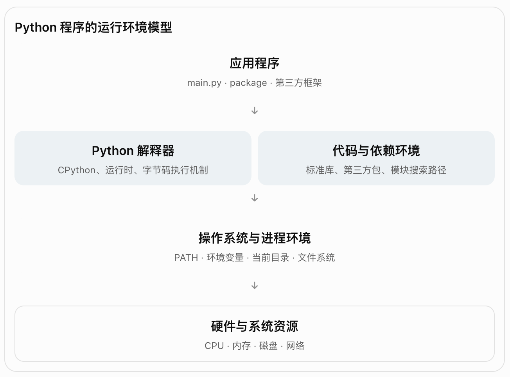
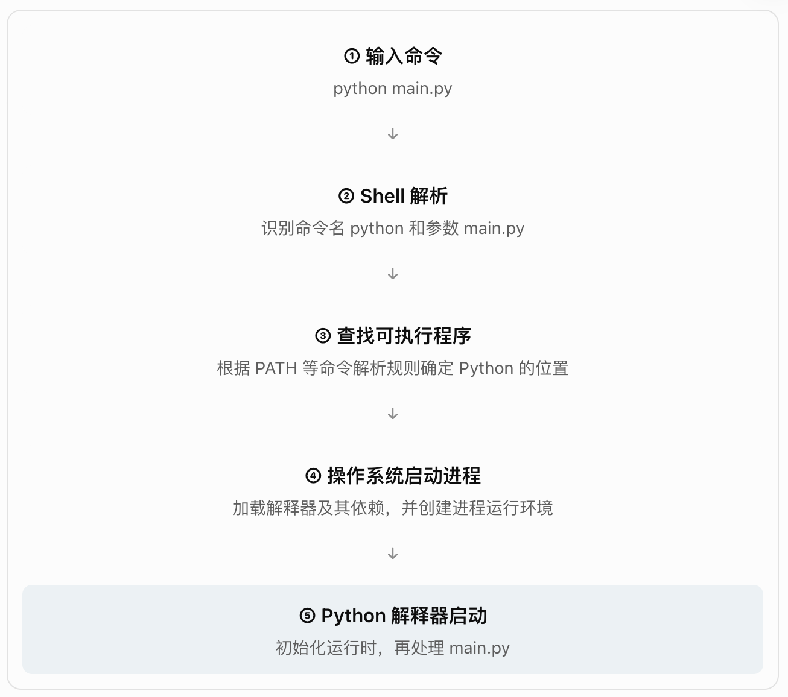
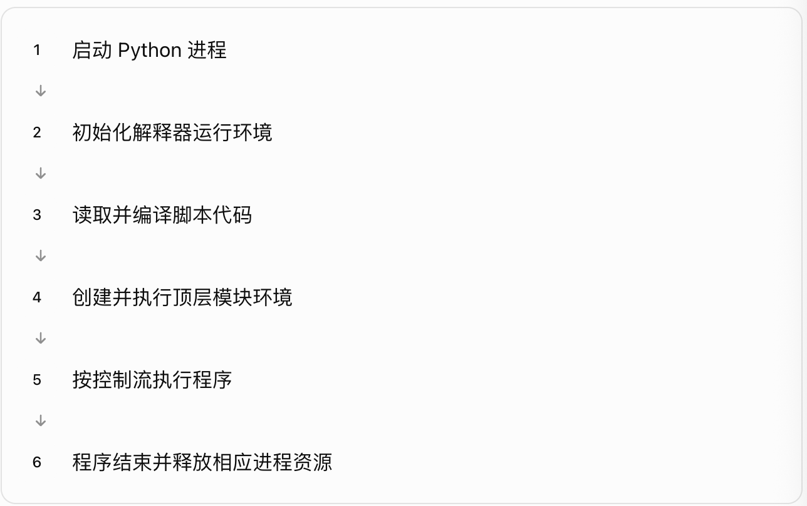
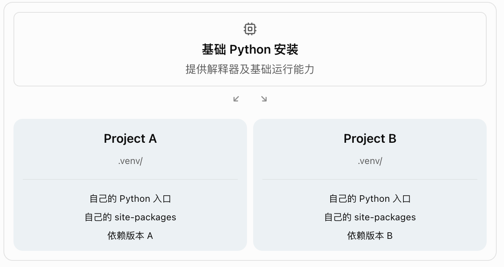
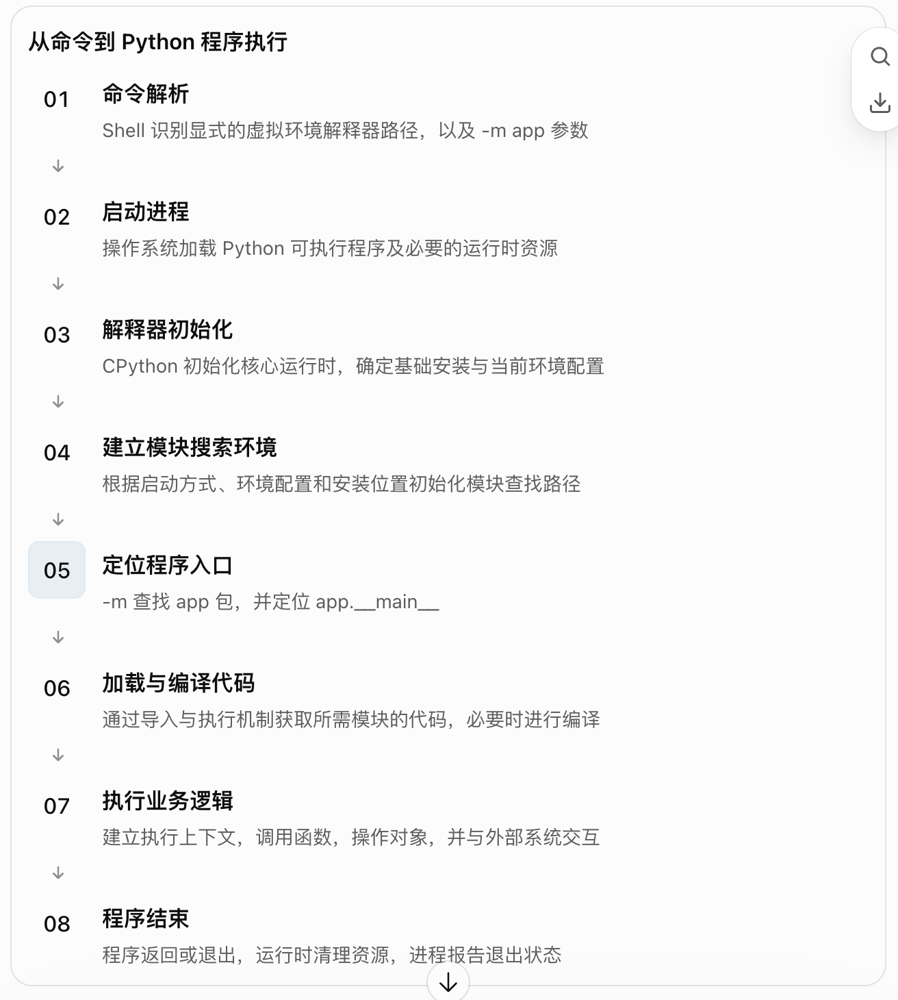

## 第二章：Python 的运行环境与程序执行方式

(第一篇 · 语言本质与基础模型) (第 2 / 27 章)

上一章，我们建立了 Python 的三个重要底层认知：

- **语言层面**：Python 定义语法、语义和对象行为。
- **执行层面**：以 CPython 为例，源代码经过解析、编译，再由运行时执行。
- **数据层面**：程序通过对象表达数据，通过名称绑定、作用域和对象操作完成计算。

但是，上一章还有一个尚未深入解释的问题：

当我们在终端输入：

```bash
python main.py
```

计算机究竟是怎样找到 Python、启动解释器、加载代码、定位第三方依赖，然后让程序运行起来的？

这就是第二章要研究的核心。

本章会从 **操作系统、Python 解释器、程序入口、模块搜索路径、依赖安装和虚拟环境** 六个维度，建立一套完整的 Python 运行环境模型。

## 2.1 什么是 Python 运行环境？

首先，要区分一个容易混淆的概念：

**安装了 Python，不等于已经理解或正确配置了 Python 的运行环境。**

一个完整的 Python 运行环境，至少涉及以下几个部分。



从这个结构可以看出：

运行 Python 程序，并不只是解释器读取一个 `.py` 文件那么简单。

我们需要回答几个不同的问题。

| 问题 | 由什么决定 |
|--------|--------|
| 运行哪个 Python？ | 命令解析、可执行文件路径 |
| 使用哪个 Python 版本？ | 被启动的解释器 |
| 使用哪些第三方依赖？ | 当前 Python 环境的安装目录与模块搜索机制 |
| 从哪个文件开始运行？ | Python 启动参数和程序入口 |
| 如何找到其他模块？ | 导入系统、`sys.path` 等 |
| 程序在哪个目录运行？ | 进程当前工作目录 |
| 如何访问系统资源？ | 操作系统接口、运行时和标准库 |

本章最重要的目标，就是把这些概念彻底区分开。

---

## 2.2 从终端执行 `python` 开始理解启动机制

我们先研究最基础的命令：

```bash
python --version
```

为什么输入 `python`，操作系统就能够运行一个 Python 解释器？

### 一、`python` 首先是一个命令名

当我们在终端输入：

```bash
python main.py
```

在常见的命令行环境中，首先处理这个命令的通常是 Shell，例如 Bash、Zsh 或 PowerShell。

Shell 负责解析命令，并根据自己的命令查找规则确定要执行哪个程序。

在常见的 PATH 查找场景下，流程可以理解为：



需要注意：`python` 不是某个全世界统一的固定文件。

它只是当前命令行环境所解析的命令名称。

不同计算机、不同终端，甚至同一终端中的不同环境配置，都可能让 `python` 指向不同的解释器。

### 二、什么是 PATH？

`PATH` 是操作系统进程环境中常见的环境变量，用于向命令解释器提供查找可执行程序的目录。

例如，在 Linux 或 macOS 中，它可能包含：

```text
/usr/local/bin:/usr/bin:/bin
```

这些路径之间使用冒号分隔。

在 Windows 中，PATH 通常使用分号分隔不同目录。

假设 PATH 包含：

```text
/opt/python/bin
/usr/local/bin
/usr/bin
```

而其中存在：

```text
/opt/python/bin/python
```

那么 Shell 在相应规则下就可能把 `python` 解析为这个路径的可执行程序。

这里要建立一个非常重要的区分：

**PATH 是用来寻找命令及可执行程序的，并不是 Python 用来寻找 `import` 模块的路径。**

后面我们会讲另一个经常与之混淆的概念：`sys.path`。

### 三、为什么会出现 python、python3、py？

在不同平台上，可能会看到以下命令：

```bash
python
python3
python3.14
```

Windows 环境还可能使用：

```powershell
py
py -3
```

它们的性质并不完全相同。

- `python`：通常是某个 Python 解释器的可执行程序名称。
- `python3`：在许多 Unix 类系统中，用来明确指定 Python 3。
- `python3.14`：在支持该命名方式的安装中，可以指定相应版本的解释器。
- `py`：Windows 中的 Python 启动器或安装管理器提供的命令入口，具体行为取决于安装方式和版本。

因此，不能仅凭输入了 `python` 就断定实际使用哪个版本。

更可靠的方法是直接检查：

```bash
python --version
```

但如果想知道究竟运行的是哪个可执行文件，仅查看版本号仍然不够。

因为同一台计算机上可能存在多个版本号相同、依赖却不同的 Python 环境。

### 四、如何确认真正执行的是哪个 Python？

可以让 Python 自己告诉我们。

```bash
python -c "import sys; print(sys.executable)"
```

例如，可能输出：

```text
/home/developer/project/.venv/bin/python
```

这表示当前 Python 运行时报告的解释器可执行文件路径。

再执行：

```bash
python -c "import sys; print(sys.version)"
```

查看更完整的版本信息。

其中：

- `sys.executable`：当前解释器对应的可执行文件路径。
- `sys.version`：Python 版本及构建信息。
- `sys.version_info`：结构化的 Python 版本信息。

在排查环境问题时，**`sys.executable` 往往比单独查看版本号更加重要。**

因为它直接告诉我们当前程序究竟在使用哪个解释器。

---

## 2.3 Python 解释器内部由哪些部分组成？

第一章讲过 CPython，但没有展开它的内部构成。

我们现在从运行环境角度进一步理解。

CPython 是 Python 语言的一种实现，它不仅包含执行字节码的部分，还涉及对象管理、内存管理、模块加载和运行时服务。

可以将其主要职责划分为以下几个逻辑部分。

### CPython 的概念性内部架构

**源代码处理**

词法分析、语法分析、AST、编译

**执行引擎**

字节码执行、函数调用、控制流

**对象系统**

类型、属性、对象协议

**内存管理**

对象分配、引用计数、GC

**导入机制**

模块查找、加载与缓存

**运行时服务**

异常、线程状态、系统接口


### 一、解释器负责执行程序

例如：

```python
a = 10
b = 20

print(a + b)
```

执行引擎需要按照代码含义，完成对象读取、运算和函数调用。

### 二、对象系统负责提供行为

例如：

```python
a = [1, 2]
a.append(3)
```

解释器需要通过对象的类型及属性查找机制，找到 `append` 方法并完成调用。

这属于 Python 对象系统和执行引擎之间的协作。

### 三、内存管理负责对象生命周期

列表对象需要占用内存空间。

当对象不再被程序需要时，相关内存资源应当能够在适当时机被回收。

CPython 的常规构建主要依赖引用计数，并配合垃圾回收机制处理循环引用。

### 四、导入系统负责组织代码

例如：

```python
import json
```

Python 需要定位对应的模块，并完成必要的加载和初始化。

它不只是简单地查找一个名为 `json.py` 的文件。

导入还涉及模块缓存、包结构、搜索器与加载器等机制。

所以从系统角度来看：

**Python 解释器不仅是代码执行器，它还为 Python 程序提供了对象、模块、内存和运行时管理能力。**

---

## 2.4 Python 程序有哪些执行方式？

在真实开发中，Python 并不只有 `python main.py` 这一种执行方式。

不同启动方式的关键区别，不只是命令写法不同，还涉及**入口模块、模块搜索路径、运行上下文和程序参数**。

常见执行方式如下。

| 执行方式 | 命令 | 主要用途 |
|--------|--------|--------|
| 交互式运行 | `python` | 直接执行表达式和语句 |
| 脚本运行 | `python main.py` | 执行指定文件 |
| 模块运行 | `python -m app.main` | 通过模块系统定位并执行 |
| 命令运行 | `python -c "print(1)"` | 执行命令行提供的代码 |
| 标准输入运行 | `python -` | 从标准输入读取代码 |
| 包运行 | `python -m app` | 执行包的 `__main__.py` |

这些形式都由 CPython 官方命令行接口支持。 [Python 3.15.2 documentation](https://docs.python.org/3/using/cmdline.html?utm_source=chatgpt.com)

### 一、交互式运行：REPL

终端输入：

```bash
python
```

在交互式终端中，通常会进入：

```python
>>> 1 + 2
3

>>> name = "Python"

>>> print(name)
Python
```

这里出现了一个特殊符号：

```text
>>>
```

它是 Python 交互式提示符，不属于需要输入的 Python 代码。

REPL 是：

**Read → Evaluate → Print → Loop**

即读取输入、求值或执行、展示结果、继续等待输入。

在 Python 中，这个过程不仅可以计算表达式，还可以执行赋值、定义函数、定义类等语句。

例如：

```python
>>> x = 10
>>> x + 20
30
```

有个细节值得注意。

在交互环境中，直接输入：

```python
x + 20
```

Python 通常会展示表达式结果。

但是在普通脚本中：

```python
x = 10
x + 20
```

并不会因为计算出了 `30` 就自动打印它。

如果需要输出，应该写：

```python
print(x + 20)
```

原因在于：交互式环境存在专门的结果展示机制，而普通脚本不会自动展示每个表达式的值。

另外，REPL 会保留当前会话中创建的名称绑定。

```python
>>> a = 100
>>> b = 200
>>> a + b
300
```

但退出 REPL、重新启动解释器后，先前定义的普通内存状态不会自动恢复。

这说明 REPL 是一个持续运行的 Python 会话，而不是每输入一行代码就必然新建一个操作系统进程。

### 二、脚本运行

假设存在文件：

```text
main.py
```

内容为：

```python
print("程序开始")

name = "Python"

print(name)

print("程序结束")
```

运行：

```bash
python main.py
```

Python 会将该文件作为程序入口执行。

典型的执行生命周期可以理解为：



脚本运行适合自动化任务、一次性数据处理、命令行应用，以及很多服务程序的入口。

不过，脚本执行与模块执行存在重要区别。

### 三、模块运行：`python -m`

这是 Python 工程中非常重要的一种启动方式。

例如：

```bash
python -m pip --version
```

这里：

```text
python
```

表示启动一个 Python 解释器。

```text
-m
```

表示使用模块执行模式。

```text
pip
```

表示让解释器通过模块导入机制查找名为 `pip` 的模块或包，并执行其入口。

所以，`-m` 的核心不是“执行某个路径下的 Python 文件”，而是：

**根据模块名称，通过 Python 模块系统定位并执行代码。**

两种启动方式存在根本区别：

```bash
python app/main.py
```

关注的是文件路径。

而：

```bash
python -m app.main
```

关注的是模块名称。

这会影响包上下文和模块搜索行为，后面我们会详细分析。

### 四、命令行直接执行代码：`-c`

例如：

```bash
python -c "print(10 + 20)"
```

这会执行：

```python
print(10 + 20)
```

并输出：

```text
30
```

这类方式适合环境探查、简单自动化和执行少量 Python 代码。

例如：

```bash
python -c "import sys; print(sys.executable)"
```

它不需要提前创建 `.py` 文件。

但它并不适合作为复杂应用的主要代码组织方式。

---

## 2.5 程序入口：`__name__` 与 `__main__`

现在进入一个非常重要的语言机制。

为什么 Python 项目经常出现这样的代码？

```python
if __name__ == "__main__":
    main()
```

要理解它，首先必须区分：

**一个 Python 文件被导入，与它作为程序入口执行，是两种不同的运行上下文。**

### 一、什么是 `__name__`？

每个模块都有一些特殊属性。

其中 `__name__` 表示模块在当前运行上下文中的名称。

例如创建：

```python
# hello.py

print(__name__)
```

如果直接执行：

```bash
python hello.py
```

输出：

```text
__main__
```

如果创建另一个文件：

```python
# app.py

import hello
```

然后执行：

```bash
python app.py
```

导入 `hello` 时通常会输出：

```text
hello
```

为什么？

因为对于直接执行的顶层模块，Python 会将其 `__name__` 设置为：

```python
"__main__"
```

而作为普通模块导入时，它的 `__name__` 通常是模块的实际名称。 [Python 3.15.2 documentation](https://docs.python.org/3/library/__main__.html?utm_source=chatgpt.com)

### 二、为什么需要区分入口执行与模块导入？

考虑以下代码：

```python
# tools.py

def calculate(a, b):
    return a + b

print("初始化完成")

print(calculate(10, 20))
```

假设我们想在其他文件中复用 `calculate`：

```python
# main.py

from tools import calculate

result = calculate(100, 200)
print(result)
```

执行 `main.py` 时，导入 `tools` 会运行它的顶层代码。

因此，除了输出 `300`，还会出现：

```text
初始化完成
30
```

这可能不是我们希望的行为。

因为我们只想导入一个函数，却额外执行了演示逻辑。

需要注意：**`import` 不只是读取函数声明，模块首次加载时通常会执行模块顶层代码。**

Python 不会因为某条语句处于模块顶层，就自动判断它是“初始化逻辑”还是“演示逻辑”。

### 三、入口保护机制

可以改成：

```python
# tools.py

def calculate(a, b):
    return a + b

def main():
    print("初始化完成")
    print(calculate(10, 20))

if __name__ == "__main__":
    main()
```

现在有两种情况。

直接执行：

```bash
python tools.py
```

此时：

```python
__name__ == "__main__"
```

条件成立，因此执行：

```python
main()
```

但在其他模块中：

```python
from tools import calculate
```

此时 `tools.__name__` 为 `"tools"`，因此不会自动调用 `main()`。

注意，**并不是整个模块的代码都不执行**。

函数定义、类定义和其他不在入口保护条件中的顶层代码，仍然会在模块初始化时执行。

入口保护真正控制的是其条件语句内部的代码是否执行。

### 四、推荐的程序入口组织方式

对于需要支持脚本执行的模块，一个清晰的结构是：

```python
import sys

def calculate(a: int, b: int) -> int:
    return a + b

def main() -> int:
    result = calculate(10, 20)
    print(result)

    return 0

if __name__ == "__main__":
    sys.exit(main())
```

这里引入了两个新概念。

首先，`main()` 只是一个普通函数，并不是 Python 语言规定必须存在的函数名。

它是一种工程约定，用于集中管理程序入口逻辑。

其次：

```python
sys.exit(main())
```

会在执行 `main()` 之后，把结果交给程序退出机制。

在常见约定中：

- 返回 `0` 表示成功。
- 返回非零整数表示特定失败状态。

这种结构便于复用、测试，也能与 Python 命令行工具的入口机制保持一致。

---

## 2.6 `python main.py` 与 `python -m app.main` 为什么不一样？

这是本章最值得深入理解的一个问题。

假设有以下项目：

```text
my_project/
│
├── app/
│   ├── __init__.py
│   ├── main.py
│   └── utils.py
│
└── README.md
```

`utils.py`：

```python
def greet(name):
    return f"Hello, {name}"
```

`main.py`：

```python
from .utils import greet

print(greet("Python"))
```

这里使用了：

```python
from .utils import greet
```

前面的点号表示相对导入。

它要求 Python 能够识别当前模块所在的包上下文。

### 一、直接执行文件

在项目根目录下执行：

```bash
python app/main.py
```

可能得到这样的错误：

```text
ImportError: attempted relative import with no known parent package
```

这是因为直接按文件路径执行时，`main.py` 作为顶层脚本运行。

它通常没有能够支持上述显式相对导入的已知父包上下文。

具体来说，直接执行普通文件时，其 `__package__` 通常是 `None`。

所以：

```python
from .utils import greet
```

中的点号无法正确解析。

### 二、按照模块执行

换成：

```bash
python -m app.main
```

在项目根目录已处于模块搜索路径的前提下，这样运行就可以成功。

输出：

```text
Hello, Python
```

这是因为 Python 通过模块查找机制定位：

```text
app.main
```

然后将其作为程序入口执行。

此时，它知道该模块属于：

```text
app
```

这个包。

因此：

```python
from .utils import greet
```

可以根据包上下文定位到：

```text
app.utils
```

### 三、两种执行方式的核心区别

| 维度 | `python app/main.py` | `python -m app.main` |
|--------|--------|--------|
| 定位依据 | 文件路径 | 模块名称 |
| 执行入口名称 | `__main__` | `__main__` |
| 包上下文 | 通常缺少已知父包 | 根据模块位置建立 |
| `sys.path` 首项 | 通常是脚本目录 | 通常是当前工作目录 |
| 显式相对导入 | 容易失败 | 可根据包上下文正常工作 |
| 典型使用 | 独立脚本 | 包内模块或工程入口 |

需要明确一点：

`-m` **并不代表性能更高，也不意味着直接执行文件的方式已经过时**。

它们的差异主要在代码定位与运行上下文。

如果项目本身采用包结构，模块化启动往往能够更好地保留项目的组织关系。

这也是很多 Python 工程工具使用 `python -m ...` 的重要原因。

官方文档明确规定，`-m` 通过标准导入机制定位模块，并在 `__main__` 上下文执行它。 [Python 3.15.2 documentation](https://docs.python.org/3/using/cmdline.html?utm_source=chatgpt.com)

### 四、`python -m app` 又是什么意思？

如果希望直接启动一个包：

```bash
python -m app
```

那么可以采用这样的项目结构：

```text
my_project/
│
└── app/
    ├── __init__.py
    ├── __main__.py
    ├── main.py
    └── utils.py
```

其中：

```python
# app/__main__.py

from .main import main

main()
```

而：

```python
# app/main.py

def main():
    print("应用启动")
```

当执行：

```bash
python -m app
```

Python 会定位并执行包中的：

```text
app/__main__.py
```

注意，这里的 `__main__.py` 和 `__name__ == "__main__"` 是相关但不同的概念：

前者是特定用途的文件名，后者是判断当前模块是否作为顶层入口运行的条件。

---

## 2.7 工作目录、文件目录与模块搜索路径

下面研究另一个经常导致 Python 项目出现问题的概念。

假设有以下代码：

```python
with open("config.json", encoding="utf-8") as f:
    content = f.read()
```

为什么有时在编辑器中能够正常运行，在终端中却提示文件不存在？

原因通常不是 Python 无法读取 JSON，而是：

**程序的当前工作目录和代码文件所在目录不是同一个概念。**

### 一、什么是当前工作目录？

当前工作目录（Current Working Directory，CWD）是进程用来解析很多相对文件路径的基础目录。

可以通过：

```python
import os

print(os.getcwd())
```

获取。

或者使用：

```python
from pathlib import Path

print(Path.cwd())
```

假设项目结构为：

```text
my_project/
│
├── config.json
│
└── app/
    └── main.py
```

并且当前终端位置是：

```text
/home/user/my_project
```

执行：

```bash
python app/main.py
```

那么在通常情况下，Python 程序的工作目录仍然是：

```text
/home/user/my_project
```

而不是：

```text
/home/user/my_project/app
```

所以：

```python
open("config.json")
```

会尝试从当前工作目录定位：

```text
/home/user/my_project/config.json
```

即使实际执行的代码位于 `app/main.py`。

### 二、`__file__` 是什么？

在普通文件模块中，Python 通常会提供：

```python
__file__
```

表示该模块对应的文件路径。

我们可以使用：

```python
from pathlib import Path

current_file = Path(__file__).resolve()

current_dir = current_file.parent

print(current_file)
print(current_dir)
```

其中：

```python
Path(__file__).resolve().parent
```

通常用于获得当前源文件所在目录。

如果希望读取当前项目根目录下的配置文件，可以明确构建路径：

```python
from pathlib import Path

project_root = Path(__file__).resolve().parent.parent

config_path = project_root / "config.json"

content = config_path.read_text(encoding="utf-8")
```

这样做的好处是文件位置不再依赖终端当时所在的目录。

但也要注意，`__file__` 不会在所有执行上下文中都存在。例如普通 REPL 中通常没有对应的脚本文件。

### 三、PATH、PYTHONPATH、sys.path 有什么区别？

这三个概念很容易混淆。

| 名称 | 所属层次 | 主要作用 |
|--------|--------|--------|
| `PATH` | 操作系统及命令行环境 | 查找可执行程序 |
| `PYTHONPATH` | Python 环境配置 | 向 Python 模块搜索路径添加目录 |
| `sys.path` | Python 运行时 | 当前解释器使用的模块搜索路径列表 |

区别可以用两个问题说明。

当输入：

```bash
python
```

系统怎样找到 Python 解释器？

主要与命令解析机制及 `PATH` 等配置有关。

但当 Python 执行：

```python
import my_module
```

如何找到 `my_module`？

这由 Python 的导入系统决定，而 `sys.path` 是文件系统模块查找的重要输入之一。

这两种查找发生在不同的层次。

### 四、理解 `sys.path`

可以打印：

```python
import sys

for path in sys.path:
    print(path)
```

输出可能包含：

```text
/home/user/my_project
/usr/local/lib/python3.x
/usr/local/lib/python3.x/site-packages
```

这些只是示意路径，具体内容依赖操作系统、解释器和当前环境。

Python 启动时会初始化模块搜索路径。

在普通 CPython 启动配置下，它通常受到以下因素影响：

1. 程序的启动方式与入口位置。
2. `PYTHONPATH` 等环境配置。
3. Python 自带标准库的安装位置。
4. 当前环境的第三方包安装位置。
5. 解释器启动选项以及 `site` 初始化行为。

不同运行方式还会影响搜索路径的开头。

例如，默认情况下：

```bash
python app/main.py
```

会将脚本所在目录加入前面的搜索位置。

而：

```bash
python -m app.main
```

会将当前工作目录放在前面的搜索位置。

官方关于 `sys.path` 初始化的文档明确区分了这些规则，同时说明了一些启动选项可以改变它们。 [Python 3.15.2 documentation](https://docs.python.org/3.15/library/sys_path_init.html?utm_source=chatgpt.com)

不过不要误认为 `import` 只是在 `sys.path` 中从头到尾查找 `.py` 文件。

实际导入系统还涉及：

- `sys.modules` 中已加载模块的缓存。
- 内置模块、冻结模块。
- Meta Path Finder 和 Loader。
- 包及其内部搜索路径。
- 扩展模块和其他可加载的模块形式。

其中最值得先理解的是 `sys.modules`。

它是模块缓存的重要组成部分。

通常情况下，一个模块第一次被导入时会执行初始化；后续对同一模块名称的导入，可能直接取得已经加载的模块对象，而不是重新运行其所有顶层代码。

这些细节将在第 17 章完整展开。

### 五、为什么不推荐随意修改全局 `PYTHONPATH`？

因为全局配置会影响使用该环境变量的不同 Python 运行实例。

一旦把某个项目目录长期写入全局 `PYTHONPATH`，可能导致其他项目导入了不期望的模块。

这甚至会掩盖项目自身的包结构问题。

通常更合理的方向是明确项目结构、使用正确的运行入口，并通过标准的包安装和环境管理方式让模块可被定位。

另外，Python 默认把脚本目录或当前目录加入搜索路径，有时会造成模块名称冲突。例如项目中创建一个 `json.py`，就可能干扰标准库 `json` 的导入。

在安全要求更高的场景中，CPython 还提供 `-P`、`-I` 等选项，用于限制部分默认搜索路径和环境配置行为。 [Python 3.15.2 documentation](https://docs.python.org/3/library/sys.html?utm_source=chatgpt.com)

---

## 2.8 Python 虚拟环境的原理

现在进入本章的另一个核心内容。

为什么一个 Python 项目通常需要独立的虚拟环境？

### 一、先理解没有虚拟环境时的问题

假设计算机安装了一个 Python 解释器。

现在有两个项目：

```text
Project A
    需要某个库的 1.x 版本

Project B
    需要同一个库的 2.x 版本
```

如果两个项目共享同一组第三方包安装目录，就可能发生依赖冲突。

例如：

Project A 依赖旧版本 API。

Project B 依赖新版本 API。

如果不加区分地更新共享环境中的依赖，可能修复了 Project B，却破坏了 Project A。

因此，我们需要一种机制：

**让不同项目使用独立的依赖安装空间。**

虚拟环境就是为解决这类问题而设计的。

### 二、什么是 venv？

Python 标准库提供：

```text
venv
```

用于创建轻量级的 Python 虚拟环境。

虚拟环境建立在某个已有 Python 安装之上，拥有自己的环境目录与第三方包安装位置。

默认情况下，它与基础 Python 环境的第三方包安装空间隔离。 [Python 3.15.2 documentation](https://docs.python.org/3.15/library/venv.html?utm_source=chatgpt.com)

可以理解为：



这里有一个非常容易误解的地方：

**创建虚拟环境，并不是重新实现一套 Python 语言，也不是启动一台独立虚拟机。**

虚拟环境通常会提供指向或复制自基础安装的 Python 可执行程序，并借助环境配置改变解释器的安装前缀、包搜索位置等行为。

其主要目标是隔离 Python 层面的环境，而不是隔离整个操作系统。

### 三、虚拟环境的典型目录结构

执行：

```bash
python -m venv .venv
```

在 Linux 或 macOS 中，可能生成：

```text
my_project/
│
├── main.py
│
└── .venv/
    ├── pyvenv.cfg
    ├── bin/
    │   ├── python
    │   ├── pip
    │   └── activate
    └── lib/
        └── python3.x/
            └── site-packages/
```

在 Windows 中，通常类似：

```text
my_project/
│
├── main.py
│
└── .venv/
    ├── pyvenv.cfg
    ├── Scripts/
    │   ├── python.exe
    │   ├── pip.exe
    │   └── Activate.ps1
    └── Lib/
        └── site-packages/
```

具体文件和目录可能随平台、版本及创建参数有所不同。

这里尤其重要的是：

```text
pyvenv.cfg
```

它是虚拟环境的重要配置文件。

其中包含与基础 Python 安装有关的信息，以及是否允许访问系统级第三方包等配置。

### 四、虚拟环境如何被 Python 识别？

Python 运行时有一组重要属性：

```python
import sys

print(sys.prefix)
print(sys.base_prefix)
```

这两个属性代表不同含义。

`sys.prefix` 表示当前 Python 环境对应的安装前缀。

`sys.base_prefix` 表示基础 Python 安装的前缀。

对于标准 `venv`，可以通过：

```python
sys.prefix != sys.base_prefix
```

判断是否运行在虚拟环境中。

在现代 CPython 中，启动时的路径初始化会识别相关 `pyvenv.cfg` 配置，并设置相应环境前缀。

其中 Python 3.14 对前缀初始化的阶段进行了调整，因此不同版本在使用 `-S` 等特殊启动选项时可能存在行为差异。 [Python 3.15.2 documentation](https://docs.python.org/3.15/library/sys_path_init.html?utm_source=chatgpt.com)

这里最重要的不是记住这些内部细节，而是理解：

**虚拟环境隔离依赖，靠的不是简单地给项目文件夹加一个名字，而是改变 Python 运行环境的定位与包搜索配置。**

### 五、激活虚拟环境究竟做了什么？

创建环境后，我们通常会执行激活命令。

Linux / macOS：

```bash
source .venv/bin/activate
```

Windows PowerShell：

```powershell
.\.venv\Scripts\Activate.ps1
```

激活后，终端可能出现：

```text
(.venv)
```

这个前缀只是方便识别当前环境的提示。

激活机制真正重要的操作之一，是修改当前 Shell 的 `PATH`，使虚拟环境的可执行程序目录优先被找到。

例如原本：

```text
/usr/local/bin/python
```

激活之后，输入：

```bash
python
```

可能优先找到：

```text
/home/user/my_project/.venv/bin/python
```

因此：

```bash
python main.py
```

会使用虚拟环境对应的 Python 运行入口。

**激活虚拟环境不等于创建一个新的 Python 进程。**

激活只是在当前 Shell 会话中调整环境设置。

真正执行 `python` 命令时，才启动对应的 Python 程序。

另外，激活并不是使用虚拟环境的必要条件。

即使完全没有激活，也可以直接运行：

```bash
.venv/bin/python main.py
```

Windows 下则可以使用：

```powershell
.\.venv\Scripts\python.exe main.py
```

这种方式直接指定虚拟环境的解释器路径，避免依赖当前 Shell 的 PATH 查找结果。

### 六、虚拟环境与容器有什么区别？

既然后续还会学习 Docker，这里先区分二者。

| 维度 | Python venv | Docker 容器 |
|--------|--------|--------|
| 主要目标 | 隔离 Python 运行环境及包 | 提供应用运行所需的容器化环境 |
| Python 依赖 | 可以隔离 | 可以隔离 |
| 操作系统文件系统 | 大体共享宿主环境 | 使用容器文件系统视图 |
| 系统级依赖 | 仍依赖宿主系统 | 可随镜像打包部分系统依赖 |
| 进程和网络隔离 | 不提供专门隔离 | 通常利用操作系统隔离机制 |
| 典型用途 | 本地项目依赖管理 | 环境交付、部署与运行隔离 |

虚拟环境不能替代容器，容器也不意味着内部不需要合理管理 Python 依赖。

它们解决的是不同层次的问题。

---

## 2.9 pip、依赖安装与解释器的关系

理解了虚拟环境，再来看 `pip`。

### 一、pip 是什么？

`pip` 是 Python 生态中常用的包安装和管理工具。

它可以从 Python 包索引或其他受支持的来源获取软件包，并安装到目标 Python 环境中。

例如：

```bash
python -m pip install requests
```

这里并不是让 Python 自己执行 HTTP 请求库的业务代码。

它的含义是：

让当前选择的 Python 解释器运行 `pip` 工具，然后执行包安装操作。

对于采用常规配置的环境，第三方 Python 模块通常安装在对应环境的 `site-packages` 目录中。

### 二、为什么推荐 `python -m pip`？

假设电脑有两个 Python 环境：

```text
/usr/bin/python3

/home/user/project/.venv/bin/python
```

而 Shell 中的：

```bash
pip
```

恰好被解析为某个全局安装的 pip 程序。

此时执行：

```bash
pip install requests
```

可能会将依赖安装到非预期的 Python 环境中。

然后程序使用：

```bash
/home/user/project/.venv/bin/python main.py
```

就可能找不到它。

原因在于安装依赖和执行程序所使用的环境并不一致。

使用：

```bash
python -m pip install requests
```

能够让当前 `python` 对应的解释器执行其环境中的 `pip` 模块，从而大幅减少环境错配问题。

如果需要彻底明确目标环境，还可以使用：

```bash
.venv/bin/python -m pip install requests
```

这也是 Python Packaging 官方指南中采用的安装方式。 [Python Packaging User Guide](https://packaging.python.org/en/latest/tutorials/installing-packages/?utm_source=chatgpt.com)

但要注意，`pip` 不是所有 Python 安装都必然自带的模块。某些发行版或特殊环境需要单独安装它。

### 三、为什么安装成功却无法导入？

考虑：

```bash
pip install some_package
```

安装工具提示成功。

但执行：

```python
import some_package
```

却抛出：

```text
ModuleNotFoundError
```

这类问题的关键不是立刻重复安装很多次。

应该从运行模型出发，判断：

当前程序是否使用了安装目标对应的解释器？

当前解释器的模块搜索路径是否包含所需的安装目录？

包的安装名称和导入名称是否一致？

模块是否真的存在并且兼容当前 Python 版本及平台？

尤其要注意：**包的安装名称与 Python 导入名称不一定相同。**

例如，有些 Python 包使用一个名称发布，但需要通过另一个名称进行导入。

而 `ModuleNotFoundError` 也未必表示顶层包完全不存在。

有时候是包内部导入的某个间接依赖缺失。

理解解释器、pip 和导入路径之间的关系，能帮助我们判断实际问题在哪里。

### 四、虚拟环境是否保证依赖完全可复现？

不保证。

假设两个开发者都创建了虚拟环境，然后分别执行：

```bash
python -m pip install some_package
```

由于安装时间、依赖约束、Python 版本或操作系统不同，最终安装结果仍可能不同。

所以必须区分：

**依赖隔离（Isolation）** 和 **依赖可复现（Reproducibility）**。

虚拟环境主要解决依赖隔离。

为了提高环境可复现性，往往还需要：

- 明确 Python 版本要求。
- 使用项目依赖声明，例如 `pyproject.toml`。
- 对依赖版本建立约束或锁定。
- 在适当场景下使用锁文件和一致的安装流程。

这些内容将在第 25 章的工程化依赖管理中进一步讲解。

---

## 2.10 Python 程序运行时还依赖哪些进程信息？

除了代码与模块，还有另一组影响程序行为的重要信息：**进程运行上下文**。

一个 Python 程序通常作为操作系统进程运行。

进程会拥有或访问相应的命令行参数、环境变量、工作目录、标准输入输出和系统资源。

### 一、命令行参数：`sys.argv`

假设程序为：

```python
# main.py

import sys

print(sys.argv)
```

执行：

```bash
python main.py Alice 20
```

典型输出为：

```python
['main.py', 'Alice', '20']
```

`sys.argv` 是 Python 提供的程序参数列表。

这里要注意两个细节。

首先，`sys.argv[0]` 通常与程序入口有关，不是第一个业务参数。

其次，命令行输入的普通参数是字符串。

例如：

```python
sys.argv[2]
```

得到的是：

```python
"20"
```

而不是整数 `20`。

如果程序需要数值，必须根据业务规则进行解析和验证。

在真实命令行应用中，通常会使用 `argparse` 等工具管理参数。

### 二、环境变量

在 Python 中，可以通过：

```python
import os

mode = os.environ.get("APP_MODE", "development")
```

读取进程环境变量。

环境变量是进程运行上下文中的配置数据，而不是 Python 的局部变量或全局变量。

例如，操作系统可以为进程提供：

```text
APP_MODE=production
```

然后 Python 程序可以获取相应值。

在 AI 项目中，环境变量经常用于提供服务地址、运行模式、API 凭据等配置。

这里有一个值得强调的区别：

`.env` 是一种常见的文本配置文件约定，并不等同于操作系统环境变量。

**Python 标准库不会因为项目根目录存在 `.env` 文件，就自动把文件内容全部加载到 `os.environ`。**

如果项目采用 `.env`，通常还需要明确的加载机制，或者由开发工具、启动器、容器平台在进程启动前提供环境变量。

### 三、标准输入、标准输出与错误输出

Python 程序通常具备三个基本的标准流：

| 标准流 | Python 对象 | 主要用途 |
|--------|--------|--------|
| 标准输入 | `sys.stdin` | 接收输入数据 |
| 标准输出 | `sys.stdout` | 输出正常结果 |
| 标准错误 | `sys.stderr` | 输出错误和诊断信息 |

例如：

```python
import sys

print("正常输出")

print("错误信息", file=sys.stderr)
```

这两条输出语句的目的地不同。

在终端上，它们可能显示得很相似，但操作系统允许对这些流分别进行重定向。

例如，在常见 Unix Shell 中：

```bash
python main.py > output.txt 2> error.txt
```

可以分别处理正常输出和错误输出。

这不仅是命令行编程的基础，也是理解日志采集、容器日志和 CI/CD 任务的重要前提。

### 四、程序退出状态

当 Python 程序正常执行完成时，通常以成功状态退出。

但可以通过：

```python
import sys

sys.exit(1)
```

向外部运行环境表达失败。

操作系统进程管理、Shell 脚本和自动化系统，可以根据退出状态决定后续行为。

因此，Python 应用并不是脱离操作系统独立存在的。

它始终运行在某个进程上下文中，并通过运行时与外部环境交互。

---

## 2.11 `__pycache__` 和 `.pyc` 文件究竟是什么？

上一章已经讨论过：

Python 源代码在 CPython 中通常会经过编译，再执行相应字节码。

这就会引出一个常见现象。

项目运行之后，目录中出现：

```text
__pycache__/
```

里面可能存在：

```text
utils.cpython-315.pyc
```

这个文件有什么作用？

### 一、`.pyc` 是编译缓存

它通常保存 CPython 编译后的代码对象的序列化形式，其中包括字节码及相关信息。

在适当条件下，Python 可以复用这些缓存，避免重复完成某些编译工作。

例如：

```text
project/
│
├── main.py
├── utils.py
│
└── __pycache__/
    └── utils.cpython-315.pyc
```

这里的 `315` 表示对应的 CPython 3.15 字节码缓存标记的一部分。

不同版本或实现可能采用不同缓存标记。

### 二、Python 为什么需要缓存字节码？

假设程序每次启动都导入一些没有变化的模块。

如果每次都重新解析和编译全部模块代码，就会产生重复工作。

因此，Python 可以将部分编译结果保存下来。

在之后的加载过程中，如果缓存有效，就可以复用。

在后续模块加载时，可以利用有效缓存。

不过需要注意：并不是所有被执行的 `.py` 文件都会自动生成对应的 `.pyc`。

例如，作为普通顶层脚本直接执行的文件，通常不会因为这次执行而自动产生它自己的 `.pyc` 文件。

字节码缓存主要与模块导入机制相关。 [Python 3.14.7 documentation](https://docs.python.org/3/faq/programming.html?highlight=__pycache__&utm_source=chatgpt.com)

### 三、`.pyc` 不是机器码

这个区别非常重要。

`.pyc` 并不是通常意义上可以直接由 CPU 执行的本地可执行程序。

它仍然需要兼容的 Python 运行时来解释和执行。

所以：

**生成 `.pyc` 并不等于把 Python 项目转换成不依赖 Python 运行时的原生程序。**

同时，`.pyc` 也不是可靠的源代码加密方案。

不能因为某个项目只有字节码文件，就认为其中的程序逻辑已经得到了强安全保护。

---

## 2.12 为什么编辑器与终端的运行结果可能不同？

现在把环境机制应用到真实开发场景。

假设同一个项目：

在 VS Code 中运行正常。

在终端执行：

```bash
python main.py
```

却发生错误。

为什么同一份代码会出现不同结果？

因为编辑器并不只是帮我们把文件交给 Python。

它可能还会决定：

- 使用哪个 Python 解释器。
- 使用哪个工作目录启动程序。
- 提供哪些环境变量。
- 传递哪些命令行参数。
- 采用文件启动还是模块启动。
- 是否附加调试器。

例如：

```text
编辑器运行
    ↓
选择项目虚拟环境
    ↓
将项目根目录作为工作目录
    ↓
注入开发环境配置
    ↓
启动 Python
```

而直接在终端运行时，可能是：

```text
终端运行
    ↓
PATH 指向系统 Python
    ↓
当前目录是其他目录
    ↓
没有项目环境变量
    ↓
执行 main.py
```

虽然使用的是同一份源代码，但运行上下文不同。

因此，结果可能不同。

这也是为什么在分析 Python 程序问题时，除了代码本身，还需要理解它是在什么环境中启动的。

### 一个统一的环境诊断模型

当需要了解 Python 程序当前所处的环境时，可以使用下面这段代码查看相关运行信息。

```python
import os
import sys
from pathlib import Path

def show_environment():
    print("Python 版本:")
    print(sys.version)

    print("\n解释器路径:")
    print(sys.executable)

    print("\n当前工作目录:")
    print(os.getcwd())

    print("\n当前环境前缀:")
    print(sys.prefix)

    print("\n基础环境前缀:")
    print(sys.base_prefix)

    print("\n是否属于标准 venv 环境:")
    print(sys.prefix != sys.base_prefix)

    print("\n模块搜索路径:")
    for path in sys.path:
        print(path)

    print("\n程序参数:")
    print(sys.argv)

    print("\n当前模块名称:")
    print(__name__)

    print("\n当前文件路径:")
    print(Path(__file__).resolve())

if __name__ == "__main__":
    show_environment()
```

把这段代码保存成普通 `.py` 文件并运行，就可以观察：

当前到底运行着哪个解释器、使用什么工作目录、属于哪个虚拟环境，以及模块查找依赖哪些路径。

它并不能检测一切环境问题，但覆盖了大量 Python 工程运行问题的基础信息。

---

## 2.13 把整套运行机制连接起来

我们用一个实际项目，从头到尾串联本章内容。

假设项目结构如下：

```text
ai_service/
│
├── .venv/
│
├── app/
│   ├── __init__.py
│   ├── __main__.py
│   ├── main.py
│   └── config.py
│
└── pyproject.toml
```

在项目根目录启动：

```bash
.venv/bin/python -m app
```

这条命令执行时，可以将整个过程分成八个主要阶段。



这八个阶段不是八段彼此独立的源代码流程，而是对 Python 程序启动与运行过程的概念性划分。

其中一些操作存在嵌套、交叉或实现差异。例如，代码编译可能在导入过程中发生，模块初始化也可能继续触发更多模块导入。

但是它能够建立一个完整的运行时认识：

**操作系统负责启动进程，解释器负责建立 Python 运行时，导入系统负责定位代码，代码执行机制负责完成程序逻辑。**

这四种职责需要区分，也需要结合起来理解。

---

## 2.14 本章的核心知识归纳

第一章我们研究了 Python 程序内部的对象和执行原理。

第二章则从更外部的角度，理解 Python 程序在一个具体环境中如何启动、定位和运行。

下面是本章需要形成的六个核心心智模型。

**模型一：命令名不等于解释器本身**

`python` 是命令入口，实际执行哪个 Python 与路径解析及环境配置有关。要确定实际解释器，应当检查 `sys.executable`。

---

**模型二：启动方式决定程序上下文**

REPL、脚本、`-c`、`-m` 和包入口不是完全等价的运行方式，它们会影响模块身份、包上下文及搜索路径。

---

**模型三：命令查找与模块查找相互独立**

`PATH` 主要参与命令查找；`sys.path` 是 Python 模块搜索的重要组成部分；工作目录又决定了很多相对文件路径的解析。

---

**模型四：虚拟环境是依赖环境隔离机制**

`venv` 并不是完整虚拟机。它建立在基础 Python 之上，通过专用运行入口、环境配置和包安装目录实现项目依赖隔离。

---

**模型五：程序运行依赖进程上下文**

当前工作目录、命令行参数、环境变量、标准输入输出和退出状态，都会影响 Python 程序的行为。

---

**模型六：源代码、模块与字节码缓存不是同一个概念**

源文件定义程序，模块机制负责代码组织与加载，字节码缓存主要用于减少重复编译工作。

### 用一张表区分最容易混淆的概念

| 概念 | 本质 | 容易产生的误解 |
|--------|--------|--------|
| `python` | 解释器命令入口 | 认为它永远指向同一个 Python |
| `PATH` | 命令查找路径 | 认为它负责查找 Python 模块 |
| `sys.path` | Python 模块搜索路径 | 认为它只是系统 PATH 的复制 |
| `__file__` | 模块文件路径信息 | 认为它始终等于工作目录 |
| `__name__` | 当前模块的名称 | 认为它总是源文件名 |
| `__main__` | 顶层执行环境名称 | 认为它是必须定义的函数 |
| `venv` | Python 环境隔离机制 | 认为它等于 Docker |
| `pip` | Python 包安装管理工具 | 认为它一定安装到目标项目 |
| `.pyc` | 编译缓存 | 认为它是原生可执行机器码 |

## 第一章与第二章的知识关联

我们现在可以把两章组合起来：

第一章 · 内部执行机制

**代码如何执行？**

源码编译、对象模型、名称绑定、执行帧、作用域

第二章 · 外部运行环境

**程序如何启动？**

进程、解释器定位、运行入口、模块路径、虚拟环境

**完整的 Python 程序运行模型**

在确定的进程与解释器环境中，按照语言规则组织并执行 Python 代码

接下来，我们就可以正式进入 Python 语言的基础语法体系。

此前很多看起来复杂的问题，例如“为什么赋值不等于复制对象”“为什么同一个文件有两种执行方式”，已经有了明确的原理解释。

这会使后续语法学习更加容易形成完整的知识体系。

---

## 下一章：第三章 Python 语法体系

第三章将系统讲解 Python 语法的组织原则。

重点不是简单罗列 `if`、`for`、`while` 或 `=` 的用法，而是建立以下认识：

语法中的表达式（Expression）与语句（Statement）有什么本质区别？Python 如何根据缩进确定代码块？赋值到底如何求值和绑定？运算符优先级、短路求值和链式比较如何影响程序行为？为什么某些语法在编译阶段就会出错，而有些问题直到运行时才出现？

在这一章，我们将把前两章建立的解释器、对象和名称绑定模型，真正运用到 Python 语法的理解中。
