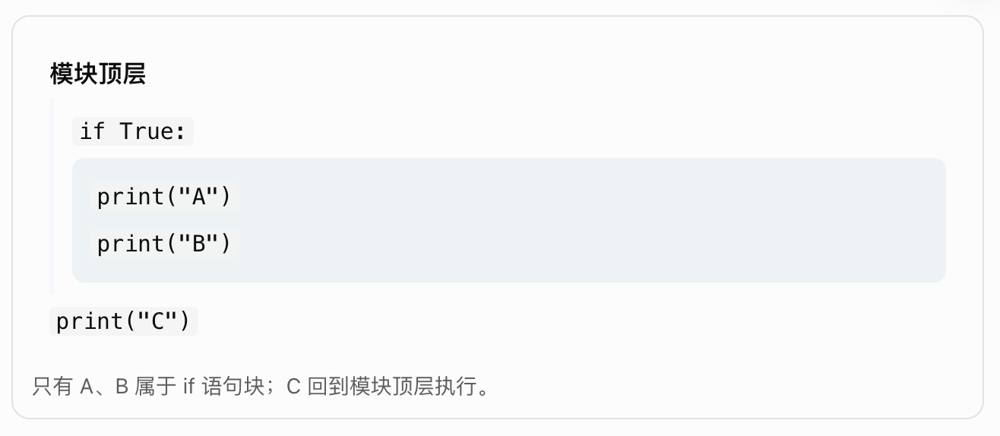
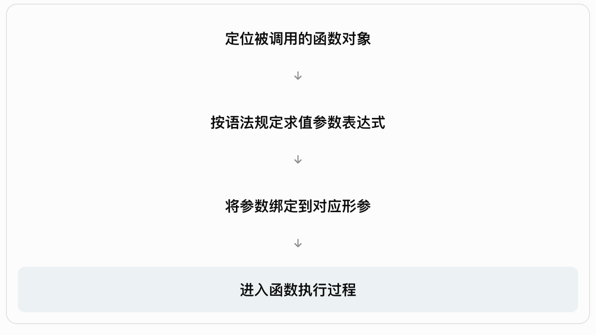

## 第三章：Python 语法体系

第一篇 · 语言本质与基础模型 · 第 3 / 27 章

前两章，我们已经理解了 Python 的运行机制和运行环境：

第一章回答了**Python 程序内部如何执行**，包括解释器、字节码、对象模型、变量绑定和执行帧。

第二章回答了**Python 程序如何启动**，包括解释器定位、模块加载、运行入口、模块搜索路径和虚拟环境。

从第三章开始，我们正式进入 Python 语言本身。

但这一章并不打算按照传统方式，逐个介绍各种语法符号，而是要理解一套更底层的逻辑：

**Python 如何将源代码转换成有明确结构和执行语义的程序？**

例如：

```python
a = 10
b = 20

if a < b:
    result = a + b
else:
    result = a - b

print(result)
```

这段代码虽然简单，但实际上涉及六个不同的机制：

| 机制 | 对应的问题 |
|--------|--------|
| 词法分析 | `if`、`a`、`<`、`10` 分别是什么？ |
| 语法分析 | 哪些符号能够组成合法表达式和语句？ |
| 代码块 | 哪些语句属于 `if`，哪些属于 `else`？ |
| 表达式求值 | `a + b` 应该如何计算？ |
| 名称绑定 | `result = ...` 究竟改变了什么？ |
| 控制流 | 程序会执行哪些语句，跳过哪些语句？ |

本章的学习目标就是建立这些规则之间的联系。

---

# 3.1 Python 源代码的四个层次

首先，必须建立一个整体模型。

程序员看到的是源代码文本，但 Python 不会直接把每一个字符当作独立命令执行。

概念上，源代码会经历下面的处理过程：

**第一层：字符（Characters）**

字母、数字、符号、空格、换行符

`result = 10 + 20`

**第二层：词法单元（Tokens）**

标识符、字面量、运算符、分隔符

`result` · `=` · `10` · `+` · `20`

**第三层：语法结构（Syntax）**

表达式、赋值语句、条件语句、函数定义

赋值语句 ← 加法表达式

**第四层：执行语义（Semantics）**

计算结果、绑定名称、操作对象、改变控制流

计算 30，并使 result 绑定计算结果

这四层分别回答不同的问题。

字符层回答“代码包含什么文本”。

词法层回答“这些文本能够识别成什么语言元素”。

语法层回答“这些语言元素可以组成什么结构”。

语义层回答“这些结构实际意味着什么”。

需要注意，编译器的真实内部处理并不一定是四个完全独立的阶段；这是一种用于理解语言规则的分层模型。

官方 Python 语言参考手册也分别定义词法分析、表达式和语句等内容。 [Python 3.15.2 documentation](https://docs.python.org/3/reference/lexical_analysis.html?utm_source=chatgpt.com) [Python 3.15.2 documentation](https://docs.python.org/3/reference/expressions.html?utm_source=chatgpt.com)

## 3.2 词法体系：Python 如何识别源代码？

### 一、什么是词法分析？

词法分析（Lexical Analysis）是把源代码字符识别为词法单元（Token）的过程。

例如：

```python
price = 100 + 20
```

可以识别为：

| 内容 | 类别 | 含义 |
|--------|--------|--------|
| `price` | 标识符 | 一个名称 |
| `=` | 运算符 | 赋值语法符号 |
| `100` | 数值字面量 | 表示整数值 |
| `+` | 运算符 | 加法 |
| `20` | 数值字面量 | 表示整数值 |

词法分析只是识别这些元素，并不意味着已经完成加法。

真正的计算属于后续执行阶段。

### 二、标识符与关键字

标识符（Identifier）用于命名变量、函数、类和其他程序元素。

例如：

```python
user_name = "Tom"

total_price = 100

def calculate_total():
    pass
```

这里的：

```text
user_name
total_price
calculate_total
```

都是标识符。

Python 标识符区分大小写：

```python
name = "Python"
Name = "Java"

print(name)  # Python
print(Name)  # Java
```

它们是两个不同的名称。

在 Python 3 中，标识符还可以包含符合规则的 Unicode 字符：

```python
价格 = 100
数量 = 3

总价 = 价格 * 数量
```

这是合法的 Python 代码。

但从团队协作和跨语言工程实践来看，通常仍推荐普通代码标识符采用易于共享和维护的英文命名约定。

关键字（Keyword）与普通标识符不同。

例如：

```python
if
else
for
while
def
class
return
```

这些词在 Python 语法中具有特殊含义，不能像普通标识符一样随意使用。

例如：

```python
class = 100
```

会产生语法错误，因为 `class` 已经用于表示类定义语法。

Python 还存在**软关键字（Soft Keyword）**。

例如 `match`、`case` 在特定语法上下文中具有特殊含义，但在其他合法上下文中仍可以作为普通名称。

所以，Python 并不是简单地把所有看起来有特殊用途的词永久保留为关键字。

### 三、字面量是什么？

字面量（Literal）是直接写在源代码中的值表示。

例如：

```python
100
3.14
"Python"
b"hello"
```

分别涉及整数、浮点数、字符串和字节串等字面量。

而：

```python
number
```

不是字面量，而是一个名称表达式。

当执行它时，需要根据名称解析规则找到已经绑定的对象。

这里还有一个容易忽略的细节：

```python
-100
```

在 Python 语法结构中，并不是一个单独的负整数字面量。

它可以分解为：

```text
一元负号 -
    └── 整数字面量 100
```

这点看似微小，但会影响后面指数运算与负号结合的优先级问题。

例如：

```python
print(-2 ** 2)
```

输出：

```text
-4
```

而不是 `4`。

因为这段表达式相当于：

```python
-(2 ** 2)
```

### 四、注释与字符串不是一回事

Python 使用 `#` 开始普通注释。

```python
# 这是注释

price = 100  # 商品价格
```

但如果 `#` 出现在字符串中：

```python
message = "价格 #100"
```

它就是字符串内容，而不是注释开始符号。

还有一个容易被误解的写法：

```python
"""
这是一段说明文字
"""
```

这在语法上是三引号字符串字面量，不是一种独立的“多行注释语法”。

当三引号字符串出现在模块、类或函数体开头的特定位置时，它可以成为文档字符串（Docstring）。

但在其他位置，它依然是字符串表达式。

因此，需要区分：

**注释是词法层面的说明内容，字符串是会参与 Python 语法和对象模型的程序元素。**

### 五、物理行与逻辑行

Python 有两个很重要的概念：

物理行（Physical Line）是源文件中由换行符分隔的文本行。

逻辑行（Logical Line）是 Python 在词法与语法处理中识别出的语句行单位。

二者不一定一一对应。

例如：

```python
total = (
    100
    + 200
    + 300
)
```

虽然源代码写成多行，但它们在词法层面可以组成一条逻辑行。

Python 允许在括号 `()`、方括号 `[]` 和花括号 `{}` 内进行隐式续行。

例如：

```python
users = [
    "Tom",
    "Jack",
    "Alice",
]

config = {
    "host": "localhost",
    "port": 8000,
}
```

这种写法不仅为了美观，也使复杂表达式更容易阅读和维护。

Python 也支持反斜杠显式续行：

```python
total = 100 + \
        200 + \
        300
```

但在需要跨行书写表达式时，通常优先采用括号结构，因为它更清晰，也更不容易受到行尾字符影响。

关键原理是：

**Python 并不是单纯以物理换行符判定一条语句是否结束，而是按照逻辑行及语法规则来处理。**

官方词法规范明确区分物理行、逻辑行以及显式、隐式续行机制。 [Python 3.15.2 documentation](https://docs.python.org/3/reference/lexical_analysis.html?utm_source=chatgpt.com)

---

# 3.3 缩进与代码块：Python 如何描述程序结构？

Python 最具代表性的语法特征之一就是缩进。

但理解缩进，不能只停留在“Python 使用四个空格”的层次。

缩进在 Python 中具有**语法意义**。

### 一、缩进不是单纯的代码格式

先看 JavaScript：

```javascript
if (true) {
    console.log("A");
    console.log("B");
}
```

JavaScript 使用花括号表达这里的语句分组。

Python 则写成：

```python
if True:
    print("A")
    print("B")
```

对于 Python 而言，这里的缩进不是为了视觉对齐。

它用于标识哪些语句属于同一个语句块（Suite）。

在 Python 的词法处理中，缩进层级会产生类似：

```text
INDENT
DEDENT
```

这样的特殊 Token。

它们帮助语法分析器识别块结构。

### 二、缩进如何确定语句归属？

观察：

```python
if True:
    print("A")
    print("B")

print("C")
```

结构可以理解为：



如果缩进发生变化，程序的语义就可能发生变化。

例如：

```python
if False:
    print("A")

print("B")
```

只输出：

```text
B
```

而：

```python
if False:
    print("A")
    print("B")
```

不会输出任何内容。

两段代码的不同之处不是计算逻辑，而是第二个 `print` 的语法归属发生了变化。

### 三、为什么约定使用四个空格？

Python 的语法核心要求是：缩进层级必须按照规则保持一致。

它并不规定所有合法程序都必须采用四个空格。

例如，下面也可以是合法代码：

```python
if True:
  print("Hello")
```

但主流 Python 风格指南 PEP 8 推荐每一级缩进使用四个空格。

工程中还应避免混合使用 Tab 和空格，因为这可能使缩进含义不一致，进而触发 `TabError`。

所以要区分两个层次：

| 层次 | 含义 |
|--------|--------|
| 语言规范 | 缩进确定语句块结构 |
| 代码风格 | 通常采用每级四个空格 |

### 四、缩进块不等于作用域

这是本节最重要的知识点。

在 JavaScript 中，使用 `let` 或 `const` 声明的变量通常具有块级作用域。

但是，Python 的 `if`、`for`、`while` 不会仅仅因为建立了缩进块，就创建新的普通局部作用域。

例如：

```python
if True:
    message = "Python"

print(message)
```

输出：

```text
Python
```

再看：

```python
for i in range(3):
    result = i * 10

print(i)
print(result)
```

输出：

```text
2
20
```

因为这个 `for` 循环没有创建一个独立的局部命名空间。

循环中的名称绑定仍然发生在其所在的作用域中。

但函数不同：

```python
def calculate():
    result = 100
    print(result)

calculate()

print(result)
```

最后一行在没有其他同名绑定的情况下，会抛出 `NameError`。

因为函数体创建了自己的局部名称作用域。

所以务必记住：

> **语句块负责组织代码执行结构，作用域负责规定名称可见性和绑定位置；二者不是同一个概念。**

这一区别，是后面理解闭包、全局变量、局部变量和装饰器的基础。

---

# 3.4 表达式与语句：Python 语法最根本的区分

Python 中的代码结构，可以从两个重要概念入手：

**表达式（Expression）负责求值，语句（Statement）负责规定执行动作或控制结构。**

这是理解后续所有语法的关键。

## 一、什么是表达式？

表达式是一种能够被求值的语法结构。

例如：

```python
10
10 + 20
a * b
len("Python")
```

这些都是表达式。

从对象模型来看，表达式求值会产生一个结果对象。

例如：

```python
10 + 20
```

求值后得到整数对象 `30`。

又如：

```python
len("Python")
```

求值后得到整数对象 `6`。

表达式不一定只是算术运算，还可以涉及：

| 表达式类型 | 示例 | 求值结果 |
|--------|--------|--------|
| 名称表达式 | `price` | 名称绑定的对象 |
| 算术表达式 | `10 + 20` | 运算结果 |
| 比较表达式 | `10 < 20` | 比较结果 |
| 函数调用表达式 | `len("AI")` | 函数返回值 |
| 属性访问表达式 | `user.name` | 属性查找结果 |
| 下标表达式 | `items[0]` | 下标访问结果 |
| 列表表达式 | `[1, 2, 3]` | 列表对象 |
| 条件表达式 | `a if flag else b` | 被选中分支的结果 |

特别注意：表达式的求值过程不保证没有副作用。

例如：

```python
items = []

items.append(10)
```

第二行中的函数调用是表达式，但执行时会修改列表。

它返回 `None`，同时产生了修改对象的副作用。

所以不能认为“表达式只负责计算，不会改变程序状态”。

## 二、什么是语句？

语句是 Python 程序中的执行单位。

例如：

```python
a = 100
```

这是一条赋值语句。

```python
if a > 50:
    print("Greater")
```

这是一条条件语句。

```python
return result
```

这是一条返回语句，只能出现在允许返回语句的语法上下文中，例如函数体。

语句可以包含表达式。

例如：

```python
result = 10 + 20
```

其中：

```python
10 + 20
```

是表达式，而整行：

```python
result = 10 + 20
```

是赋值语句。

其含义为：先计算右侧表达式，再将结果赋给左侧目标。

## 三、表达式与语句为什么要区分？

看下面的 JavaScript：

```javascript
let a = 10;
let b = (a = 20);
```

JavaScript 普通赋值可以作为表达式返回相应的值。

但 Python 中，不能直接写：

```python
a = 10

b = (a = 20)  # SyntaxError
```

因为 Python 的普通赋值 `=` 是赋值语句的语法部分，不能直接放在一个要求表达式的地方。

Python 3.8 引入了专门的赋值表达式运算符 `:=`：

```python
a = 10

b = (a := 20)

print(a)  # 20
print(b)  # 20
```

这里：

```python
a := 20
```

能够完成名称绑定，并产生可供外围表达式使用的值。

所以 Python 区分了两种机制：

| 机制 | 语法 | 是否产生可供外围使用的表达式值 |
|--------|--------|--------|
| 普通赋值语句 | `a = 20` | 否 |
| 赋值表达式 | `(a := 20)` | 是 |

这体现了一个重要设计思想：

Python 并没有要求所有能够执行操作的语法结构都必须作为表达式。

它区分用于控制程序的语句结构，以及能够嵌入计算过程的表达式结构。

## 四、简单语句与复合语句

Python 的语句还可以分为两大类。

| 类型 | 含义 | 示例 |
|--------|--------|--------|
| 简单语句 | 可以放在单个逻辑行内 | 赋值、`return`、`pass`、`import` |
| 复合语句 | 通过子句及语句块组织其他语句 | `if`、`for`、`while`、`try`、`def`、`class` |

例如：

```python
x = 10
```

是简单语句。

而：

```python
if x > 0:
    print("Positive")
```

是复合语句。

复合语句通常采用这样的结构：

```text
关键字 条件或定义内容:
    语句块
```

其中冒号与后续语句块属于语法结构。

Python 允许在某些条件下将简单语句写在冒号同一行，但工程中通常优先采用独立缩进块，以增强可读性。

官方语言规范把这两类语句分别定义为 Simple Statements 和 Compound Statements。 [Python 3.15.0 documentation](https://docs.python.org/3/reference/simple_stmts.html?highlight=assignments&utm_source=chatgpt.com) [Python 3.15.2 documentation](https://docs.python.org/3/reference/compound_stmts.html?utm_source=chatgpt.com)

---

# 3.5 运算符：表达式是如何组合的？

掌握表达式之后，下一步是理解表达式内部的组合规则。

例如：

```python
result = 10 + 20 * 3
```

究竟应该先执行加法还是乘法？

这涉及运算符优先级（Operator Precedence）。

但我们还必须区分另外两个容易混淆的概念：

**优先级、结合性、求值顺序。**

它们并不是同一回事。

## 一、什么是运算符？

运算符是表达特定操作的语法元素。

例如：

```python
10 + 20
```

其中：

```python
+
```

表示加法操作。

但 Python 运算符的行为并不总是固定的底层机器指令。

例如：

```python
print(10 + 20)       # 30
print("AI" + "Agent") # AIAgent
```

两次使用同一个 `+`。

第一次处理整数加法，第二次处理字符串拼接。

从 Python 对象模型来看，运算符与对象类型提供的运算协议有关。

对于用户自定义类，某些运算符还可以通过特殊方法实现定制行为。

因此：

> 运算符负责定义操作的语法形式，具体的运算行为则与操作数的类型和协议有关。

## 二、主要运算符体系

| 类别 | 运算符 | 说明 |
|--------|--------|--------|
| 算术 | `+`、`-`、`*` | 加、减、乘 |
| 除法 | `/`、`//`、`%` | 真除法、向下取整除法、取模 |
| 幂运算 | `**` | 指数运算 |
| 矩阵运算 | `@` | 矩阵乘法协议 |
| 比较 | `==`、`!=`、`>`、`<`、`>=`、`<=` | 值比较 |
| 身份 | `is`、`is not` | 对象身份比较 |
| 成员 | `in`、`not in` | 成员关系判断 |
| 逻辑 | `and`、`or`、`not` | 布尔逻辑 |
| 位运算 | `&`、`\\|`、`^`、`~` | 按位运算 |
| 位移 | `<<`、`>>` | 位移操作 |
| 赋值相关 | `=`、`+=`、`:=` | 赋值语句、增强赋值、赋值表达式 |

这里有一个值得注意的细节：`=` 和 `+=` 参与赋值语句语法，不能简单地把它们视为与 `+`、`*` 完全相同的普通二元表达式运算符。

## 三、优先级决定表达式的结构

例如：

```python
result = 10 + 20 * 3
```

由于乘法优先级高于加法，其表达式结构为：

```text
加法
├── 左操作数：10
└── 右操作数：乘法
    ├── 左操作数：20
    └── 右操作数：3
```

所以：

```python
result = 10 + (20 * 3)
```

结果为：

```text
70
```

如果我们希望先加法：

```python
result = (10 + 20) * 3
```

结果就是：

```text
90
```

括号可以明确改变表达式的分组方式。

## 四、Python 运算符优先级

下面按照从高到低的顺序，整理 Python 常用表达式运算符的优先级。

| 优先级 | 运算符或结构 | 说明 |
|--------|--------|--------|
| 最高 | `()`、`[]`、属性访问、函数调用 | 分组、下标、调用等 |
| 高 | `await x` | 等待表达式 |
| ↑ | `**` | 幂运算 |
| ↑ | `+x`、`-x`、`~x` | 一元运算 |
| ↑ | `*`、`@`、`/`、`//`、`%` | 乘除相关 |
| ↑ | `+`、`-` | 加减 |
| ↑ | `<<`、`>>` | 位移 |
| ↑ | `&` | 按位与 |
| ↑ | `^` | 按位异或 |
| ↑ | `\\|` | 按位或 |
| ↑ | 比较、`in`、`is` | 比较与关系判断 |
| ↑ | `not` | 逻辑非 |
| ↑ | `and` | 逻辑与 |
| ↑ | `or` | 逻辑或 |
| ↑ | `x if c else y` | 条件表达式 |
| ↑ | `lambda` | Lambda 表达式 |
| 最低 | `:=` | 赋值表达式 |

这张表描述的是表达式语法的结合强弱，而不是实际操作数一定按什么时间顺序被计算。 [Python 3.15.2 documentation](https://docs.python.org/3/reference/expressions.html?utm_source=chatgpt.com)

不需要机械背诵整张表。

真正重要的是理解容易影响代码语义的几种关系。

例如：

```python
a + b * c
```

乘法优先于加法。

```python
a > 0 and b > 0
```

比较优先于逻辑与。

```python
a or b and c
```

逻辑与优先于逻辑或，相当于：

```python
a or (b and c)
```

但如果一个表达式需要依靠大量运算符优先级知识才能正确阅读，通常应该适当增加括号。

## 五、结合性决定同级运算的分组方式

例如：

```python
10 - 3 - 2
```

减法通常按照从左到右的结合方式分组：

```python
(10 - 3) - 2
```

结果为：

```text
5
```

而不是：

```python
10 - (3 - 2)
```

但幂运算 `**` 是一个重要例外。

```python
2 ** 3 ** 2
```

它按照右结合方式分组：

```python
2 ** (3 ** 2)
```

结果为：

```text
512
```

而不是：

```python
(2 ** 3) ** 2
```

后者结果是 `64`。

结合性关注的是：

**当相同优先级的操作出现在一起时，表达式应该如何组合。**

它不是在规定所有操作数的实际求值先后顺序。

## 六、除法中隐藏着两种不同语义

Python 提供：

```python
/
```

和：

```python
//
```

例如：

```python
print(7 / 2)   # 3.5
print(7 // 2)  # 3
```

对于内置整数，`/` 执行真除法，得到浮点结果。

`//` 则执行向下取整除法。

“向下取整”与“截断小数部分”并不相同。

例如：

```python
print(-7 // 2)  # -4
```

因为：

```text
-7 / 2 = -3.5
```

向负无穷方向取整，得到 `-4`。

与之对应：

```python
print(-7 % 2)  # 1
```

满足：

```python
-7 == (-7 // 2) * 2 + (-7 % 2)
```

对于内置整数，这种商与余数的关系是 Python 整数除法的重要规则。

这些差异会影响分页、索引、数学算法和数值处理。

---

# 3.6 求值顺序：表达式究竟先计算什么？

现在来到本章最关键的部分之一。

很多开发者会把运算符优先级与表达式求值顺序混为一谈。

实际上，它们解决的是不同问题。

**优先级与结合性**

决定表达式如何形成结构，哪些操作组合在一起。

**求值顺序**

决定在运行时，哪些子表达式先被计算、哪些后被计算。

## 一、Python 表达式通常从左到右求值

Python 语言规范明确规定，表达式按从左到右的顺序求值；赋值时先计算右侧，再处理左侧赋值目标。 [Python 3.15.2 documentation](https://docs.python.org/3/reference/expressions.html?utm_source=chatgpt.com)

通过函数调用可以非常直观地观察这一点。

```python
def value(name, number):
    print(name)
    return number

result = value("A", 10) + value("B", 20)
```

输出：

```text
A
B
```

最后 `result` 为 `30`。

这说明左侧函数调用先完成，然后计算右侧函数调用。

再看一个容易误判的表达式：

```python
result = value("A", 2) + value("B", 3) * value("C", 4)
```

它的运算结构是：

```python
A + (B * C)
```

但三个函数调用的求值顺序是：

```text
A
B
C
```

因此，必须区分：

**乘法优先级更高，并不意味着包含乘法的右侧函数调用一定比左侧加法操作数先执行。**

运算符的优先级决定结构，操作数仍然遵循 Python 的求值规则。

## 二、函数参数按照表达式求值规则计算

看下面的代码：

```python
def log(name):
    print(name)
    return name

def combine(a, b, c):
    return a + b + c

result = combine(
    log("A"),
    log("B"),
    log("C"),
)
```

会依次输出：

```text
A
B
C
```

然后函数 `combine` 接收三个已经求值完成的参数。

在普通同步函数调用中，可以理解为：



这里还需要记住：

求值顺序不会被参数绑定顺序取代。

例如：

```python
def show(a, b):
    print(a, b)

show(b=log("B"), a=log("A"))
```

仍然会先输出：

```text
B
A
```

然后输出：

```text
A B
```

因为参数表达式先按照调用语法中的顺序求值，之后才根据参数名称绑定到 `a` 和 `b`。

## 三、控制流可以决定表达式是否求值

Python 并不是无条件把一条表达式中的所有部分都计算完。

例如：

```python
True or print("Hello")
```

右侧的 `print` 不会执行。

这是因为 `or` 运算具有短路求值规则。

同样：

```python
False and print("Hello")
```

也不会执行右侧的 `print`。

因此，分析求值顺序时，还要考虑控制流与短路规则。

这部分将在 3.8 节展开。

---

# 3.7 赋值语义：理解 `=`、解包与增强赋值

这一节直接连接第一章的对象模型。

我们已经知道：

Python 的名称不是简单的数据盒子，名称通过绑定关系引用对象。

那么赋值到底是怎样运行的？

## 一、普通赋值：先求值，再绑定

观察：

```python
a = 10 + 20
```

从语义上可以拆分为：

**计算右侧表达式**

`10 + 20`

**得到结果对象**

整数 `30`

**执行目标赋值**

名称 `a` 绑定到结果对象

如果 `a` 之前已经绑定了其他对象，这次赋值会更新它的绑定关系。

但这不意味着此前对象的内容必然被修改。

## 二、赋值目标不一定是变量名称

Python 的赋值目标可以有不同形式。

```python
name = "Tom"
```

这是名称赋值。

```python
user.name = "Tom"
```

这是属性赋值。

```python
items[0] = 100
```

这是下标赋值。

这三种操作的目标语义并不相同。

名称赋值负责绑定名称。

属性赋值需要找到目标对象，并通过其属性赋值机制执行操作。

下标赋值则需要找到容器对象及对应位置，并通过对象提供的下标赋值机制执行。

因此，不能简单地把所有 `=` 都理解为“修改左侧变量的内存”。

## 三、链式赋值：多个名称绑定同一个结果

例如：

```python
a = b = [1, 2, 3]
```

Python 会先求值右侧表达式，再将这个结果分配给多个目标。

```python
print(a is b)  # True
```

两个名称绑定的是同一个列表对象。

因此：

```python
a.append(4)

print(b)
```

输出：

```text
[1, 2, 3, 4]
```

链式赋值不会自动为每个名称构造一个独立的列表副本。

这一点对于可变对象尤其重要。

## 四、序列解包赋值

Python 支持一种非常有用的赋值方式：

```python
a, b = 10, 20
```

它会将右侧数据按位置分配给左侧目标。

从语义上可以理解为：

先求值右侧表达式列表，再执行目标解包和绑定。

例如：

```python
user = ("Tom", 20)

name, age = user
```

解包后：

```python
name  # "Tom"
age   # 20
```

右侧不要求一定是元组，也可以是其他支持迭代的数据。

例如：

```python
a, b, c = [10, 20, 30]
```

对于没有星号的解包赋值，目标数量通常需要与解包得到的元素数量匹配，否则会抛出 `ValueError`。

### 星号解包

```python
first, *middle, last = [1, 2, 3, 4, 5]
```

结果为：

```python
first   # 1
middle  # [2, 3, 4]
last    # 5
```

其中：

```python
*middle
```

会接收匹配其他目标之后剩余的元素，并将它们组织成列表。

这体现了 Python 赋值语法在数据结构拆解方面的能力。

## 五、为什么 Python 可以交换两个变量？

例如：

```python
a = 10
b = 20

a, b = b, a
```

执行后：

```python
a  # 20
b  # 10
```

为什么不需要第三个临时变量？

因为右侧：

```python
b, a
```

会在左侧赋值发生前完成求值。

因此，可以将其概念性地理解为：

```python
temporary = (b, a)

a = temporary[0]
b = temporary[1]
```

这是一种用于理解语义的等价思路，并不代表解释器一定要在内部创建完全相同的临时元组对象。

核心原理是：

**先获得右侧值，再按照目标解包规则进行赋值。**

## 六、多目标赋值具有确定的目标处理顺序

这里有一个容易被忽略的细节。

```python
items = [0, 0]
i = 0

i, items[i] = 1, 99

print(i)
print(items)
```

输出：

```text
1
[0, 99]
```

为什么修改了第二个元素，而不是第一个元素？

因为右侧的 `1, 99` 先求值，之后左侧赋值目标按从左到右的顺序处理。

先执行：

```python
i = 1
```

随后执行：

```python
items[i] = 99
```

此时 `i` 已经是 `1`。

所以修改的是 `items[1]`。

这说明，普通解包赋值虽然先计算全部右侧值，但**左侧各目标的赋值操作并不都是在一个不可分割的瞬间完成**。

## 七、增强赋值：`+=` 与普通赋值并不完全相同

观察：

```python
a = 10
a += 5
```

对于内置整数，最终结果与：

```python
a = a + 5
```

一致。

但是，这两种语法的语义并不完全等价。

增强赋值（Augmented Assignment）具有自己的运算与赋值规则。

对于可变对象，它可能执行原地修改。

例如：

```python
a = [1, 2]
b = a

a += [3]

print(a)       # [1, 2, 3]
print(b)       # [1, 2, 3]
print(a is b)  # True
```

这里的列表 `+=` 会原地扩展已有列表。

但如果写成：

```python
a = [1, 2]
b = a

a = a + [3]

print(a)       # [1, 2, 3]
print(b)       # [1, 2]
print(a is b)  # False
```

则会通过列表加法创建新列表，再将 `a` 重新绑定到新对象。

原来的 `b` 仍然绑定旧列表。

### 列表中 `+=` 与 `= ... + ...` 的区别

**`a += [3]`**

列表原地扩展

---

原列表内容改变

`a is b` 为 True

**`a = a + [3]`**

新列表 + 名称重绑定

---

旧列表保持不变

`a is b` 为 False

Python 的增强赋值机制还会确保某些复杂赋值目标只被求值一次。

例如：

```python
items[get_index()] += 1
```

与：

```python
items[get_index()] = items[get_index()] + 1
```

不能在所有情况下视为等价。

第一种增强赋值形式会对目标表达式进行一次求值，而第二种普通赋值形式在此例中可能调用 `get_index()` 两次。

从 Python 特殊方法的角度来看，`+=` 还可能调用对象的 `__iadd__()` 方法；如果没有适当的原地运算实现，则可能采用常规二元加法路径。

这部分属于 Python 数据模型的高级内容，我们会在第 14 章深入讲解。 [Python 3.15.0 documentation](https://docs.python.org/3/reference/simple_stmts.html?highlight=nonlocal&utm_source=chatgpt.com)

## 八、赋值表达式 `:=`

最后，再看一种特殊语法：

```python
value := expression
```

它称为赋值表达式（Assignment Expression），也称为海象运算符。

例如：

```python
if (count := len([10, 20, 30])) > 2:
    print(count)
```

可以理解为：

首先执行：

```python
len([10, 20, 30])
```

得到 `3`。

然后把 `3` 绑定到 `count`。

接着使用这个值与 `2` 比较。

因为条件成立，最终输出：

```text
3
```

它的价值在于：某些场景下可以同时保存表达式的结果并参与后续判断，避免重复计算。

但 `:=` 也受到语法位置限制，并不意味着可以在任何地方任意替代 `=`。

到这里，我们可以把 Python 赋值语义归纳为：

| 语法 | 核心语义 |
|--------|--------|
| `a = expr` | 求值表达式并赋给目标 |
| `a = b = expr` | 一次求值，依次赋给多个目标 |
| `a, b = iterable` | 迭代解包并赋给各目标 |
| `a += expr` | 增强赋值，可能原地修改 |
| `a := expr` | 绑定名称并产生表达式值 |

**理解赋值机制的核心，不是记住多少种写法，而是始终能够判断：创建了什么对象、哪些名称发生绑定、哪些已有对象发生修改。**

---

# 3.8 布尔逻辑：为什么 `and`、`or` 不一定返回布尔值？

Python 的条件判断建立在一个重要机制之上：

**真值测试（Truth Value Testing）。**

也就是说，Python 不要求 `if`、`while`、`and`、`or` 的操作数必须是 `bool` 类型。

它们可以根据对象的真值决定控制流。

## 一、什么是对象的真值？

例如：

```python
if 100:
    print("条件成立")
```

这是合法的 Python 代码。

同样：

```python
if "Python":
    print("条件成立")
```

也可以成立。

原因是 Python 允许对象在布尔上下文中接受真值判断。

内置类型的常见规则如下：

| 对象 | 真值 |
|--------|--------|
| `False` | 假 |
| `None` | 假 |
| `0`、`0.0` | 假 |
| `""` | 假 |
| `[]`、`()`、`{}`、`set()` | 假 |
| 非零数字 | 真 |
| 非空字符串 | 真 |
| 非空容器 | 真 |

例如：

```python
print(bool(0))         # False
print(bool(100))       # True
print(bool(""))        # False
print(bool("Python"))  # True
print(bool([]))        # False
print(bool([1]))       # True
```

这里需要注意：

`bool(obj)` 是将对象的真值转换为布尔值。

但 `if obj:` 并不意味着它必须先在程序中创建一个独立的 `bool(obj)` 变量。

二者体现的是同一套真值判断语义。

此外，自定义类还可以通过 `__bool__()` 或 `__len__()` 等协议影响对象的真值行为。

## 二、`and` 如何执行？

观察：

```python
a and b
```

它的执行逻辑是：

**先求值 a，并判断其真值**

**a 为假**

直接返回 a 的值

不求值 b

**a 为真**

求值 b 并返回 b 的值

例如：

```python
print(0 and 100)      # 0

print(10 and 20)      # 20

print("" and "Hello") # ""
```

注意，返回值不是必然的 `True` 或 `False`。

`and` 返回的是相应操作数的值。

## 三、`or` 如何执行？

`or` 的规则与 `and` 相反。

对于：

```python
a or b
```

如果 `a` 为真，直接返回 `a`，不再求值 `b`。

否则求值 `b`，并返回 `b` 的值。

例如：

```python
print(10 or 20)         # 10

print(0 or 20)          # 20

print("" or "Default")  # Default
```

这意味着：

```python
name = input_name or "Anonymous"
```

当 `input_name` 为假值时，会使用 `"Anonymous"`。

但这种写法存在一个需要理解的问题。

假设：

```python
value = 0

result = value or 100
```

得到的是：

```text
100
```

如果 `0` 是一个合法业务值，这个逻辑就可能不符合预期。

假设我们真正想表达的是：

> 只有没有值时，才使用默认值。

那么可能应该写成：

```python
result = 100 if value is None else value
```

这与 `or` 的真值判断语义不同。

因此，不能把：

```python
a or default
```

简单理解成：

```text
当 a 不存在时，使用默认值
```

它真正表示的是：

```text
当 a 的真值为假时，使用默认值
```

## 四、`not` 与 `and`、`or` 不同

```python
not x
```

执行真值取反，返回的是布尔值。

例如：

```python
print(not 0)       # True

print(not 100)     # False

print(not "")      # True
```

所以：

| 运算符 | 返回值规则 |
|--------|--------|
| `and` | 返回某个操作数的值 |
| `or` | 返回某个操作数的值 |
| `not` | 返回 `True` 或 `False` |

这些是 Python 语言规范规定的布尔运算语义。 [Python 3.15.2 documentation](https://docs.python.org/3/reference/expressions.html?utm_source=chatgpt.com)

## 五、为什么短路求值很重要？

考虑：

```python
user = None

if user is not None and user.name == "Tom":
    print("Found")
```

因为左侧：

```python
user is not None
```

为 `False`，Python 不会继续求值：

```python
user.name
```

因此避免了对 `None` 进行属性访问。

如果没有短路机制，就可能触发：

```text
AttributeError
```

短路求值可以被用来构建安全的条件判断。

但同时要认识到：如果右侧表达式存在函数调用、网络请求或状态修改等副作用，那么它可能根本不会执行。

因此，**短路求值不仅改变结果，也会改变程序实际执行了哪些操作。**

另外，Python 的：

```python
and
or
```

与：

```python
&
|
```

不能混为一谈。

后两者属于位运算符，也可以被类型重载为其他行为，例如集合运算或数组逐元素运算。

对于普通布尔对象，它们可以产生类似逻辑与、逻辑或的结果，但通常不会采用 `and`、`or` 的短路求值语义。

这点在后面学习 NumPy、Pandas 时尤其重要。

---

# 3.9 比较表达式：值、身份与成员关系

Python 的比较体系包含三种不同层次的判断：

**值比较**

`==`、`<` 等

比较对象的值或顺序关系

**身份比较**

`is`、`is not`

是否为同一个对象

**成员判断**

`in`、`not in`

是否存在成员关系

## 一、`==` 与 `is` 的本质区别

例如：

```python
a = [1, 2, 3]
b = [1, 2, 3]
```

执行：

```python
print(a == b)  # True
```

是因为两个列表的元素内容相等。

但是：

```python
print(a is b)  # False
```

因为它们是分别创建的两个列表对象。

反过来：

```python
a = [1, 2, 3]
b = a

print(a == b)  # True
print(a is b)  # True
```

此时不仅值相等，而且对象身份相同。

两种比较的含义可以归纳为：

```text
==  关注对象的相等关系

is  关注对象的身份关系
```

对于普通业务数据的值比较，通常使用 `==`。

对于 `None` 这样的单例对象，通常使用：

```python
if value is None:
    ...
```

而不是：

```python
if value == None:
    ...
```

这是因为前者直接检查身份，而相等比较可能涉及类型的自定义行为。

另外，CPython 可能会复用某些整数和字符串对象，不能依靠：

```python
a is b
```

来判断两个数值或字符串是否相等。

## 二、成员判断 `in`

例如：

```python
items = ["Python", "Java", "Go"]

print("Python" in items)  # True
```

这里检查的是列表中是否存在相应成员。

但对于字典：

```python
user = {
    "name": "Tom",
    "age": 20,
}
```

执行：

```python
print("name" in user)  # True
print("Tom" in user)   # False
```

为什么 `"Tom" in user` 返回 `False`？

因为字典的 `in` 操作检查的是**键**，不是值。

对于字符串：

```python
print("Py" in "Python")  # True
```

则表现为子字符串判断。

这些差异说明，成员操作由具体容器类型及其协议决定。

## 三、链式比较不是简单地从左到右计算布尔值

Python 支持：

```python
0 < x < 100
```

例如：

```python
x = 50

print(0 < x < 100)  # True
```

它大体相当于：

```python
0 < x and x < 100
```

但在求值次数上有一个重要区别：链式比较中的中间表达式只求值一次。

例如：

```python
def get_value():
    print("调用函数")
    return 50

result = 0 < get_value() < 100
```

只会输出一次：

```text
调用函数
```

然后：

```python
result  # True
```

链式比较还具有短路行为。

如果前一段比较已经为假，后续部分不再继续求值。

Python 允许混合比较：

```python
a < b <= c
```

甚至：

```python
a < b > c
```

第二种表示：

```text
a 小于 b，并且 b 大于 c
```

并不要求 `a` 与 `c` 之间存在某种直接的大小关系。

官方表达式规范明确规定，比较运算可以链式组合，并且中间表达式最多求值一次。 [Python 3.15.2 documentation](https://docs.python.org/3/reference/expressions.html?utm_source=chatgpt.com)

---

# 3.10 控制流语句：Python 如何决定执行哪些代码？

到现在为止，我们已经知道如何识别表达式、组合表达式、确定求值顺序和执行赋值。

但程序还需要通过条件、循环等机制控制执行路径。

这里先从语法语义的角度建立统一认识。第九章会进一步系统展开流程控制。

## 一、`if` 的执行逻辑

```python
if condition_a:
    do_a()
elif condition_b:
    do_b()
else:
    do_c()
```

关键语义在于：

`if`、`elif`、`else` 构成一个条件选择结构，在普通执行过程中最多选择其中一个分支执行。

一旦某个条件成立，对应分支执行后，其余 `elif` 和 `else` 分支就不会再执行。

因此：

```python
if True:
    print("A")
elif True:
    print("B")
```

只会输出：

```text
A
```

## 二、条件表达式与 `if` 语句

Python 还提供条件表达式：

```python
result = a if condition else b
```

它与 `if` 语句的作用存在关联，但不是同一种语法结构。

例如：

```python
age = 20

status = "adult" if age >= 18 else "minor"
```

这里条件表达式能够直接产生值，供 `status` 绑定。

其求值顺序为：

先求值条件。

如果条件为真，求值 `a`。

如果条件为假，求值 `b`。

未被选中的分支不会被求值。

所以：

```python
result = "OK" if True else 1 / 0
```

不会触发除零异常。

原因不是 Python 忽略了除零表达式，而是该分支在此次执行中没有被求值。

## 三、`while` 的执行模型

```python
count = 0

while count < 3:
    print(count)
    count += 1
```

`while` 的基本语义是：

每次进入循环前求值条件。

条件为真时执行循环体。

循环体完成后，再次求值条件。

条件为假时，循环结束。

这与编译语言中的某种固定底层机器循环指令并不是一个可以简单画等号的概念；Python 仍然会根据对象真值、表达式求值和控制流规则执行。

## 四、`for` 的本质不是普通计数循环

在其他语言中，我们可能熟悉：

```javascript
for (let i = 0; i < 3; i++) {
    console.log(i);
}
```

这种显式计数循环。

Python 的 `for` 更强调迭代协议。

例如：

```python
for item in [10, 20, 30]:
    print(item)
```

从语言语义来看：

Python 首先求值被迭代的对象，然后获取迭代器。

之后不断从迭代器获取下一个元素，并把元素赋给循环目标 `item`。

当迭代结束时，循环终止。

因此，Python 的 `for` 并不依赖被遍历对象必须具有整数下标。

它可以处理支持迭代协议的各种对象。

这将直接连接第 12 章的迭代器与生成器机制。

### `for ... else` 的特殊语义

Python 还允许：

```python
for item in items:
    if item == target:
        break
else:
    print("没有找到")
```

这里的 `else` 不是与某个 `if` 配对。

它属于 `for` 语句。

在循环正常迭代完毕、没有通过 `break` 退出时，`else` 分支会执行。

同样，`while` 也支持 `else` 分支。

这是一种由循环控制流决定的语义，而不是简单的真假条件二选一。

## 五、其他控制流结构的职责

Python 还有以下重要语句形式：

| 结构 | 主要职责 |
|--------|--------|
| `break` | 提前退出当前最近一层循环 |
| `continue` | 跳过当前迭代剩余部分，继续循环 |
| `pass` | 空语句，不执行实质操作 |
| `return` | 从函数返回 |
| `raise` | 抛出异常 |
| `try` | 组织异常处理与清理逻辑 |
| `with` | 通过上下文管理协议管理执行区间 |
| `match` | 按模式对数据进行匹配 |
| `def` | 定义函数 |
| `class` | 定义类 |

它们并不是彼此毫无联系的关键字。

本质上都是在 Python 的代码块和执行模型之上，为程序提供不同形式的控制机制。

例如，`try` 修改了异常情况下的控制路径。

`with` 通过对象协议对进入和退出代码块的行为进行组织。

`match` 则根据模式匹配结果选择分支，还可能产生名称绑定。

以后深入学习异常、上下文管理和对象协议时，我们会看到这些高级机制与本章语法体系之间的联系。

---

# 3.11 Python 语法中几个容易被忽略的细节

## 一、元组的关键语法不是括号，而是逗号

看：

```python
a = (100)

b = (100,)
```

两者有什么区别？

```python
print(type(a))  # <class 'int'>

print(type(b))  # <class 'tuple'>
```

因为：

```python
(100)
```

只是一个使用括号分组的表达式。

而：

```python
(100,)
```

包含逗号，表示单元素元组。

同理：

```python
a = 10, 20
```

也会产生一个元组。

```python
print(a)  # (10, 20)
```

这说明 Python 的语法不能只凭视觉直觉判断。

某些数据结构的构造，实际上由特定分隔符和语法规则决定。

## 二、`pass` 与 `...` 不是同一种语法

例如：

```python
def process():
    pass
```

`pass` 是空语句。

它用于语法上需要一条语句、但暂时不需要执行动作的地方。

而：

```python
def process():
    ...
```

这里的：

```python
...
```

是一个表达式，求值为 `Ellipsis` 对象。

在这个例子中，两种写法都不会产生有意义的业务行为，但它们的语法性质不同。

`pass` 是语句。

`...` 是常量表达式。

因此，不能把它们视为完全相同的语言元素。

## 三、分号可以分隔简单语句，但不是必需的

例如：

```python
a = 10; b = 20; print(a + b)
```

这是合法的 Python 代码。

但 Python 通常使用换行组织简单语句：

```python
a = 10
b = 20
print(a + b)
```

在工程实践中，后者一般更清晰。

这与第二章讨论的逻辑行概念有关。

Python 不依靠每行末尾的分号来确定普通语句结束。

## 四、表达式成功求值，不代表结果一定被使用

例如：

```python
100 + 200
```

这是一条合法的表达式语句。

它能够完成求值。

但在普通脚本中，如果计算结果没有被绑定、返回、输出或以其他方式使用，这个值就不会自动成为可见输出。

相反：

```python
print(100 + 200)
```

会显式输出结果。

这里要再次区分：

**求值结果** 与 **可观察的程序输出**。

表达式求值可以产生对象，但程序是否输出它，是另一个问题。

## 五、语法分析与运行时异常是两个阶段

看下面的代码：

```python
print("开始")

if True
    print("Hello")
```

这段源码存在语法错误。

在通常的脚本执行模式中，CPython 会先对模块源码进行解析和编译。

因此，整个模块在执行前就会因为语法错误被拒绝。

前面的：

```python
print("开始")
```

也不会执行。

但如果是：

```python
print("开始")

result = 10 / 0
```

这段代码在语法上没有问题。

它可以被编译。

运行时先输出：

```text
开始
```

随后执行：

```python
10 / 0
```

时触发 `ZeroDivisionError`。

两种错误发生在不同的阶段。

| 错误类型 | 示例 | 典型发生阶段 |
|--------|--------|--------|
| `SyntaxError` | 不合法的语法结构 | 解析或编译阶段 |
| `IndentationError` | 不合法的缩进结构 | 解析或编译阶段 |
| `NameError` | 读取未绑定的名称 | 运行阶段 |
| `TypeError` | 执行不支持的类型操作 | 通常为运行阶段 |
| `ZeroDivisionError` | 除数为零 | 运行阶段 |

需要注意，这不是 Python 所有异常的完整分类。

另外，运行中的程序也可能动态解析新代码或导入其他模块，因此语法错误并不意味着只能在整个进程启动之前发生。

真正要理解的是：

**程序必须先具有合法的语法结构，才能按照相应执行语义运行；而语法合法，并不保证运行一定成功。**

---

# 3.12 用一段完整程序串联 Python 语法体系

现在用一个包含多个语言机制的程序，完整分析它的执行逻辑。

```python
def calculate_order(prices, discount=None):
    total = sum(prices)

    if discount is not None and discount > 0:
        total *= 1 - discount

    status = "free_shipping" if total >= 100 else "normal"

    return total, status

items = [30, 40, 50]

amount, delivery_status = calculate_order(
    items,
    discount=0.1,
)

print(amount)
print(delivery_status)
```

输出：

```text
108.0
free_shipping
```

我们不按照代码行号机械地阅读，而是按照语法和运行机制分析。

## 第一阶段：定义函数

```python
def calculate_order(prices, discount=None):
```

这是函数定义语句。

其中：

```python
def
```

是关键字。

```python
calculate_order
```

是标识符。

括号内是函数参数定义。

冒号和缩进负责确定函数体的语法结构。

执行函数定义语句时，Python 创建函数对象，并将名称 `calculate_order` 与它绑定。

此时函数体中的订单计算逻辑还没有执行。

## 第二阶段：构造列表对象

```python
items = [30, 40, 50]
```

右侧：

```python
[30, 40, 50]
```

是列表显示表达式。

求值后产生列表对象。

然后名称 `items` 绑定到这个列表对象。

## 第三阶段：求值函数调用

```python
calculate_order(
    items,
    discount=0.1,
)
```

这是函数调用表达式。

Python 查找 `calculate_order` 绑定的函数对象，然后求值参数。

参数绑定后，函数开始执行。

此时局部参数：

```python
prices
```

与外部：

```python
items
```

引用同一个列表对象。

而：

```python
discount
```

绑定到浮点数 `0.1`。

## 第四阶段：执行普通赋值

```python
total = sum(prices)
```

先调用 `sum`，得到整数 `120`。

再使局部名称 `total` 绑定这个结果对象。

## 第五阶段：执行条件判断

```python
if discount is not None and discount > 0:
```

这里包含身份比较、数值比较与逻辑与运算。

由于 `discount` 为 `0.1`，第一个条件成立。

随后计算：

```python
discount > 0
```

也成立。

因此进入缩进块：

```python
total *= 1 - discount
```

右侧表达式先按照运算规则求值：

```python
1 - 0.1
```

得到浮点数 `0.9`。

然后执行增强赋值。

对于当前内置数值类型，计算结果为：

```text
108.0
```

并使 `total` 绑定到相应结果对象。

## 第六阶段：求值条件表达式

```python
status = "free_shipping" if total >= 100 else "normal"
```

先求值条件：

```python
total >= 100
```

成立。

所以只求值：

```python
"free_shipping"
```

不需要求值另一个分支。

然后将结果与 `status` 绑定。

## 第七阶段：返回表达式列表

```python
return total, status
```

这里涉及两个机制。

`return` 是函数返回语句。

而：

```python
total, status
```

是逗号分隔的表达式列表，形成一个包含两个元素的元组结果。

因此返回值相当于：

```python
(108.0, "free_shipping")
```

## 第八阶段：解包赋值

回到调用方：

```python
amount, delivery_status = calculate_order(
    items,
    discount=0.1,
)
```

函数调用表达式已经得到返回值。

然后执行解包赋值。

```python
amount
```

绑定到 `108.0`。

```python
delivery_status
```

绑定到 `"free_shipping"`。

最后，两次 `print` 分别输出这两个结果。

## 从语法到语义的完整关系

**源码结构**

关键字、标识符、表达式、语句

**语法组织**

函数定义、赋值、条件、返回

**表达式求值**

函数调用、算术计算、比较、短路求值

**对象与名称操作**

创建对象、绑定参数、增强赋值、返回对象

**程序的可观察结果**

输出金额和订单状态

现在可以看出：

Python 的各种语法规则并不是彼此孤立的。

每一种语句、表达式与运算符，最终都要融入统一的对象模型和执行机制。

---

# 3.13 本章总结：建立 Python 的语法执行模型

这一章我们建立了六个重要认知。

| 核心认知 | 最重要的原则 |
|--------|--------|
| 词法与语法 | 源代码先被识别为 Token，再组成具有明确规则的语法结构 |
| 缩进与代码块 | 缩进决定语句归属，但缩进块不等于独立作用域 |
| 表达式与语句 | 表达式负责求值，语句规定执行动作和控制结构 |
| 优先级与求值顺序 | 优先级决定表达式结构，求值顺序决定实际计算先后 |
| 赋值与对象绑定 | 赋值可能绑定名称，也可能通过属性或下标修改对象 |
| 条件与控制流 | 真值判断、短路规则和分支结构决定代码实际执行路径 |

将本章与前两章结合，我们已经能够从三个不同层次理解 Python。

**第一章：Python 如何执行代码？**

理解解释器、对象模型、名称绑定、执行帧和内存管理的基础原理。

---

**第二章：Python 在什么环境中执行？**

理解解释器启动、程序入口、模块搜索、虚拟环境和进程运行上下文。

---

**第三章：Python 如何理解代码的结构与含义？**

理解词法、语法、表达式、语句、运算规则、求值顺序和控制流。

对于这一章，我希望你记住的不是运算符优先级表，也不是某一种赋值写法。

而是下面这条主线：

> **Python 语法负责描述程序结构，表达式求值负责产生计算结果，语句控制程序执行，而对象模型与名称绑定机制共同决定这些操作如何改变程序状态。**

这就是 Python 语法体系的统一逻辑。

## 下一章：第四章 Python 对象模型

下一章我们会回到第一章已经初步建立的对象概念，并把它彻底讲透。

重点研究对象身份（Identity）、类型（Type）、值（Value）之间的关系，以及变量绑定、可变性、相等性、引用共享、对象生命周期之间的底层联系。

其中最值得深入的几个问题是：

为什么两个值相等的对象不一定是同一个对象？为什么 Python 的整数和字符串不能原地修改？为什么 `list += ...` 与 `list = list + ...` 可能表现不同？为什么函数内部修改列表会影响调用方，而重新绑定参数名称通常不会？

学完第四章，后面理解 Python 容器、函数、闭包、面向对象和共享状态时，就会有更扎实的理论基础。
