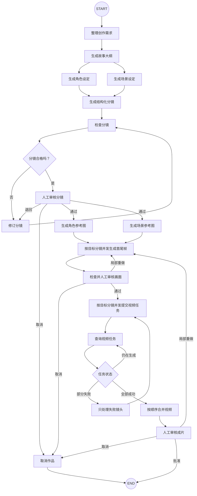

# 项目设计

## 工作流设计

整个工作流大致如下：

## 固定漫剧的故事

如果每次都换一个故事，后面展示的角色、分镜、图片和状态快照就很难对应起来。

因此，整个系列统一使用下面这份创意作为演示案例：

> 深夜的办公室里，程序员小林正在修改一款漫画应用。零点到来时，他设计的漫画角色阿沐突然从屏幕中走了出来。

现在先把我们已经知道的约束整理成一张简单的需求卡：

| 项目     | 当前约定                         |
| -------- | -------------------------------- |
| 暂定名称 | 《零点之后》                     |
| 类型     | 都市奇幻                         |
| 目标时长 | 约 45 秒                         |
| 镜头数量 | 5 个                             |
| 画面风格 | 暖色系二维漫画风格               |
| 主要角色 | 程序员小林、漫画角色阿沐         |
| 主要场景 | 深夜办公室                       |
| 最终结果 | 一段按分镜合成、可以播放的短视频 |

后续我们可以观察同一份创意怎样逐步变成故事、角色设定、分镜、图片和视频。

---

-EOF-