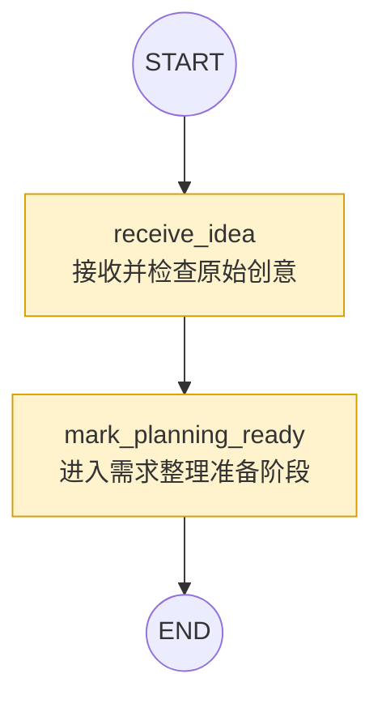

# 搭建项目


## 1. 创建项目

```bash
mkdir ai-comic-drama
cd ai-comic-drama
```

使用 `uv` 创建一份最小 `pyproject.toml`：

```bash
uv init --bare --name ai-comic-drama --python 3.12
```

几个参数分别表示：

- `--bare`：只生成最小项目配置，不提前创建与本系列不一致的示例包；
- `--name ai-comic-drama`：把项目名固定为 `ai-comic-drama`；
- `--python 3.12`：声明项目**<u>至少</u>**使用 Python 3.12；

把项目解释器固定到 Python 3.12：

```bash
uv python pin 3.12
```

这条命令会创建 `.python-version`：

```text
3.12
```

以后在项目目录中运行 `uv` 命令时，它会优先使用这条版本约束。

```bash
uv run python --version
```

环境输出为：

```text
Python 3.12.14
```


## 2. 初始化Git

执行：

```bash
git init
```

会看到类似输出：

```text
Initialized empty Git repository in .../ai-comic-drama2/.git/
```

在根目录创建 `.gitignore`：

```bash
touch .gitignore
```

写入以下内容：

```gitignore
# Python 运行环境与缓存
.venv/
__pycache__/
*.py[cod]
.pytest_cache/
.ruff_cache/

# 真实密钥只保留在本机
.env

# LangGraph 本地开发服务的数据与缓存
.langgraph_api/

# 后续生成的图片、视频和临时产物
outputs/*
!outputs/.gitkeep
```


## 3. 安装依赖

- langgraph

- langgraph-cli[inmem]：在本地启动 Agent Server

  - 凡是是非业务代码，最终一定会出现框架、库、或者xxxxx来帮你解决这个问题，让你专注于你的业务

- langgraph-sdk：让 Python 代码方便地调用 Agent Server

  ```
  Agent Server
      ▲
      │ HTTP API
      │
  langgraph-sdk
      ▲
      │
      │
   客户端代码
  ```

[依赖示意图](https://xiejie-typora.oss-cn-chengdu.aliyuncs.com/2026-09-20-033405.png)

```bash
uv add "langgraph==1.2.11" "langgraph-sdk==0.4.4"
```

```bash
uv add --dev "langgraph-cli[inmem]==0.4.31"
```


## 4. 创建环境变量

```bash
touch .env.example .env
```

暂时不需要写入内容。


## 5. 最小图结构




## 6. state

```py
# state.py

import operator
from typing import Annotated, TypedDict


class ComicDramaState(TypedDict):
    """贯穿 AI 漫剧工作流的状态。

    当前只加入骨架图实际使用的三个字段。需求、故事、角色、场景、
    分镜和素材等字段，会在后续文章真正需要它们时再逐步扩展。
    """

    # 用户最初输入的创意。后续需求整理节点会以它为起点。
    raw_requirement: str

    # 客户端和 Studio 用来判断走到哪一阶段。节点在业务写盘成功后才更新它。
    # 例：首次输入 "submitted"；分镜待审 "quality_passed"；成片待审 "final_video_ready"；验收通过 "final_video_approved"
    current_stage: str

    # 各节点只返回本节点新增的字符串。operator.add 追加到历史，避免后写覆盖先写。
    # 例：["已接收用户创意", "已生成结构化创意需求", "已生成故事大纲", "已收到人工审核命令：revise", "已按人工意见生成 v1 分镜"]
    events: Annotated[list[str], operator.add]
```

```py
# __init__.py

from .state import ComicDramaState

__all__ = ["ComicDramaState"]
```


## 7. nodes

receive_idea.py

```py
from server.states import ComicDramaState


def receive_idea(state: ComicDramaState) -> dict[str, object]:
    """接收并完成最小输入检查，暂时不分析具体创作要求。"""

    raw_requirement = state["raw_requirement"].strip()
    if not raw_requirement:
        raise ValueError("raw_requirement 不能为空，请先输入漫剧创意")

    return {
        "raw_requirement": raw_requirement,
        "current_stage": "idea_received",
        "events": ["已接收用户创意"],
    }
```


mark_planning_ready.py

临时节点

```py
from server.states import ComicDramaState


def mark_planning_ready(state: ComicDramaState) -> dict[str, object]:
    """确认创意已经存在，并把流程推进到等待需求整理阶段。"""

    if state["current_stage"] != "idea_received":
        raise ValueError("只有已接收的创意才能进入需求整理阶段")

    return {
        "current_stage": "planning_ready",
        "events": ["已进入需求整理准备阶段"],
    }

```

```py
# __init__.py
from .mark_planning_ready import mark_planning_ready
from .receive_idea import receive_idea

__all__ = ["mark_planning_ready", "receive_idea"]
```


## 8. graph

```py
from langgraph.graph import END, START, StateGraph

from server.nodes import mark_planning_ready, receive_idea
from server.states import ComicDramaState

builder = StateGraph(ComicDramaState)
builder.add_node("receive_idea", receive_idea)
builder.add_node("mark_planning_ready", mark_planning_ready)
builder.add_edge(START, "receive_idea")
builder.add_edge("receive_idea", "mark_planning_ready")
builder.add_edge("mark_planning_ready", END)

graph = builder.compile()
```

```py
# __init__.py

from .graph import graph

__all__ = ["graph"]
```


## 9. langgraph.json

```json
{
  "dependencies": ["."],
  "graphs": {
    "comic_drama": "./server/workflows/graph.py:graph"
  },
  "env": ".env"
}
```

- `dependencies`：表示 Agent Server 启动时需要安装/加载哪些项目依赖。
  - 这里的 `"."` 就是**当前项目本身**，也就是把当前 Python 项目作为依赖加载。通常会结合 `pyproject.toml` 中声明的依赖一起使用。
- `graphs`：用来告诉 Agent Server **有哪些 LangGraph 图可以运行，以及图在哪里。**


## 10. 启动 Agent Server

```json
uv run langgraph dev
```

测试：

```json
{
  "raw_requirement": "深夜的办公室里，程序员小林正在修改一款漫画应用。零点到来时，他设计的漫画角色阿沐突然从屏幕中走了出来。",
  "current_stage": "submitted",
  "events": []
}
```


## 11. 客户端测试

```py
from langgraph_sdk import get_sync_client

SERVER_URL = "http://127.0.0.1:2024"
GRAPH_ID = "comic_drama2"
IDEA = (
    "制作一部45秒的都市奇幻漫剧：程序员小林在深夜办公室，"
    "遇见从漫画中走出来的阿沐。全剧5个镜头，采用暖色二维漫画风格。"
)


def main() -> None:

    client = get_sync_client(url=SERVER_URL)

    assistants = client.assistants.search(graph_id=GRAPH_ID)

    if not assistants:
        raise RuntimeError(f"Agent Server 中没有找到 Graph：{GRAPH_ID}")
    assistant = assistants[0]

    thread = client.threads.create(metadata={"title": "零点之后"})

    run = client.runs.create(
        thread["thread_id"],
        assistant["assistant_id"],
        input={
            "raw_requirement": IDEA,
            "current_stage": "submitted",
            "events": [],
        },
    )

    result = client.runs.join(thread["thread_id"], run["run_id"])
    state = client.threads.get_state(thread["thread_id"])

    print(f"Graph ID：{assistant['graph_id']}")
    print(f"Assistant ID：{assistant['assistant_id']}")
    print(f"Thread ID：{thread['thread_id']}")
    print(f"Run ID：{run['run_id']}")
    print(f"Run 返回阶段：{result['current_stage']}")
    print(f"Thread 保存阶段：{state['values']['current_stage']}")


if __name__ == "__main__":
    main()

```

执行客户端：

```bash
python client/server_client.py
```


## 12. Git提交

```bash
git add .
git commit -m "chore: initialize LangGraph project"
```


---

-EOF-

