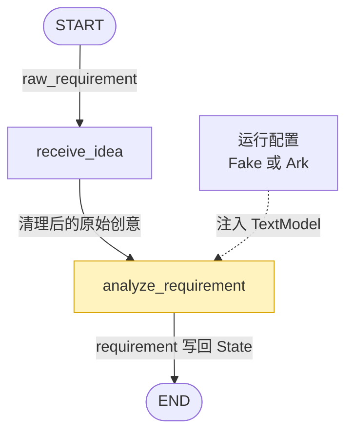

# 需求结构化

上一节课跑通了一个最小的图，这节课要将用户的需求结构化。

`raw_requirement`

```
深夜的办公室里，程序员小林正在修改一款漫画应用。零点到来时，他设计的漫画角色阿沐突然从屏幕中走了出来。
```

`requirement`

```json
{
    "title": "零点之后",
    "genre": "都市奇幻",
    "target_audience": "喜欢悬疑反转的年轻观众",
    "duration_seconds": 45,
    "shot_count": 5,
    "visual_style": "冷暖对比的二维漫画",
    "aspect_ratio": "9:16",
    "core_idea": "深夜的办公室里，程序员小林正在修改一款漫画应用。零点到来时，他设计的漫画角色阿沐突然从屏幕中走了出来。",
    "constraints": [],
}
```

**图结构**




## 1. schema

用于验证数据是否符合要求。

```bash
uv add "pydantic==2.13.5"
```

`CreativeRequirement` 是一个 **Pydantic 数据模型**，可以理解为带验证的类型。

之后 `state` 里面的 `requirement` 就是该类型。

```py
# creative_requirement.py

from typing import Literal

from pydantic import BaseModel, ConfigDict, Field, model_validator


class CreativeRequirement(BaseModel):
    model_config = ConfigDict(extra="forbid", str_strip_whitespace=True)

    title: str = Field(min_length=1, max_length=60, description="暂定剧名")
    genre: str = Field(min_length=1, max_length=30, description="题材类型")
    target_audience: str = Field(min_length=1, max_length=50, description="目标观众")
    duration_seconds: int = Field(default=45, ge=30, le=60, description="成片时长")
    shot_count: int = Field(default=5, ge=4, le=6, description="计划镜头数")
    visual_style: str = Field(
        default="暖色二维漫画",
        min_length=1,
        max_length=50,
        description="统一画面风格",
    )
    aspect_ratio: Literal["9:16", "16:9", "1:1"] = Field(
        default="9:16",
        description="成片画幅",
    )
    core_idea: str = Field(
        min_length=10,
        max_length=500,
        description="保留关键人物、冲突与结局方向的创意摘要",
    )
    constraints: list[str] = Field(
        default_factory=list,
        max_length=8,
        description="用户明确提出的其他限制",
    )

    @model_validator(mode="after")
    def validate_video_duration_capacity(self):
        minimum = 2 * self.shot_count
        maximum = 12 * self.shot_count
        if not minimum <= self.duration_seconds <= maximum:
            raise ValueError(
                f"当前视频链路每镜支持 2～12 秒；"
                f"{self.shot_count} 镜的总时长必须在 "
                f"{minimum}～{maximum} 秒之间"
            )
        return self

```

**部分字段说明**

```py
model_config = ConfigDict(
    extra="forbid", 					# 不允许出现模型没有定义的字段。
    str_strip_whitespace=True # 自动去掉字符串首尾空格。
)
```

```py
@model_validator(mode="after")
def validate_video_duration_capacity(self):
```

前面的字段都验证完了，并且 `CreativeRequirement` 对象基本创建好了之后，再进行一次“整个对象级别”的检查。

所以这时候已经可以**<u>同时读取多个字段</u>**：

```
self.shot_count
self.duration_seconds
```

这就是它和 `Field()` 最大的区别：

```
Field
 │
 ├─ title 自己是否合法
 ├─ duration_seconds 自己是否合法
 ├─ shot_count 自己是否合法
 └─ aspect_ratio 自己是否合法
            │
            ▼
     model_validator
            │
            ▼
 检查多个字段之间是否合理
```

比如，镜头数量和总时长之间是有关系的，系统规定：

```
每个镜头最短 2 秒
每个镜头最长 12 秒
```

所以不能只单独检查 `duration_seconds` 和 `shot_count`，这时候就需要：

```py
@model_validator(mode="after")
```


**schema包入口文件**

```py
from .creative_requirement import CreativeRequirement

__all__ = ["CreativeRequirement"]
```


## 2. state

增加 `requirement` 字段

```python
requirement: NotRequired[CreativeRequirement]
```


## 3. prompt

```py
SYSTEM_PROMPT = """你是漫剧项目的需求分析师。请把用户创意整理为结构化需求。
保留用户明确给出的事实，不要擅自改写人物关系、核心冲突和结局方向。
用户没有说明制作参数时，使用以下项目默认值：45 秒、5 个镜头、暖色二维漫画、9:16。
当前视频链路每镜支持 2～12 秒；确保总时长位于 2 × 镜头数与 12 × 镜头数之间。
constraints 只记录用户明确提出、但其他字段尚未表达的限制。"""
```

```py
from .system_prompt import SYSTEM_PROMPT

__all__ = ["SYSTEM_PROMPT"]
```


## 4. model

模型这一块儿分为：

1. fake 模型：返回的是模拟数据
2. ark 真实模型：火山引擎

`text_model.py` 定义模型接口，后期使用模型的时候不需要区分是 fake 还是真实模型

```py
from typing import Protocol

from server.schema import CreativeRequirement


# 先规定“模型应该长什么样”
class TextModel(Protocol):
    def analyze_requirement(self, raw_requirement: str) -> CreativeRequirement:
        """把自然语言创意转换为经过校验的结构化需求。"""
```

`fake_text_model.py`

```py
from typing import Any

from server.schema import CreativeRequirement


class FakeTextModel:
    """本地开发使用的确定性替身，不发起任何网络请求。"""

    def __init__(self, response: dict[str, Any] | None = None) -> None:
        self._response = response

    def analyze_requirement(self, raw_requirement: str) -> CreativeRequirement:
        response = self._response or {
            "title": "零点之后",
            "genre": "都市奇幻",
            "target_audience": "喜欢悬疑反转的年轻观众",
            "duration_seconds": 45,
            "shot_count": 5,
            "visual_style": "冷暖对比的二维漫画",
            "aspect_ratio": "9:16",
            "core_idea": raw_requirement,
            "constraints": [],
        }
        return CreativeRequirement.model_validate(response)

```

`ark_text_model.py`

```bash
uv add "arkruntime==0.6.0"
```

>火山引擎：https://www.volcengine.com/
>
>开通真实模型

[火山方舟 SDK 提供 OpenAI 风格的 Chat Completions 接口](https://docs.volcengine.com/docs/ark/compatible-with-openai-sdk?utm_source=chatgpt.com&lang=zh)

[参数说明](https://docs.volcengine.com/docs/ark/chat-api?lang=zh&utm_source=chatgpt.com)

```py
from arkruntime import Ark

from server.prompts import SYSTEM_PROMPT
from server.schema import CreativeRequirement


class ArkTextModel:
    """火山方舟结构化输出适配器。"""

    def __init__(self, *, api_key: str, model: str) -> None:
        self._client = Ark.volc(api_key=api_key)
        self._model = model

    def analyze_requirement(self, raw_requirement: str) -> CreativeRequirement:
        completion = self._client.beta.chat.completions.parse(
            model=self._model,
            messages=[
                {"role": "system", "content": SYSTEM_PROMPT},
                {"role": "user", "content": raw_requirement},
            ],
            response_format=CreativeRequirement,
        )
        requirement = completion.choices[0].message.parsed
        if requirement is None:
            raise ValueError("文本模型没有返回可解析的结构化需求")
        return requirement

```

`build_text_model.py`

```py
import os

from .ark_text_model import ArkTextModel
from .fake_text_model import FakeTextModel
from .text_model import TextModel


def build_text_model() -> TextModel:
    provider = os.getenv("TEXT_MODEL_PROVIDER", "fake").strip().lower()
    if provider == "fake":
        return FakeTextModel()
    if provider == "ark":
        api_key = os.getenv("ARK_API_KEY", "").strip()
        model = os.getenv("ARK_MODEL", "").strip()
        if not api_key or not model:
            raise RuntimeError("使用 ark 时必须配置 ARK_API_KEY 和 ARK_MODEL")
        return ArkTextModel(api_key=api_key, model=model)
    raise ValueError(f"不支持的 TEXT_MODEL_PROVIDER：{provider}")

```

配置环境变量

```
TEXT_MODEL_PROVIDER=
ARK_API_KEY=
ARK_MODEL=
```

[模型注入](https://xiejie-typora.oss-cn-chengdu.aliyuncs.com/2026-09-21-101455.png)

```py
from .build_text_model import build_text_model
from .text_model import TextModel

__all__ = ["TextModel", "build_text_model"]
```


## 5. 新增节点

`make_analyze_requirement.py`

```py
from server.model import TextModel
from server.states import ComicDramaState


def make_analyze_requirement(text_model: TextModel):
    """通过闭包注入文本模型，让节点不依赖具体厂商 SDK。"""

    def analyze_requirement(state: ComicDramaState) -> dict[str, object]:
        """把原始创意转换为经过 Pydantic 校验的需求契约。"""

        if state["current_stage"] != "idea_received":
            raise ValueError("需求分析只能在收到创意后执行")

        # 无论 Fake 还是真实服务，返回值都已经通过同一 Schema 校验。
        requirement = text_model.analyze_requirement(state["raw_requirement"])

        # 节点只返回状态增量，不原地修改共享 State。
        return {
            "requirement": requirement,
            "current_stage": "requirement_ready",
            "events": ["已生成结构化创意需求"],
        }

    return analyze_requirement

```

```py
from .make_analyze_requirement import make_analyze_requirement
from .mark_planning_ready import mark_planning_ready
from .receive_idea import receive_idea

__all__ = ["make_analyze_requirement", "mark_planning_ready", "receive_idea"]
```


## 6. 图的更新

```py
from langgraph.graph import END, START, StateGraph

from server.model import TextModel, build_text_model
from server.nodes import make_analyze_requirement, receive_idea
from server.states import ComicDramaState


def build_graph(text_model: TextModel):
    builder = StateGraph(ComicDramaState)
    builder.add_node("receive_idea", receive_idea)
    builder.add_node("analyze_requirement", make_analyze_requirement(text_model))


    builder.add_edge(START, "receive_idea")
    builder.add_edge("receive_idea", "analyze_requirement")
    builder.add_edge("analyze_requirement", END)

    return builder.compile()


graph = build_graph(build_text_model())
```


## 7. 提交代码

```bash
git add .
git commit -m "feat: structure comic drama requirements"
```


---

-EOF-

