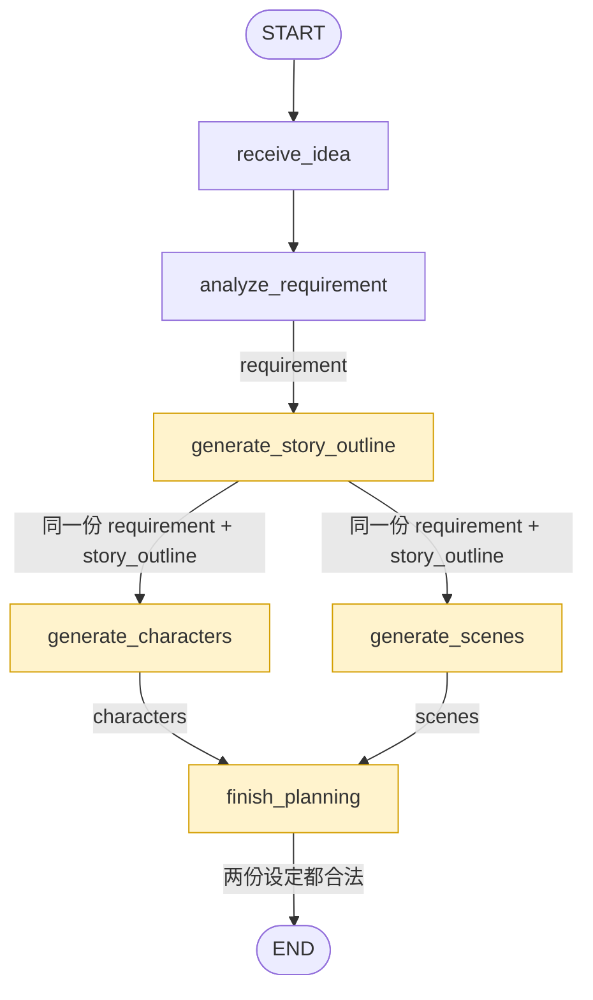

# 故事大纲与设定

**目前进度**

`requirement`

```json
{
    "title": "零点之后",
    "genre": "都市奇幻",
    "target_audience": "喜欢悬疑反转的年轻观众",
    "duration_seconds": 45,
    "shot_count": 5,
    "visual_style": "冷暖对比的二维漫画",
    "aspect_ratio": "9:16",
    "core_idea": "深夜的办公室里，程序员小林正在修改一款漫画应用。零点到来时，他设计的漫画角色阿沐突然从屏幕中走了出来。",
    "constraints": [],
}
```

**本节课要生成**

`story_outline`：故事大纲

```json
"story_outline": {
    "opening": "小林在深夜办公室加班，漫画角色阿沐突然出现在屏幕旁。",
    "conflict": "阿沐必须在零点前回到漫画，否则会从故事中消失。",
    "development": "小林和阿沐寻找被遗落的最后一页，逐渐理解彼此的孤独。",
    "turning_point": "小林发现最后一页需要由自己画出，才能让故事继续。",
    "ending": "零点钟声响起，阿沐回到漫画，留下两人重逢的约定。",
    "theme": "用创作连接两个世界，也让孤独的人获得陪伴。"
  },
```

`characters`：人物设定

```json
"characters": [
  {
    "character_id": "char_xiaolin",
    "name": "小林",
    "identity": "深夜加班的程序员",
    "personality": "认真但有些孤独",
    "appearance": "短发，眼下略有倦意",
    "clothing": "浅灰衬衫与深色长裤",
    "visual_keywords": ["短发", "浅灰衬衫"]
  },
  {
    "character_id": "char_amu",
    "name": "阿沐",
    "identity": "从漫画中走出的女孩",
    "personality": "勇敢而温柔",
    "appearance": "黑色长发，明亮的眼睛",
    "clothing": "暖黄色外套与白色裙子",
    "visual_keywords": ["黑色长发", "暖黄色外套"]
  }
]
```

`scenes`：场景设定

```json
"scenes": [
  {
    "scene_id": "scene_office",
    "name": "深夜办公室",
    "time": "午夜前后",
    "location": "电脑桌与落地窗相邻的开放办公区",
    "lighting": "台灯暖光与窗外冷光交错",
    "colors": "暖黄和深蓝",
    "visual_keywords": ["二维漫画", "暖黄台灯", "深蓝夜景"]
  }
]
```


**图结构**




## 1. schema

### 1-1. 故事大纲

`story_outline.py`

```py
from pydantic import (
    BaseModel,
    ConfigDict,
    Field,
)


class StoryOutline(BaseModel):
    """分镜前先确定故事因果，不包含镜头级动作。"""

    model_config = ConfigDict(extra="forbid", str_strip_whitespace=True)

    opening: str = Field(min_length=5, description="开端")
    conflict: str = Field(min_length=5, description="主要冲突")
    development: str = Field(min_length=5, description="发展")
    turning_point: str = Field(min_length=5, description="转折")
    ending: str = Field(min_length=5, description="结局")
    theme: str = Field(min_length=2, description="主题表达")
```


### 1-2. 人物设定

`character_profile.py`

```py
from pydantic import (
    BaseModel,
    ConfigDict,
    Field,
)


class CharacterProfile(BaseModel):
    """角色 ID 是跨分镜引用的稳定键，不依赖中文姓名。"""

    model_config = ConfigDict(extra="forbid", str_strip_whitespace=True)

    character_id: str = Field(pattern=r"^char_[a-z0-9_]+$", description="稳定角色 ID")
    name: str = Field(min_length=1, description="角色名")
    identity: str = Field(min_length=2, description="身份")
    personality: str = Field(min_length=2, description="性格")
    appearance: str = Field(min_length=2, description="稳定外观")
    clothing: str = Field(min_length=2, description="稳定服装")
    visual_keywords: list[str] = Field(
        min_length=1, description="图像提示词可复用的关键词"
    )
```

这里注意：

```py
character_id: str = Field(
    pattern=r"^char_[a-z0-9_]+$",
    description="稳定角色 ID"
)
```

这里 Pydantic 的 `Field(pattern=...)` 表示：**`character_id` 必须符合这个正则规则，否则校验失败。**

拆开看：

```
^char_[a-z0-9_]+$
│ │     │       │
│ │     │       └─ $ 字符串必须在这里结束
│ │     └───────── [a-z0-9_]+：一个或多个小写字母、数字或下划线
│ └─────────────── 必须以 char_ 开头
└───────────────── ^ 字符串必须从这里开始
```

例如：

| `character_id`   | 是否通过 | 原因                       |
| ---------------- | -------- | -------------------------- |
| `char_001`       | ✅        | 符合                       |
| `char_tom`       | ✅        | 符合                       |
| `char_main_role` | ✅        | 符合                       |
| `char_tom123`    | ✅        | 符合                       |
| `tom`            | ❌        | 没有 `char_`               |
| `character_tom`  | ❌        | 不是 `char_` 开头          |
| `char_Tom`       | ❌        | `T` 是大写字母             |
| `char_张三`      | ❌        | 不允许中文                 |
| `char_`          | ❌        | `+` 要求后面至少有一个字符 |


`character_list.py`

```py
from pydantic import (
    BaseModel,
    ConfigDict,
    Field,
)

from .character_profile import CharacterProfile


class CharacterList(BaseModel):
    """让方舟 parse 用一个顶层模型承载角色列表。"""

    model_config = ConfigDict(extra="forbid")
    characters: list[CharacterProfile] = Field(min_length=1)
```

结构关系如下：

```
CharacterList
      │
      └── characters
              │
              ├── CharacterProfile
              ├── CharacterProfile
              └── CharacterProfile
```


### 1-3. 场景设定

`scene_profile.py`

```py
from pydantic import (
    BaseModel,
    ConfigDict,
    Field,
)


class SceneProfile(BaseModel):
    """场景 ID 将用于分镜和参考图的关联。"""

    model_config = ConfigDict(extra="forbid", str_strip_whitespace=True)

    scene_id: str = Field(pattern=r"^scene_[a-z0-9_]+$", description="稳定场景 ID")
    name: str = Field(min_length=1, description="场景名")
    time: str = Field(min_length=2, description="故事中的时间")
    location: str = Field(min_length=2, description="空间布局")
    lighting: str = Field(min_length=2, description="光线")
    colors: str = Field(min_length=2, description="主色调")
    visual_keywords: list[str] = Field(
        min_length=1, description="图像提示词可复用的关键词"
    )
```

`scene_list.py`

```py
from pydantic import (
    BaseModel,
    ConfigDict,
    Field,
)

from .scene_profile import SceneProfile


class SceneList(BaseModel):
    model_config = ConfigDict(extra="forbid")
    scenes: list[SceneProfile] = Field(min_length=1)
```

结构关系如下：

```
SceneList
   │
   └── scenes
          │
          ├── SceneProfile
          ├── SceneProfile
          └── SceneProfile
```


更新 init 文件：

```py
from .character_list import CharacterList
from .character_profile import CharacterProfile
from .creative_requirement import CreativeRequirement
from .scene_list import SceneList
from .scene_profile import SceneProfile
from .story_outline import StoryOutline

__all__ = [
    "CharacterList",
    "CharacterProfile",
    "CreativeRequirement",
    "SceneList",
    "SceneProfile",
    "StoryOutline",
]

```


## 2. state

新增 3 个状态：

```py
story_outline: NotRequired[StoryOutline]
characters: NotRequired[list[CharacterProfile]]
scenes: NotRequired[list[SceneProfile]]
```


## 3. prompt

`story_prompt.py`

```py
STORY_PROMPT = """根据创作需求生成短篇漫剧故事大纲。
开端、冲突、发展、转折、结局必须形成因果链，适合指定时长和镜头数量。
保留需求中的人物关系、类型、画风和限制；不要提前写分镜。"""
```

`character_prompt.py`

```py
CHARACTER_PROMPT = """根据创作需求和已确定的故事大纲生成角色设定。
只登记故事里实际出现的角色，保持身份、性格、外观、服装稳定。
character_id 使用 char_ 加小写英文或数字，例如 char_xiaolin；不要输出镜头。"""
```

`scene_prompt.py`

```py
SCENE_PROMPT = """根据创作需求和已确定的故事大纲生成场景设定。
只登记故事里实际需要的空间，明确时间、布局、光线和色彩，遵守统一画风。
scene_id 使用 scene_ 加小写英文或数字，例如 scene_office；不要输出镜头。"""
```

更新包入口文件：

```py
from .character_prompt import CHARACTER_PROMPT
from .scene_prompt import SCENE_PROMPT
from .story_prompt import STORY_PROMPT
from .system_prompt import SYSTEM_PROMPT

__all__ = ["CHARACTER_PROMPT", "SCENE_PROMPT", "STORY_PROMPT", "SYSTEM_PROMPT"]
```


## 4. model

`text_model.py`：对外（节点）暴露的接口，约束模型的行为

```py
from typing import Protocol

from server.schema import (
    CharacterProfile,
    CreativeRequirement,
    SceneProfile,
    StoryOutline,
)


# 先规定“模型应该长什么样”
# Protocol 的核心作用就是：
# 告诉 Python 类型系统：TextModel 描述的是一种“结构要求”，
class TextModel(Protocol):
    def analyze_requirement(self, raw_requirement: str) -> CreativeRequirement:
        """把自然语言创意转换为经过校验的结构化需求。"""

    def generate_story_outline(self, requirement: CreativeRequirement) -> StoryOutline:
        """先固定故事因果。"""

    def generate_characters(
        self, requirement: CreativeRequirement, outline: StoryOutline
    ) -> list[CharacterProfile]:
        """基于同一大纲生成角色设定。"""

    def generate_scenes(
        self, requirement: CreativeRequirement, outline: StoryOutline
    ) -> list[SceneProfile]:
        """基于同一大纲生成场景设定。"""
```

`fake_text_model.py`

```py
from typing import Any

from server.schema import (
    CharacterProfile,
    CreativeRequirement,
    SceneProfile,
    StoryOutline,
)


class FakeTextModel:
    """本地开发使用的确定性替身，不发起任何网络请求。"""

    def __init__(
        self, response: dict[str, Any] | None = None, *, planning_fault: str = "none"
    ) -> None:
        self._response = response
        self._planning_fault = planning_fault

    def analyze_requirement(self, raw_requirement: str) -> CreativeRequirement:
        response = self._response or {
            "title": "零点之后",
            "genre": "都市奇幻",
            "target_audience": "喜欢悬疑反转的年轻观众",
            "duration_seconds": 45,
            "shot_count": 5,
            "visual_style": "冷暖对比的二维漫画",
            "aspect_ratio": "9:16",
            "core_idea": raw_requirement,
            "constraints": [],
        }
        return CreativeRequirement.model_validate(response)

    def generate_story_outline(self, requirement: CreativeRequirement) -> StoryOutline:
        return StoryOutline(
            opening="小林在深夜办公室加班，漫画角色阿沐突然出现在屏幕旁。",
            conflict="阿沐必须在零点前回到漫画，否则会从故事中消失。",
            development="小林和阿沐寻找被遗落的最后一页，逐渐理解彼此的孤独。",
            turning_point="小林发现最后一页需要由自己画出，才能让故事继续。",
            ending="零点钟声响起，阿沐回到漫画，留下两人重逢的约定。",
            theme="用创作连接两个世界，也让孤独的人获得陪伴。",
        )

    def generate_characters(
        self, requirement: CreativeRequirement, outline: StoryOutline
    ) -> list[CharacterProfile]:
        if self._planning_fault == "characters":
            raise ValueError("Fake 角色分支故意失败")

        return [
            CharacterProfile(
                character_id="char_xiaolin",
                name="小林",
                identity="深夜加班的程序员",
                personality="认真但有些孤独",
                appearance="短发，眼下略有倦意",
                clothing="浅灰衬衫与深色长裤",
                visual_keywords=["短发", "浅灰衬衫"],
            ),
            CharacterProfile(
                character_id="char_amu",
                name="阿沐",
                identity="从漫画中走出的女孩",
                personality="勇敢而温柔",
                appearance="黑色长发，明亮的眼睛",
                clothing="暖黄色外套与白色裙子",
                visual_keywords=["黑色长发", "暖黄色外套"],
            ),
        ]

    def generate_scenes(
        self, requirement: CreativeRequirement, outline: StoryOutline
    ) -> list[SceneProfile]:
        if self._planning_fault == "scenes":
            raise ValueError("Fake 场景分支故意失败")

        return [
            SceneProfile(
                scene_id="scene_office",
                name="深夜办公室",
                time="午夜前后",
                location="电脑桌与落地窗相邻的开放办公区",
                lighting="台灯暖光与窗外冷光交错",
                colors="暖黄和深蓝",
                visual_keywords=["二维漫画", "暖黄台灯", "深蓝夜景"],
            )
        ]
```

`ark_text_model.py`

```py
import json
from typing import Any

from arkruntime import Ark

from server.prompts import CHARACTER_PROMPT, SCENE_PROMPT, STORY_PROMPT, SYSTEM_PROMPT
from server.schema import (
    CharacterList,
    CharacterProfile,
    CreativeRequirement,
    SceneList,
    SceneProfile,
    StoryOutline,
)


class ArkTextModel:
    """火山方舟结构化输出适配器。"""

    def __init__(self, *, api_key: str, model: str) -> None:
        self._client = Ark.volc(api_key=api_key)
        self._model = model

    def analyze_requirement(self, raw_requirement: str) -> CreativeRequirement:
        completion = self._client.beta.chat.completions.parse(
            model=self._model,
            messages=[
                {"role": "system", "content": SYSTEM_PROMPT},
                {"role": "user", "content": raw_requirement},
            ],
            response_format=CreativeRequirement,
        )
        requirement = completion.choices[0].message.parsed
        if requirement is None:
            raise ValueError("文本模型没有返回可解析的结构化需求")
        return requirement

    def _parse(self, *, system: str, payload: dict[str, Any], schema: type[Any]) -> Any:
        """三种策划调用共用第 04 篇验证过的结构化输出方式。"""
        completion = self._client.beta.chat.completions.parse(
            model=self._model,
            messages=[
                {"role": "system", "content": system},
                {"role": "user", "content": json.dumps(payload, ensure_ascii=False)},
            ],
            response_format=schema,
        )
        parsed = completion.choices[0].message.parsed
        if parsed is None:
            raise ValueError("文本模型没有返回可解析的策划结果")
        return parsed

    def generate_story_outline(self, requirement: CreativeRequirement) -> StoryOutline:
        return self._parse(
            system=STORY_PROMPT,
            payload={"requirement": requirement.model_dump(mode="json")},
            schema=StoryOutline,
        )

    def generate_characters(
        self, requirement: CreativeRequirement, outline: StoryOutline
    ) -> list[CharacterProfile]:
        result = self._parse(
            system=CHARACTER_PROMPT,
            payload={
                "requirement": requirement.model_dump(mode="json"),
                "story_outline": outline.model_dump(mode="json"),
            },
            schema=CharacterList,
        )
        return result.characters

    def generate_scenes(
        self, requirement: CreativeRequirement, outline: StoryOutline
    ) -> list[SceneProfile]:
        result = self._parse(
            system=SCENE_PROMPT,
            payload={
                "requirement": requirement.model_dump(mode="json"),
                "story_outline": outline.model_dump(mode="json"),
            },
            schema=SceneList,
        )
        return result.scenes

```

`model_dump(mode="json")` 把 Pydantic 对象变成一个“可以安全拿去做 JSON 序列化”的 Python 字典。

```
CreativeRequirement 对象
        ↓
model_dump(mode="json")
        ↓
JSON 兼容的 dict
        ↓
放进 payload


StoryOutline 对象
        ↓
model_dump(mode="json")
        ↓
JSON 兼容的 dict
        ↓
放进 payload
```

最后 `payload` 大概长这样：

```json
{
    "requirement": {
        "title": "零点之后",
        "genre": "都市奇幻",
        "duration_seconds": 45
    },
    "story_outline": {
        "opening": "...",
        "conflict": "...",
        "development": "...",
        "turning_point": "...",
        "ending": "..."
    }
}
```

这样后面的 `_parse()` 就很容易把整个 `payload` 序列化后交给模型。

>注意：还有一个容易混淆的点：**`model_dump(mode="json")` 和 `model_dump_json()` 不一样。**
>
>```py
>model.model_dump(mode="json")
># → dict
>
>model.model_dump_json()
># → str，也就是真正的 JSON 字符串
>```


`build_text_model.py`

```py
import os

from .ark_text_model import ArkTextModel
from .fake_text_model import FakeTextModel
from .text_model import TextModel


def build_text_model() -> TextModel:
    provider = os.getenv("TEXT_MODEL_PROVIDER", "fake").strip().lower()
    
    if provider == "fake":
        planning_fault = os.getenv("FAKE_PLANNING_FAULT", "none").strip().lower()
        if planning_fault not in {"none", "characters", "scenes"}:
            raise ValueError(f"不支持的 FAKE_PLANNING_FAULT：{planning_fault}")
        return FakeTextModel(planning_fault=planning_fault)


    if provider == "ark":
        api_key = os.getenv("ARK_API_KEY", "").strip()
        model = os.getenv("ARK_MODEL", "").strip()
        if not api_key or not model:
            raise RuntimeError("使用 ark 时必须配置 ARK_API_KEY 和 ARK_MODEL")
        return ArkTextModel(api_key=api_key, model=model)

    raise ValueError(f"不支持的 TEXT_MODEL_PROVIDER：{provider}")

```

[模型注入](https://xiejie-typora.oss-cn-chengdu.aliyuncs.com/2026-09-21-101455.png)


**更新环境变量**

```bash
# 支持配置的值有：none、characters、scenes
FAKE_PLANNING_FAULT=none
```


## 5. 新增节点

`make_generate_story_outline.py`

```py
from server.model import TextModel
from server.states import ComicDramaState


def make_generate_story_outline(text_model: TextModel):
    def generate_story_outline(state: ComicDramaState) -> dict[str, object]:
        # 故事必须服从已校验的需求，而不是重新理解原始字符串。
        requirement = state.get("requirement")
        if requirement is None:
            raise ValueError("缺少 requirement，不能生成故事大纲")
        outline = text_model.generate_story_outline(requirement)
        return {
            "story_outline": outline,
            "current_stage": "story_ready",
            "events": ["已生成故事大纲"],
        }

    return generate_story_outline

```

`make_generate_characters.py`

```py
from server.model import TextModel
from server.states import ComicDramaState


def make_generate_characters(text_model: TextModel):
    def generate_characters(state: ComicDramaState) -> dict[str, object]:
        requirement = state.get("requirement")
        outline = state.get("story_outline")
        if requirement is None or outline is None:
            raise ValueError("缺少需求或故事大纲，不能生成角色设定")
        # 【重要】并发节点只写自己的业务键，不与场景分支争写 current_stage。
        return {
            "characters": text_model.generate_characters(requirement, outline),
            "events": ["已生成角色设定"],
        }

    return generate_characters

```

`make_generate_scenes.py`

```py
from server.model import TextModel
from server.states import ComicDramaState


def make_generate_scenes(text_model: TextModel):
    def generate_scenes(state: ComicDramaState) -> dict[str, object]:
        requirement = state.get("requirement")
        outline = state.get("story_outline")
        if requirement is None or outline is None:
            raise ValueError("缺少需求或故事大纲，不能生成场景设定")
        return {
            "scenes": text_model.generate_scenes(requirement, outline),
            "events": ["已生成场景设定"],
        }

    return generate_scenes

```


`finish_planning.py`

```py
from server.states import ComicDramaState


def finish_planning(state: ComicDramaState) -> dict[str, object]:
    """扇入后确认两路结果完整，才允许策划阶段结束。"""
    characters = state.get("characters") or []
    scenes = state.get("scenes") or []

    if not characters or not scenes:
        raise ValueError("角色或场景设定为空，策划不能完成")

    character_ids = [item.character_id for item in characters]
    scene_ids = [item.scene_id for item in scenes]

    if len(character_ids) != len(set(character_ids)):
        raise ValueError("角色 character_id 重复")

    if len(scene_ids) != len(set(scene_ids)):
        raise ValueError("场景 scene_id 重复")

    return {"current_stage": "planning_ready", "events": ["策划资料已汇合并通过检查"]}

```


更新包入口文件：

```py
from .finish_planning import finish_planning
from .make_analyze_requirement import make_analyze_requirement
from .make_generate_characters import make_generate_characters
from .make_generate_scenes import make_generate_scenes
from .make_generate_story_outline import make_generate_story_outline
from .receive_idea import receive_idea

__all__ = [
    "finish_planning",
    "make_analyze_requirement",
    "make_generate_characters",
    "make_generate_scenes",
    "make_generate_story_outline",
    "receive_idea",
]

```


## 6. 图的更新

`graph.py`

```py
from langgraph.graph import END, START, StateGraph

from server.model import TextModel, build_text_model
from server.nodes import (
    finish_planning,
    make_analyze_requirement,
    make_generate_characters,
    make_generate_scenes,
    make_generate_story_outline,
    receive_idea,
)
from server.states import ComicDramaState


def build_graph(text_model: TextModel):
    # StateGraph 只描述业务节点、连边以及共享 State。
    builder = StateGraph(ComicDramaState)
    builder.add_node("receive_idea", receive_idea)
    builder.add_node("analyze_requirement", make_analyze_requirement(text_model))
    builder.add_node("generate_story_outline", make_generate_story_outline(text_model))
    builder.add_node("generate_characters", make_generate_characters(text_model))
    builder.add_node("generate_scenes", make_generate_scenes(text_model))
    builder.add_node("finish_planning", finish_planning)

    builder.add_edge(START, "receive_idea")
    builder.add_edge("receive_idea", "analyze_requirement")
    builder.add_edge("analyze_requirement", "generate_story_outline")

    builder.add_edge("generate_story_outline", "generate_characters")
    builder.add_edge("generate_story_outline", "generate_scenes")

    builder.add_edge(["generate_characters", "generate_scenes"], "finish_planning")
    builder.add_edge("finish_planning", END)

    return builder.compile()


graph = build_graph(build_text_model())
```


## 7. 提交代码

```bash
git add .
git commit -m "feat: generate storyoutline characters and scenes"
```


---

-EOF-

