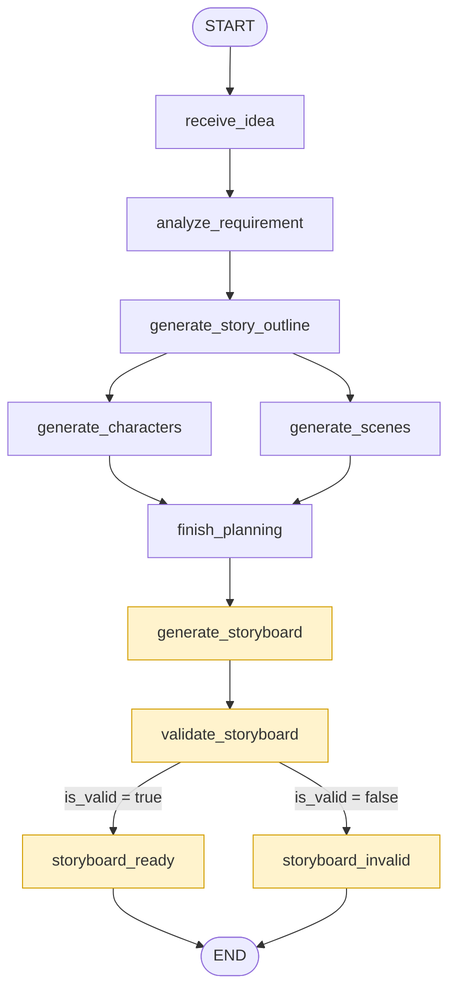

# 生成结构化分镜

## 1. 本节课目标

根据已有信息：

- requirement：结构化信息
- story_outline：故事大纲
- characters：角色设定
- scenes：场景设定

生成分镜：

`storyboard`：对应是一个数组，数组里面每一个对象就是一个分镜

```json
"storyboard": [
  {
    "shot_id": "shot_001",
    "order": 1,
    "duration_seconds": 10,
    "scene_id": "scene_late_night_office",
    "character_ids": ["char_xiaolin"],
    "action": "小林伏在工位前敲完漫画应用...",
    "composition": "竖屏9:16中景，框住小林上半身和大半桌面，背景露出墙面的圆形指针挂钟...",
    "dialogue": "终于写完了，改完这个bug就能收工啦...",
    "camera_motion": "固定机位轻微慢推",
    "start_frame_prompt": "暖黄落地灯照亮深夜空荡的办公室，戴黑框眼镜眼下带着青黑的小林伏在工位前...",
    "end_frame_prompt": "小林指尖按下键盘回车键，墙上挂钟的时针分针对齐12点整...",
    "video_prompt": "小林专注敲击键盘补完最后几行代码，时不时扶一下滑到鼻尖的眼镜..."
  },
  { ... },
  { ... },
  { ... },
  { ... }
]
```

`storyboard_validation`：对于分镜的硬检查是否通过

```json
"storyboard_validation": {
    "is_valid": true,
    "errors": []
  },
```


**图结构**



## 2. schema

`storyboard.py`

```py
from pydantic import (
    BaseModel,
    ConfigDict,
    Field,
)


class StoryBoard(BaseModel):
    """一个能按稳定 ID 关联后续素材与视频任务的镜头。"""

    model_config = ConfigDict(extra="forbid", str_strip_whitespace=True)
    shot_id: str = Field(pattern=r"^shot_[a-z0-9_]+$", description="稳定镜头 ID")
    order: int = Field(ge=1, description="从 1 开始的播放顺序")
    duration_seconds: int = Field(ge=2, le=12, description="镜头时长，单位秒")
    scene_id: str = Field(pattern=r"^scene_[a-z0-9_]+$", description="引用已登记场景")
    character_ids: list[str] = Field(description="引用已登记角色，可为空列表")
    action: str = Field(min_length=1, description="画面中发生的动作")
    composition: str = Field(min_length=1, description="主体位置与构图")
    dialogue: str = Field(description="台词或旁白，没有则为空字符串")
    camera_motion: str = Field(min_length=1, description="镜头运动或固定机位")
    start_frame_prompt: str = Field(min_length=1, description="生成静态首帧的提示词")
    end_frame_prompt: str = Field(min_length=1, description="生成静态尾帧的提示词")
    video_prompt: str = Field(min_length=1, description="生成首尾帧之间运动的提示词")

```

`storyboard_list.py`

```py
from pydantic import (
    BaseModel,
    ConfigDict,
    Field,
)

from .storyboard import StoryBoard


class StoryBoardList(BaseModel):
    """真实模型结构化输出需要顶层对象，State 只保存内部 shots。"""

    model_config = ConfigDict(extra="forbid")
    storyboard_list: list[StoryBoard] = Field(min_length=1)
```

结构关系还是一样：

```
StoryBoardList
      │
      └── storyboard_list
              │
              ├── StoryBoard
              ├── StoryBoard
              └── StoryBoard
```

`storyboard_validation.py`

```py
from pydantic import (
    BaseModel,
    ConfigDict,
)


class StoryboardValidation(BaseModel):
    """硬规则结果；失败时保留可定位的错误给后续修订节点。"""

    model_config = ConfigDict(extra="forbid")
    is_valid: bool
    errors: list[str]

```


更新入口文件：

```py
from .character_list import CharacterList
from .character_profile import CharacterProfile
from .creative_requirement import CreativeRequirement
from .scene_list import SceneList
from .scene_profile import SceneProfile
from .story_outline import StoryOutline
from .storyboard import StoryBoard
from .storyboard_list import StoryBoardList
from .storyboard_validation import StoryboardValidation

__all__ = [
    "CharacterList",
    "CharacterProfile",
    "CreativeRequirement",
    "SceneList",
    "SceneProfile",
    "StoryBoard",
    "StoryBoardList",
    "StoryOutline",
    "StoryboardValidation",
]
```


## 3. state

新增 2 个字段：

```py
storyboard: NotRequired[list[StoryBoard]]
storyboard_validation: NotRequired[StoryboardValidation]
```

- storyboard 用于存储分镜列表，注意是列表
- storyboard_validation：存储分镜的验证结果，是否通过了硬性坚持


## 4. prompt

`storyboard_prompt.py`

```py
STORYBOARD_PROMPT = """根据结构化需求、故事大纲及已有角色和场景生成完整分镜。
严格使用提供的目标镜头数和目标总时长；每个镜头有稳定 shot_id、从 1 开始的顺序号、2～12 秒的时长。
scene_id 和 character_ids 只能引用输入中的已有 ID，不得新造角色或场景。
start_frame_prompt 描述静态首帧，end_frame_prompt 描述静态尾帧，video_prompt 描述两帧之间的动作。
生成前核对关键道具的来源、数量、持有者与状态，以及人物、道具、出入口在空间中的位置；跨镜头保持一致，必要变化写出对应动作。不输出额外分析字段。
每个镜头优先表达一个清楚的核心动作，动作数量与镜头秒数相适应；首帧给出核心动作所需的人物、道具与空间关系，尾帧体现动作结果，视频提示词连接二者。
相邻镜头允许合理切镜和省略，但不能遗漏核心因果或使关键道具、人物位置无解释地改变。
camera_motion 描述摄影机运动，不把人物运动或观众视线移动误写成摄影机运动；固定机位下人物和道具仍可移动。
沿用已有奇幻规则与视觉风格，不添加与大纲冲突的新规则；关键视觉元素在相关帧中保持可辨认且一致。
保持用户明确给出的事实和画风。只返回符合结构化输出 Schema 的对象。"""
```

更新入口文件：

```py
from .character_prompt import CHARACTER_PROMPT
from .scene_prompt import SCENE_PROMPT
from .story_prompt import STORY_PROMPT
from .storyboard_prompt import STORYBOARD_PROMPT
from .system_prompt import SYSTEM_PROMPT

__all__ = [
    "CHARACTER_PROMPT",
    "SCENE_PROMPT",
    "STORYBOARD_PROMPT",
    "STORY_PROMPT",
    "SYSTEM_PROMPT",
]
```


## 5. model

1. 改接口：增加对应的方法
2. 改模型：在模型上新增接口所对应的方法
   1. 真模型
   2. 假模型

`text_model.py` 新增 `generate_storyboard` 方法

```py
def generate_storyboard(
        self,
        requirement: CreativeRequirement,
        outline: StoryOutline,
        characters: list[CharacterProfile],
        scenes: list[SceneProfile],
    ) -> list[StoryBoard]:
        """只引用已登记角色与场景，返回整版分镜。"""
```


`fake_text_model.py`

1. init 方法新增 `_storyboard_fault`

   ```py
   def __init__(
           self,
           response: dict[str, Any] | None = None,
           *,
           planning_fault: str = "none",
           storyboard_fault: str = "none",
       ) -> None:
           self._response = response
           self._planning_fault = planning_fault
           self._storyboard_fault = storyboard_fault
   ```

2. 新增 `generate_storyboard` 方法的实现

   ```py
   def generate_storyboard(
           self,
           requirement: CreativeRequirement,
           outline: StoryOutline,
           characters: list[CharacterProfile],
           scenes: list[SceneProfile],
       ) -> list[StoryBoard]:
           """确定性分镜样本；数量与总时长必须服从结构化需求。"""
           moments = [
               ("小林看到屏幕旁出现阿沐", "小林惊讶地抬头", "阿沐站到桌边"),
               ("阿沐解释零点前必须回去", "阿沐指向墙上的钟", "小林决定帮忙"),
               ("两人寻找漫画的最后一页", "两人在桌上翻找", "发现空白纸张"),
               ("小林画出能让故事继续的画面", "小林握笔停顿", "画纸上出现回家的路"),
               ("阿沐回到漫画并约定重逢", "阿沐走向发光书页", "书页合上留下约定"),
           ]
           
           # 把成片总时长拆成每镜整数秒，保证加起来刚好等于 requirement.duration_seconds
           # divmod(a, b) 一次算出商和余数
           base_duration, remainder = divmod(
               requirement.duration_seconds, requirement.shot_count
           )
   
           storyboard = [
               StoryBoard(
                   shot_id=f"shot_{index:02d}",
                   order=index,
                   # 默认 45 秒 / 5 镜：base_duration=9，remainder=0，每镜都是 9 秒。
                   # 如果是 47 秒 / 5 镜：base_duration=9，remainder=2。后面赋值用了：
                   # duration_seconds=base_duration + (index <= remainder)
                   duration_seconds=base_duration + (index <= remainder),
                   scene_id="scene_office",
                   character_ids=["char_xiaolin", "char_amu"],
                   action=action,
                   composition="竖屏中景，人物与办公桌保持相对位置",
                   dialogue="",
                   camera_motion="缓慢推近",
                   start_frame_prompt=f"暖色二维漫画，深夜办公室，{start}",
                   end_frame_prompt=f"暖色二维漫画，深夜办公室，{end}",
                   video_prompt=(
                       f"{base_duration + (index <= remainder)} 秒镜头："
                       f"{action}；镜头缓慢推近。"
                   ),
               )
               for index, (action, start, end) in enumerate(moments, start=1)
           ]
   
           # 根据环境变量的设置，故意破坏
           if self._storyboard_fault == "duplicate_id":
               # 第 2 镜的 shot_id 改成和第 1 镜一样
               # 校验会触发：shot_id 重复
               storyboard[1] = storyboard[1].model_copy(update={"shot_id": storyboard[0].shot_id})
           elif self._storyboard_fault == "unknown_character":
               # 第 3 镜角色改成 char_missing
               # 校验的时候应该触发：引用了不存在的角色
               storyboard[2] = storyboard[2].model_copy(update={"character_ids": ["char_missing"]})
           elif self._storyboard_fault == "duration_mismatch":
               # 第 4 镜（不够 4 镜就改最后一镜）时长 +3
               # 校验的时候会触发：总时长对不上 duration_seconds
               fault_index = min(3, len(storyboard) - 1)
               storyboard[fault_index] = storyboard[fault_index].model_copy(
                   update={"duration_seconds": storyboard[fault_index].duration_seconds + 3}
               )
   
           return storyboard
   ```

   注意里面的这一段代码：

   ```py
   storyboard = [
       StoryBoard(
           shot_id=f"shot_{index:02d}",
           order=index,
           # 默认 45 秒 / 5 镜：base_duration=9，remainder=0，每镜都是 9 秒。
           # 如果是 47 秒 / 5 镜：base_duration=9，remainder=2。后面赋值用了：
           # duration_seconds=base_duration + (index <= remainder)
           duration_seconds=base_duration + (index <= remainder),
           scene_id="scene_office",
           character_ids=["char_xiaolin", "char_amu"],
           action=action,
           composition="竖屏中景，人物与办公桌保持相对位置",
           dialogue="",
           camera_motion="缓慢推近",
           start_frame_prompt=f"暖色二维漫画，深夜办公室，{start}",
           end_frame_prompt=f"暖色二维漫画，深夜办公室，{end}",
           video_prompt=(
               f"{base_duration + (index <= remainder)} 秒镜头："
               f"{action}；镜头缓慢推近。"
           ),
       )
       for index, (action, start, end) in enumerate(moments, start=1)
   ]
   ```

   这里仍然是列表推导式，意思是：

   ```json
   [要放进列表里的东西 for 元素 in 可迭代对象]
   
   [StoryBoard(...) for ... in enumerate(moments, start=1)]
         ↑ 创建对象                    ↑ 遍历 moments
   ```

   举个例子：

   ```py
   class Student:
       def __init__(self, name, score):
           self.name = name
           self.score = score
   
   students_data = [
       ("Tom", 90),
       ("Jack", 85),
       ("Lucy", 95),
   ]
   
   students = [
       Student(name, score) for name, score in students_data
   ]
   
   # stduents: [里面是5个 Stduent 实例对象]
   ```


`ark_text_model.py`

```py
def generate_storyboard(
        self,
        requirement: CreativeRequirement,
        outline: StoryOutline,
        characters: list[CharacterProfile],
        scenes: list[SceneProfile],
    ) -> list[StoryBoard]:
        # 【重要】把目标数量、总时长、可用 ID 连同完整设定传给模型。
        # 结构化解析只校验单个字段；跨镜头规则仍由 Python 校验节点负责。
        result = self._parse(
            system=STORYBOARD_PROMPT,
            payload={
                "requirement": requirement.model_dump(mode="json"),
                "story_outline": outline.model_dump(mode="json"),
                "characters": [item.model_dump(mode="json") for item in characters],
                "scenes": [item.model_dump(mode="json") for item in scenes],
                "target_shot_count": requirement.shot_count,
                "target_duration_seconds": requirement.duration_seconds,
                "allowed_character_ids": [item.character_id for item in characters],
                "allowed_scene_ids": [item.scene_id for item in scenes],
            },
            schema=StoryBoardList,
        )
        return result.storyboard_list
```


`build_text_model.py`

主要更新 fake 分支：

```py
if provider == "fake":
    planning_fault = os.getenv("FAKE_PLANNING_FAULT", "none").strip().lower()
    storyboard_fault = os.getenv("FAKE_STORYBOARD_FAULT", "none").strip().lower()

    if planning_fault not in {"none", "characters", "scenes"}:
        raise ValueError(f"不支持的 FAKE_PLANNING_FAULT：{planning_fault}")

    if storyboard_fault not in {
        "none",
        "duplicate_id",
        "unknown_character",
        "duration_mismatch",
    }:
        raise ValueError(f"不支持的 FAKE_STORYBOARD_FAULT：{storyboard_fault}")

    return FakeTextModel(
        planning_fault=planning_fault, storyboard_fault=storyboard_fault
    )

```

更新环境变量文件：

```bash
# 模拟生成分镜的时候报错
# 支持配置的值有：none、duplicate_id、unknown_character、duration_mismatch
FAKE_STORYBOARD_FAULT=none
```


## 6. 新增节点

`make_generate_storyboard.py`

```py
from server.model import TextModel
from server.states import ComicDramaState


def make_generate_storyboard(text_model: TextModel):
    def generate_storyboard(state: ComicDramaState) -> dict[str, object]:
        requirement = state.get("requirement")
        outline = state.get("story_outline")
        characters = state.get("characters")
        scenes = state.get("scenes")
        if requirement is None or outline is None or not characters or not scenes:
            raise ValueError("缺少需求、大纲、角色或场景，不能生成分镜")

        storyboard = text_model.generate_storyboard(
            requirement, outline, characters, scenes
        )
        return {
            "storyboard": storyboard,
            "current_stage": "storyboard_generated",
            "events": ["已生成结构化分镜"],
        }

    return generate_storyboard

```


`validate_storyboard.py`

```py
from server.schema import StoryboardValidation
from server.states import ComicDramaState


def validate_storyboard(state: ComicDramaState) -> dict[str, object]:
    """把校验报告写回 State，失败也要留可诊断的结果。"""
    requirement = state["requirement"]
    storyboard = state["storyboard"]
    expected_count = requirement.shot_count
    expected_seconds = requirement.duration_seconds
    character_ids = {item.character_id for item in state["characters"]}
    scene_ids = {item.scene_id for item in state["scenes"]}

    # 进行验证
    errors: list[str] = []
    if len(storyboard) != expected_count:
        errors.append(f"镜头数量应为 {expected_count}，实际为 {len(storyboard)}")

    ids = [shot.shot_id for shot in storyboard]
    if len(ids) != len(set(ids)):
        errors.append("shot_id 重复")

    orders = [shot.order for shot in storyboard]
    if len(orders) != len(set(orders)):
        errors.append("镜头 order 重复")
    if sorted(orders) != list(range(1, expected_count + 1)):
        errors.append(f"镜头 order 应连续为 1～{expected_count}")

    for shot in storyboard:
        if shot.scene_id not in scene_ids:
            errors.append(f"{shot.shot_id} 引用了不存在的场景 {shot.scene_id}")
        for character_id in shot.character_ids:
            if character_id not in character_ids:
                errors.append(f"{shot.shot_id} 引用了不存在的角色 {character_id}")
        if len(shot.character_ids) != len(set(shot.character_ids)):
            errors.append(f"{shot.shot_id} 的 character_ids 重复")
        if not 2 <= shot.duration_seconds <= 12:
            errors.append(f"{shot.shot_id} 时长必须在 2～12 秒之间")
        for field_name in ("start_frame_prompt", "end_frame_prompt", "video_prompt"):
            if not getattr(shot, field_name).strip():
                errors.append(f"{shot.shot_id} 缺少 {field_name}")

    total = sum(shot.duration_seconds for shot in storyboard)
    if total != expected_seconds:
        errors.append(f"镜头总时长应为 {expected_seconds} 秒，实际为 {total} 秒")

    report = StoryboardValidation(is_valid=not errors, errors=errors)

    return {
        "storyboard_validation": report,
        "events": ["已完成分镜硬规则校验"],
    }

```

这段代码看上去很长，其实就是在做硬性坚持，检查生成的分镜是否存在：

1. `shot_id` 重复
2. 引用了不存在的场景
3. 引用了不存在的角色
4. 时长


检查后会有两种结果：通过、不通过

`storyboard_ready.py`

```py
from server.states import ComicDramaState


def storyboard_ready(state: ComicDramaState) -> dict[str, object]:
    return {"current_stage": "storyboard_ready", "events": ["分镜硬规则通过"]}
```

`storyboard_invalid.py`

```py
from server.states import ComicDramaState


def storyboard_invalid(state: ComicDramaState) -> dict[str, object]:
    return {"current_stage": "storyboard_invalid", "events": ["分镜硬规则未通过"]}
```


更新包入口文件：

```py
...
from .make_generate_storyboard import make_generate_storyboard
from .storyboard_invalid import storyboard_invalid
from .storyboard_ready import storyboard_ready
from .validate_storyboard import validate_storyboard

__all__ = [
    ...
    "make_generate_storyboard",
    "storyboard_invalid",
    "storyboard_ready",
    "validate_storyboard",
]
```


## 7. 图的更新

`graph.py`

新增一个路由函数：

```py
def route_storyboard(
    state: ComicDramaState,
) -> Literal["storyboard_ready", "storyboard_invalid"]:
    return (
        "storyboard_ready"
        if state["storyboard_validation"].is_valid
        else "storyboard_invalid"
    )
```

更新图：

```py
builder.add_node("generate_storyboard", make_generate_storyboard(text_model))
builder.add_node("validate_storyboard", validate_storyboard)
builder.add_node("storyboard_ready", storyboard_ready)
builder.add_node("storyboard_invalid", storyboard_invalid)

...
builder.add_edge("finish_planning", "generate_storyboard")
builder.add_edge("generate_storyboard", "validate_storyboard")
builder.add_conditional_edges("validate_storyboard", route_storyboard)
builder.add_edge("storyboard_ready", END)
builder.add_edge("storyboard_invalid", END)
```


## 8. 客户端代码

```py
from langgraph_sdk import get_sync_client

SERVER_URL = "http://127.0.0.1:2024"
GRAPH_ID = "comic_drama"
IDEA = (
    "制作一部45秒的都市奇幻漫剧：程序员小林在深夜办公室，"
    "遇见从漫画中走出来的阿沐。全剧5个镜头，采用暖色二维漫画风格。"
)


def main() -> None:
    client = get_sync_client(url=SERVER_URL)
    assistants = client.assistants.search(graph_id=GRAPH_ID)

    if not assistants:
        raise RuntimeError(f"Agent Server 中没有找到 Graph：{GRAPH_ID}")
    assistant = assistants[0]


    thread = client.threads.create(metadata={"title": "零点之后"})
    run = client.runs.create(
        thread["thread_id"],
        assistant["assistant_id"],
        input={
            "raw_requirement": IDEA,
            "current_stage": "submitted",
            "events": [],
        },
    )

    result = client.runs.join(thread["thread_id"], run["run_id"])
    state = client.threads.get_state(thread["thread_id"])
    values = state["values"]

    print(f"Graph ID：{assistant['graph_id']}")
    print(f"Assistant ID：{assistant['assistant_id']}")
    print(f"Thread ID：{thread['thread_id']}")
    print(f"Run ID：{run['run_id']}")
    print(f"Run 返回阶段：{result['current_stage']}")
    print(f"Thread 保存阶段：{values['current_stage']}")
    print("事件：")
    for event in values["events"]:
        print(f"  - {event}")

    requirement = values["requirement"]
    print(
        f"需求：{requirement['title']} / "
        f"{requirement['duration_seconds']} 秒 / "
        f"{requirement['shot_count']} 镜"
    )
    print(f"故事主题：{values['story_outline']['theme']}")
    print(f"角色数：{len(values['characters'])}")
    print(f"场景数：{len(values['scenes'])}")
    print(f"分镜数：{len(values['storyboard'])}")
    print(f"分镜校验通过：{values['storyboard_validation']['is_valid']}")


# 用 python client/server_client.py 直接运行时，才会进入 main()。
# 被其他模块 import 时不会自动发请求。
if __name__ == "__main__":
    main()

```


## 9. 提交代码

```bash
git add .
git commit -m "feat: generate and validate storyboard"
```


---

-EOF-