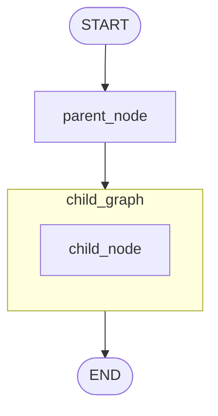
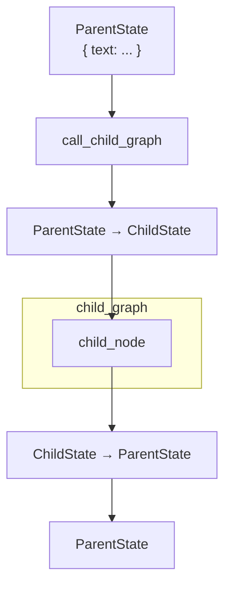
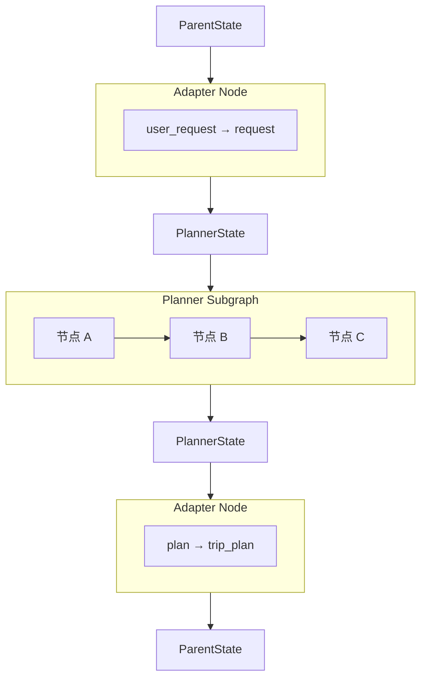
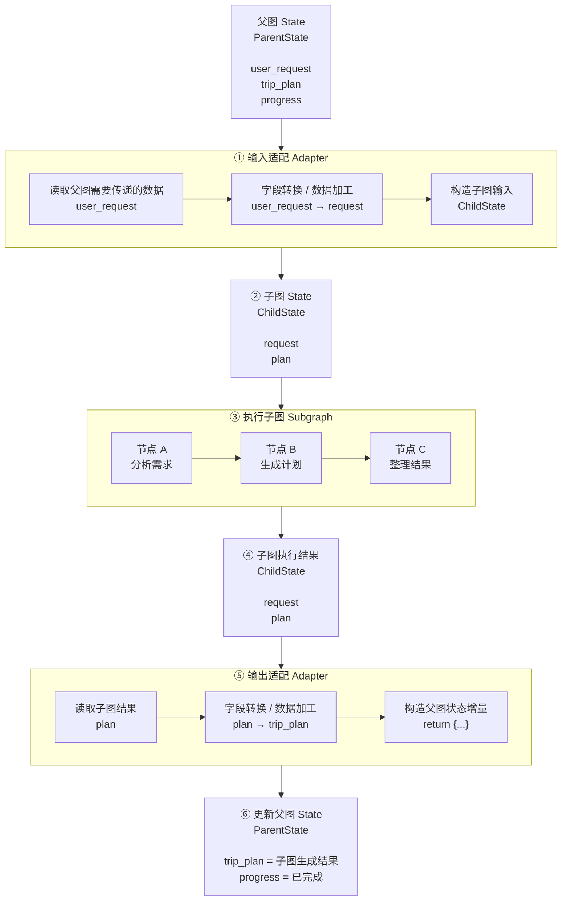

# langgraph子图

LangGraph 里使用子图（Subgraph）时，最常见可以理解成 **两种形式**：

1. 直接把子图作为父图的一个节点
2. 在普通节点函数内部调用子图

核心区别就是：**子图能不能直接吃父图的 State。**


## 1. 子图的两种形式


**子图直接作为一个节点**

当父图和子图能够共享/兼容 State 时，可以直接：

```python
from typing import TypedDict
from langgraph.graph import StateGraph, START, END


class State(TypedDict):
    text: str


# ---------- 子图 ----------
def child_node(state: State):
    return {
        "text": state["text"] + " -> 子图处理"
    }


child_builder = StateGraph(State)
child_builder.add_node("child_node", child_node)

child_builder.add_edge(START, "child_node")
child_builder.add_edge("child_node", END)

child_graph = child_builder.compile()


# ---------- 父图 ----------
def parent_node(state: State):
    return {
        "text": state["text"] + " -> 父图处理"
    }


parent_builder = StateGraph(State)

parent_builder.add_node("parent_node", parent_node)

# 直接把整个子图当成节点
parent_builder.add_node("child_graph", child_graph)

parent_builder.add_edge(START, "parent_node")
parent_builder.add_edge("parent_node", "child_graph")
parent_builder.add_edge("child_graph", END)

graph = parent_builder.compile()
```

结构就是：




这种方式最简单，更像：

> **“这个子图本来就是我这个大图的一部分。”**

父子之间共享 State 会比较自然。


**在普通节点里调用子图**

如果父图和子图的 State 不一样，通常会在一个普通节点中调用：

```python
from typing import TypedDict
from langgraph.graph import StateGraph, START, END


# ---------- 子图 ----------
class ChildState(TypedDict):
    message: str


def child_node(state: ChildState):
    return {
        "message": state["message"] + " -> 子图处理"
    }


child_builder = StateGraph(ChildState)
child_builder.add_node("child_node", child_node)

child_builder.add_edge(START, "child_node")
child_builder.add_edge("child_node", END)

child_graph = child_builder.compile()


# ---------- 父图 ----------
class ParentState(TypedDict):
    text: str


def call_child_graph(state: ParentState):

    # ① 父 State → 子 State
    child_input = {
        "message": state["text"]
    }

    # ② 调用子图
    result = child_graph.invoke(child_input)

    # ③ 子 State → 父 State
    return {
        "text": result["message"]
    }


parent_builder = StateGraph(ParentState)

parent_builder.add_node("call_child", call_child_graph)

parent_builder.add_edge(START, "call_child")
parent_builder.add_edge("call_child", END)

graph = parent_builder.compile()
```

这里多了一层**状态转换**：



第二种更像：

> **“我要调用一个独立模块完成某件事情。”**


**总结**

| 方式                 | 写法                             | 适合情况                    |
| -------------------- | -------------------------------- | --------------------------- |
| **子图直接作为节点** | `add_node("child", child_graph)` | 父子图 State 兼容           |
| **节点内部调用子图** | `child_graph.invoke(...)`        | 父子图 State 不同，需要转换 |


## 2. 节点调用子图核心意义：适配层

第二种方式：**在普通节点里调用子图**

真正值得理解的地方，其实不仅仅是“在节点里 `invoke` 子图”，而是中间这个 **Adapter Node（适配节点）**。

可以把它理解成：

> **父图和子图使用两套不同的数据协议，Adapter 负责在两套协议之间翻译。**
>
> 父图 ： 状态
>
> 子图：状态
>
> 两个状态是不一样的，外层包的函数作为适配层，做翻译操作。


**为什么需要 Adapter？**

假设现在有一个“旅行规划”的父图：

```python
class ParentState(TypedDict):
    user_request: str
    user_id: str
    trip_plan: str
    progress: list[str]
```

父图可能长这样：

```
分析需求 → 搜索信息 → 制定旅行计划 → 保存结果
```

但是“制定旅行计划”这件事情比较复杂，所以我们把它单独做成一个子图。

而这个子图是一个独立模块，它自己的 State 是：

```python
class PlannerState(TypedDict):
    request: str
    plan: str
```

注意：

```
ParentState                PlannerState

user_request ──────────────→ request
user_id                       不需要
progress                      不需要
trip_plan   ←───────────────  plan
```

这时候就不能简单地把整个 `ParentState` 全部交给子图。

所以需要 Adapter：



所以 Adapter 干的事情非常简单：**进去的时候转换一次，出来的时候再转换一次。**


**代码示例**

例如：

```python
def call_planner(state: ParentState):

    # ① ParentState → PlannerState
    # 输入适配
    child_input = {
        "request": state["user_request"]
    }

    # ② 执行子图
    child_result = planner_graph.invoke(child_input)

    # ③ PlannerState → ParentState
    return {
        "trip_plan": child_result["plan"],
        "progress": ["旅行计划生成完成"]
    }
```

这里的 `call_planner` 就是 Adapter Node。

核心就是：



**什么时候用这种方式？**

最典型的是：**子图本身是一个相对独立、可复用的业务模块。**

比如在做一个比较大的 Agent：

```
                Main Agent
                    │
        ┌───────────┼───────────┐
        ↓           ↓           ↓
   Research      Planner     Writer
   Subgraph      Subgraph    Subgraph
```

三个子图可能各有自己的 State：

```python
class ResearchState(TypedDict):
    query: str
    sources: list[str]
    summary: str
```

```py
class PlannerState(TypedDict):
    requirement: str
    steps: list[str]
```

```py
class WriterState(TypedDict):
    topic: str
    materials: list[str]
    article: str
```

但是父图可能是：

```python
class AgentState(TypedDict):
    user_request: str

    research_result: str
    plan: list[str]
    final_answer: str

    messages: list
    progress: list[str]
```

这时候我们就不希望：

> 为了让子图能直接塞进父图，而强迫所有子图都使用 `AgentState`。

因为这样会导致子图和父图**高度耦合**。


---

-EOF-

