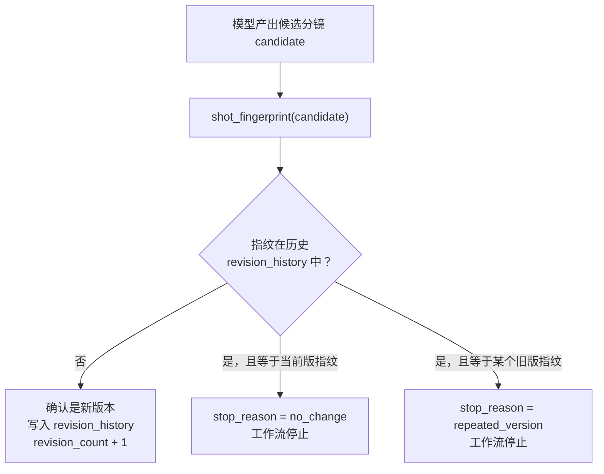

# 指纹

在 `RevisionRecord` 中有一个看起来有点神秘的字段：

```python
class RevisionRecord(BaseModel):
    model_config = ConfigDict(extra="forbid")
    version: int = Field(ge=0)
    fingerprint: str = Field(min_length=16, max_length=16)
    source_codes: list[str]
    target_shot_ids: list[str]
```

`fingerprint` 被限制为**恰好 16 个字符**，例如 `"ab12cd34ef56aa78"`。

它到底是什么？为什么一串十六进制字符就能代表"这一版分镜"？本文把这件事讲清楚。


## 1. 什么是指纹

先回忆一个生活常识：**确认一个人的身份，不需要记住他的整张脸，只需要比对他的指纹。**

指纹有两个关键特性：

- 同一个人，每次按出来的指纹都一样。
- 不同人的指纹几乎不可能一样，差之毫厘就是另一个人。

程序里的"指纹"是完全相同的思路：**把任意大小的内容，通过哈希函数（hash function）压缩成一段固定长度的摘要，用这段摘要来代表内容的身份。**

比如对一段文本计算 SHA-256：

```python
import hashlib

print(hashlib.sha256("主角推开门".encode("utf-8")).hexdigest())
# 输出：b262be7e2e9f0cc2ec46095947b8f0df3959a67bad8d3b996fba37a4d68c985f
# （64 位十六进制字符，其中前 16 位是 b262be7e2e9f0cc2）
```

无论原文是一个字还是一整本书，输出的长度永远固定为 64 个十六进制字符。这个输出就称为原文的**指纹**（更正式的说法是**摘要 / digest**）。

它有三个对工程非常有价值的特性：

| 特性 | 含义 | 工程上的用处 |
| --- | --- | --- |
| **确定性** | 同样的内容，任何时候算出来的指纹都一模一样 | 可以用指纹判断"两次内容是否相同" |
| **雪崩效应** | 内容只改一个标点，指纹会变得面目全非 | 内容有任何实质变化都会被发现 |
| **单向性** | 从指纹无法反推出原文 | 指纹可以放心地公开、存储，不泄露内容 |

这些特性不是某个库的巧合，而是 SHA-256 这类哈希函数的设计目标。日常生活中你已经间接用过它了：下载文件后网站给出的"校验值"、Git 的 commit id，本质都是内容指纹。

> **核心认知：指纹回答的问题只有一个——"这两份内容是不是同一份？" 它不回答内容是什么，只回答内容是否相同。**


## 2. 课程中的指纹是怎么算出来的

项目中对应的函数在 `revision.py`：

```python
def shot_fingerprint(shots: list[Shot]) -> str:
    """对完整分镜取稳定指纹，用于识别未变化或回到旧版本。"""
    payload = [shot.model_dump(mode="json") for shot in shots]
    raw = json.dumps(payload, ensure_ascii=False, sort_keys=True).encode("utf-8")
    return hashlib.sha256(raw).hexdigest()[:16]
```

一共三步，逐步看：

**第 ① 步：`shot.model_dump(mode="json")` 把对象变成纯字典**

`Shot` 是 Pydantic 模型，不能直接序列化。`model_dump(mode="json")` 把它转成只含基础类型（字符串、数字、列表、字典）的普通字典，这是后续能转成 JSON 的前提。

**第 ② 步：`json.dumps(..., sort_keys=True)` 得到稳定的字节串**

这一步是整个函数里最讲究的地方，关键词是**稳定**。

`json.dumps` 默认会按照字典里键的插入顺序输出。而同样一份数据，只要字段的写入顺序不同，序列化出来的字符串就不同，最终算出的指纹也不同——**内容明明没变，指纹却变了**，指纹就失去了意义。

`sort_keys=True` 强制把所有键按字母序排列，保证**同一份内容，无论它以什么顺序、什么途径构造出来，序列化结果都逐字节一致**。

`ensure_ascii=False` 则让中文以 UTF-8 原文写入而不是 `\uXXXX` 转义，两者都能工作，但前者更直观。

**第 ③ 步：`sha256(...)[:16]` 取摘要的前 16 位**

完整的 SHA-256 指纹是 64 位十六进制字符，这里只截取前 16 位。为什么敢截、以及 `Field(min_length=16, max_length=16)` 为什么这样约束，下一节展开。


## 3. 指纹在这里解决了什么问题

回到 `RevisionRecord` 的设计初衷。它的类注释写得很清楚：

```python
class RevisionRecord(BaseModel):
    """版本摘要。完整分镜只在 State.shots 里留当前版，历史用指纹识别「没改」或「回到旧稿」。"""
```

修订过程中，分镜会被一轮一轮地修改。一个很自然的想法是：**把每一版完整分镜都存进历史**，事后可以随时回看。但这样做有两个问题：

1. **浪费存储**：一版分镜就是一个大 JSON 列表，修订十几轮就要存十几份几乎相同的大对象。
2. **比较昂贵**：判断"新改出来的这一版和之前某版是否一样"，需要逐字段遍历对比整个列表。

于是项目换了一个思路——**历史里只存轻量的版本摘要**（版本号、指纹、修订原因、涉及镜头），完整分镜只保留当前版。指纹在这里承担两件事：

**识别"修订了个寂寞"（`no_change`）**

模型按要求修订了一轮，但新分镜和当前版逐字相同——说明模型实际上什么都没改，继续修下去也只是浪费调用次数和费用，工作流应该停下来。

**识别"绕回旧稿"（`repeated_version`）**

新分镜和当前版不同，但和历史中某一版相同——说明模型没有产生新进展，只是换了个旧版本回来，同样应该停止。

整个判断在 `revision.py` 里只有几行：

```python
signature = shot_fingerprint(candidate)                        # ① 给候选新稿算指纹
old_signatures = {record.fingerprint for record in state["revision_history"]}  # ② 取出所有历史指纹

if signature in old_signatures:                                # ③ 撞上了历史中的某版
    reason = (
        "no_change"
        if signature == shot_fingerprint(old_shots)            # 和当前版相同：白改
        else "repeated_version"                                # 和历史旧版相同：回到旧稿
    )
```

用一张图概括它在修订流程中的位置：



注意这个设计里**比较的成本**：无论一版分镜有多大，"指纹是否相同"永远只是一次 16 个字符的字符串比较。这就是指纹的工程意义——**用一个极小的摘要，代替对整个大对象的比较**。


## 4. 为什么只取前 16 位

完整的 SHA-256 有 64 位十六进制字符，项目只保留前 16 位（即 64 个二进制位）。这是**有意权衡**，理由是碰撞概率。

所谓"碰撞"，是指两份不同内容算出了相同指纹。只要指纹长度是有限的，碰撞在理论上就可能发生，问题只在于概率有多小。

16 位十六进制 = 64 个二进制位，根据生日悖论（birthday paradox），出现一次碰撞大约需要尝试 2³² ≈ 42 亿个不同版本。也就是说，碰撞概率大致是：

```text
版本数 n        至少撞一次的概率（约）
    10          2.7 × 10⁻¹⁸
   100          2.7 × 10⁻¹⁶
  1000          2.7 × 10⁻¹⁴
 10000          2.7 × 10⁻¹²
```

而本项目的修订上限是 `max_revisions`，合法范围 0～3，加上人工修订总共也就几个版本。对比上表可以看到，碰撞概率低到没有任何工程意义。

那为什么不直接用完整 64 位？也可以，但没有收益：16 位已经足够区分几个版本，更短的字符串在日志里更好读、存储更省、肉眼比对更容易。这就是 `fingerprint: str = Field(min_length=16, max_length=16)` 的由来——**用一个恰好 16 位的强约束，把"指纹"这个约定固定进数据校验层**，任何人构造 `RevisionRecord` 时传错长度都会被 Pydantic 直接拦下。

> **关键结论：截断换取可读性，是安全的，因为碰撞概率由"版本数量级"决定，而不是由指纹长度是否完整决定。** 只有当系统要区分天文数字级的对象时，才值得用完整摘要。


## 5. 动手验证

下面这段代码不依赖项目，可以直接运行，验证指纹的三个核心性质。建议自己动手跑一遍。

```python
import hashlib
import json


def fingerprint(obj) -> str:
    """和项目中 shot_fingerprint 相同的算法：稳定序列化 + sha256 前 16 位。"""
    raw = json.dumps(obj, ensure_ascii=False, sort_keys=True).encode("utf-8")
    return hashlib.sha256(raw).hexdigest()[:16]


shots_v1 = [
    {"shot_id": "shot_01", "action": "主角推开门"},
    {"shot_id": "shot_02", "action": "主角发现桌上的信"},
]
# v2 只改了一个标点：句号 -> 感叹号
shots_v2 = [
    {"shot_id": "shot_01", "action": "主角推开门"},
    {"shot_id": "shot_02", "action": "主角发现桌上的信！"},
]

print("v1            =", fingerprint(shots_v1))
print("v1 再算一次    =", fingerprint(shots_v1))
print("v2 (标点不同) =", fingerprint(shots_v2))
```

运行结果：

```text
v1            = 4adc9a8e78afa86d
v1 再算一次    = 4adc9a8e78afa86d
v2 (标点不同) = 1c816e60dcbcf1d3
```

三个性质一目了然：

1. **确定性**：`v1` 计算两次，结果完全相同。
2. **雪崩效应**：只改了一个标点（`.` → `!`），指纹从 `4adc9a8e...` 变成了 `1c816e60...`，看不出任何关联。
3. **定长**：无论分镜列表多长，指纹永远是 16 位。

再验证一下第 2 节强调的**稳定序列化**。同样的数据，字段写入顺序不同：

```python
a = {"shot_id": "shot_01", "action": "推门"}
b = {"action": "推门", "shot_id": "shot_01"}  # 内容相同，字段顺序不同

# 不加 sort_keys：同样的内容算出两个不同指纹
h = lambda d: hashlib.sha256(json.dumps([d], ensure_ascii=False).encode("utf-8")).hexdigest()[:16]
print(h(a))  # 1dfb68fef9485bae
print(h(b))  # 36d49ffd880864db

# 加了 sort_keys：指纹归一
print(fingerprint([a]))  # 36d49ffd880864db
print(fingerprint([b]))  # 36d49ffd880864db
```

这也解释了为什么 `shot_fingerprint` 里 `sort_keys=True` 不是可选项，而是**必须**——少了它，"内容没变"和"内容变了"就无法区分。


## 6. 写在最后

回到开头的 `RevisionRecord`，现在每个字段都可以读懂了：

- `version`：第几版（初稿是 0）。
- `fingerprint`：这一版分镜内容的指纹（SHA-256 前 16 位），用极低成本的字符串比较代替整版分镜的对比。
- `source_codes`：这一版是因为哪些问题而修订的；人工修订记 `["human_review"]`，初稿是 `[]`。
- `target_shot_ids`：这一版允许改动的镜头范围。

整个设计的判断链路可以总结为一句话：

> **内容是否相同这类确定性判断，不要逐字段比对大对象，也不要交给模型，而是把内容归一化成稳定字节串、算出指纹，只做一次字符串比较。**

最后澄清两个容易混淆的边界：

- **指纹不是加密**。它单向、不可逆，无法从 `ab12cd34ef56aa78` 还原出任何分镜内容，所以历史记录里存指纹不存在内容泄露问题。
- **指纹不防恶意伪造，只防意外重复**。它解决的是"模型是不是白改了、是不是绕回旧稿"这类诚实但低效的行为；如果有人故意构造一份不同内容去撞同样的指纹（且截断到 16 位），理论上是可行的。这是工程上的有意取舍——修订场景面对的是"不够聪明"的模型，而不是"心怀恶意"的攻击者。

---

-EOF-
