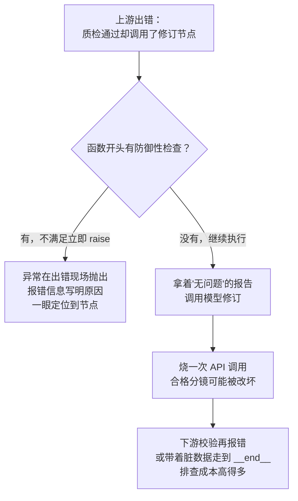

# 防御性编程

在 `revision.py` 的 `revise_storyboard` 节点里，函数体一开始有这么一段代码：

```python
def revise_storyboard(state: ComicDramaState) -> dict[str, object]:

    # 先拿到质量报告
    report = state["quality_report"]

    # 防御性代码
    if report is None or report.is_passed or not report.issues:
        raise ValueError("没有可执行的质量问题，不能修订")
    if state["revision_count"] >= state["max_revisions"]:
        raise ValueError("修订次数已达上限")
```

从"正常流程"看，这两个 `if` 检查的似乎都是**不应该发生**的事：设计好的工作流里，走到修订节点说明质检失败了、修订次数没超限，这些检查岂不是多此一举？

恰恰相反。这两行就是典型的**防御性编程**。本文把这件事讲清楚：它是什么、为什么在"不可能发生"的地方也要写检查、以及为什么检查不通过时要直接 `raise` 而不是悄悄绕过去。


## 1. 什么是防御性编程

先用一个生活例子建立直觉：**开车系安全带。**

没有司机会"预期"自己今天要出车祸。系安全带不是因为有撞车计划，而是因为一旦出事，代价太大，而系上它的成本几乎为零。防御性编程是完全相同的思路：

> **不信任一切前置条件天然成立，在一项工作真正开始之前，先花极低的成本验证"这件事现在能不能做"，不能做就立即、明确地停下来。**

在代码里，"能不能做"通常表现为函数执行所依赖的一组**前置条件**（precondition）：

- 我依赖的这份数据存在吗？（`report is None`）
- 当前的状态允许执行这一步吗？（修订次数还够吗？）
- 入参的取值在合法范围内吗？

如果答案是否定的，函数有两条路：

1. **继续往下走**，假装一切正常，让错误混进后续的计算里。
2. **立即抛出一个明确的异常**，把"这里出了问题"这件事暴露给调用者。

防御性编程选择的是第二条路，它背后有一条重要的工程原则——**快速失败（fail fast）**：错误暴露得越早，定位它的成本越低。


## 2. 课程中的两个 if 分别在防什么

回到开头的代码，逐条拆开看。这两个 `if` 各自防的是一类不同的"不应该发生"。

**第一个 `if`：防的是"节点被以错误的时机调用"**

```python
if report is None or report.is_passed or not report.issues:
    raise ValueError("没有可执行的质量问题，不能修订")
```

它检查了三种"手里没有可执行的修订依据"的状态：

| 条件 | 什么情况下会成立 | 说明 |
| --- | --- | --- |
| `report is None` | 这个节点被错误路径调用了，比如工作流图的连线配错，跳过质检直接进了修订 | 数据层面的防线 |
| `report.is_passed` | 质检已经通过了，状态机却流转到了修订节点 | 流转逻辑的防线 |
| `not report.issues` | 报告没列出任何具体问题，修订无从下手 | 业务含义的防线 |

单独看，每一种都是"正常设计下不会发生"的事。但工作流是由图驱动的，`revise_storyboard` 自己决定不了上游以什么状态调用它。**一旦上游出错（连错一条边、某个节点忘了写返回值），如果没有这道检查，函数就会拿着一份"没有质量问题"的报告去调用模型修订——白白烧掉一次 API 调用，还可能把合格的分镜改坏。**

**第二个 `if`：防的是"状态机被突破上限"**

```python
if state["revision_count"] >= state["max_revisions"]:
    raise ValueError("修订次数已达上限")
```

修订次数上限 `max_revisions` 是工作流的一道刹车——修订是花钱的，不能让模型无限改下去。正常情况下，达到上限的节点应该流向"修订耗尽"的结束分支，根本不该执行到这里。但这道检查意味着：**即使上游的分支判断写错了，节点也不会真的突破上限**，工作流不会陷入"改到破产"的死循环。

注意这两个 `if` 的关系：它们是**同一道防线的两道闸**。第一道拦"数据状态不对"，第二道拦"流程状态不对"。而且实际上，在课程的完整代码里，这种检查不止开头这两处——后面还有一串校验（修订不得改变镜头数量、不得改变总时长、不得改变顺序号、只能改报告指出的镜头……），全都是同一种思想的延伸：**凡是后续逻辑依赖的约定，都在继续之前显式确认一遍。**


## 3. 为什么检查不通过要 raise，而不是"默默处理"

这是初学者最常见的疑问：检查出问题之后，`raise` 会让整个工作流崩溃，看起来很吓人；我改成"默默返回"或者"返回一个默认值"不就行了吗？

对比一下两条路在出错时的表现：



关键点在于：**抛异常不是"制造了崩溃"，而是"把本来就存在的 bug 在它发生的地方标了出来"。**

如果换成默默返回，错误并不会消失，只会换一个更晚、更隐蔽的地方发作：

- 返回空结果，工作流"正常结束"，但产出物是错的——这是最坏的情况，错误直接被带进最终交付。
- 返回一个默认值，下游基于这个默认值继续算，报出来的错误信息和工作流的图、节点的意图完全对不上——排查时你得先搞清楚"这个默认值是哪来的"。

而 `raise ValueError("没有可执行的质量问题，不能修订")` 给出的信息是完整的：**出错的节点、出错的原因、当时的状态**，三者俱全。这就是"快速失败"的价值：把诊断成本一次性付在离 bug 最近的地方，而不是让它利滚利地流到下游。

> **核心认知：防御性检查失败时的 `raise`，不是程序在"发脾气"，而是程序在"自首"——它拒绝带着错误的数据继续往前走。**


## 4. 防御性编程和业务校验不是一回事

还有一个容易混淆的边界需要划清。你可能觉得："这不就是入参校验吗？"不完全对。两者都在"检查"，但防的东西不一样：

| | 防御性编程 | 业务校验 |
| --- | --- | --- |
| 防什么 | **不应该发生**的事：程序员错误、状态机越界、上游 bug | **合理但非法**的事：用户输错、外部数据不规范 |
| 触发时说明 | 代码或流程出了 bug | 输入本身不合法，系统运行正常 |
| 典型位置 | 函数开头、节点入口、模块边界 | 表单、API 入口、数据清洗 |
| 失败后的语义 | "这里坏掉了，必须修代码" | "这次请求不合法，请重试" |

用课程的例子对照：用户在配置里把 `max_revisions` 填成 `-1`，这是**业务校验**要拦的（配置不合法）；而质检通过的分镜流进了修订节点，这是**防御性编程**要拦的（流程出了 bug）。

这个区别直接决定了处理方式的差异：业务校验失败通常返回友好的错误提示、走正常的错误分支；防御性检查失败则应该直接抛异常，让 bug 在开发/测试阶段就炸出来。**如果把这两类检查混在一起"统一返回错误提示"，防御性检查就失去了暴露 bug 的作用——它会被当成普通错误被忽略掉。**

当然，边界不是绝对的：在 LangGraph 这种多节点协作的系统里，一个节点的"业务输入"就是另一个节点的"输出"，上游节点的 bug 对下游来说就是"不该出现的外部数据"。这正是课程里每个节点入口都要写防御性检查的原因——**在节点与节点之间，防御性编程和业务校验天然重合。**


## 5. 动手验证

下面这段代码不依赖项目，可以直接运行，对比"没有防御"和"有防御"两种写法在出错时的差别。

场景：给每个镜头的观众评分算平均分，低于 6 分就要触发修订。

```python
# 版本 A：没有防御性检查
# 分数列表为空时静默返回 0.0——把上游 bug 伪装成"观众给了 0 分"
def average_score_v1(scores):
    if not scores:
        return 0.0
    return sum(scores) / len(scores)


# 版本 B：防御性版本，前置条件不满足立即失败
def average_score_v2(scores):
    if not scores:
        raise ValueError("评分为空，不能计算平均分——请检查上游评分流程是否出错")
    return sum(scores) / len(scores)


# 模拟上游 bug：评分环节出错，传进来一个空列表
scores = []

# 版本 A：不报错，但得出一个"合理但错误"的结论
avg = average_score_v1(scores)
if avg < 6:
    print(f"平均分 {avg}，低于 6 分，触发修订！")  # 平均分 0.0，白白触发一次修订

# 版本 B：在出错现场立刻爆炸，附赠原因说明
average_score_v2(scores)
```

运行结果：

```text
平均分 0.0，低于 6 分，触发修订！
Traceback (most recent call last):
  File "demo.py", line 26, in <module>
    average_score_v2(scores)
  File "demo.py", line 13, in average_score_v2
    raise ValueError("评分为空，不能计算平均分——请检查上游评分流程是否出错")
ValueError: 评分为空，不能计算平均分——请检查上游评分流程是否出错
```

两个版本的差别一目了然：

1. **版本 A 把 bug 翻译成了错误的行为**：空列表被静默地解释成"0 分"，下游据此白白触发一次修订——这和课程里"拿着没有问题的报告去修订"是同一类事故。
2. **版本 B 把 bug 留在了原地**：异常抛出的位置就是出错的位置，报错信息直接写明"上游评分流程出了问题"，排查方向一秒确定。

建议你动手改一改这个 demo：把 `scores` 换成正常数据 `[8, 7, 9]` 再跑一遍，确认防御性检查在"一切正常"时零成本通过——它只在上游出错的时刻才站出来。


## 6. 写在最后

回到开头的两个 `if`，现在可以读懂它们的分量了：

- 它们检查的不是"可能发生的用户错误"，而是"不应该发生的流程错误"。
- 检查失败时 `raise`，是把 bug 暴露在它发生的地方，而不是让它混进下游变成更贵的错误。
- 成本几乎为零：正常情况下两次比较就通过，出错时却能保住一次 API 调用和一份工作流产出。

整个思想可以总结成一句话：

> **凡是后续逻辑依赖的约定，都在继续之前显式确认；确认失败就立即以明确的异常终止，而不是带着错误的数据往前走。**

带着这句话回看课程代码，你会发现 `revise_storyboard` 里从开头两个 `if` 到后面一整串"修订不得改变……"的校验，本质上是同一件事的不同切面——数据状态、流程状态、业务约束，层层设防。这也解释了为什么防御性编程在多节点、图驱动、每个环节都可能由 AI 参与的系统里尤其重要：**节点之间互不信任，整个系统才值得信任。**

---

-EOF-
