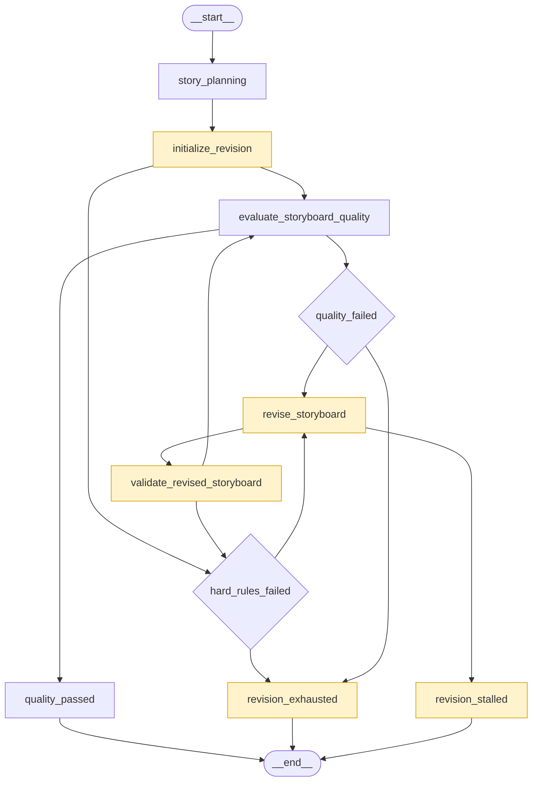

# 工作流

本次功能迭代所对应的工作流（mermaid图）




## 工作流验证

初始状态共用这一份，只改 `max_revisions`：

```json
{
  "raw_requirement": "深夜的办公室里，程序员小林正在修改一款漫画应用。零点到来时，他设计的漫画角色阿沐突然从屏幕中走了出来。",
  "current_stage": "submitted",
  "events": [],
  "max_revisions": 2
}
```

### 1. 一次通过，不进修订

```
FAKE_STORYBOARD_FAULT=none
FAKE_QUALITY_FAULT=none
FAKE_REVISION_SCENARIO=none
max_revisions=2
```

子图校验通过后：`initialize_revision` → `evaluate_storyboard_quality` → `quality_passed` → 结束。

看结果：`current_stage` 为 `quality_passed`，`stop_reason` 为空，`revision_count` 为 0，`revision_history` 只有初版。事件末尾是「已完成分镜语义质量评价」「分镜质量检查通过，尚待人工审核」。


### 2. 首评失败，修订一次后通过

```
FAKE_STORYBOARD_FAULT=none
FAKE_QUALITY_FAULT=none
FAKE_REVISION_SCENARIO=second_pass
max_revisions=2
```

`none` 会被假模型改成首评 `plot_gap`（第三镜）。`max_revisions` 至少为 1。

`initialize_revision` → 评价失败 → `quality_failed` → `revise_storyboard`（第 1 版）→ `validate_revised_storyboard` 通过 → 再评价，因为已有上一份报告，直接通过 → `quality_passed`。

看结果：`current_stage` 为 `quality_passed`，`revision_count` 为 1，`stop_reason` 为空，`quality_report.is_passed` 为 true。历史里有 version 0 和 version 1。

`plot_gap`、`character_inconsistent`、`visual_unclear`、`motion_conflict` 都是第三镜不通过，和 `second_pass` 搭配时父图走法相同，只是问题 `code` 不同。


### 3. 每次都不通过，改满次数

```
FAKE_STORYBOARD_FAULT=none
FAKE_QUALITY_FAULT=none
FAKE_REVISION_SCENARIO=always_fail
max_revisions=2
```

评价 → 失败 → 修订 → 再校验通过 → 再评价失败。这样转两圈，`revision_count` 到 2 之后：`quality_failed` → `revision_exhausted`。

看结果：`current_stage` 为 `revision_exhausted`，`stop_reason` 为 `max_revisions_reached`，`revision_count` 为 2。事件末尾是「已达到 2 次修订上限」。每次修订都会给动作加上前缀，所以指纹一直是新的，不会停在停滞。

把 `max_revisions` 改成 1，就只修订 1 次，第二次失败后同样进 `revision_exhausted`。


### 4. 修订内容没变

```
FAKE_STORYBOARD_FAULT=none
FAKE_QUALITY_FAULT=plot_gap
FAKE_REVISION_SCENARIO=unchanged
max_revisions=2
```

质量故障必须是一种失败（`plot_gap` 即可）。若质量是 `none`，首评会通过，根本不会调用修订。

`initialize_revision` → 评价失败 → `quality_failed` → `revise_storyboard`。假修订原样返回，指纹和当前分镜相同，节点写下 `stop_reason=no_change`，再进 `revision_stalled`。

看结果：`current_stage` 为 `revision_stalled`，`stop_reason` 为 `no_change`，`revision_count` 仍为 0，分镜与初版相同。事件里有「修订没有产生新版本，工作流停止」和「修订停滞：no_change」。


### 5. 第二次修订退回初版

```
FAKE_STORYBOARD_FAULT=none
FAKE_QUALITY_FAULT=none
FAKE_REVISION_SCENARIO=repeat_version
max_revisions=2
```

`max_revisions` 必须是 2。设成 1 时，第 1 版还是新内容，复评失败后次数用尽，会走到第 3 组的 `revision_exhausted`，看不到退回。

第 1 轮：评价失败（被改成 `plot_gap`）→ 修订出第 1 版（动作带前缀）→ 硬规则通过 → 复评仍失败。第 2 轮：`revision_count` 已经是 1，假修订把前缀撤掉，指纹回到初版。`revise_storyboard` 写下 `stop_reason=repeated_version`，再进 `revision_stalled`。

看结果：`current_stage` 为 `revision_stalled`，`stop_reason` 为 `repeated_version`，`revision_count` 停在 1（停滞这次不计入新版本），历史里只有 version 0 和 version 1。


### 6. 修订后撞上硬规则，然后次数用尽

```
FAKE_STORYBOARD_FAULT=none
FAKE_QUALITY_FAULT=plot_gap
FAKE_REVISION_SCENARIO=hard_regression
max_revisions=1
```

质量必须先失败，否则首评通过，不会修订。这里把上限设成 1，才能停在「次数用尽」。

评价失败 → 修订把 `shot_03` 的角色改成 `char_missing`（第 1 版，指纹是新的）→ `validate_revised_storyboard` 失败 → `hard_rules_failed`（跳过模型评价）→ `revision_count` 已是 1，不再修订 → `revision_exhausted`。

看结果：`current_stage` 为 `revision_exhausted`，`stop_reason` 为 `max_revisions_reached`，`revision_count` 为 1，当前分镜里仍有 `char_missing`。`quality_report` 是硬规则转出来的，`issues[].code` 为 `hard_rule`。

上限若是 2：第一次修订后硬规则失败，还会再修订一次；第二次内容与当前分镜相同，会改走第 4 组，`stop_reason` 为 `no_change`。


### 7. 初版硬规则失败，修订后通过

```
FAKE_STORYBOARD_FAULT=unknown_character
FAKE_QUALITY_FAULT=none
FAKE_REVISION_SCENARIO=none
max_revisions=2
```

子图校验失败，阶段先到 `storyboard_invalid`。父图：`initialize_revision` → `hard_rules_failed`（问题指向 `shot_03`）→ `revise_storyboard`。假修订把该镜角色改回 `char_xiaolin`、`char_amu` → 再校验通过 → 语义评价通过（质量和修订场景都是 `none`）→ `quality_passed`。

看结果：`current_stage` 为 `quality_passed`，`revision_count` 为 1，`storyboard_validation.is_valid` 为 true。

`duplicate_id` 和 `duration_mismatch` 的父图终点一样，也是修订 1 次后 `quality_passed`。这两类错误文案里抽不出镜头 id，`affected_shot_ids` 为空，假模型会顺手改 `shot_01`，同时把重复 id 或总时长修好。


### 8. 上限为 0，失败后立刻结束

```
FAKE_STORYBOARD_FAULT=none
FAKE_QUALITY_FAULT=plot_gap
FAKE_REVISION_SCENARIO=none
max_revisions=0
```

`initialize_revision` 接受 0。评价失败 → `quality_failed` → 比较 `0 < 0` 不成立 → `revision_exhausted`。不会进入 `revise_storyboard`。

看结果：`revision_count` 为 0，`stop_reason` 为 `max_revisions_reached`，事件是「已达到 0 次修订上限」。

若这一组把质量改成 `none`，首评会通过，直接 `quality_passed`，上限 0 不会被用到。


### 9. 图中断

另外两组用来确认图会中断，而不是走到某个结束节点：

- `FAKE_QUALITY_FAULT=invalid_report`，分镜和修订场景都是 `none`：硬规则通过后，评价节点校验报告失败（`is_passed=true` 却带 error），Run 报错。`current_stage` 停在子图写下的 `storyboard_ready`。
- `max_revisions` 传 `4`、`-1` 或 `true`：规划子图能跑完，`initialize_revision` 抛「max_revisions 必须是 0～3 的整数」。


---

-EOF-
