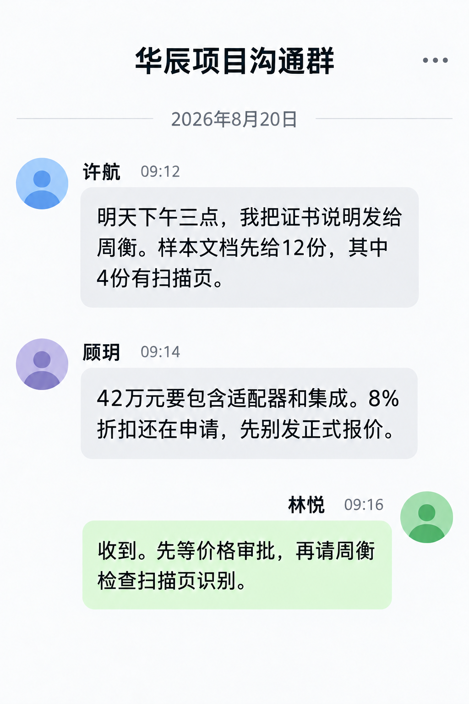

# 华辰销售群聊天

华辰群聊补充材料计划与折扣状态。

> 资料快照：2026-08-20；整理日期：2026-11-04。状态与结论仅适用于所引证据的时间、版本和范围。

原始资料：[IMG-001_华辰销售群聊天.png](../../raw/图片素材/IMG-001_华辰销售群聊天.png)

提取方式：本轮直接视觉阅读；下文为 Agent 对可见信息的整理，未运行独立 OCR 服务。

## 可见文字提取

群名“华辰项目沟通群”，日期 2026-08-20。

- 许航 09:12：明天下午三点把证书说明发给周衡；先给 12 份样本文档，其中 4 份有扫描页。
- 顾玥 09:14：42 万元包含适配器和集成，8% 折扣仍在申请，暂不发正式报价。
- 林悦 09:16：先等价格审批，再请周衡检查扫描页识别。

“明天下午三点”据群聊日期归一为 2026-08-21 15:00，截图未明确时区。以上是计划和沟通状态，没有收件或识别通过证据。

关联：[SALES-001 · 华辰精工八月销售跟进纪要](SALES-001.md)、[华辰精工](../entities/华辰精工.md)、[图片证据与多模态资料](../concepts/图片证据与多模态资料.md)、[版本演进与待确认事项](../concepts/版本演进与待确认事项.md)。

## 引用本页

- [图片证据与多模态资料](../concepts/图片证据与多模态资料.md)
- [版本演进与待确认事项](../concepts/版本演进与待确认事项.md)
- [华辰精工](../entities/华辰精工.md)
- [CUST-001 · 华辰精工知识助手商机与需求记录](CUST-001.md)
- [SALES-001 · 华辰精工八月销售跟进纪要](SALES-001.md)

[返回知识索引](../index.md)
