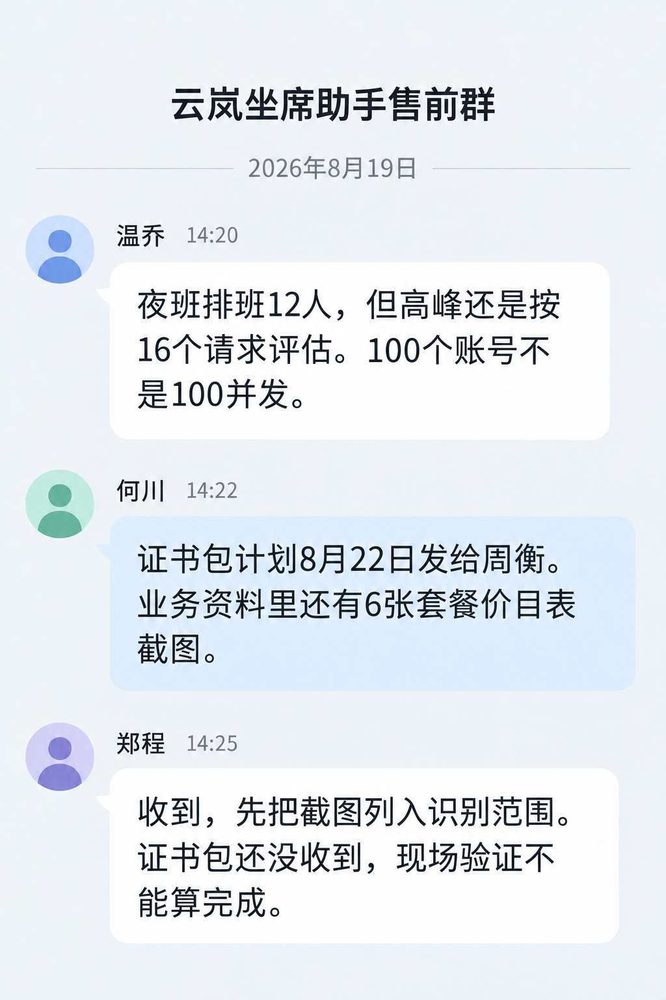

# 云岚售前群聊天

云岚群聊确认 16 请求，新增 6 张价目表截图和证书发送计划。

> 资料快照：2026-08-20；整理日期：2026-11-04。状态与结论仅适用于所引证据的时间、版本和范围。

原始资料：[IMG-002_云岚售前群聊天.png](../../raw/图片素材/IMG-002_云岚售前群聊天.png)

提取方式：本轮直接视觉阅读；下文为 Agent 对可见信息的整理，未运行独立 OCR 服务。

## 可见文字提取

群名“云岚坐席助手售前群”，日期 2026-08-19。

- 温乔 14:20：夜班排班 12 人，高峰仍按 16 个请求评估，100 个账号不是 100 并发。
- 何川 14:22：证书包计划 8 月 22 日发给周衡，业务资料还有 6 张套餐价目表截图。
- 郑程 14:25：把截图列入识别范围，证书包尚未收到，现场验证不能算完成。

发送日期归一为 2026-08-22；没有证据说明已发送、已收到或截图已解析。

关联：[CUST-002 · 云岚客服坐席助手商机与需求记录](CUST-002.md)、[云岚客服](../entities/云岚客服.md)、[图片证据与多模态资料](../concepts/图片证据与多模态资料.md)、[版本演进与待确认事项](../concepts/版本演进与待确认事项.md)。

## 引用本页

- [图片证据与多模态资料](../concepts/图片证据与多模态资料.md)
- [版本演进与待确认事项](../concepts/版本演进与待确认事项.md)
- [软件兼容与现场验收](../concepts/软件兼容与现场验收.md)
- [云岚客服](../entities/云岚客服.md)
- [CUST-002 · 云岚客服坐席助手商机与需求记录](CUST-002.md)

[返回知识索引](../index.md)
